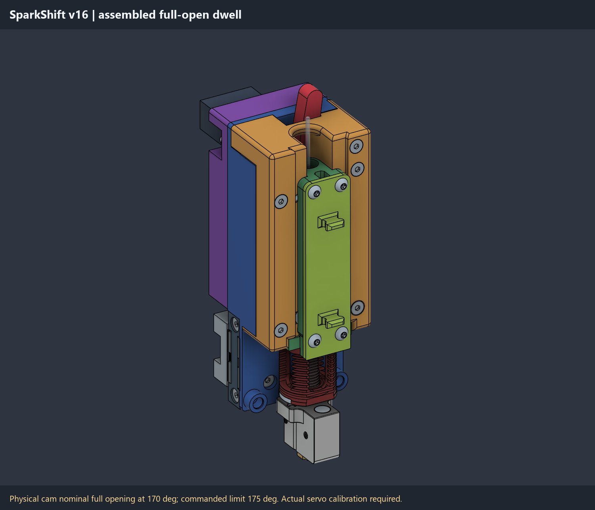
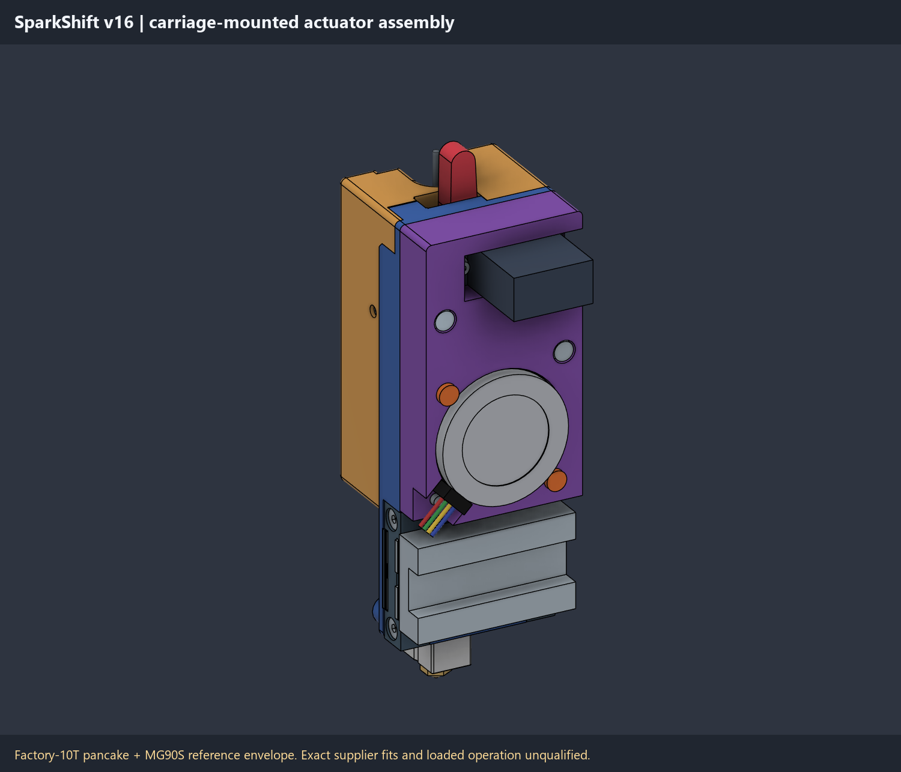
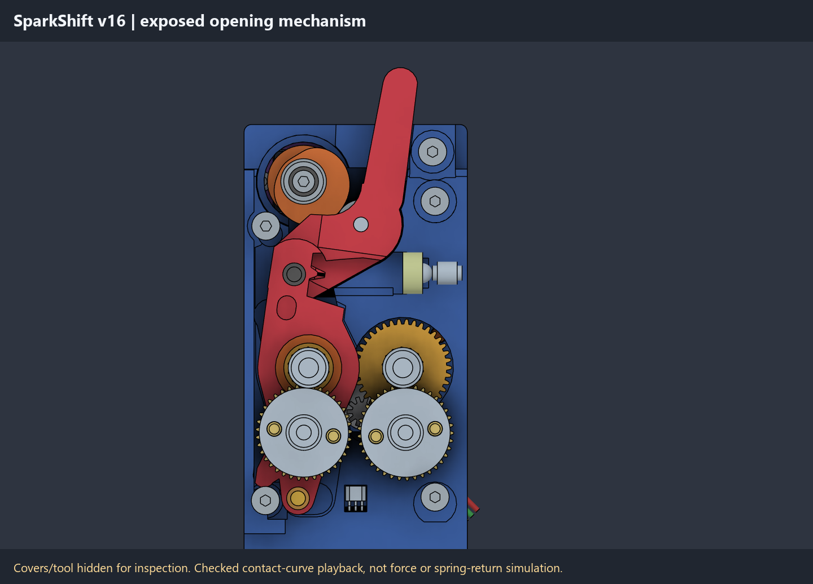
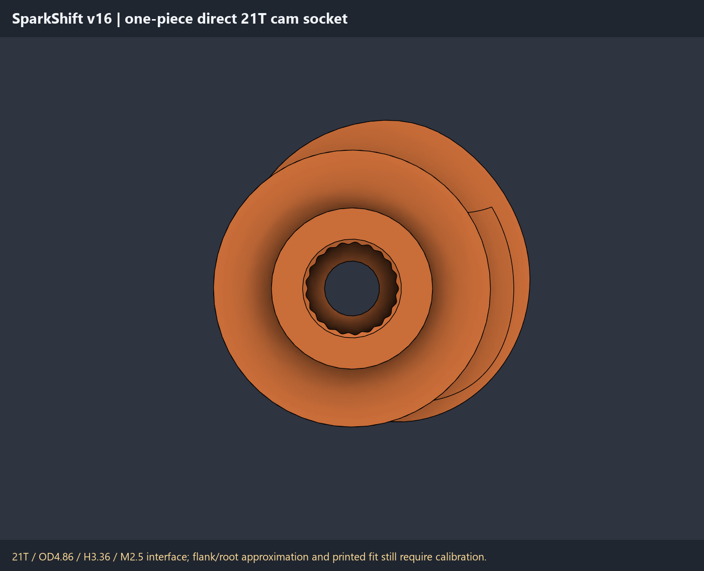
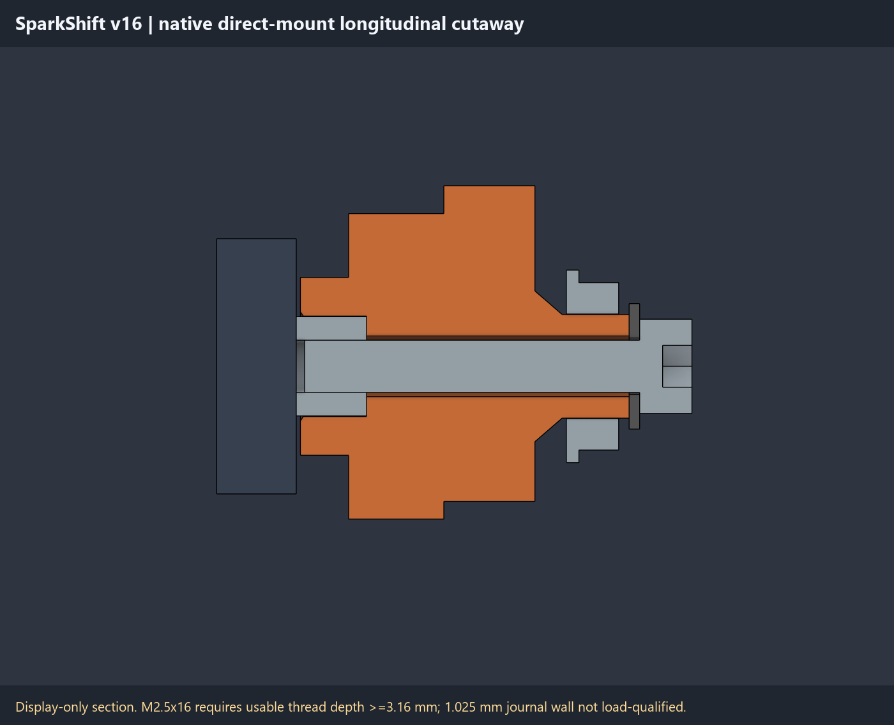
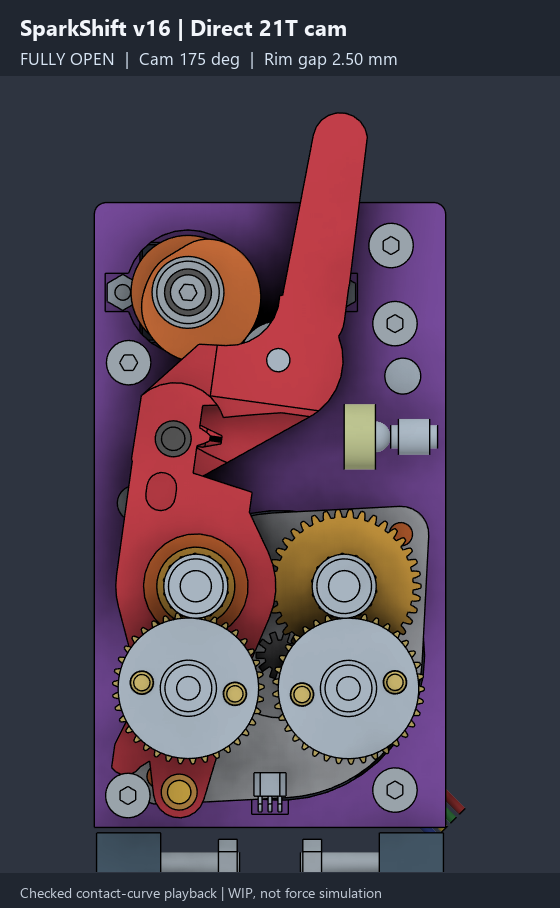

# v16 direct-mount inspection and motion notes

> [!WARNING]
> **WIP / FIT PENDING / NOT READY FOR PRINTING OR USE.** This substantial,
> human-directed, AI-assisted **vibe developed** work is not professional
> engineering or physical qualification. Digital fits, clearances, and
> animations do not approve loaded operation, heat, strength, or endurance.

## One matched inspection set

Use the [v16 native F3D](cad/SparkShift_AHG_min_v16.f3d),
[whole-assembly STEP](cad/SparkShift_AHG_min_v16.step), and
[17 inspection STLs](stl_v16), **not for printing or operation approval**.
The full current set includes the [portable playback](playback_v16/README.md)
and [optional calibration trials](calibration_v16/README.md); no older
native exports, partial prototype ZIP, or v15 animation is substituted.

## Physical cam and commanded motion

The nominal hob-rim opening is **2.50mm at cam 170 degrees**. The checked
CAD command range is **0..175 degrees**, with **170..175 concentric open
dwell**. The nominal 5-degree upper margin assumes the reference unit's
stated 180-degree stroke; it is not a certified range for all MG90S servos.
Actual clocking, safe endpoints, and controller mapping require calibration.
These CAD angles are not printer pulse-width settings.

Soft entry followed by reduced arm travel per cam degree increases ideal
mechanical advantage through the loaded stroke. Actual spring rate,
preload, friction, servo torque, and deflection are unknown. The concentric
dwell removes **ideal normal-force backdrive torque**, not spring load,
bearing load, friction, or required holding/retention checks. It is **not a
positive power-off latch**.

## One printed cam/hub, no OEM horn

P05 is one printed cam plus direct output hub. The OEM horn body is removed.
The inspected reference hardware was counted/measured as 21T, 4.86mm crest
OD, 3.36mm spline height above the plastic boss, and M2.5 center thread.
Other MG90S clones must be measured independently; neither the label nor an
external ear span certifies tooth form, mounting pitch, or boss datum.

| Interface reference | Nominal geometry / remaining fit gate |
|---|---|
| Socket tooth form | 21T count confirmed on the reference unit; 4.62mm root and sinusoidal flanks are photo-estimated trials, not maker-certified spline geometry. |
| Trial allowance | +0.025mm normal socket clearance; not a universal printer/material fit or rated torque path. |
| Boss gap and spline engagement | 0.20mm boss gap; 3.16mm total engagement. The 0.20mm entry lead leaves 2.96mm full-depth engagement. |
| Journal | Retained 4.95mm OD into MF85ZZ 5x8x2.5mm. A 2.9mm bore leaves 1.025mm radial wall; loaded strength is unqualified. |
| Retainer and washer | Standard M2.5x16 socket-head envelope and washer 2.7mm ID / 6mm OD / 0.5mm thick. Coarse 0.45mm pitch is assumed, not independently verified for another servo. |
| Retainer thread engagement | 2.96mm nominal; require **measured usable blind depth >=3.16mm** before tightening. External 3.36mm spline height is not blind thread depth. |

Confirm real tooth fit, screw pitch, permissible engagement, bottoming margin,
and clamp seating. Do not force or tighten a bottomed screw, or assume the
model's matching reference shaft proves a printed socket fits actual steel.
The [generic BOM](BOM.md) includes the retainer, washer, bearing, and every
other build requirement without personal-stock deductions.

The [optional five-collar calibration guide](calibration_v16/README.md)
describes gentle, unpowered fit trials and their limits; the collars are
not an 18th assembly part or proof of final hub strength/retention.

## Front-case pocket and bench assembly

The front case has **6.4mm washer / 4.9mm head blind pockets to Y16.9**;
about **16.026mm3** is removed. Bearing seat, insert/magnet/pin backing,
and the already-clearing P02 actuator plate remain unchanged by this mount
revision. No exterior driver tunnel is added.

The straight front driver path is **blocked**. Bench-preassemble servo,
cam, outboard bearing, washer, and center retainer before closing the case.
The sampled front-case **interface** axial path was clear at cam 90 and
175 degrees; the closed 0-degree attempt interfered. Those interface-only
checks are not complete assembly/service or whole-tool installation
qualification. Other tools and actual printed parts may differ.

Retained case-clamp references are three M3x25 plus one M3x40, with a
separate upper M3x35. All use real heat-sets, not substituted case nuts.
Rear-load FRAME_2's P01 insert before plate closure; front-load FRAME_3's
P02 insert before blue P01 captures it. Install the spring-adjuster insert
in the bare front half before closing case and arm/spring/ball access.
Actual iron, pilot, torque, pullout, and material fits remain unqualified.
Original P17 and all four M2.5x8 hotend mounts are retained.

## Checked contact-curve preview, not physical simulation

Use the [portable playback guide](playback_v16/README.md), not **Drive Joint**
alone: that command does not synchronize cam and arm. The supplied helper
drives native occurrence poses from the checked contact curve using
**explicit forward kinematics**. It is CAD kinematics, **not spring-force,
servo-current, friction, simultaneous feed/release, or real-time physical
simulation**.

Fusion's automatic tangent-follow trial selected penetrating take-up poses
and was removed. **No extra non-printing drive bodies are installed** in
the current prototype. Historical authoring functions for those rejected
references do not make them part of the assembly.

The matching data contains 701 cam/arm samples from 0 to 175 degrees.
The helper checks the F3D's data-hash attribute and fixed input transforms;
preserve the matching script/manifest/data folder. Do not use an older
native motion ratio or a renamed v15 GIF as current evidence.

## Geometry/source evidence boundary

The current prototype's native readback reports **142 exact body matches**:
137 source definitions unchanged, five changed, and the OEM horn removed.
That is not a physical fit/force test or independently equal scalar mass.
The whole-assembly STEP transfer reports 142 valid solids with no explicit
healing; independent readback spatially matches all 142 native bodies.
**All 142 native shape comparisons are complete**, with maximum symmetric
difference **1.3374534259965239e-8mm3**. Independent scalar-mass equality is
**not claimed**. All 142 source definitions still compare at zero difference
against the approved F3D after exports/gallery and again after recording,
with no helper-body leak.

### Best-effort inspection meshes and slicer checks

The current full set was exported from the approved native source. These
qualifications describe that measured set, not initial unsealed export presets:

| Current native export result | Qualification / remaining limit |
|---|---|
| All 17 meshes; 134,652 facets total | Each is closed/manifold, coherently wound, one positive-volume component, and zero degenerate facets. |
| Maximum relative mesh/native volume error | 0.0376686%, not exact scalar-volume equality or deposited material. |
| Bed placement | Maximum absolute bed-origin residual about 1.67e-14mm; XY is nonnegative apart from floating-point roundoff. |
| P01 stored-normal metadata | Only three **zero stored STL normal vectors on microscopic, nondegenerate facets** remain as warnings. All other stored normals pass; no inverted or non-microscopic bad normals are reported. |

Topology and winding checks do not establish that every stored normal is
clean. The three retained P01 warnings belong to this exact mesh set.

The exported native bytes are retained: **no facet deletion or normal
rewriting** is used to turn a warning into a clean-looking receipt.
Microscopic zero-normal metadata warnings are reported separately from
geometry/topology failures. Degenerate facets, inverted normals, and
non-microscopic normal problems remain failures, not accepted warnings.

These are **best-effort native inspection exports**, not print qualification.
**Inspect each mesh and its warnings in a slicer**, including surface,
scale, thin-feature, support, and material behavior. Slicer acceptance or
automatic normal handling does not qualify the real spline, strength,
fit, loaded motion, or thermal use.

An upstream recompute dropped **0.6100926mm3** of an inherited cam band at
Y4.8..4.85 after display cleanup. A bounded late **native join** restored
that band exactly. This was not a facet patch, mesh repair, smoothing,
or scalar-mass-equality proof.

### Current native gallery and motion

Six new source-bound, labelled PNGs have been inspected. They are **WIP
native CAD renders/cutaways, not photographs**, not older gallery images.

Closed assembly with original HF tool retained, not a physically tested build.

Nominal full opening at 170 degrees / command limit 175 degrees; this pose
does not qualify real endpoints or loaded operation.

Vendor envelopes and mounting/load capability remain unqualified.

Covers/tool are hidden for inspection, not removed from the physical design.
Checked contact-curve kinematics is not force or spring-return simulation.

The 21T count is reference-unit confirmed; root/flank approximation and
printed fit still need calibration on the actual output.

Native display-only section, not a changed part or physical fit proof.
Usable blind depth >=3.16mm and the 1.025mm journal wall are still fit/load
gates, not validated strength.

The new `SparkShift_v16_cam_opening.gif` is complete: **177 fresh native
frames, 560x908 pixels, 9.26 seconds**. Full-frame decoded pixels match the
encoder inputs, and the native-view pixels in all 88 matching forward/return
pose pairs have zero changes. These are recording-integrity checks, not physical motion,
timing, friction, or spring-return validation. The recording is bound to
the current native source; all 142 source definitions remain unchanged
after recording, with no display-body leak.

No older animation or raw capture is substituted. Display omissions do not
change actual part geometry; the assembled F3D/STEP are authoritative, not
exploded installation/removal-path proof.

## Preserved limitations

The direct mount is FIT PENDING: spline flank/root shape, actual servo
variant, clocking/endpoints, blind thread depth, printed torque/journal
strength, spring/preload/servo margin, supports, snap retention, hot creep/
life, load, and endurance remain unqualified.

Two rear 4x7x2 bearing references and both standard compound-shaft lengths
remain **HOLD**. Common MR74ZZ 2.5mm width is not drop-in; modeled 26.3mm /
24.9mm shafts and inherited 4x25/4x24 names are not buying/cut dimensions.
No shaft-machining instructions are supplied.

Positive support for the bare A1104-family Hall package, paired Maxwell/
magnet-interface centering, and the 0.05mm grid are unfinished. Gear
internals need not be symmetric. P01 `Extrude2` and P03 `Extrude14` are
inherited warnings; `Extrude33`, `DeleteFace29`, `DeleteFace30`, `Extrude46`,
`Extrude47`, and `DeleteFace46` remain intentional suppressed history,
not an all-healthy claim.

Full gear phase, predecessor native drive-link ratio, electrical/thermal
controls, calibrated printer offsets, safe heater operation, and unattended
use are not qualified. CPAP and Beacon/probe accessories remain deferred.
Disc-magnet alternatives are research only; the build reference remains
eight 5x15x3mm bars, not redesigned pockets.

Read [authoring-tool limits](source_v16/README.md) and
[mixed-scope attribution](ATTRIBUTION.md). GPL-3.0 custom work, separate
CC BY-SA 3.0 P13/P14 liners, and vendor-reference rights are preserved;
vibe development does not reassign upstream authorship.
