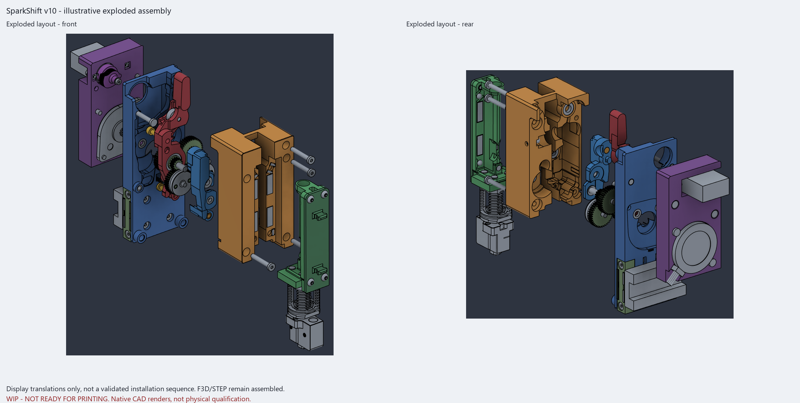
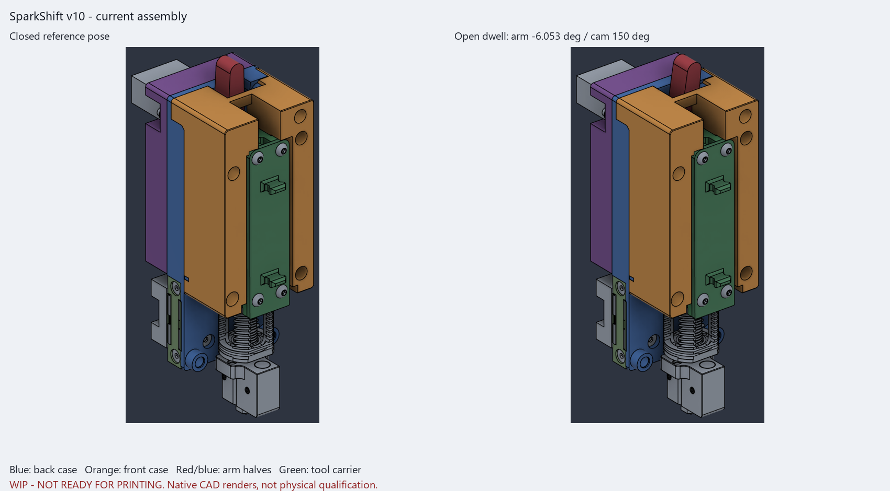
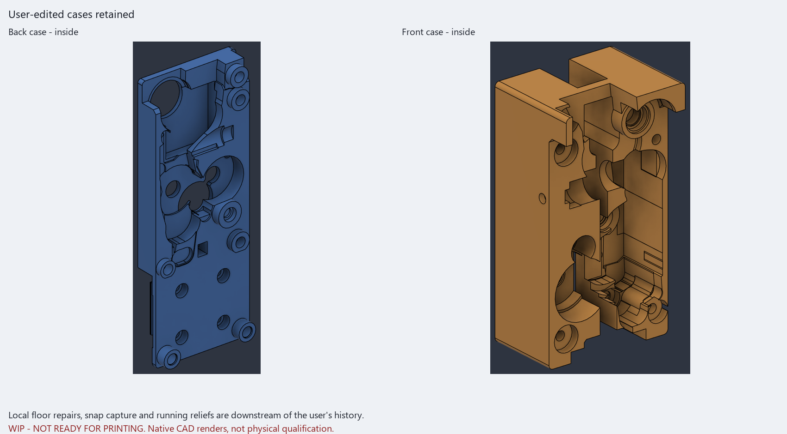
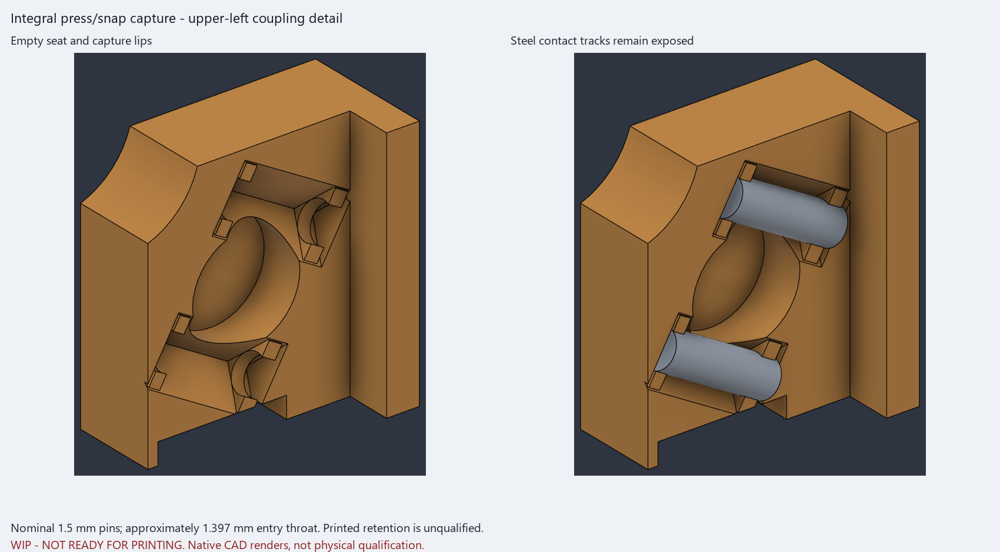
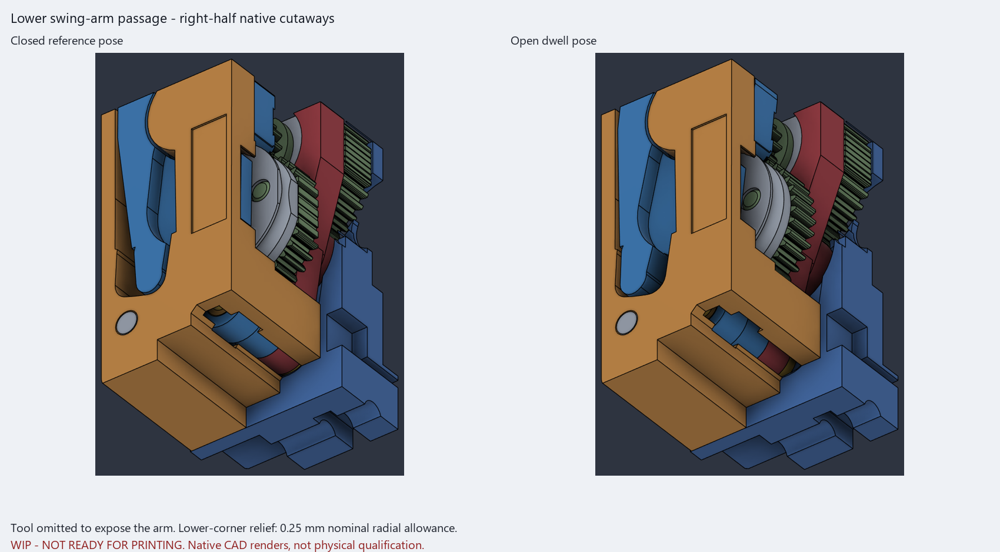
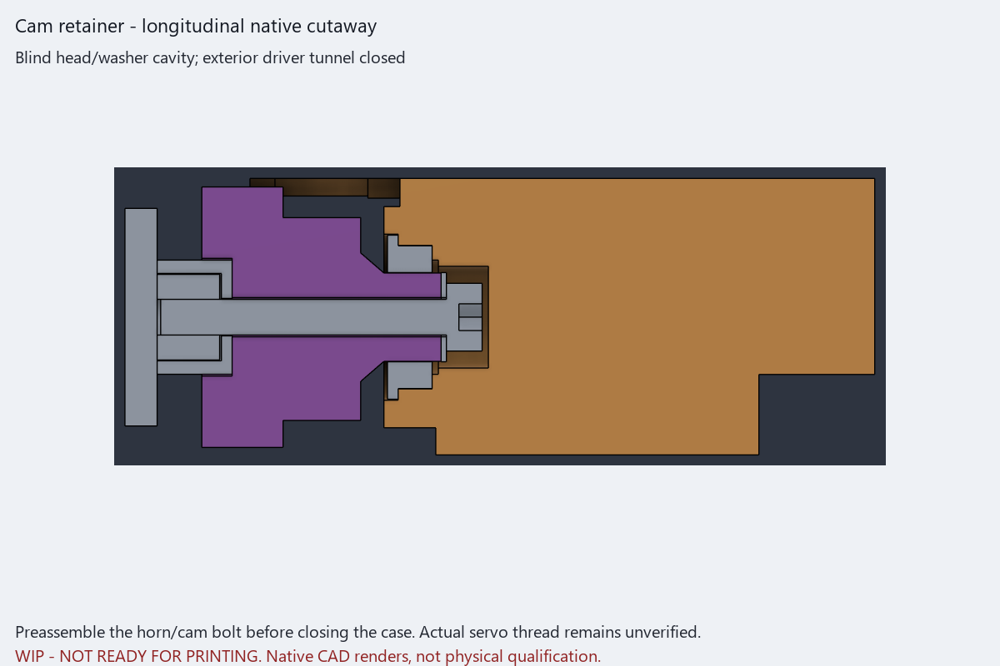

# v10 inspection and visual notes

> [!WARNING]
> **WIP / NOT READY FOR PRINTING OR USE.** This substantial, human-directed,
> AI-assisted **vibe developed** iteration is not professional engineering
> validation or physical qualification. Images are native CAD renders/cutaways,
> not photographs; displayed poses are not safe printer-operation instructions.

## One matched current set

Use the [v10 F3D](cad/SparkShift_AHG_min_v10.f3d),
[assembly STEP](cad/SparkShift_AHG_min_v10.step), and
[17 millimeter bed-oriented STLs](stl_v10) for inspection/development only,
**not printing approval**. Orientation is a rigid transform, not mesh repair.
Supports and printer/material fits still need review. Do not mix older exports,
motion helpers, captured private inputs, or predecessor mutation commands.

The architecture remains the factory-10T LDO pancake, unmodified HGX,
independent MG90S, separate actuator plate, interleaved supports, 45mm printed
core, and four retained 9mm belt interfaces. There are 143 modeled bodies,
17 print shapes, and 11 inherited joints, not 143 purchases or qualified
current drive behavior. See the [partial BOM](BOM.md) and
[source-tool limitations](source_v10/README.md).

## User edits and local running clearance

The latest open-case cleanup and its native history are captured and retained.
Only a local P03 lower-corner swept cut was added after that latest snapshot:
about 3.983mm3 removed around P04R's 2.2mm corner, with 0.25mm nominal radial
allowance over -7..+0.3 degrees and authoring Y11.75..15.85mm. It addresses a
**mid-stroke clash missed by endpoint-only checks**; no arm, bearing, bolt,
hardware position, or datum is moved. That allowance is geometric, not an
actual printed running-fit guarantee.

The upper remote front-arm socket relief remains. Full 1.5mm right-upper
socket/magnet backing is restored; all four magnet-pocket and all four
ball-socket backing footprints are checked complete. Protected bearing-seat
support and the frozen belt region have zero added/removed differences against
the captured input. Purchased hardware positions are unchanged.

## Integral pressed/snap pin capture

Each of the six nominal **1.5x5mm steel coupling pins** (4.9mm CAD length) has
**two short integral C capture bands**, one near each end. The nominal mouth
is about **1.397mm**. The middle steel contact tracks remain exposed, with both
seating rails/lips and axial stops preserved. No glue or separate keeper is
specified.

This implements the requested pressed/snap-style CAD concept, not a verified
insertion force, fit, retention strength, or resistance to popping out under
real coupling loads. Maxwell-style contact geometry does not itself qualify
printed creep, stiffness, or capture durability. Calibrate actual pin size,
material, and printer before treating these mouths as usable fits.

## Arm and cam preassembly references

The two-piece P04R/P04F arm keeps its upper M3x10 clamp, lower M3x14 button-head
into a backed short M3 heat-set, and rounded central key. Both arm pilots are
4.0mm with short tapers to 4.4mm for the 4.6mm OD x 4mm insert reference.
Actual insert/printer fit and loaded stiffness/pullout remain unqualified;
there is no loose lower nut.

The supplied OEM horn remains the real servo spline insert. The printed cam
has a short integral journal in an MF85ZZ 5x8x2.5mm bearing, not fabricated
print-ready female spline teeth or a separate journal pin.

The exterior **6.4mm cam-driver tunnel is closed**. Internal inner-ring relief
and a **5.7mm blind head/washer cavity** remain, with **0.35mm head axial gap**
and a separate local tool-top passage. **Secure the cam/horn center retainer
before clamping the front and rear case halves.** Its M2x16 is only a
dimensional reference; actual servo thread, permissible engagement, horn, and
printed-journal fit are not verified. Do not force an assumed screw or infer
that the blind cavity permits exterior driver access.

## Current native visual panels

All seven panels are **WIP native renders/cutaways, not photos or physical
qualification**. Cutaways hide or section geometry for inspection; they are
not manufacturing models, alternate parts, or complete views of all hardware.
Colours are inspection identifiers, not required filament colours.

The exploded views use **display translations only** on disposable native
copies of the audited geometry. They are not physical photographs, a validated
installation sequence, installation-path proof, or a service-clearance check.
The authoritative F3D and STEP remain **assembled**; no exploded CAD export or
geometry change is supplied.

Closed/open reference views show the matching assembly, not qualified motion.

Inside views distinguish retained user cleanup from the local running reliefs.

Empty and installed detail views show the short capture lips and exposed steel
tracks; they do not demonstrate physical snap retention.

The tool is omitted from these native cutaways to expose the arm and lower-corner
relief. They are inspection views, not altered parts or tool-free operation.
Endpoint renders alone do not establish mid-stroke or continuous-travel clearance.

The upper/lower clamps and central key remain dimensioned CAD references, not
a loaded torsional-stiffness or insert-strength result.

This cutaway shows the blind running cavity, not through-driver access.
Cam/horn retainer preassembly and actual servo-thread verification remain
required review items.

## Digital evidence and its limits

| Source-bound result | What it establishes, and what it does not |
|---|---|
| Nine case/arm/cam samples, ten whole-tool samples through 35mm, and 38 lower-corner samples | No unexpected contacts in the checked geometry, except explicitly named press references; not continuous/full gear-phase or physical clearance qualification. |
| Protected support, belt region, and backing footprints | Exact retained regions and backed sockets/magnets, not structural, fatigue, retention, or thermal ratings. |
| F3D readback: 143 bodies, 11 joints, all 17 prints match | Source-bound inventory/geometry, not a corrected predecessor native drive-link ratio or complete working mechanism. |
| STEP readback: 143 raw-valid solids at matching coordinates | All 143 source-preserving native symmetric differences match, with maximum about 7.17e-8mm3. Only four bounded nonoverlapping measurement partitions were needed; neither source nor STEP was healed. This does **not** claim independently equal scalar masses. |
| Raw/bed meshes: closed, single-component, consistent winding/normals, nondegenerate, and native-volume gates | Rigidly oriented inspection exports without repair, not actual deposited material, physical fits, or support-free printing. |

Cross-kernel scalar mass integration differs on some existing NURBS/reference
bodies. Shape comparison and coordinate readback are separate evidence;
independent mass equality is not claimed.

Two inherited warnings remain: P01 `Extrude2` and P03 `Extrude14`. They are
preserved, not hidden or described as newly corrected. Small legacy gear gaps,
the old native drive-link ratio, and nonstandard modeled compound-shaft lengths
remain unresolved. Do not use the old motion helper as current factory-10T
validation.

Physical snap/axial retention, fits, strength/torsional stiffness, servo/spring
margin, hot creep/life, complete assembly/service, safe controls, and endurance
remain unqualified. No heater operation, G-code, printer profile, calibrated
offsets, or unattended-use approval is provided. CPAP and sensor/probe
accessories remain deferred.

Read [licence/source attribution](ATTRIBUTION.md) before redistribution.
Vibe-development acknowledgement does not replace upstream authorship or
extend rights over vendor/hotend reference geometry.
