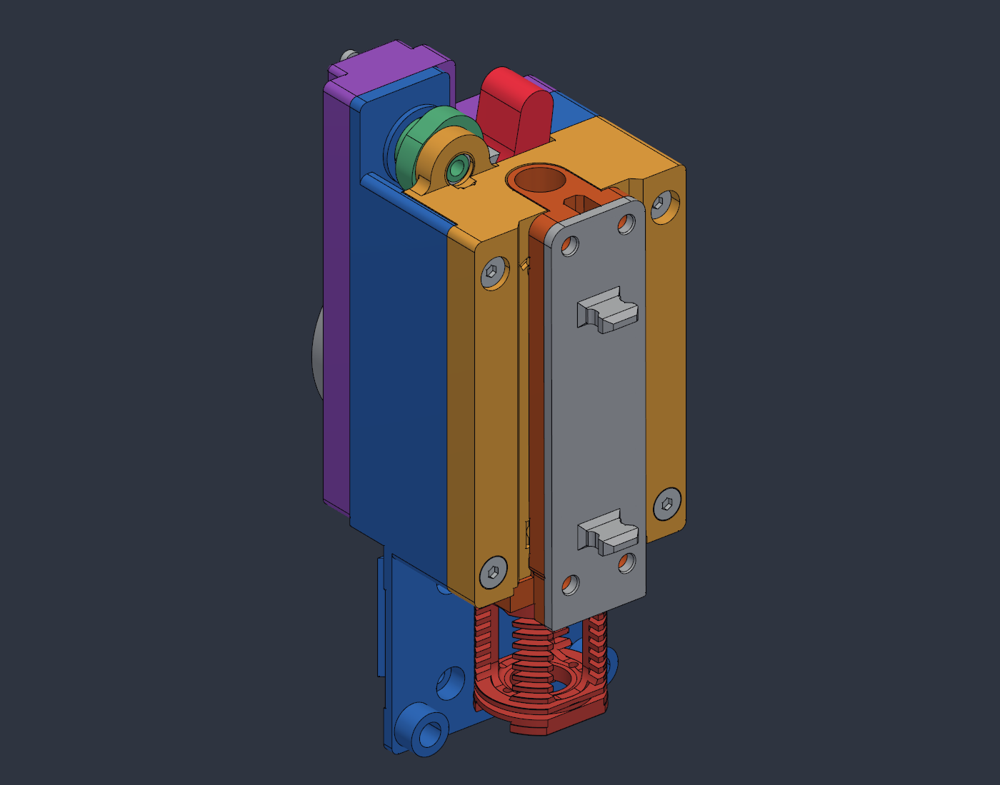
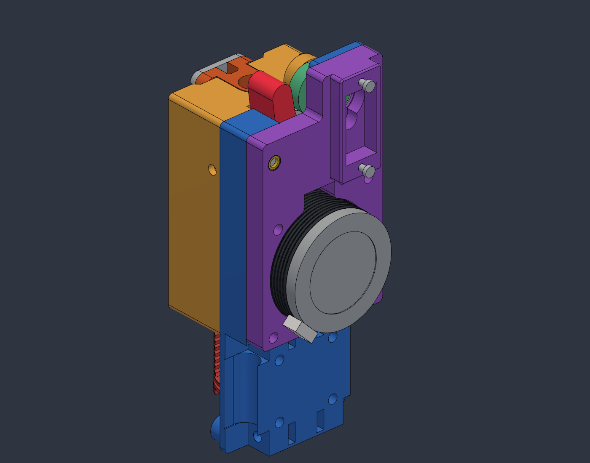
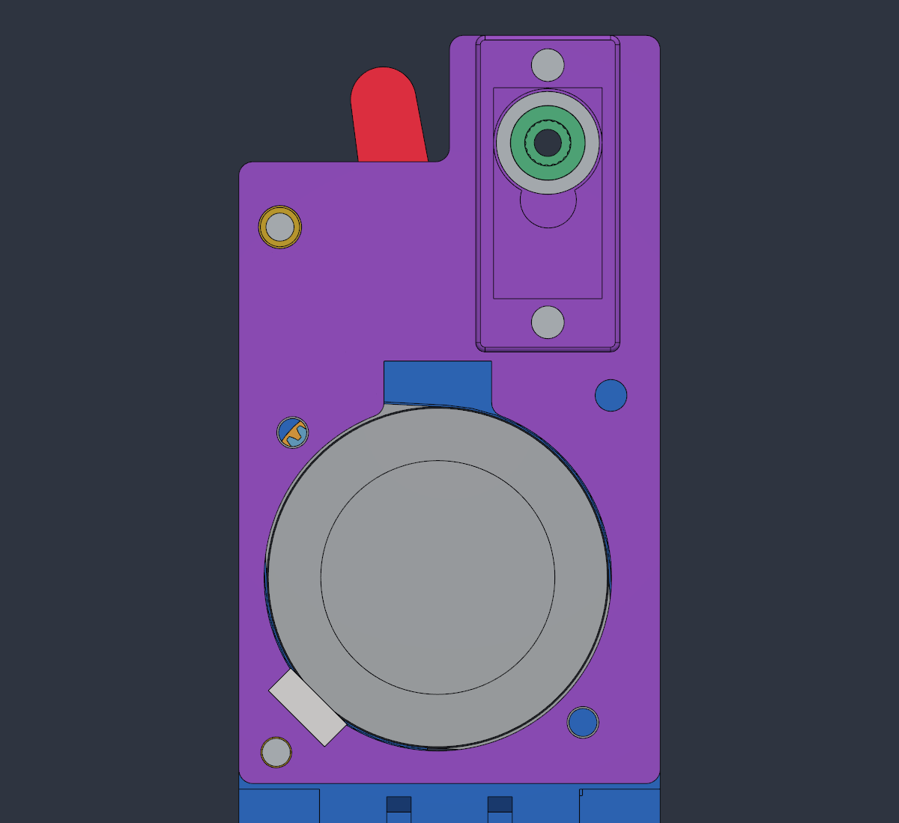
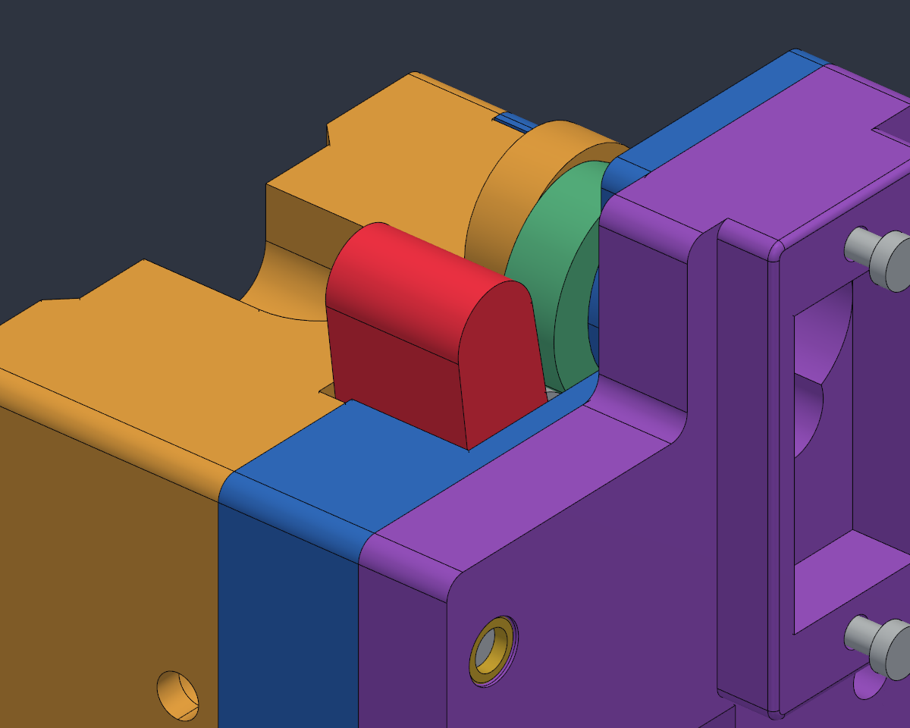

# v26j inspection and change notes

> [!WARNING]
> **WIP / FIT PENDING / NOT READY FOR PRINTING OR USE.** This substantial,
> human-directed, AI-assisted **vibe developed** work is not professional
> engineering or physical qualification. Digital geometry and sampled
> clearances do not approve loaded operation, heat, strength, or endurance.

Use the matched [v26 F3D](cad/SparkShift_AHG_min_v26.f3d),
[whole-assembly STEP](cad/SparkShift_AHG_min_v26.step), and
[17 inspection STLs](stl_v26). The editable F3D is the **timeline 1648,
135-body v26j** snapshot, not the earlier v26i publication.
See [all print roles and orientation notes](PRINT_PARTS.md). Eight PNGs
and one GIF are approved render/preview assets, not physical tests.

## What changed

| Area | Current v26 state |
|---|---|
| New P03 ladder frame | A symmetric flush **bottom cross-bridge** and **mid-upper cross-bridge** join the receiver sides, retaining the existing upper connection: a **triple-bridged closed-loop ladder frame**, not an inverted U. |
| Matching P01 recess | Lower-front P01 stock is relieved with **0.15mm nominal clearance** for P03's lower beam and full-depth +X foot; use the matched v26j pair, not an old blue housing with the new receiver. |
| P01/P03 structure | Contoured arm clearance remains, but the old square opening is closed by a **1.85mm continuous rear top bridge**, joining the upper bolt towers outside the MR128 bore. P03 retains its compact receiver cross-tie below the retainer. |
| New interlock load paths | **Four-zone X-shear mortise-and-tenon keys and coaxial bosses** in P01 engage matching P03 sockets with **0.15mm nominal mating clearance**, intended to restrain the receiver U legs in both X directions without extra fasteners. |
| Cam support | Rear MR128ZZ **8x12x3.5mm**, Y=-1.05..2.45 across P02/P01; front MF85ZZ **5x8x2.5mm**, Y=10.70..13.20 in the P03 cam tower. |
| P02 motor/servo plate | **7mm**, Y=-6.70..0.30. Continuous rear ear-seat frame reaches Y=-11.20; two **M2x8 self-tapping screws** use 1.7mm pilots. No servo-ear M2 nuts, washers, or M2 heat-sets. |
| Latest servo window | **11.60 x 22.56mm**, X=4.70..16.30, Z=34.06..56.62, Y=-11.20..-6.00. R5.800 tower clearance at (X10.500, Z50.721) is tangent to the sides; R3.000 bump clearance is centred at (X10.550, Z44.620), to Y=-2.00. |
| Motor entry | **11.5mm** notch, X=-6.998..4.502, approximately Z=21.5..27.4, with R1.5 bore-entry rounds. Preserve connector insertion/service clearance. |
| Case clamps | Four corner M3 button-head references have modelled **2.0mm AF x 0.9mm** hex sockets. Real heat-sets remain; see the exact lengths/hosts below and in the BOM. |
| Lower-left post | Screw axis moved to (X18.50, Z-14.60), with a concentric R2.7742 boss and R1.6922 tangent blend, replacing the thin offset corner/notch. Nominal screw-hole wall is 1.124mm; that is not a strength rating. |
| Maxwell interface | Six locating pins retain YUDX-matched axes; P03 uses full-length conformal **teardrop snap seats** instead of fragmented end-box seats. Balls and eight bar-magnet interfaces remain references needing real retention/fit checks. |
| P04R/P04F arms | P04R retains its **15mm shorter G1-tangent** lever. P04F now has one flat Y=26.850mm print-face reference, unified X19.830mm side wall, restored rear blind insert pocket, and cleaned R9.35 gear-clearance arc. |
| Retained magnet reinforcement | Earlier v26g reclaimed Y=27.200..29.800mm behind both +X receiver magnets for **1.527mm rear backing**. That **+1,041.652mm3** change predates the later shear sockets and cross-bridges; the current comparison image shows v26h versus v26j. |
| Case agreement | Z48.700 decks, aligned lower wire-slot surfaces, and continuous **R1.5 rounds along all four longitudinal outer edges** of the P01/P02/P03 assembly. Cam, bearing, insert, magnet, and pin interfaces were not made arbitrarily symmetric. |

### v26a-j sequence, preserving manual edits

| Pass | Recorded change |
|---|---|
| v26a | Case/corner agreement, sliver/step cleanup, and analytic arm cam-clearance surfaces; retained the manual P04F/P03 edits. |
| v26b | Kept the manual bay-wall deletions, then re-cut P03's R6.9 boss bay and R4.4 lobe groove with nominal 0.4mm local clearance and a tangent ceiling junction. |
| v26c | Thickened the lower-left clamp load path and moved its screw/insert; preserved the manual P02 R1.5 corner round. |
| v26d | Moved right-side bolts and heat-set pockets, removed retired locating sockets, and completed matching modelled head sockets. |
| v26e | Kept the rear servo frame/motor-notch edits, shortened/blended the lever, unified the crown/deck, and cleaned P04F steps without closing functional arm clearance. |
| v26f | Preserved the 11.6mm tangent servo-window/keyhole edits and matching outer rounds; this was the previous timeline-1589 publication. |
| v26g | Kept the flat P04F face, restored the rear blind M3 insert/pocket, and reclaimed P03 magnet backing with full sampled cam clearance. |
| v26h | Replaced P01's square upper cutout with a continuous rear top bridge and extended analytical arm-relief ramp; refreshed the matched exports and visual set at timeline 1632. |
| v26i | Added four-zone P01 tenons/bosses and P03 sockets against X spreading; retained the top bridge, flat P04F, and magnet reinforcement at timeline 1644. |
| v26j | Joined P03's lower and middle sides into a triple-bridged ladder frame and cut the matching P01 recess; retained the four-zone shear interlocks. Current snapshot is timeline 1648. |

This is a change log, not instructions to replay older candidates. No
intermediate exports, raw reports, or private authoring inputs are shipped.

### Current P01/P03 pair and retained P04F

| Part | Current native review | Refinement / boundary |
|---|---|---|
| P04F | **3,854.094mm3 / 83 faces** | Front face pulled back **2.550mm** to Y=26.850mm, about 493mm2 flat contact area. Rear blind M3 pocket at native (X14.950, Z31.400), Y=15.60..20.60, retains **6.250mm** wall behind the print face; actual insert/material fit still needs checks. |
| P03 | **30,882.669mm3 / 249 faces** | **+812.23mm3 vs v26i** for the cross-bridges/full-depth lower foot. Retains the captured shear sockets, magnet-backing concept and nominal Y=27.200mm pocket floor; local plane gaps are not global minimum clearances. |
| P01 | **33,426.859mm3 / 247 faces** | **-556.11mm3 vs v26i** for the matching lower-front recess. Retains the four-zone keys, R9/sloped arm ramp and rear bridge Y=0.30..2.15 outside the MR128 bore; no strength/deflection rating is implied. |

### New cross-bridges and matching blue-housing recess

Coordinates below are **assembly millimetres**. These are two new
connections in addition to the existing P03 upper connection; the
four-zone P01/P03 shear keys below are retained, not replaced.

| Feature | Current geometry / relationship |
|---|---|
| **Symmetric flush bottom cross-bridge** | **27.40 x 2.60 x 2.30mm** overall: X=-13.70..13.70, Z=-19.08..-16.48, Y=9.35..11.65. It continuously crosses X=0 and connects the lower receiver sides. The overall beam width is not its unsupported print span. |
| **Full-depth +X lower foot** | X=9.20..22.50, Z=-20.40..-17.50, Y=9.35..26.00. It reaches back to the lower mating region like the -X foot rather than relying only on the lower two bolts. |
| **Matching P01 recess** | Lower-front blue-housing stock is removed for the beam/foot with **0.15mm nominal clearance**. That is a geometric fit allowance, not a guaranteed printed clearance or proof the remaining P01 wall is strong enough. |
| **Mid-upper cross-bridge** | X=-3.50..3.50, Z=18.50..27.11, Y=16.01..19.50. It joins the inner walls at X=-3.20 and X=3.20, **behind P17's tongue (Y>=19.95)** and **in front of P04R (Y<=15.60)**. These local Y limits are not a global clearance certificate. |

The bridges provide a direct printed connection across the former open
receiver, while the keys provide geometric X-shear registration to P01.
Neither is a proven stiffness, fatigue, creep, or service-life result.
Keep the case bolts and the matched pair; **do not force a binding bridge/
recess fit together with bolt torque**.

For P03 printed face-down on the Y=31.50mm reference, the middle bridge
has a **6.40mm free span** between X=-3.20..3.20. The lower bar has an
**18.40mm free span** between X=-9.20..9.20. Review bridging/material
behaviour in the slicer; optional **build-plate-only support** beneath the
lower span is a candidate, not a verified recipe or universal requirement.
No support-free printability is claimed. See [print-part notes](PRINT_PARTS.md).

### Four-zone anti-spreading interlock

All coordinates are **assembly millimetres**; bolt axes below use (X, Z).
P01 carries the male geometry and P03 the matching mortises. The nominal
**0.15mm mating clearance** is a geometric allowance, not a guaranteed
printer/material fit or a preloaded joint.

| Zone | P01 shear geometry | Matching P03 capture |
|---|---|---|
| **1: +X lower leg** | At bolt **(18.50, -14.60)**: R2.50 / 5.00mm-OD coaxial boss, Y=25.90..29.00 (**3.10mm deep**), fused to a lower-foot tenon X=15.35..20.65, Z=-19.25..-17.65 (**5.30 x 1.60mm**) and outer rib X=18.50..20.65, Z=-19.25..-12.10 (**2.15 x 7.15mm**). | Keyhole mortise, Y=25.90..29.15, captures the boss/foot/rib. |
| **2: -X lower inner leg** | Rectangular tenon **3.60 x 5.80 x 2.80mm**, X=-13.50..-9.90, Z=-17.80..-12.00, Y=11.40..14.20; works with the existing R2.85 lower-right bolt boss at **(-18.50, -14.45)**. | Matching inner mortise to Y=14.35. |
| **3: -X mid-column** | Rectangular key **3.40 x 7.00 x 2.80mm**, X=-19.00..-15.60, Z=21.50..28.50, Y=11.40..14.20. | Matching mid-column mortise to Y=14.35. |
| **4: -X upper bolt** | At **(-18.10, 41.72)**: R2.50 / 5.00mm-OD coaxial shear boss, Y=11.40..14.20 (**2.80mm deep**). | R2.65 socket, Y=11.40..14.35. |

These retained interfaces are intended to carry X shear through geometry rather
than bolt friction alone. The existing case bolts still clamp the halves;
keys are **not a substitute for clamps**, an interference fit, or proof
that the housing cannot creep/spread. Clearance permits movement before
contact. Printed tolerance, layer direction, material, preload, temperature,
cyclic loads and long-term creep remain **unqualified**. Do not use bolt
force to pull a binding or partially seated keyed pair together.

The authoring review reports **0.000mm3 new static/dynamic clashes** across
the 135-solid assembly and **71 cam poses**, 0..175 degrees in 2.5-degree
steps. This preserves accepted reference contacts/overlaps, including the
servo-envelope exception below; it is not an assertion that every original
reference body is disjoint. Sampling does not prove continuous motion,
deflection, strength, snap force, or a real-world assembly/removal procedure.

## Case bolts and assembly references

Pairs below are **(X, Z) in assembly millimetres**; each bolt runs along Y.
"Left/right" follows the recorded model names, not a viewer's screen.

| Location | Axis (X, Z) | Screw reference | Heat-set host / axial interval |
|---|---|---|---|
| Upper-left | (18.10, 41.72) | M3x30 button head | P01, Y=0.30..4.30 |
| Upper-right | (-18.10, 41.72) | M3x35 button head | Rear-loaded P02, Y=-6.50..-2.50 |
| Lower-left | (18.50, -14.60) | M3x25 button head | P01, Y=6.00..10.00 |
| Lower-right | (-18.50, -14.45) | M3x35 button head | Front-loaded P02, Y=-3.70..0.30 |

Upper axes mirror exactly; lower X positions mirror, but lower-right Z is
**0.15mm higher** to retain approximately 1.03mm wall to its heat-set knurl.
This is not complete geometric symmetry or a validated fastener specification.
The distinct plate retainer is **one M3x10 button head** at (17.25, 23.72)
into a P01 heat-set. Motor ears use **two M3x10 button heads** into the
motor flange, not the superseded M3x18 references.

Plan rear-bearing insertion before closing P02 around its seat, and
bench-check the cam, both bearings, servo, washer, and retainer stack.
Front-/rear-loaded insert pockets imply different access directions;
physical iron clearance, seating, pilot fit, screw engagement, torque,
and service access remain unqualified. Do not substitute case nuts.

The printed cam/hub remains direct to the reference **21T servo output**,
with **no OEM horn**, one **M2.5x16** retainer and **2.7/6/0.5mm** washer.
The reference crest OD 4.86mm / exposed spline height 3.36mm / M2.5 thread
do not certify another servo. Historical 4.62mm root/sinusoidal flank and
+0.025mm normal allowance are empirical trials, not maker-standard teeth.
**Measure actual usable blind depth and the final stack before tightening**;
exposed shaft height is not thread depth. Do not force a bottomed retainer.
An earlier assembly's nominal engagement is not a v26 fit certificate.

## Digital checks and their limits

| Check on this source-bound package | Result / boundary |
|---|---|
| Native archive | **50,664,025 bytes; timeline 1648**; native review reports **135/135 body readback matches**, maximum difference 0.000mm3. This is not a physical fit/load test. |
| Whole STEP | **49,982,477 bytes; 135/135 valid solid readbacks reported**, with 135 solid BREP records. Structural completeness does not claim independent STEP/native shape or scalar-mass equality. |
| Inspection mesh set | **17 parts / 420,820 facets**; each one closed, manifold, coherently wound, positive-volume component; zero degenerate triangles. |
| Current P01 STL | **Native Fusion binary export, 11,988 facets**. Mesh volume 33,441.015mm3 vs analytic 33,426.859mm3: approximately **0.04235%** tessellation difference, not exact volume/shape equality. |
| Current P03 STL | **Native Fusion binary export, 12,570 facets**. Mesh volume 30,888.182mm3 vs analytic 30,882.669mm3: approximately **0.01785%** tessellation difference. |
| Stored STL normals | **Zero zero-length or inverted stored normals found** in the current 17-part set. The older P01 metadata warning count is not carried into v26. |
| Tool withdrawal | Native review reports **36/36 sampled offsets clear**. This does not prove every continuous path or a real removal procedure. |
| Filament feed | Native review reports **48/48 sampled pairs clear**. This is not extrusion/load/thermal qualification. |
| Cam motion | Final source-bound review reports **zero cam-motion overlaps**. This is sampled geometry, not force, spring, or torque qualification; retain the servo-envelope exception below. |

**Known servo-envelope exception:** the legacy **12.2mm**
`HOBBY_SERVO_ENVELOPE` intersects the tightened **11.6mm** P02 window.
Earlier MG90S/MG90D STEP ear-seat studies do not prove the latest opening
fits any purchased variant. Measure body, tower, ears, output, and lead
exit on the selected unit; do not describe this model as collision-free
without that exception.

The mesh bytes are preserved without repair, facet deletion, or normal
rewriting. **Both P01 and P03 remain in assembly coordinates**, including
negative Z, not on the print bed. Their current bytes are native Fusion
binary STL exports, replacing the previous P01 OpenCascade tessellation
and the older bed-oriented P03. Intended bed-face references are **P01
Y=0.30mm rear / P03 Y=31.50mm front**; check in a slicer rather than assuming
the highest Y bound is the face plane. Other orientations also need review;
none is support-free/print-ready approval. Small tessellation/float residues
remain possible.
**Inspect each mesh in a slicer**, including thin walls, surfaces, supports,
and actual material/nozzle resolution.

The underlying cam work uses contact-curve kinematics, not spring-force,
friction, torque, servo-current, or real-time physical simulation. The
current GIF labels a **0..175-degree cam**, reaching **7.87 degrees of arm
rotation and 2.73mm hob bite release gap** at full open. The labelled gap
is a CAD-preview metric, not a measured physical clearance. Do not mix it
with older nominal opening metrics or convert the animation into servo
pulse-width commands; actual clocking/endpoints require calibration.
Concentric dwell removes ideal normal-force backdrive torque, **not
spring/bearing load or friction**, and is **not a positive power-off latch**.
Drive Joint alone does not establish synchronized cam/arm motion.
The GIF is a rendered preview; **no matched v26 standalone portable
playback script is supplied**.

Source tools are an [incremental live-state snapshot](source_v26/README.md),
not a complete clean-checkout rebuild. Native timeline readback and healthy
appended features do not establish that all inherited history is warning-free.

## Current rendered gallery

The **six refreshed gallery PNGs**, exploded architecture PNG, reinforcement
comparison PNG, and dual-viewport GIF are **source-bound rendered inspection
assets**, not native-UI screenshots, photographs, physical tests, or an
accessory design. The annotated four-panel comparison shows historical
**v26h before** versus **v26j after**, both with the toolhead hidden,
plus isolated P03 inside and P01 mating views. It replaces the older
magnet-wall-only comparison; the filename is retained.
Colours, offsets, transparency, and hidden bodies are inspection aids.

The corrected exploded layout separates all 17 printed roles and selected
hardware/hotend references. Diagram offsets do not qualify assembly
order, access tools, or a collision-free continuous withdrawal path.
Use the native figures above for quantitative changes; artwork labels
are schematic annotations, not a replacement for part measurements.

**71 frames / 1280x784 / 3.44 seconds**, fully decoded during publication
checks. The GIF's frame count is distinct from the 71-pose geometry sampling grid.
Its playback rate is not physical servo speed, spring return, force,
friction, thermal, or simultaneous feed/release simulation.

From left to right: v26h front **before**, v26j front **after**, the isolated
**P03 rear/inside**, and the isolated **P01 front mating face**. P17 is
hidden in both front views so the new mid-upper cross-bridge, bottom
closed-loop bridge, and +X lower-foot extension can be seen. The inside
and mating views expose the full-depth foot, recess, and retained shear
interfaces; they are not extra parts or physical assembly instructions.

Closed view with the reference tool carrier and hotend. Vendor geometry
does not establish a certified hotend assembly or safe thermal use.

Open cam/arm pose, not calibrated servo endpoints or a full-motion recording.

Rear view exposes the plate, motor, and ear-seat frame. The servo envelope
is hidden for inspection; its absence from the render is not a fit pass.

Tool/interface bodies are selectively hidden to show the teardrop pin seats,
bar-magnet pockets, case bolts, and new lower/middle connections; this is
not a physical operating setup or a support-free printing claim.
In particular, **P17 is hidden**: the docked removable toolhead covers
these changes in the normal closed-assembly render. The README now shows
this direct front view and the annotated comparison before that render.

The tightened window must be checked against the selected real servo.

Deck/round agreement and lever clearance are geometric, not loaded strength
or hand-access qualification.

## Remaining gates and next-session scope

Real spline/body fit, clocking, retainer bottoming margin, spring/preload,
servo torque, snap force, insert retention, full gear phase, shaft sourcing,
hot creep, wiring/controls, and endurance remain open. The two rear
4x7x2mm supports and both standard compound-shaft lengths remain **HOLD**.
The bare Hall package still needs verified support and electrical integration.
YUDX pin-seat agreement does not finish all magnet/Maxwell alignment or
the broader 0.05mm placement-grid goal.

The lower arm/magnet region retains functional clearance details; it was
not indiscriminately filled or rounded. P03's new magnet backing is
deliberately paired with the shortened P04F and checked sampled motion.
Broad symmetry, accessory holes,
or vendor envelopes must not be changed merely to make a render look clean.

## SparkShift v26 Accessory & 3010 Toolhead Suite (`P20`–`P24`, `P17_3010`, `P18_3010`)

The complete accessory and 3010 high-flow toolhead suite is located in [`cad/SparkShift_Accessories_v26/`](cad/SparkShift_Accessories_v26/README.md) alongside the updated [accessories plan](ACCESSORIES_PLAN.md), [print parts guide](PRINT_PARTS.md), and [generic BOM](BOM.md):

- **Pure-Primitive B-Rep Solids**: All 8 printable parts (`P20_CPAP_Hose_Inlet`, `P21_CPAP_Gantry_Bridge`, `P22_CPAP_Lower_Plenum`, `P23_Beacon_Cartographer_Mount`, `P24_EBB42_Controller_Mount`, `P17_HF_tool_carrier_3010`, `P17_HF_tool_carrier_2510`, and `P18_Tool_docking_backplate_3010`) are constructed 100% from analytical OpenCascade primitives (`0` BSpline/Bezier/Sphere faces, `0` sliver faces `< 0.15 mm²`, `1` solid / `1` shell, `100%` watertight manifold STLs, and `0.000 mm³` interference against the `v26j` carriage).
- **NEMA14 Stepper Pancake Clearance**: Verified `27.39 mm` unobstructed axial pocket (`Z = -48.61 mm` to `-21.22 mm`), accommodating all `17.4–21.8 mm` NEMA14 pancake motors with `+5.59 mm` to `+9.99 mm` axial headroom and a `39.70 mm` upper wire-egress bay.
- **3010 Side Exhaust & Wire Routing**: `P17_HF_tool_carrier_3010` features bilateral `12.7 × 14.0 mm` side exhaust windows (`252.8 mm²` total area) and an enlarged `6.0 × 6.5 mm` (`39.0 mm²`) vertical heater/thermistor wire channel with a `1.40 mm` heatbreak cooling-air divider wall.

See [`cad/SparkShift_Accessories_v26/README.md`](cad/SparkShift_Accessories_v26/README.md) for the complete 17-image + 4-animation gallery, B-Rep verification audit, CFD results, and 350mm 8-tool / 9-tool Voron 2.4R2 dock layout. See [mixed-scope attribution](ATTRIBUTION.md) for GPL-3.0 custom work, separate CC BY-SA 3.0 P13/P14 liners, and vendor-reference rights.

