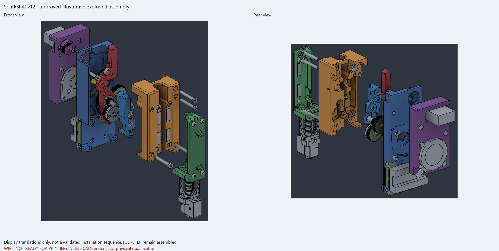
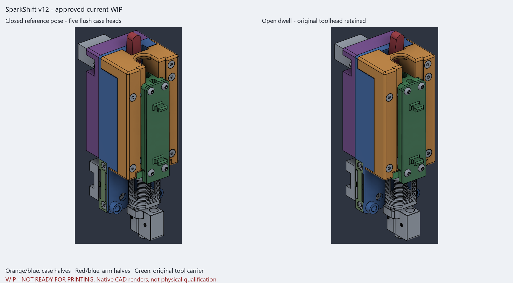
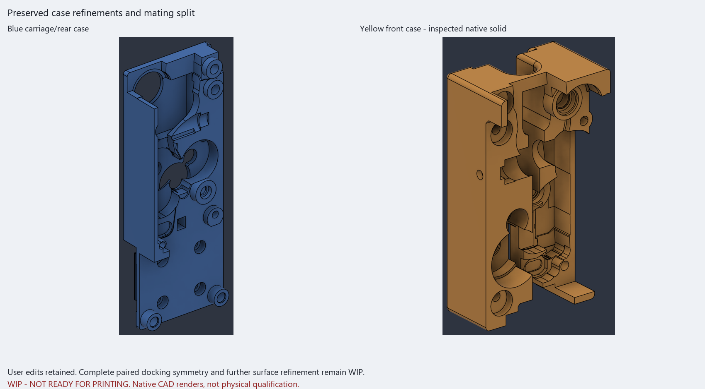
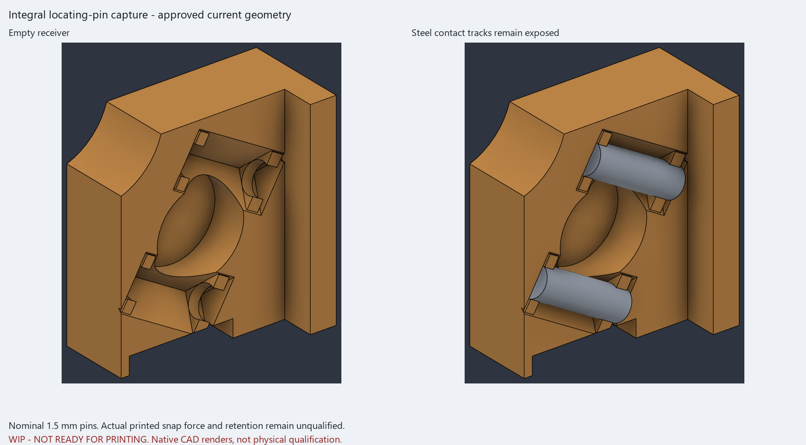
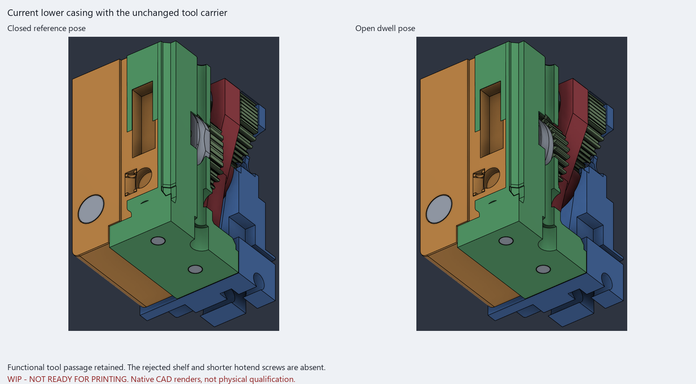
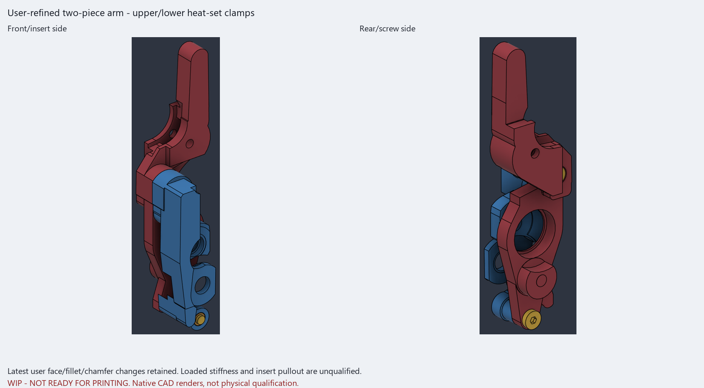
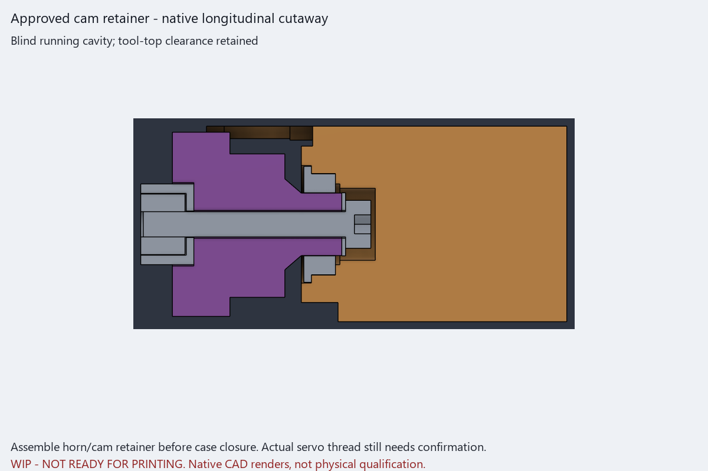
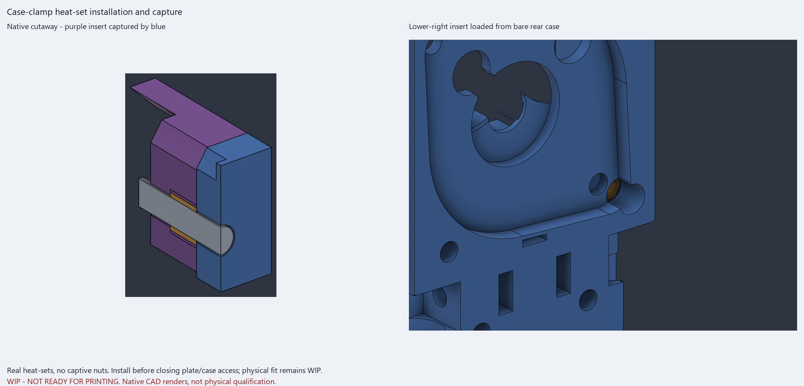

# v12 approved-snapshot notes

> [!WARNING]
> **WIP / NOT READY FOR PRINTING OR USE.** This substantial, human-directed,
> AI-assisted **vibe developed** work is not professional engineering validation
> or physical qualification. Nominal dimensions and native renders do not
> approve printing, loaded assembly, heat-staking, or safe operation.

## One matched inspection set

Use the [v12 F3D](cad/SparkShift_AHG_min_v12.f3d),
[assembled STEP](cad/SparkShift_AHG_min_v12.step), and
[17 millimeter bed-oriented STLs](stl_v12) for inspection/development only,
**not printing approval**. Mesh orientation is rigid, not repair or
support-free qualification. Do not mix predecessor exports or mutation tools.

## Applied scope, not the model title

The approved assembly has 143 bodies and 11 joints, with a matching 17-print
export set. The factory-10T LDO pancake, unmodified HGX,
independent MG90S, separate actuator plate, interleaved supports, 45mm core,
and four 9mm belt interfaces remain.

The user's later face/fillet/chamfer/extrude edits are included. Four central
path-wall analytic-plane edits were applied, but **complete paired docking
symmetry and the 0.05mm placement grid remain unfinished**. Not every contact,
pocket, coupling feature, or magnet is verified centered. Vendor gear/fit
dimensions are not rounded to that grid, and gear internals are not forced
symmetric.

An actual Hall cross-web joins case areas. The **sensor package still uses
its old slot/lead geometry; no positive cradle or retainer is installed**.
Package support/retention qualification remains open. Centering and Hall
studies were stopped; a native document title is not evidence they were built.

## Four-head flush alignment

The requested step changes only four selected heads and necessary seats.
Each head moves **+1.70mm** to the common **Y33.15 flush plane**
with **Y31.5 under-head seats**, matching the unchanged fifth
`CLAM_M3x25_FRAME_2`.

| Installed reference | Modeled quantity / scope |
|---|---|
| Case clamps FRAME_0 / FRAME_1 / FRAME_2 | Three M3x25; FRAME_2 is the unchanged fifth reference in the head-alignment comparison. |
| Lower-left case clamp FRAME_3 | One M3x40; the earlier 35mm trial is not the installed length. |
| Separate upper frame screw | One M3x35 into P01's insert; its head and hex socket are present. |

Standard lengths and blind-tip clearances retain **full 4mm nominal
engagement for the four targeted inserts**. The unchanged lower-right fifth
keeps its separate nominal engagement reference. Neither is vendor-thread,
torque, insert-pullout, or strength qualification.

The source comparison for this bounded step preserves the fifth and
136 unaffected bodies; seven changed body shapes match the expected
head/seat changes. That is not permission to infer completed symmetry,
Hall retention, or healthy status for disabled features. A subsequent
microscopic head-pocket alignment is bounded separately below.

### Native counterbore alignment, not mesh healing

The upper counterbore's legacy center Z41.7205952152 was aligned to its
approved screw/seat at **Z41.72**, a **0.000595mm** correction. About
**0.0060802mm3** changes only inside that head pocket; the other 142 bodies,
all five Y33.15 flush head planes, and target insert engagements remain
unchanged. This removes a raw four-facet-edge tessellation defect at the
native geometry source, **not facet deletion, smoothing, or mesh repair**.
Neither the defective provisional mesh nor precision trials are this set.

## Three different heat-set installation orders

All case retainers remain real heat-sets, **not captive nuts**.

| Interface | Actual geometry / required assembly order |
|---|---|
| Lower-right FRAME_2, P01 | X18.2/Z-13.7, insert Y6..10; 4.0mm pilot / 4.8mm rear entry, full 1.6mm radial wall and backing, 2.0mm material outside the insert. Install through the bare rear shell **before the actuator/motor plate closes access**. |
| Lower-left FRAME_3, purple P02 | X-16/Z-13, insert Y-3.7..0.3. Axis raised about 1.2794mm without extending P02 below Z-17.78. **Front-load the insert into the bare plate before assembling blue P01**. |
| Spring adjuster, bare front case | Original spring axis/insert retained. **Bench-install before case and arm/spring/ball closure**; not through an assembled-case access path. |

Blue P01 is the through-clearance **sandwiched member** for FRAME_3. Its
front-loaded purple insert is captured by a checked blue annulus: 1.6mm
depth, 3.3mm through diameter smaller than the 4.6mm insert, missing material
0. Purple pilot radial stock is 1.6mm with missing material 0. This is the
accepted stack concept, not actual insert fit or load/thermal qualification.

The broad rear-edge cutback and matching blue extension are actual geometry.
The spring-tool reference is a 10mm heater body / 7mm shaft / 4.6mm working
end. That stated envelope is not universal actual-iron compatibility or
physical heat-staking qualification. Confirm real tooling and printed fit;
do not treat an earlier envelope result as approval for every iron.

## Retained hardware and functional openings

Original P17/toolhead and **all four original M2.5x8 hotend mounts remain
unaltered**. No shortened hotend bolts, shelf/counterbore redesign, or nut
substitution is supplied. The arm keeps its two halves, upper/lower heat-set
clamps, and central key. Purchased HGX and vendor gear geometry are retained.

Tool-withdrawal slots and local tool-top/cam clearance remain functional
openings, **not an obsolete full screwdriver tunnel**. The cam still needs
retainer preassembly before case closure. Its supplied horn is the actual
spline insert; the integral journal/MF85ZZ and M2x16 center screw remain
references with actual horn/thread/journal fits unqualified.

## Preserved warnings and suppressions

| History state | Exact current operations |
|---|---|
| Active inherited warnings | P01 `Extrude2`; P03 `Extrude14`. |
| Intentionally suppressed, not active healthy features | `Extrude33`, `DeleteFace29`, `DeleteFace30`, `Extrude46`, `Extrude47`, `DeleteFace46`. |

Latest user refinements and corruption recovery are included; no whole-design
restore or display-edge hiding substitutes for those edits. The approved
geometry is frozen for publication, with later changes rejected rather than
silently mixed into an audit.

## Eight current native visual panels

All eight panels are **WIP native CAD renders/cutaways, not photographs or
physical tests**, from the matching final source. Colours identify parts,
not filament/material choices. Sections and display omissions are inspection
devices, not alternate parts or operation instructions.

**Display translations only**, not a validated installation sequence,
assembly/removal-path proof, or exploded export. Authoritative F3D/STEP
remain assembled.

Reference poses show the original toolhead and current heads, not continuous
or physically tested motion.

User edits and the mating split are retained. Complete paired docking
symmetry and further surface refinement remain unfinished.

Capture lips and steel tracks are geometry references, not measured
printed snap force or physical retention.

These right-half cutaways **include the original green P17 carrier and
mounting references** to show casing-clearance relationships. They do
not depict the rejected shelf or shorter hotend screws. Sections are
display-only; endpoint images do not establish full withdrawal clearance.

Latest face/fillet/chamfer changes are retained, not loaded stiffness or
insert-pullout qualification.

Blind running cavity and tool-top clearance, not an exterior driver path.
Assemble the horn/cam retainer before case closure; verify actual servo
thread and horn/journal fits.

Left: a **native cutaway showing the gold insert in purple P02 captured
by blue P01**, not a photograph or an iron-envelope render. Right: the
rear-loaded lower-right insert in the bare blue case. Install before
closing the relevant plate/case access; physical fit and heat-staking remain
unqualified.

## Current digital evidence and its limits

| Final source-bound result | Scope and limit |
|---|---|
| F3D independently reopened: 143 exact body matches, 11 joints | All 143 symmetric differences are zero; preserves source shapes/history, not complete design or physical qualification. |
| Independent STEP readback: 143 raw-valid positive-volume solids, coordinates matched | All 143 exact-source shape comparisons pass; maximum symmetric difference 3.91682789e-8mm3 within 1e-5mm3. Only bounded nonoverlapping measurement partitions; no source/STEP healing. |
| Nine current case/arm/cam and ten complete tool-withdrawal positions from 0 to 35mm | Zero unexpected overlaps or errors with frozen source stable throughout; named press references are separate. Not continuous/full gear-phase or physical clearance qualification. |
| All 17 raw and bed meshes pass closure, single-component, winding, normals, nondegenerate, native-volume, and bed-origin gates | **81,514 facets** in the bed set; rigid rotation/translation only, no facet repair/deletion/smoothing. Not actual FDM deposition, support-free geometry, or hardware fit. |
| Final source still matches exports through rendering | Inspection images and deliverables share the final geometry, not approval of unbuilt centering/Hall candidates. |

Independent scalar-mass equality is **not claimed**. Shape/coordinate
readback is separate from cross-kernel scalar integration. Both inherited
warnings and all six intentional suppressions remain; no all-healthy
feature-history claim is made.

Physical insert/printer/iron fits, vendor thread depth, torque, horn/spline,
snap force/retention, strength/torsional stiffness, servo/spring margin,
supports, hot creep/life, full gear-phase coverage, predecessor native ratio,
and nonstandard compound-shaft lengths remain unqualified. No heater
instructions, G-code, printer profile, calibrated offsets, or unattended-use
approval is provided. CPAP/probe accessories remain deferred; Hall package
support is not installed qualification.

See the [partial BOM](BOM.md), [source-tool limits](source_v12/README.md),
and [mixed-scope attribution](ATTRIBUTION.md). GPL-3.0 custom work, separate
CC BY-SA 3.0 P13/P14 liners, and vendor-reference rights are preserved;
vibe development does not replace upstream authorship.
