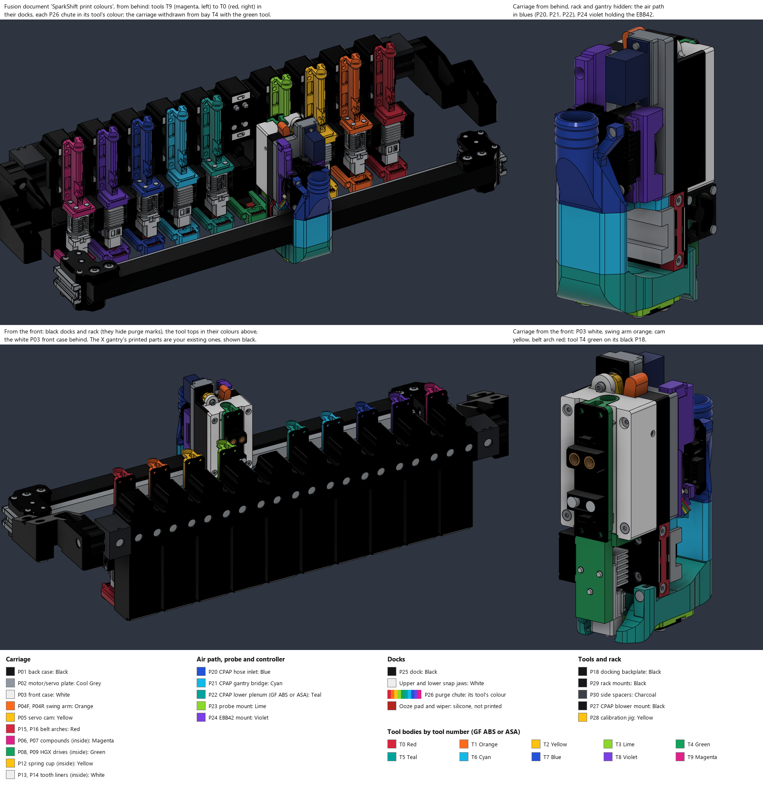

# v26j print-part inspection notes

> [!WARNING]
> **WIP / FIT PENDING / NOT READY FOR PRINTING OR USE.**
> This human-directed, AI-assisted **vibe developed** model is not physically
> qualified. These are inspection meshes, not a slicer project, support plan,
> material recommendation, G-code, or approval for loaded/heated operation.

## Current print set for the toolchanger build (revision 40)

Print these files for the ten-tool machine: one file per part, at its latest revision. Older
versions stay in `stl_v26/` and `cad/SparkShift_Accessories_v26/stl/` as history; in
particular, the P17, P18 and P22–P26 files in `stl_v26/` are superseded. Each STL has a
matching STEP in the neighbouring `step/` folder. The Colour column is a suggested scheme; see
[Colour scheme](#colour-scheme).

Nothing below has been printed or fitted yet. **Print a first-article set first**: the
carriage, one Bambu tool, one Red Lizard tool and two docks. Check:

- the P18 bushing seats (Ø7.04 mm) and P25 pin bores (Ø4.98 mm) with your actual
  bushings and pins (new in revision 39);
- the snap jaws closing on P18's T-lugs;
- the M2.5 L4 and M3 × 3 mm heat-set inserts, and the probe mount (P23 on P22);
- P20's two button heads seated in its lugs, clear of the EBB42 board, and P21's moved inserts
  (new in revision 40). Also look at whether P21's conduit touches the X beam (see the notes
  below);
- a tool docking and the carriage withdrawing, by hand;
- the probe height with the P28 jig.

Before making the silicone pads and wipers, measure a real Bambu nozzle: its tip should be
38.75 mm below the centres of the two upper hotend mounting holes.

### Carriage: one set

| Part | File | Qty | Colour | Notes |
|---|---|---:|---|---|
| P01 back case | [P01_Back_case_COTS_MR74_Lowered_Bosses_R31_REVIEW](cad/SparkShift_Accessories_v26/stl/P01_Back_case_COTS_MR74_Lowered_Bosses_R31_REVIEW.stl) | 1 | Black | P22 mount bosses 1.5 mm lower (revision 31). Printed rear face down, each boss starts with a 1 mm unsupported crescent. |
| P02 motor/servo plate | [P02_Motor_servo_plate_12p5mm](stl_v26/P02_Motor_servo_plate_12p5mm.stl) | 1 | Cool Grey | COTS servo window |
| P03 front case | [P03_Front_case_COTS](stl_v26/P03_Front_case_COTS.stl) | 1 | White | |
| P04F swing arm, front | [P04F_Swing_arm_front_half_COTS](stl_v26/P04F_Swing_arm_front_half_COTS.stl) | 1 | Orange | Locking hook |
| P04R swing arm, rear | [P04R_Swing_arm_rear_half](stl_v26/P04R_Swing_arm_rear_half.stl) | 1 | Orange | |
| P05 servo cam | [P05_Servo_cam_COTS](stl_v26/P05_Servo_cam_COTS.stl) | 1 | Yellow | |
| P06, P07 compounds | [left](stl_v26/P06_Left_compound_38T_14T.stl), [right](stl_v26/P07_Right_compound_38T_14T.stl) | 1 each | Magenta | |
| P08, P09 HGX drives | [left](stl_v26/P08_Left_HGX_drive_37T.stl), [right](stl_v26/P09_Right_HGX_drive_37T.stl) | 1 each | Green | |
| P12 spring pressure cup | [P12_Spring_pressure_cup](stl_v26/P12_Spring_pressure_cup.stl) | 1 | Yellow | |
| P13, P14 GT2 tooth liners | [left](stl_v26/P13_Left_tooth_liner.stl), [right](stl_v26/P14_Right_tooth_liner.stl) | 1 each | White | |
| P15, P16 belt arches | [left](stl_v26/P15_Left_belt_arch.stl), [right](stl_v26/P16_Right_belt_arch.stl) | 1 each | Red | |
| P20 CPAP hose inlet | [P20_CPAP_Hose_Inlet_Button_Head_Lugs_R40_REVIEW](cad/SparkShift_Accessories_v26/stl/P20_CPAP_Hose_Inlet_Button_Head_Lugs_R40_REVIEW.stl) | 1 | Blue | Screw lugs at X±5.5 with button-head counterbores (revision 40) |
| P21 CPAP gantry bridge | [P21_CPAP_Gantry_Bridge_Moved_Inserts_R40_REVIEW](cad/SparkShift_Accessories_v26/stl/P21_CPAP_Gantry_Bridge_Moved_Inserts_R40_REVIEW.stl) | 1 | Cyan | Top-flange inserts at X±5.5, 1 mm forward (revision 40) |
| P22 CPAP lower plenum | [P22_CPAP_Lower_Plenum_Probe_Mounts_R37_REVIEW](cad/SparkShift_Accessories_v26/stl/P22_CPAP_Lower_Plenum_Probe_Mounts_R37_REVIEW.stl) | 1 | Teal | Beside the hotend: GF/CF ABS or ASA |
| P23 probe mount | [P23_Probe_Mount_Raised_Rear_Ears_R37_REVIEW](cad/SparkShift_Accessories_v26/stl/P23_Probe_Mount_Raised_Rear_Ears_R37_REVIEW.stl) | 1 | Lime | Beacon RevH Normal or Cartographer V3 |
| P24 EBB42 mount | [P24_EBB42_Controller_Mount_Cable_Entry_R35_REVIEW](cad/SparkShift_Accessories_v26/stl/P24_EBB42_Controller_Mount_Cable_Entry_R35_REVIEW.stl) | 1 | Violet | |

The core parts are the COTS drop-in variants that [BOM.md](BOM.md) recommends; they take
standard bearings, dowels and servo parts.

### Tools: ten, any mix of Bambu and Red Lizard

| Part | File | Qty | Colour | Notes |
|---|---|---:|---|---|
| Bambu body | [Bambu_Three_Screw_Fan_R33_REVIEW](cad/SparkShift_Accessories_v26/stl/Bambu_Three_Screw_Fan_R33_REVIEW.stl) | 1 per Bambu tool | [By tool number](#colour-scheme) | GF/CF ABS or ASA |
| Red Lizard body | [RedLizard_Fan_Wall_R33_REVIEW](cad/SparkShift_Accessories_v26/stl/RedLizard_Fan_Wall_R33_REVIEW.stl) | 1 per Red Lizard tool | [By tool number](#colour-scheme) | GF/CF ABS or ASA |
| P18 docking backplate | [P18_Docking_Backplate_Bushing_Seats_R39_REVIEW](cad/SparkShift_Accessories_v26/stl/P18_Docking_Backplate_Bushing_Seats_R39_REVIEW.stl) | 10 | Black | Same part on both hotends |

### Docks: ten

| Part | File | Qty | Colour | Notes |
|---|---|---:|---|---|
| P25 dock | [P25_Dock_Pin_Seats_R39_REVIEW](cad/SparkShift_Accessories_v26/stl/P25_Dock_Pin_Seats_R39_REVIEW.stl) | 10 | Black | |
| Upper snap jaw | [Dock_Upper_Snap_Jaw_REVIEW](cad/SparkShift_Accessories_v26/stl/Dock_Upper_Snap_Jaw_REVIEW.stl) | 10 | White | Flexing detent: check on the first article |
| Lower snap jaw | [Dock_Lower_Snap_Jaw_REVIEW](cad/SparkShift_Accessories_v26/stl/Dock_Lower_Snap_Jaw_REVIEW.stl) | 10 | White | Flexing detent: check on the first article |
| P26 purge chute | [P26_Chute_Arm_Chamfer_R36_REVIEW](cad/SparkShift_Accessories_v26/stl/P26_Chute_Arm_Chamfer_R36_REVIEW.stl) | 10 | [Its tool's colour](#colour-scheme) | |
| Ooze pad | [Dock_Ooze_Pad_Datum_SILICONE_R37_REVIEW](cad/SparkShift_Accessories_v26/stl/Dock_Ooze_Pad_Datum_SILICONE_R37_REVIEW.stl) | 10 | Not printed | High-temperature silicone, cast or cut; not rigid filament |
| Wiper | [Dock_Wiper_Datum_SILICONE_R37_REVIEW](cad/SparkShift_Accessories_v26/stl/Dock_Wiper_Datum_SILICONE_R37_REVIEW.stl) | 10 | Not printed | High-temperature silicone, cast or cut; not rigid filament |

### Rack, frame and jig: one set

| Part | File | Qty | Colour | Notes |
|---|---|---:|---|---|
| P29 rack mounts | [left](cad/SparkShift_Accessories_v26/stl/P29_Dock_Rack_Gantry_Mount_L.stl), [right](cad/SparkShift_Accessories_v26/stl/P29_Dock_Rack_Gantry_Mount_R.stl) | 1 each | Black | |
| P30 side spacers | [left](cad/SparkShift_Accessories_v26/stl/P30_Dock_Side_Spacer_L.stl), [right](cad/SparkShift_Accessories_v26/stl/P30_Dock_Side_Spacer_R.stl) | 1 each | Charcoal | |
| Crossbar | 2020 extrusion, 450 mm | 1 | Not printed | Purchased |
| P27 CPAP blower mount | [P27_CPAP_7040_Blower_Frame_Mount](cad/SparkShift_Accessories_v26/stl/P27_CPAP_7040_Blower_Frame_Mount.stl) | 1 | Black | On the frame |
| P28 calibration jig | [P28_Dock_and_Probe_Calibration_Jig_R37_REVIEW](cad/SparkShift_Accessories_v26/stl/P28_Dock_and_Probe_Calibration_Jig_R37_REVIEW.stl) | 1 | Yellow | 2.60 mm probe feeler |

**Print settings**
([accessories README](cad/SparkShift_Accessories_v26/README.md#recommended-print-settings)):
ABS or ASA, 0.20 mm layers with a 0.4 mm nozzle, 4 walls, 40–60 % gyroid or cubic infill.
Use GF/CF ABS for P22 and the tool bodies, which sit beside the hotend.

### Colour scheme

The Colour column is for looks and for telling parts apart; it doesn't change fit, and any
colour works. Use the nearest filament you have.

- **Structure is dark.** P01, P18, the docks, P27 and P29 are black, P30 charcoal and P02
  cool grey. Black docks also hide purge marks.
- **The carriage's front is white** (P03), and the parts that move are warm: the swing arm
  orange, the servo cam yellow and the belt arches red.
- **The air path runs in blues**: P20 blue, P21 cyan and P22 teal. The probe mount (P23) is
  lime and the EBB42 mount (P24) violet.
- **Each tool has its own colour**, in rainbow order by tool number, and the P26 chute in its
  bay matches. A tool parked in the wrong bay stands out.
- **Parts inside the case** (P06–P09 and P12–P14) can't be seen once it is closed; their
  colours only tell them apart on the bench.

| Tool | T0 | T1 | T2 | T3 | T4 | T5 | T6 | T7 | T8 | T9 |
|---|---|---|---|---|---|---|---|---|---|---|
| Body and P26 chute | Red | Orange | Yellow | Lime | Green | Teal | Cyan | Blue | Violet | Magenta |

P22 and the tool bodies sit beside the hotend, so print them in a coloured GF ABS or ASA;
carbon-filled grades mostly come in black only. The hex values are in
[print_colors.py](cad/SparkShift_Accessories_v26/print_colors.py), and
[build_print_colour_review.py](cad/SparkShift_Accessories_v26/build_print_colour_review.py)
builds a coloured STEP of the whole build for Fusion.

### Hardware that differs from BOM.md

[BOM.md](BOM.md) lists the hardware for one receiver and one tool; repeat its tool rows for
each of the ten tools. These items differ in the current parts:

- **Each tool**
  - 2× 5×7×5.5 mm bushings, pressed flush into P18 (they replace the tool's two dowel pins).
  - 2× Ø6×4 mm N52 magnets in P18's magnet bar, or one 15×5×3 / 12×6×3 mm bar (unchanged).
  - P18 to the body: 4× M3 screws; the lower pair go into M3 × 3 mm heat-set inserts.
  - Fan (25 × 25 × 10 mm): M2.5×14 ultra-low-head screws (head at most Ø4.5 × 0.8 mm) into
    fan-side M2.5 × L4 × OD3.5 heat-set inserts. A Bambu tool takes 3 of each, a Red Lizard 2.
  - Bambu hotend: 3× M2.5×10 low-head screws (head at most Ø4.5 × 1.7 mm), with 0.5 mm washers
    (OD4.5, ID2.7) on the upper two, into 3× front-entry M2.5 × L4 × OD3.5 inserts.
  - Red Lizard hotend: its original 4× M2.5×8 heatsink screws.
- **Each dock**
  - 2× Ø5×12 mm rounded dowel pins, pressed 6.5 mm into P25 and standing 5.5 mm proud (they
    replace the dock's two bushings).
  - 2× Ø6×4 mm N52 magnets, or one bar (unchanged).
  - 2× M5×10 screws and 2020 M5 T-nuts to the crossbar (not M5×12).
  - 2× M3×12 socket-head screws for P26.
- **Rack:** 6× M5×10 button-head screws and T-nuts for each P29.
- **Carriage (revision 37 probe mount)**
  - Probe: 2× M3×6 low-profile socket-head screws (head 5.5 × 1.5 mm) through the probe board
    and P23 into 2× M3 × 3 mm heat-set inserts (OD 4.5) in P22.
  - P23 to P22: 2× M3×4 ISO 7380 button-head screws into 2× M3 × 3 mm inserts in P22.
  - These replace the four M3×8 P23 screws and the probe's two captive M3 nuts. The other
    accessory fasteners are in the
    [accessories README](cad/SparkShift_Accessories_v26/README.md#fasteners--heat-set-inserts-bom).
- **Carriage (revision 40)**
  - P20 to P21: 2× M3×8 ISO 7380 button-head screws (were socket heads) into the same 2× M3 × 3 mm
    inserts in P21's top flange, now at X±5.5. Fit them before the EBB42: they sit under its board.

For ten tools and ten docks: 20 dowel pins, 20 bushings, 40 Ø6×4 magnets (or 20 bars),
20 M5×10 screws with T-nuts and 20 M3×12 screws.

### Not designed yet

These don't block printing, but the machine can't run without them:

- wiring for the ten tools (six wires each: heater, thermistor and fan);
- routing for the EBB42 cable bundle and the CPAP hose from the P27 blower to P20;
- the ten-bay Klipper configuration (`klipper/sparkshift_toolchanger.cfg` is the old nine-bay
  template);
- moving the bed back 31 mm (option B) and the on-printer checks listed in the
  [accessories README, revision 34](cad/SparkShift_Accessories_v26/README.md#low-z-fix-rigid-rack-bed-front-edge-behind-the-docks-revision-34).

### Design notes to settle on the first article

Recorded in revision 40 without changing the parts
([details](cad/SparkShift_Accessories_v26/README.md#p20-to-p21-screws-and-two-design-notes-revision-40)):

- **P21's conduit against the X beam.** In the Monolith model, its front face lies on the beam's
  rear face (0.0 mm), and the probe cable runs 0.2 mm from it. Check that the carriage slides the
  full X travel without rubbing. If it rubs, moving the column 1.5 mm rearward gives about 1.1 mm
  and still leaves 6.8 mm to the rear motor mounts at the rear limit.
- **No screws hold the CPAP/EBB42 stack.** P24's two rear holes line up with core inserts that the
  core's own case screws already fill. The stack (P20, P21, P24 and the EBB42) rests on P22's
  collar, against P02's rear face and under P02. Check how firmly it sits once the hose and cables
  are on.

## Core inspection notes (v26j)

These notes describe the v26j core meshes. For the toolchanger build, print the set above.

Use the complete [17-part v26 set](stl_v26) with
[the matching native F3D](cad/SparkShift_AHG_min_v26.f3d), **timeline 1648**,
SHA-256 `37e384e8fd53f517b94f7dba5751e773c36e82f79493535b5b7a12b53291631a`.
P04 is split into rear/front halves; P05 includes its direct servo hub,
not an extra horn. Use one of each role below, not mixed older P01/P03/P04F
parts. The [generic BOM](BOM.md) retains **15 bearings, 29 screws plus four
belt nuts, and 12 M3 heat-sets**; these geometry updates do not add hardware.

## Ladder-frame case pair and retained front arm

| Role | Current native geometry | Inspection / remaining gate |
|---|---|---|
| **P01 back case** | **33,426.859mm3 / 247 faces**, -556.11mm3 vs v26i for the lower-front recess. Retains four-zone tenons/coaxial bosses and the 1.85mm rear top bridge/arm ramp. | Match the v26j P03 beam/foot and sockets, not just the older shear-key shape. Preserve bearing/arm/bolt interfaces; no strength/creep qualification is implied. Sealed mesh remains in **assembly coordinates**. |
| **P03 front case** | **30,882.669mm3 / 249 faces**, +812.23mm3 vs v26i. Bottom and mid-upper cross-bridges plus the existing upper connection form a **triple-bridged closed-loop ladder frame**, with full-depth +X foot and retained shear sockets. | Check the **0.15mm mating clearance** into P01 and the bridge/support spans below. Existing clamp bolts remain required; do not pull a binding pair together with screw force. Mesh remains in **assembly coordinates**. |
| **P04F front arm** | 3,854.094mm3, 83 faces. Face pulled back **2.550mm** to native Y=26.850mm, about 493mm2 flat area; X=19.830 outer wall and R9.35 gear clearance unified. | The **rear blind M3 pocket** at native (X14.950, Z31.400) runs Y=15.60..20.60 and leaves **6.250mm** wall to the front face. The existing 4mm M3 insert reference is retained, not an extra purchase. Confirm insertion access, pilot/knurl fit, screw engagement and material before use. |

These native dimensions are not STL-bed coordinates. The v26j bridges/recess
and retained interlocks
were reviewed across the 135-solid assembly and **71 cam poses**, 0..175
degrees in 2.5-degree steps, with no new static/dynamic clashes reported.
This is not continuous-motion or physical force/deflection qualification;
accepted reference overlaps, including the servo-envelope exception, remain
explicit in [inspection notes](PREVIEW.md). Archive readback reports all
135 bodies matching.

## Cross-bridges, fit and support review

P03's bottom beam spans **27.40 x 2.60 x 2.30mm** overall:
X=-13.70..13.70, Z=-19.08..-16.48, Y=9.35..11.65. Its full-depth +X foot
occupies X=9.20..22.50, Z=-20.40..-17.50, Y=9.35..26.00 and fits the
matching lower-front P01 recess with **0.15mm nominal clearance**.
The mid-upper connection occupies X=-3.50..3.50, Z=18.50..27.11,
Y=16.01..19.50, between the rear arm and removable tool tongue.

For P03 **face-down on Y=31.50mm**, distinguish overall beam dimensions
from the unsupported span between its walls:

| Region | Free-span review | Support boundary |
|---|---|---|
| Mid-upper bridge | **6.40mm**, X=-3.20..3.20. | A short bridging candidate, **not guaranteed to bridge cleanly** for every material, nozzle, layer, cooling or slicer setting. |
| Bottom cross-bar | **18.40mm**, X=-9.20..9.20, Y=9.35..11.65. | Review optional **build-plate-only support** under this span, including contact/removal access and mating surfaces. This is a candidate, not a validated support recipe or universal requirement. |

The bridges close the former inverted U into a ladder frame; that is
geometric reinforcement, not proven stiffness, fatigue life or resistance
to creep. No support-free/print-ready approval follows from a short span.
Check the full slicer preview and eventual test pieces before accepting
supports or fits; no slicer profile or process validation is supplied.

## Retained interlock fit is still a physical gate

P01 carries four shear-key zones captured by P03: the **+X lower keyhole
boss/foot/rib**, **-X lower inner block**, **-X mid-column key**, and **-X
upper bolt boss**. The [four-zone dimension table](PREVIEW.md) records
their exact assembly extents. Use the matched v26j pair; the added male
keys are not compatible by assumption with an older P03.

The **0.15mm nominal mating clearance** is not a validated print tolerance
or an interference fit. It allows movement before contact. The keys aim
to carry X shear through geometry, **not replace the clamp bolts** or
guarantee that the U legs cannot widen or creep. Layer orientation, material,
dimensions, preload, heat, cyclic loads and long-term creep remain unqualified.
Check clean engagement and full seating without forcing; **do not use bolt
force to pull binding interlocks together**. No extra metal key, bolt or insert
is added to the BOM.

## Mesh provenance and orientation

The 17 sealed files total **420,820 facets**. Each independently checks as
one closed, manifold, coherently wound, positive-volume component with
zero degenerate triangles and no zero/inverted stored normals found.
All bytes are retained without repair, facet deletion or normal rewriting.

**P01 and P03 are native Fusion binary STL exports** of the v26j
parts, replacing the earlier P01 OpenCascade mesh and the older
bed-oriented P03 export. Native tessellation is approximate:

| Mesh | Facets | Mesh volume / analytic BRep volume | Approximate difference |
|---|---:|---|---|
| P01 | **11,988** | **33,441.015mm3 / 33,426.859mm3** | 14.16mm3 / **0.04235%** |
| P03 | **12,570** | **30,888.182mm3 / 30,882.669mm3** | 5.51mm3 / **0.01785%** |

These differences are not exact mesh/native shape or mass equality,
strength qualification, or a reason to repair/rewrite the sealed mesh.

P01's sealed STL bounds are approximately **X=-22.50..22.50,
Y=0.30..29.00, Z=-57.279..62.221mm**; the new +X key extends the depth.
P03's bounds are approximately **X=-22.50..22.50, Y=9.35..33.150,
Z=-20.400..57.016mm**. **Both remain in assembly coordinates, not on the
print bed**. The intended flat rear-face reference is **Y=0.30mm**;
use that face for **P01**, and the **Y=31.50mm front face for P03**.
Orient the selected face toward the bed and verify the result in a slicer;
P03's largest Y bound is not its intended face plane. Do not assume Z=0,
reuse the older P03 placement, or treat a flat visible face as support-free
approval. Other files retain their sealed inspection placements and still
need review rather than blind printing.

**Inspect every mesh in a slicer** for units/scale, thin walls, surface
faceting, contact area, bridges, support access, and actual nozzle/material
resolution. A topology pass does not qualify the 21T fit, heat-set pullout,
magnet backing, bearing fits, strength, hot creep or safe loaded motion.
No slicer profile, machine settings, or G-code is included.

## Complete 17-role set

| ID | Inspection mesh | Quantity | Licence scope |
|---|---|---:|---|
| P01 | [Recessed back case with shear keys and carriage spine](stl_v26/P01_Back_case.stl) | 1 | GPL-3.0 custom work |
| P02 | [7mm motor/servo plate and rear ear-seat frame](stl_v26/P02_Motor_servo_plate.stl) | 1 | GPL-3.0 custom work |
| P03 | [Triple-bridged ladder-frame receiver with shear sockets](stl_v26/P03_Front_case.stl) | 1 | GPL-3.0 custom work |
| P04R | [Rear swing arm and shortened manual lever](stl_v26/P04R_Swing_arm_rear_half.stl) | 1 | GPL-3.0 custom work |
| P04F | [Flat-faced front arm with blind insert pocket](stl_v26/P04F_Swing_arm_front_half.stl) | 1 | GPL-3.0 custom work |
| P05 | [One-piece direct cam/hub, FIT PENDING](stl_v26/P05_Servo_cam.stl) | 1 | GPL-3.0 custom work |
| P06 | [Left 38T/14T compound](stl_v26/P06_Left_compound_38T_14T.stl) | 1 | GPL-3.0 custom work |
| P07 | [Right 38T/14T compound](stl_v26/P07_Right_compound_38T_14T.stl) | 1 | GPL-3.0 custom work |
| P08 | [Left 37T HGX drive](stl_v26/P08_Left_HGX_drive_37T.stl) | 1 | GPL-3.0 custom work |
| P09 | [Right 37T HGX drive](stl_v26/P09_Right_HGX_drive_37T.stl) | 1 | GPL-3.0 custom work |
| P12 | [Spring pressure cup](stl_v26/P12_Spring_pressure_cup.stl) | 1 | GPL-3.0 custom work |
| P13 | [Left GT2 tooth liner](stl_v26/P13_Left_tooth_liner.stl) | 1 | **CC BY-SA 3.0** |
| P14 | [Right GT2 tooth liner](stl_v26/P14_Right_tooth_liner.stl) | 1 | **CC BY-SA 3.0** |
| P15 | [Left belt arch](stl_v26/P15_Left_belt_arch.stl) | 1 | GPL-3.0 custom work |
| P16 | [Right belt arch](stl_v26/P16_Right_belt_arch.stl) | 1 | GPL-3.0 custom work |
| P17 | [HF tool carrier (baseline 2510 front)](stl_v26/P17_HF_tool_carrier.stl) | 1 | GPL-3.0 custom work |
| P18 | [Tool docking backplate (baseline)](stl_v26/P18_Tool_docking_backplate.stl) | 1 | GPL-3.0 custom work |
| P17 (3010) | [Pure-primitive 3010 HF tool carrier with 3-in-1 universal (`15×5×3` / `12×6×3` / `Ø6×3mm`) vertical magnet pockets & quad exhaust](stl_v26/P17_HF_tool_carrier_3010.stl) | 1 | GPL-3.0 custom work |
| P17 (2510) | [Pure-primitive 2510 HF tool carrier with 3-in-1 universal (`15×5×3` / `12×6×3` / `Ø6×3mm`) vertical magnet pockets & quad exhaust](stl_v26/P17_HF_tool_carrier_2510.stl) | 1 | GPL-3.0 custom work |
| P18 (3010) | [StealthChanger-compatible `3010` docking backplate (`2× Ø5×12mm` rounded pins + universal horizontal `15×5×3`/`12×6×3` or `2× Ø6×4mm` dock magnet pocket)](stl_v26/P18_Tool_docking_backplate_3010.stl) | 1 | GPL-3.0 custom work |
| P20 | [CPAP hose inlet with Trianglelab 7040 dual-barb spigot & co-bolted EBB42 wings](stl_v26/P20_CPAP_Hose_Inlet.stl) | 1 | GPL-3.0 custom work |
| P21 | [CPAP rear gantry bridge behind Monolith 2WD 9mm X-beam](stl_v26/P21_CPAP_Gantry_Bridge.stl) | 1 | GPL-3.0 custom work |
| P22 | [CPAP lower plenum with ≥4.65mm sock thermal keepout & sub-sock crescent jets](stl_v26/P22_CPAP_Lower_Plenum.stl) | 1 | GPL-3.0 custom work |
| P23 | [Shared forward Beacon RevH Normal / Cartographer V3 Flat Pack mount](stl_v26/P23_Beacon_Cartographer_Mount.stl) | 1 | GPL-3.0 custom work |
| P24 | [Co-bolted BTT EBB42 CAN V1.2 rear controller mount with 3-slot Hall-sensor wire comb](stl_v26/P24_EBB42_Controller_Mount.stl) | 1 | GPL-3.0 custom work |
| P25 | [Compact stilt-free 34.0mm pure-primitive 3010 dock with StealthChanger `Ø5mm` bushing & universal `15×5×3`/`12×6×3`/`Ø6×4mm` magnet seats](stl_v26/P25_SparkShift_3010_Dock.stl) | 1 per tool | GPL-3.0 custom work |
| P26 | [Flush under-slung purge pellet chute & dual V-notched silicone nozzle wiper cassette](stl_v26/P26_Dock_Nozzle_Wiper_and_Purge_Chute.stl) | 1 per tool | GPL-3.0 custom work |
| P27 | [Stationary 2020 frame mount for Trianglelab 7040 blower & CAN umbilical clamp](stl_v26/P27_CPAP_7040_Blower_Frame_Mount.stl) | 1 | GPL-3.0 custom work |
| P28 | [4-in-1 dock pitch (37.3/35.0mm), probe Z-offset (2.27mm), 25mm shaft & 21.4mm spring calibration jig](stl_v26/P28_Dock_and_Probe_Calibration_Jig.stl) | 1 | GPL-3.0 custom work |
| P29L | [Left gantry-mounted 2020 dock crossbar support bracket with 3-side pocket & 24mm gusset](stl_v26/P29_Dock_Rack_Gantry_Mount_L.stl) | 1 | GPL-3.0 custom work |
| P29R | [Right gantry-mounted 2020 dock crossbar support bracket with 3-side pocket & 24mm gusset](stl_v26/P29_Dock_Rack_Gantry_Mount_R.stl) | 1 | GPL-3.0 custom work |
| P01 (COTS) | [Drop-in back case with 2.5mm deep MR74ZZ seats for standard 4×25.0mm dowel pins](stl_v26/P01_Back_case_COTS_MR74.stl) | 1 (optional COTS replacement for P01) | GPL-3.0 custom work |
| P02 (COTS) | [Drop-in 7mm motor/servo plate with 12.30mm MG90S/MG90D window (0.0mm³ servo clash)](stl_v26/P02_Motor_servo_plate_12p5mm.stl) | 1 (optional COTS replacement for P02) | GPL-3.0 custom work |
| P03 (COTS) | [Drop-in front receiver case with 3-in-1 universal (`15×5×3mm` / `12×6×3mm` / `Ø6×4mm` / `Ø6×3mm`) vertical N52 magnet pockets](stl_v26/P03_Front_case_COTS.stl) | 1 (optional COTS replacement for P03) | GPL-3.0 custom work |
| P04F (COTS) | [Drop-in front swing-arm half with cam-actuated positive toolhead locking hook (`22.8 mm³` shear lock at `0°`, `0.0 mm³` open at `175°`)](stl_v26/P04F_Swing_arm_front_half_COTS.stl) | 1 (optional COTS replacement for P04F) | GPL-3.0 custom work |
| P05 (COTS) | [Pure-primitive watertight eccentric servo cam with 4-keyed COTS spline socket (0 BSplines)](stl_v26/P05_Servo_cam_COTS.stl) | 1 (optional COTS replacement for P05) | GPL-3.0 custom work |

The [exploded diagram and GIF](README.md) are architecture/kinematics aids,
not assembly-path or print-process validation. Reference hardware and the
hotend remain separately licensed vendor geometry, not printed parts.
Preserve [mixed GPL / CC BY-SA / vendor attribution](ATTRIBUTION.md).
See the [SparkShift v26 Accessory & 3010 Toolhead Suite](cad/SparkShift_Accessories_v26/README.md) and [ACCESSORIES_PLAN.md](ACCESSORIES_PLAN.md) for the complete pure-primitive B-Rep face/edge audit (`0` BSpline/mesh faces, `0` sliver faces `< 0.15 mm²`) and STEP/STL verification receipts.
