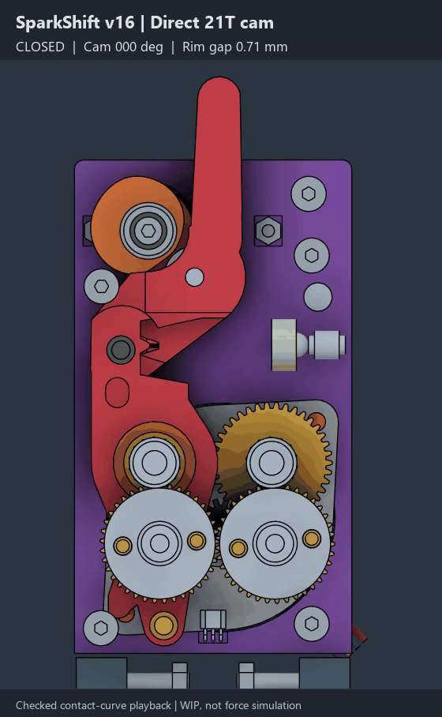
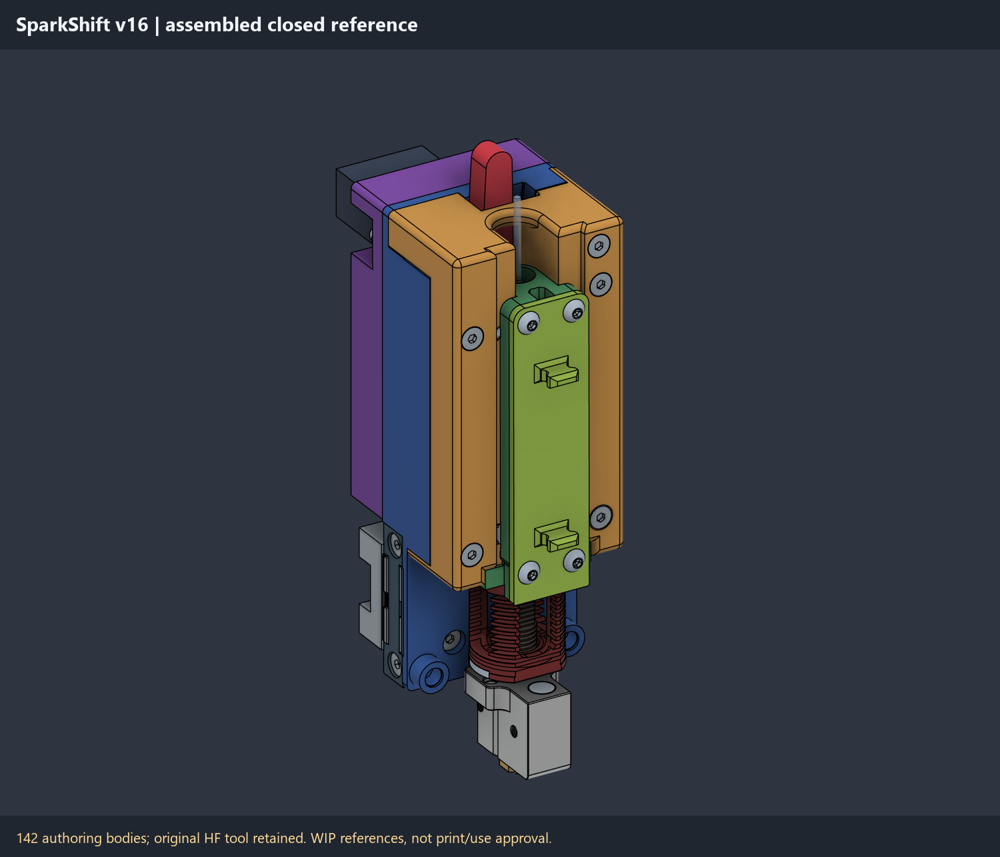

# SparkShift

> [!WARNING]
> **WORK IN PROGRESS / FIT PENDING / NOT READY FOR PRINTING OR USE**
>
> CAD, meshes, and motion previews are for inspection and development only.
> Spline fit, usable thread depth, clocking, printed strength, loaded motion,
> thermal safety, and endurance are unqualified. Bed orientation is not
> print-ready or support-free approval. Do not install or operate heated or
> unattended on the strength of this model.

**HGX quick-change hotend system**

*Same drive. New hotend.*

SparkShift is a provisional name for an original-inspired, YUDX-derived
community design: a factory-10T LDO-36STH20-1004AHG(XH) pancake motor and
unmodified purchased HGX stay on the carriage, with an independent MG90S
cam releasing the swinging hob. Forward/reverse extrusion must remain
independent of release.

**Vibe developed:** substantial iterative mechanical CAD and tooling are
AI-assisted under human direction, not professionally engineered or physically
validated. This describes SparkShift's development process, **not upstream
CxChanger/YUDX authorship or purchased hardware**. Their credit and rights
remain in [ATTRIBUTION.md](ATTRIBUTION.md).

## v16 direct-output cam -- fit pending

One printed P05 cam/hub keys directly to the servo output; **there is no OEM
horn in this revision**. The reference unit was counted/measured as 21T,
4.86mm crest OD, 3.36mm exposed spline height, and an M2.5 center thread.
**Do not assume another MG90S clone matches.** The 4.62mm root/flank form is
a photo-estimated sinusoidal fit trial, not a manufacturer spline standard.

The selected M2.5x16 retainer and 2.7/6/0.5mm washer give 2.96mm nominal
thread engagement. **Measure at least 3.16mm actual usable blind thread depth
before tightening**; the external 3.36mm spline height does not establish
that depth. Printed fit, thread/pitch, boss datum, and clocking need checks.
Straight front-driver access is blocked: bench-preassemble servo, cam,
bearing, washer, and retainer before closing the case.

The nominal hob-rim opening is **2.50mm at 170 degrees**, with a **0..175
degree CAD command range** and **170..175 concentric open dwell**. Soft entry
then reduced arm travel per cam degree increases ideal mechanical advantage,
not proven servo torque margin. Dwell removes ideal normal-force backdrive
torque, **not spring/bearing loads, friction, or the need for a real latch**.
It is not a positive power-off latch.

## Inspection, playback, and a generic build

**WIP / FIT PENDING / NOT READY FOR PRINTING:** use this matched set for
inspection and development only, not manufacturing or operation approval.

| File / folder | Content |
|---|---|
| [v16 F3D](cad/SparkShift_AHG_min_v16.f3d) | Directly editable 142-body native prototype, FIT PENDING. |
| [v16 whole-assembly STEP](cad/SparkShift_AHG_min_v16.step) | All 142 bodies, not a two-part prototype export. |
| [17 assembly STLs](stl_v16) | Complete Pxx inspection set; not print-ready or support-free. |
| [Native gallery and motion](PREVIEW.md) | Six new labelled renders, current v16 GIF, and static poster. |

The current 17 native mesh exports total **134,652 facets**, each closed,
manifold, coherently wound, and one positive-volume component, with no
degenerate facets. They remain **best-effort native inspection exports**:
P01 retains **three zero stored STL normal vectors** on microscopic,
nondegenerate facets. No other stored-normal problems are reported.
**Inspect each mesh and its warnings in a slicer**; topology checks are not
clean normal-metadata or print approval. No facet deletion or normal
rewriting is used; these warnings are retained, not silently repaired.

| Guide | Scope |
|---|---|
| [Geometry and preview limits](PREVIEW.md) | Direct-mount dimensions, bench assembly, motion scope, and digital evidence boundaries. |
| [Generic per-build BOM](BOM.md) | All reference hardware for one receiver plus one tool; not a personal shopping delta or approved purchasing list. |
| [Portable playback guide](playback_v16/README.md) | Standalone Fusion script plus matching data/F3D; checked contact-curve forward kinematics, not forces or printer control. |
| [Authoring source guide](source_v16/README.md) | Incremental engineering tools, prerequisites, and missing historical inputs; not a one-command rebuild. |
| [Optional fit-gauge guide](calibration_v16/README.md) | Five small calibration collars, not an 18th assembly part or a qualified drive interface. |

The v16 prototype contains **142 native bodies**, not 143: the OEM horn
is removed. Those bodies include reference hardware and assemblies, not
142 separate purchases. The whole STEP now matches all 142 native bodies,
with maximum symmetric difference about 1.34e-8mm3; independent scalar-mass
equality is not claimed. The gallery and 177-frame animation are newly
captured from this v16 source, not renamed v15 media.

### Native motion preview

**Drive Joint alone does not synchronize cam and arm.** Portable playback
drives both from checked contact-curve data. No extra non-printing drive
bodies, spring-force simulation, simultaneous feed/release physics, or
real-time physical simulation is supplied.

Colours and display omissions are inspection aids, not filament choices
or printer-operation instructions. See the [full current gallery](PREVIEW.md).

## Still unfinished

Positive support for the bare Hall package, exact paired Maxwell/magnet
symmetry, and the 0.05mm placement grid remain unfinished. The Hall cross-web
is not an installed package cradle/retainer. Full gear phase, predecessor
native ratio, standard compound-shaft lengths, actual fits, retention,
spring/preload/servo margins, hot-life, and safe controls remain open.
The [BOM](BOM.md) keeps the rear 4x7x2 bearing and two compound shafts on
**HOLD**, and does not assume an HGX kit covers correctly sized parts.

P01 `Extrude2` and P03 `Extrude14` are inherited warnings; the preserved
`Extrude33`, `DeleteFace29`, `DeleteFace30`, `Extrude46`, `Extrude47`, and
`DeleteFace46` suppressions are intentional, not an all-healthy history claim.
CPAP and Beacon/probe accessories remain deferred.

## Licences and sources

The unchanged [LICENSE](LICENSE) retains GPL-3.0 for CxChanger/YUDX-derived
custom work. P13/P14 GT2 liners retain **CC BY-SA 3.0** credit. Vendor/hotend
references retain their respective rights; no blanket relicensing,
manufacturer certification, commercial validation, or official Voron
endorsement is asserted. See [mixed-scope attribution](ATTRIBUTION.md).
