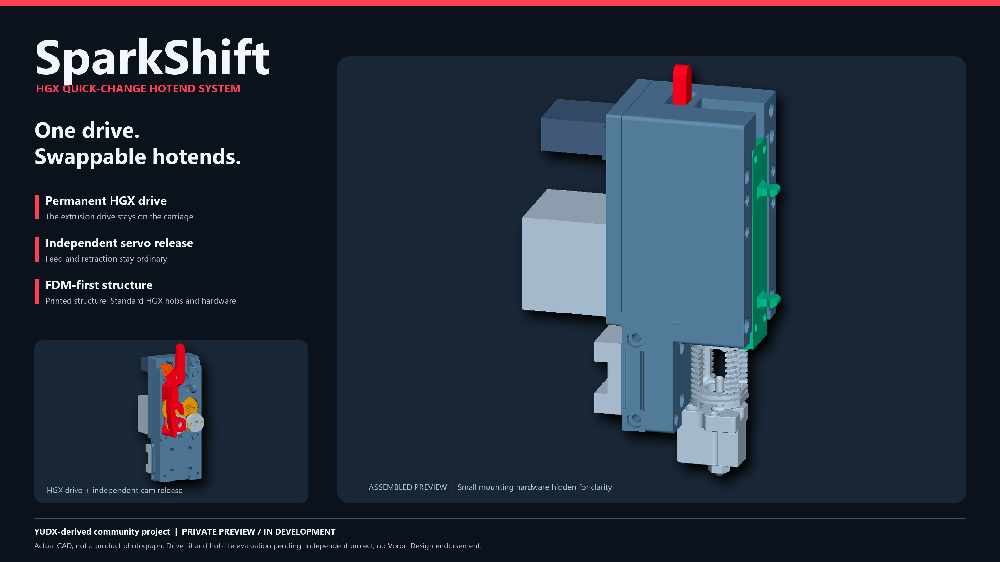

# SparkShift

**HGX quick-change hotend system**

*Same drive. New hotend.*

SparkShift is the provisional name for this YUDX-derived community hotend
changer. One permanent square NEMA14 motor and HGX drive stay on the carriage;
an independent servo-cam release opens the swinging driven hob for tool changes.
Ordinary forward or reverse extrusion must not open the arm.

This private repository is a **latest-only collaborator preview**, not a local
engineering archive, production product, or official Voron project.

Current CAD, not a product photograph. Small mounting hardware is hidden for
clarity; the native model and STEP retain the complete assembly.

## Preview handoff

| File / guide | Purpose |
|---|---|
| [SparkShift.f3d](cad/SparkShift.f3d) | Visible, colored Fusion assembly with functional groups and native joints. |
| [SparkShift.step](cad/SparkShift.step) | One complete assembly geometry exchange file. |
| [16 current STL parts](stl) | Matching millimeter, bed-oriented preview meshes. |
| [SparkShift motion helper](scripts/SparkShift_motion/SparkShift_motion.py) | Standalone Fusion script for coordinated CAD motion; [usage](PREVIEW.md#coordinated-native-motion). |
| [Current hardware/BOM](BOM.md) | Current installed quantities, printed-part list, and actual-fit caveats. |
| [Preview notes](PREVIEW.md) | Scope, review limits, and deferred work. |

These are development-preview assets, not a qualified print or heated-operation
release. Keep the supplied STL orientations and scale; use the native/STEP
assembly for assembled placement. CPAP and sensor development remain deferred.

The current set removes retired geometry while keeping the six optional
adapter pilots and functional P12 spring pressure cup. Its 1.0mm
heater-to-P01 gap is geometric clearance, not thermal qualification.

## Attribution

See [license and source attribution](ATTRIBUTION.md) and [LICENSE](LICENSE).
The CxChanger/YUDX-derived custom structure retains GPL-3.0 attribution; the
GT2 profile and derived toothed belt liners retain separate **CC BY-SA 3.0**
notices. Vendor hardware and hotend references retain their respective rights.
