# Swept-feed geometry cleanup and improvement review

**Review date:** 2026-10-30. **Scope:** the separate 28-degree, 3 mm raised-feed,
nominal 18 x 0.9 mm rear-slot variant, with cleaned direct mounts for Beacon and
Cartographer. Released R43, frozen candidate A and the previous C28 CFD geometry
remain unchanged. These are review parts, not print-qualified releases.

**Current user-directed hotend scope: Bambu Lab only.** Red Lizard clearances below
are historical comparison data, not selection criteria or a constraint on today's
optimization. Both probe mounting variants remain available. Printability and
positive duct retention are the current priorities.

**Latest share image, without branding:** [R43 vs cleaned C28 JPEG](images/r43_vs_latest_c28_share.jpg)
| [Full-size PNG](images/r43_vs_latest_c28.png).
Matched outlet views, 3D streamlines, near-bed and center-plane velocity maps, and
direct numerical comparison use the completed cleaned-geometry CFD.
The [earlier decision-summary image](images/sparkshift_c28_design_review_share.jpg)
is retained as a historical 32/28-degree comparison and explicitly labels its
pre-inlet-cleanup CFD.

## Aiming at the bead within the hotend clearance limits

**Screening round, 2026-10-31.** The question was how to make the air average just below the nozzle tip without
coming any nearer the silicone sock or hotend. Iteration-mean CFD at each design's own blower point. This is
airflow, not temperature, and none of these parts is print-qualified.

**Hard limit.** No P22 material may be nearer any Bambu hotend part than the released P22, mounted and along the
60 mm withdrawal. Those gaps are heater cradle 1.918, wire bail 2.10, silicone sock 3.20, ceramic block 4.592,
and nozzle and melt block 5.20 mm. So nothing is added inside the hotend slot (|X| < 10.2 mm) or below P22's
underside. The session's `build_aim_variant.py` measures this with exact BREP distances and refuses to export a
variant that breaks it. `aim_withdrawal.py` rechecks the withdrawal in 1 mm steps. Every variant in the tables
matches the released gaps exactly, mounted and withdrawn.

**Rejected.** The first trials extended each side jet into the hotend slot, to |X| 8.2-8.3 mm, as downturned
nozzles or deflector lips. They came within 1.20-1.27 mm of the sock and 3.22-3.27 mm of the nozzle, so they are
discarded. Their CFD is kept only as evidence: even they left the air passing 2.3-2.5 mm up.

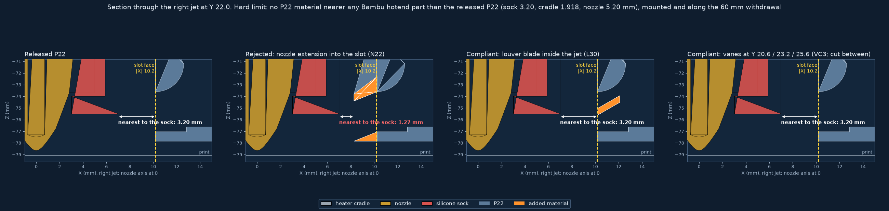

**Two measures.** *Aim* is where each outlet's mean exit direction, extended in a straight line, passes the nozzle
axis: what the outlet points at. *Passes* is where the air actually comes closest to the bead after it bends and
collides, as in the [next section](#where-the-air-passes-the-nozzle-tip). The tip is 0.2 mm above the print.

| Outlet change | Blower flow | Duct at 180 L/min | Side jets leave (down / forward) | Side jets aim at the nozzle axis (front / up) | Side jets pass (front / up) | All the air passes (front / up) |
| :--- | ---: | ---: | ---: | ---: | ---: | ---: |
| Current (released v5d) | 231 L/min | 1420 Pa | 12 / 15 deg | +3.2 / +1.8 mm | +2.6 / 2.3 mm | +0.8 / 2.3 mm |
| Floor lip trimmed 1.5 mm | 234 L/min | 1333 Pa | 17 / 18 deg | +3.4 / +0.9 mm | +2.6 / 2.5 mm | +0.7 / 2.4 mm |
| Side-jet roof lowered 1.0 mm | 209 L/min | 2151 Pa | 10 / 13 deg | +3.2 / +1.7 mm | +2.9 / 1.8 mm | +0.9 / 1.8 mm |
| Side-jet roof lowered 1.7 mm | 180 L/min | 3442 Pa | 8 / 12 deg | +3.0 / +1.6 mm | +3.1 / 1.6 mm | +0.6 / 1.6 mm |
| Vanes in the side passages (VC3) | 218 L/min | 1836 Pa | 11 / 2 deg | +0.4 / +1.8 mm | +0.6 / 2.7 mm | -1.2 / 2.6 mm |
| Louver blade in each jet (L30) | 214 L/min | 1969 Pa | 19 / 11 deg | +2.2 / +0.5 mm | +2.1 / 2.2 mm | +0.3 / 2.1 mm |
| **45-degree roof ramp (R45)** | 204 L/min | 2328 Pa | 19 / 14 deg | +3.2 / **-0.1 mm** | +2.9 / **1.4 mm** | +0.6 / 1.6 mm |
| **Louver + vanes (LV3)** | 199 L/min | 2509 Pa | 19 / 3 deg | **+0.7 / +0.3 mm** | +1.3 / 2.2 mm | -0.7 / 2.1 mm |
| Ramp + vanes (RV3) | 191 L/min | 2884 Pa | 20 / 2 deg | +1.2 / -0.4 mm | +1.8 / 1.7 mm | -0.5 / 1.8 mm |
| User's U end in each side chamber (U1) | 229 L/min | 1479 Pa | 12 / 21 deg | +3.6 / +1.9 mm | +2.9 / 2.4 mm | +1.1 / 2.2 mm |
| Front reach: chamber front wall thinned to 0.8 mm (F08) | 231 L/min | 1417 Pa | 12 / 15 deg | +2.8 / +1.7 mm | +2.2 / 2.3 mm | +0.5 / 2.2 mm |
| Ramp + floor-lip chamfer (RC) | 208 L/min | 2177 Pa | 24 / 17 deg | +3.7 / -0.9 mm | +3.3 / 1.7 mm | +0.9 / 1.7 mm |
| Louver + floor-lip chamfer (LC) | 218 L/min | 1857 Pa | 21 / 14 deg | +2.7 / -0.1 mm | +2.5 / 2.3 mm | +0.6 / 2.1 mm |

| Outlet change | Through the fresh bead | Speed at the bead, r 0.6-2 mm | Over the print, r <= 10 mm | Aimed at the hotend | Passing above 3.6 mm | Sectors R / F / L / Re |
| :--- | ---: | ---: | ---: | ---: | ---: | ---: |
| Current (released v5d) | 6.0 L/min | 17.6 m/s | 96 L/min | 62 L/min | 64 L/min | 23 / 25 / 24 / 29 m/s |
| Floor lip trimmed 1.5 mm | 5.1 L/min | 11.3 m/s | 67 L/min | 40 L/min | 54 L/min | 16 / 17 / 17 / 22 m/s |
| Side-jet roof lowered 1.0 mm | 6.1 L/min | 20.7 m/s | 94 L/min | 30 L/min | 25 L/min | 23 / 22 / 23 / 31 m/s |
| Side-jet roof lowered 1.7 mm | 3.5 L/min | 17.7 m/s | 91 L/min | 25 L/min | 18 L/min | 23 / 33 / 28 / 10 m/s |
| Vanes in the side passages (VC3) | 5.7 L/min | 12.2 m/s | 82 L/min | 57 L/min | 70 L/min | 9 / 20 / 11 / 21 m/s |
| Louver blade in each jet (L30) | 6.0 L/min | 20.4 m/s | 100 L/min | 34 L/min | 50 L/min | 31 / 32 / 32 / 13 m/s |
| **45-degree roof ramp (R45)** | 7.4 L/min | **22.7 m/s** | 98 L/min | **2 L/min** | **21 L/min** | 34 / 28 / 31 / 23 m/s |
| **Louver + vanes (LV3)** | **8.0 L/min** | 20.6 m/s | 94 L/min | 16 L/min | 46 L/min | 29 / 29 / 29 / 16 m/s |
| Ramp + vanes (RV3) | 6.3 L/min | 15.3 m/s | 85 L/min | 2 L/min | 22 L/min | 18 / 31 / 20 / 22 m/s |
| User's U end in each side chamber (U1) | 5.3 L/min | 16.1 m/s | 88 L/min | 54 L/min | 56 L/min | 22 / 23 / 22 / 24 m/s |
| Front reach: chamber front wall thinned to 0.8 mm (F08) | 7.0 L/min | 17.9 m/s | 95 L/min | 63 L/min | 61 L/min | 23 / 26 / 25 / 30 m/s |
| Ramp + floor-lip chamfer (RC) | 6.0 L/min | 19.2 m/s | 83 L/min | 2 L/min | 19 L/min | 18 / 23 / 18 / 24 m/s |
| Louver + floor-lip chamfer (LC) | 6.5 L/min | 17.1 m/s | 90 L/min | 31 L/min | 50 L/min | 24 / 28 / 25 / 11 m/s |

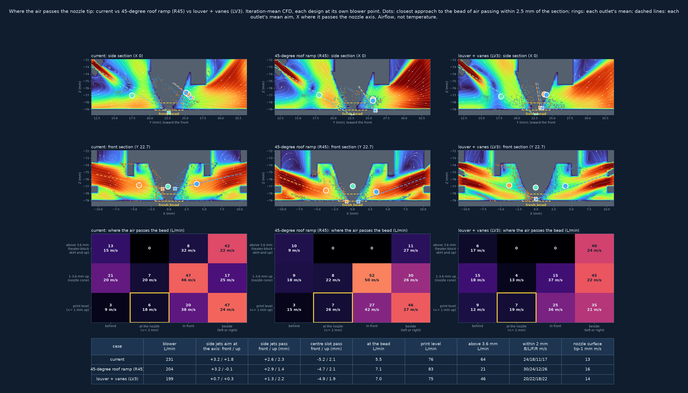

**Hot nozzle, cold bead.** The goal is to cool the bead the moment it leaves the tip while keeping air off the
nozzle and heater block, which the heater must make up. The hotend fan cools the heatsink above. Convective cooling
grows with the air speed next to a surface, so the next table compares mean air speed 0.4 mm off the CFD's walls
with the speed at the bead. *Aimed below the tip* is the share of all the air whose exit direction passes the
nozzle axis below the tip, or meets the print first.

| Outlet change | Aimed below the tip | Bead, r 0.6-2 mm | Nozzle, tip to 1 mm | Nozzle, 1 mm to the sock | Sock and heater block | Bead / nozzle above 1 mm |
| :--- | ---: | ---: | ---: | ---: | ---: | ---: |
| Current (released v5d) | 13% | 17.6 m/s | 19.3 m/s | 27.3 m/s | 25.7 m/s | 0.65 |
| Floor lip trimmed 1.5 mm | 27% | 11.3 m/s | 13.1 m/s | 22.0 m/s | 23.5 m/s | 0.51 |
| Side-jet roof lowered 1.0 mm | 16% | 20.7 m/s | 21.3 m/s | 27.3 m/s | 20.2 m/s | 0.76 |
| Side-jet roof lowered 1.7 mm | 21% | 17.7 m/s | 13.6 m/s | 20.7 m/s | 17.6 m/s | 0.86 |
| Vanes in the side passages (VC3) | 18% | 12.2 m/s | 16.6 m/s | 22.6 m/s | 21.9 m/s | 0.54 |
| **Louver blade in each jet (L30)** | 39% | 20.4 m/s | 19.1 m/s | **19.0 m/s** | 22.4 m/s | **1.08** |
| **45-degree roof ramp (R45)** | **59%** | **22.7 m/s** | 23.8 m/s | 27.8 m/s | 19.0 m/s | 0.82 |
| Louver + vanes (LV3) | 46% | 20.6 m/s | 21.9 m/s | 21.3 m/s | **18.4 m/s** | 0.97 |
| Ramp + vanes (RV3) | 57% | 15.3 m/s | 21.6 m/s | 33.6 m/s | 16.1 m/s | 0.45 |
| User's U end (U1) | 14% | 16.1 m/s | 16.6 m/s | 24.1 m/s | 23.7 m/s | 0.67 |
| Front reach (F08) | 11% | 17.9 m/s | 19.9 m/s | 28.1 m/s | 25.9 m/s | 0.64 |
| Ramp + floor-lip chamfer (RC) | **84%** | 19.2 m/s | 22.7 m/s | 27.0 m/s | 18.8 m/s | 0.71 |
| Louver + floor-lip chamfer (LC) | 55% | 17.1 m/s | 16.6 m/s | **15.9 m/s** | 22.4 m/s | 1.07 |

The bead trails the nozzle in whichever direction the head moves, so the weakest direction matters as much as the
mean. Speed 0.3 mm above the print:

| Outlet change | Bead ring, r 0.6-2 mm: behind / left / front / right | Weakest | Print, r 2-5 mm: behind / left / front / right | Weakest |
| :--- | :--- | ---: | :--- | ---: |
| Current (released v5d) | 23.7 / 17.9 / 11.1 / 17.5 m/s | 11.1 m/s | 29.4 / 25.1 / 26.6 / 24.2 m/s | 24.2 m/s |
| 45-degree roof ramp (R45) | 29.7 / 23.7 / 11.9 / 25.8 m/s | 11.9 m/s | 22.3 / 31.2 / 29.7 / 34.6 m/s | 22.3 m/s |
| Louver blade in each jet (L30) | 20.3 / 23.2 / 15.9 / 22.3 m/s | 15.9 m/s | 12.1 / 33.2 / 33.2 / 32.1 m/s | 12.1 m/s |
| Louver + vanes (LV3) | 19.9 / 22.4 / 18.4 / 21.8 m/s | **18.4 m/s** | 14.8 / 29.7 / 30.5 / 30.2 m/s | 14.8 m/s |
| Ramp + floor-lip chamfer (RC) | 27.3 / 19.6 / 10.6 / 19.6 m/s | 10.6 m/s | 23.5 / 17.8 / 23.8 / 17.7 m/s | 17.7 m/s |
| Louver + floor-lip chamfer (LC) | 16.9 / 19.1 / 13.1 / 19.4 m/s | 13.1 m/s | 10.0 / 25.0 / 29.2 / 25.0 m/s | 10.0 m/s |

- **The louver keeps the nozzle hottest for the most bead air.** It halves the air on the sides of the cone,
  where the side jets hit (22.8 to 10.1 m/s on the left, 22.7 to 12.7 on the right), and still adds 16% at the
  bead. It costs 7% of the blower flow.
- **The ramp puts the most air at the bead and the least on the sock, but not off the nozzle.** Its lower,
  faster side jets collide and drive air up the back of the cone (22.5 to 27.5 m/s).
- **Removing the lean is worst for the nozzle.** With ramp and vanes the jets collide on the nozzle, and the cone
  sees 34 m/s.
- **Aiming steeper is not more air at the bead.** Adding a floor-lip chamfer to the ramp (RC) aims 84% of all the
  air, and 97% of the side jets, below the tip. But the jets land short of the nozzle and spread, as with the lip
  trim. The bead gets 19 m/s against 23 with the ramp alone, and the print 2-5 mm out gets 21 m/s against 26 today.
  The same chamfer under the louver (LC) cut the bead to 17 m/s from 20. Aim the jets at tip height, not into the
  print short of it.
- **The louver designs give the most even bead ring.** With louver and vanes every direction at the bead gets at
  least 18 m/s, against 11 now. Their weak point is the print 2-5 mm behind the nozzle (12-15 m/s against 29),
  where the centre slot's air is pushed aside.

- **The centre slot already aims at the bead.** In every design its aim line meets the print 0.3-0.8 mm short of
  the nozzle axis, just behind the tip. Its air still passes about 5 mm behind, because the side jets and the
  nozzle cone turn it.
- **The side jets aim 3.2 mm in front and 1.8 mm up.** Height and lean have separate causes, and each has its own
  fix inside the duct.
- **Height: the 45-degree roof ramp.** The last 1.7 mm of each jet's roof becomes a straight 45-degree ramp from
  the slot face into the bell-mouth round, 0.92 mm lower at the exit. The aim line drops to print level at the
  axis. The side jets pass 1.4 mm up instead of 2.3, and air aimed at the hotend falls from 62 to 2 L/min.
- **Lean: vanes across each passage.** Three 0.45 mm vanes cut the forward lean from 15 to 2 degrees but leave
  the height. It comes from the side chamber's forward flow, not from the outlet.
- **Both: louver + vanes.** A 0.5 mm louver blade turns each jet's upper half down. With the vanes, each jet aims
  0.7 mm in front of the axis and 0.3 mm above the print, at the bead. It puts the most air through the bead of
  any design: 8.0 L/min, up a third.
- **The mean of all the air still passes about 2 mm up.** In every design, compliant or not, the two side jets
  meet head-on at the nozzle, and the collision turns part of each upward. Aiming moves where they meet, not
  that they meet.
- **Aiming the two side jets exactly at the bead backfires.** With the ramp and the vanes together (RV3), each
  jet aims 1.2 mm in front at print level, and all the air passes nearest the bead (-0.5 / 1.8 mm). But the jets
  now collide on the bead itself, so the air there slows to 15 m/s against 23 with the ramp alone. With the ramp
  alone they meet about 3 mm in front, and the air sweeps across the bead at speed.
- **Every redirecting change costs air.** Blower flow falls to 191-218 L/min from 231. The faster side jets also
  push the centre slot's air aside: the rear sector drops to 13-23 m/s from 29 while the sides rise.

**User's U end (U1).** The user's sketch rounded the side chamber's lower-front corner into a U and curled the
front wall back to the ceiling ([sketch on the R43 and current ducts](images/r43_user_u_bowl_flow.png)). On
today's duct its bottom matches the floor within 0.5 mm, so the new parts are the rounded corner and the curl. It
was built inside each chamber from |X| 12.6 outward, following the front wall forward where the chamber reaches
further. It stays within the hard limits and leaves the jet exits unchanged.

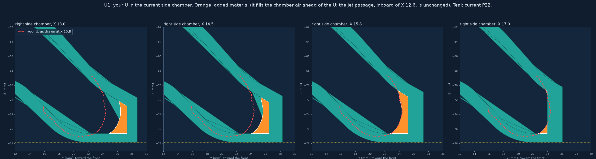

It costs almost no air (229 L/min) and evens the sectors, but it leans the jets further forward: 21 degrees
instead of 15. Air through the bead falls 12%. The fill takes chamber volume from the front of each jet passage.
Only 29% of the passage's inflow now enters ahead of Y 24, against 38%, so the front of each jet is fed by air
running forward along the passage. To bring the jets rearward the front of the passage needs more direct feed,
not less. The inverse test (F08) thins each chamber's front wall to 0.8 mm from the inside, so more chamber air
sits ahead of the passage. It moves the jets 0.4 mm rearward at no cost: the right direction, but a small effect.
Printed back-down, the U's curl would also be a 63-degree overhang inside the chamber.

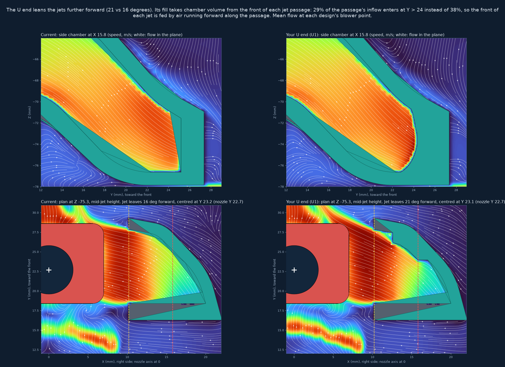

**Recommendation.** With the goal of a hot nozzle and a cold bead, the louver is the direction to take. It is the
only change that takes air off the nozzle (cone -30%) while adding air at the bead (+16%, weakest direction +43%),
for 7% of the blower flow. Its weak point is the print 2-5 mm behind the nozzle, and its 0.5 mm blade is a single
extrusion line: a printable 0.8 mm blade needs one confirming CFD. The ramp gives the bead the most air (+29%)
and prints like the existing roof (matched slicing: support 4.67 against 4.62 cm3, same time), but it leaves the
nozzle cone as exposed as now. Floor-lip chamfers, the lip trim and removing the lean all made the bead worse.
CFD cannot settle a thermal trade like this: the chosen candidate needs a printed test.

Evidence: the `side_jet_*`, `side_chamber_*` and `rejected_*` cases, each with its `tip_approach` blocks
`aim_line`, `below_tip` and `hot_nozzle_cold_bead`, and `hotend_clearance_limits` in
[verification_outlet_balance_r43.json](verification_outlet_balance_r43.json).
Reproduce the geometry with the session's `build_aim_variant.py`: `--ramp-angle 45`; `--vanes 20.6,23.2,25.6
--vane-thick 0.45 --tip-x 10.25 --vane-x-out 12.55`; `--louver-z -75.3 --louver-angle 30`; `--u-csv
user_u_centreline_mm.csv`. Then run the CFD as in the earlier sections and `cfd_tip_approach_r43.py`, whose aim
line is new in this round.

## Where the air passes the nozzle tip

**Current Bambu set, 2026-10-31.** Same iteration-mean CFD at the 231 L/min blower point, analysed with
`cfd_tip_approach_r43.py`. Each of 1,785 flux-weighted streamlines is placed where it comes closest to the bead,
on the nozzle axis midway between the tip and the print. This is airflow, not temperature.

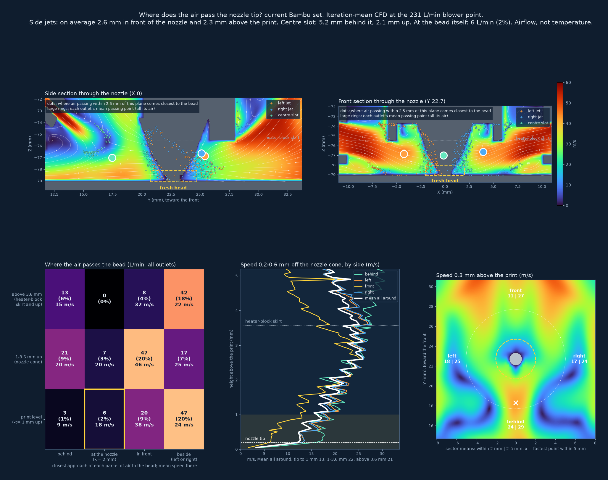

| Passes the bead (L/min) | Behind | At the nozzle, <= 2 mm | In front | Beside |
| :--- | ---: | ---: | ---: | ---: |
| Above 3.6 mm (heater-block skirt and up) | 13 | 0 | 8 | 42 |
| 1-3.6 mm up (nozzle cone) | 21 | 7 | **47, at 46 m/s** | 17 |
| Print level, <= 1 mm up | 3 | **6, at 18 m/s** | 20, at 38 m/s | 47 |

- **Side jets: in front and above.** Their air passes on average 2.6 mm in front of the nozzle axis and 2.3 mm
  above the print. The largest and fastest stream is their cores meeting 1-3.6 mm up in front of the nozzle. That
  follows from their 15-degree forward lean and 12-degree drop. Their top quarter passes beside the hotend at
  heater-block height.
- **Centre slot: behind and above.** Its air passes on average 5.2 mm behind the nozzle axis and 2.1 mm up. The
  middle of the slot meets the back of the nozzle cone 2.5-4.5 mm up; the rest lands behind and beside it. None
  of it passes at the bead.
- **The tip sits in a slow pocket.** 0.2-0.6 mm off the nozzle cone the air averages 13 m/s from the tip to 1 mm
  up and 22 m/s higher up. The front of the tip is slowest, 8 m/s. At print level within 2 mm of the axis the
  air runs 24 m/s behind, 18 left, 17 right and 11 in front. The fastest print-level air within 5 mm is 4.4 mm
  behind the nozzle, at 42 m/s.

Putting the mean flow on the bead would take side jets with no forward lean, leaving about 20 degrees down so
that they meet at the bead, and a centre slot that lands 1-2 mm behind the tip instead of meeting the cone.
These are P22 outlet changes and are untested. The side jets would still meet head-on, so they need CFD before
any decision. (Tested since, within the hotend clearance limits: see
[aiming at the bead](#aiming-at-the-bead-within-the-hotend-clearance-limits).)

Evidence: the `tip_approach` block of each case in
[verification_outlet_balance_r43.json](verification_outlet_balance_r43.json). Reproduce with
`cfd_tip_approach_r43.py <case> <out.png>` after `cfd_outlet_balance_r43.py <case> --mean` and
`cfd_nozzle_focus_r43.py <case> <out.png>`.

## Aim at the fresh bead, and the side-jet floor lip

**Review of the current Bambu set, 2026-10-31.** The question was whether it gives "a focused, laminar and precise
stream of air directed exactly at the extruded filament just below the nozzle tip". The method is iteration-mean
CFD at the set's 231 L/min blower point, analysed with `cfd_nozzle_focus_r43.py`. The fresh bead is taken as
within 2 mm of the nozzle axis and 1 mm of the print. This is airflow, not temperature.

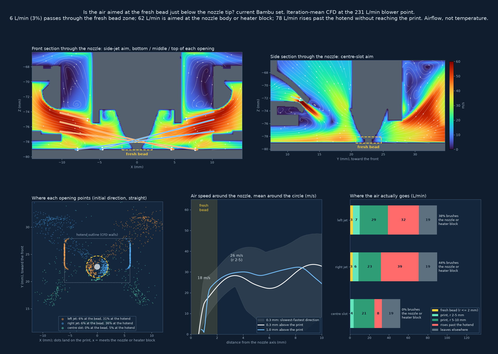

| Criterion | Current set |
| :--- | :--- |
| Air aimed at the fresh bead | 11 L/min (5%) |
| Air aimed at the nozzle body or heater block | 62 L/min (27%) |
| Air that passes through the fresh bead zone | 6 L/min (3%) |
| Air over the print within 10 mm | 96 L/min (42%) |
| Air that rises past the hotend without reaching the print | 78 L/min (34%) |
| Air that passes within 0.5 mm of the nozzle body or heater block | 74 L/min (32%) |
| Mean speed 0.3 mm above the print | 18 m/s at r 0.6-2 mm, 26 m/s at r 2-5 mm |
| Laminar | No. Reynolds number about 8,700 on the side jets' 3.45 mm height and 3,200 on the 0.9 mm centre slot; 5-7% turbulence at the openings |

- **Focused only from the sides.** Each side jet reaches the nozzle about 3 opening heights (10 mm) from its
  exit, so it arrives still coherent. The centre slot is about 13 slot heights (12 mm) from the bead. Its jet has
  spread out before it lands behind the nozzle.
- **Not precise.** Each side jet leaves 12 degrees down and 15 degrees forward, because the side channels feed it
  from the rear. Its bottom quarter leaves about 7 degrees down along the flat floor lip and skims the print.
  Its middle points past the nozzle, and its top quarter points at the heater block.
- **Slowest air at the bead.** The two side jets meet head-on just in front of the nozzle (see
  [where the air passes the nozzle tip](#where-the-air-passes-the-nozzle-tip)), so the slowest near-print air is
  right at the tip.
- **Laminar is not achievable at this flow.** Every opening of a CPAP cooler runs turbulent at 231 L/min. The
  useful part of the rule is a coherent jet aimed at the bead and kept off the hotend.

### Floor lip trimmed back 1.5 mm (screening)

The 0.75 mm floor lip under each side jet runs flat from X 12.85 to the exit at X 10.2. That flattens the jet's
bottom. This screening trial trims it back 1.5 mm where the jet is full height (Y 21.9-27.5) and changes nothing
else. The session's `build_lip_variant.py` builds it from the audited v5d P22.

| At each design's blower point | Current | Lip trimmed 1.5 mm |
| :--- | ---: | ---: |
| Total flow (duct pressure) | 231 L/min (2.32 kPa) | 234 L/min (2.24 kPa) |
| Side-jet aim | 12 degrees down, 15 forward | 17 degrees down, 19 forward |
| Side-jet air aimed at the print within 10 mm | 29% | 76% |
| Side-jet air aimed at the nozzle body or heater block | 33% | 23% |
| Air over the print within 10 mm | 96 L/min | 67 L/min |
| Air that rises past the hotend without reaching the print | 78 L/min | 89 L/min |
| Mean speed at the fresh bead, r 0.6-2 mm | 18 m/s | 11 m/s |
| Near-print sectors R / F / L / Re | 23 / 25 / 24 / 29 m/s | 16 / 17 / 17 / 22 m/s |
| Air dropping through the trimmed floor | none | 10 L/min |
| Air flowing outward under P22 | 25 L/min | 24 L/min |

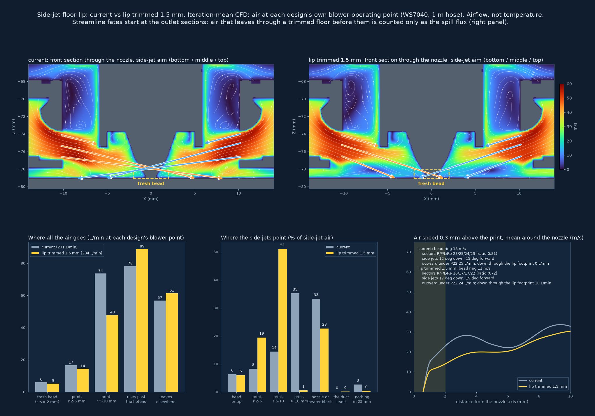

**Keep the lip.** The trim aims the jets lower as intended, but it cools worse. With the lip, the bottom of each
jet stays level and skims across the print into the bead zone at speed. Trimmed, the jets land on the print 4-6 mm
from the nozzle and spread. Some of the air drops through the opened floor, and the inward flows meet under the
nozzle and rise. The near-print sectors lose 23-32%.

The exit angle comes from the duct itself, not from the CFD's print surface: removing the lip alone turned it 5
degrees further down. The print surface, 0.2 mm below the tip across the whole CFD box, shapes the jets after they
leave. That is the realistic case for a broad print.

### Left and right

The duct is mirror-symmetric. P20, P21 and P22 have no material without a mirror partner, and the duct splits the
side flow 69.9 / 70.0 L/min. The CFD scene is not symmetric. The Bambu hotend fan sits on the right, with 535 mm3
inside the CFD box, and its underside closes the right half of the open space above the hotend. Smaller
asymmetric parts include the fan screws (41 mm3), hotend details just above the jets (4 mm3), and a chiral pair of
carriage parts.

In that static scene the left jet puts more of its air over the print: 43-44% against 36% in both averaged runs.
In operation the hotend fan runs and the head moves; the steady CFD models neither. The duct's symmetry is the
requirement, and it is met.

`cfd_cpap_r41.py domain --mirror-half` builds an exactly mirrored scene, symmetric to 0.006 mm. Its mesh failed
the skewness check at one face about 23 mm above the jets. The diagnostic run was dropped once the scene
explanation was accepted.

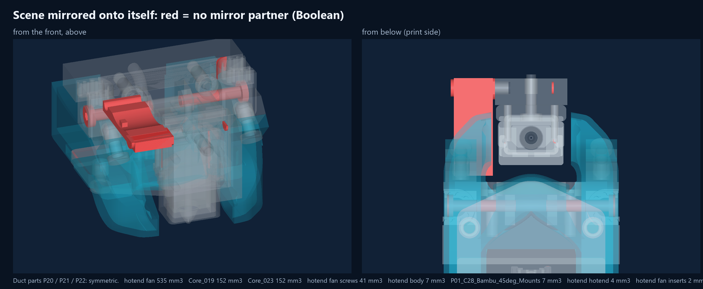

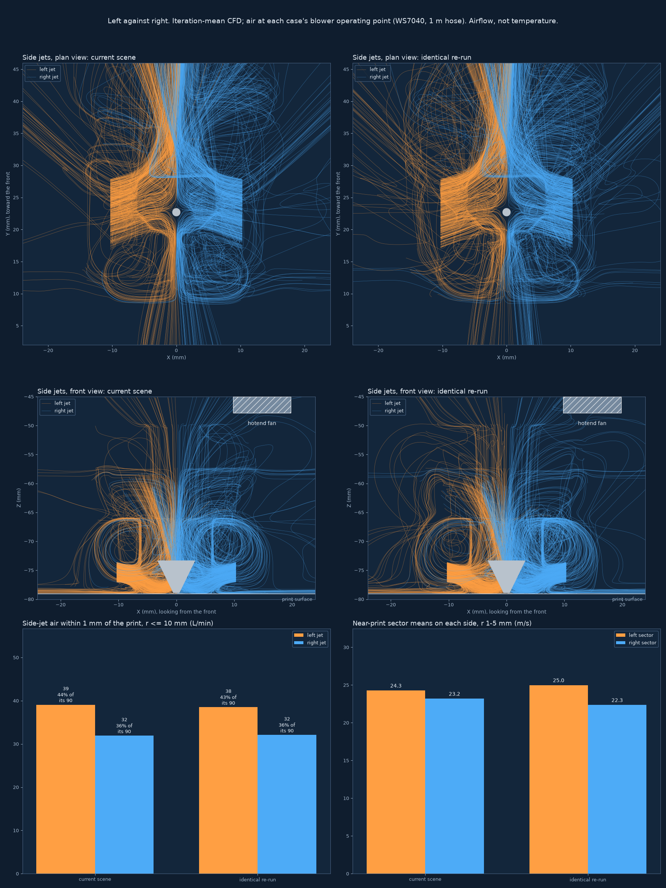

Evidence: the `nozzle_focus` blocks and the `side_jet_lip_trim_1p5` case in
[verification_outlet_balance_r43.json](verification_outlet_balance_r43.json). Reproduce with
`cfd_nozzle_focus_r43.py <case> <out.png>` (after `cfd_outlet_balance_r43.py <case> --mean`), its `--compare` mode,
and `render_outlet_balance_r43.py <out.png> --symmetry`. The lip-trim case is `r43avgV5dLip15_bambu_bed`.

## Printability, bottlenecks and centre/side balance

**Review of the current Bambu set (flow-neutral post, v5d), 2026-10-31.** Matched H2D ABS slices, iteration-averaged
CFD and per-outlet streamline tracing. This is airflow and slicer evidence, not print or thermal qualification.

### Printability: the interface material is the bottleneck, not the geometry

| Part, pose | Support | Print time (of it, prime tower) | ABS used | Support inside the airway |
| :--- | ---: | ---: | ---: | ---: |
| P01, back down | 4.78 → 2.32 cm3 | 2.75 h (0.53) → 2.04 h | 39.8 → 33.3 g | none |
| P21, top down | 1.26 → 0.68 cm3 | 1.32 h (0.46) → 0.72 h | 21.5 → 12.0 g | 0.27 → 0.13 cm3 |
| P22, back down | 9.08 → 4.62 cm3 | 3.10 h (1.16) → 1.31 h | 44.5 → 21.7 g | 1.15 → 0.58 cm3 |
| Three-part set | 15.1 → 7.6 cm3 | **7.17 h → 4.07 h** | 105.8 → 67.0 g | 1.42 → 0.71 cm3 |

The first value is the audited setup: tree supports with a Bambu Support for ABS interface. The second uses
ABS for the interface too, with a 0.2 mm top gap; nothing else changes. The breakaway interface forces a prime
tower and purge on every part. That takes 2.15 h of the 7.2 h set and about 37 g of ABS, more than any geometry
feature costs.

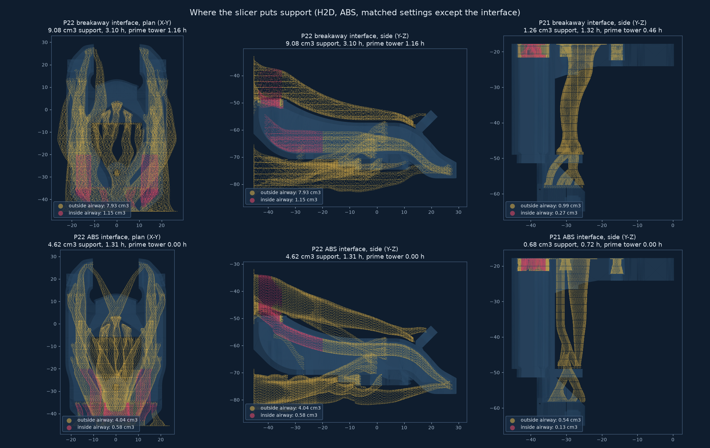

Most of P22's support is trees climbing the outside to the outlet-end overhangs (7.9 cm3). Inside the airway it
stays in the plenum lobes under the open receiver (0.89 cm3) and the start of the side channels (0.21 cm3). There
is none in the jets or the centre passage.

**Recommendation:** print P01 and P21 with single-material supports; all of their support is external or short.
Print one P22 the same way and check that the lobe support comes out through the receiver opening. If it does
not, keep the breakaway interface for P22 only; the set then takes 5.9 h.

### Near-print numbers now use iteration means

| Same geometry and settings | Right / front / left / rear sector (m/s) |
| :--- | :--- |
| Snapshot at iteration 1,200, first run | 27.5 / 24.8 / 25.7 / 33.4 |
| Snapshot, identical re-run | 23.5 / 26.9 / 25.1 / 33.3 |
| Mean of iterations 700-1,200 | 23.2 / 25.1 / 24.3 / 28.6 |
| Mean, identical re-run | 22.3 / 24.9 / 25.0 / 28.3 |

Parallel meshing is not bit-reproducible: the runs have 2,483,116, 2,483,519 and 2,483,235 cells. Near-print
speed also swings 15-21% RMS between iterations. One snapshot therefore carries that much error: the re-runs'
snapshots differ by up to 22% in a sector. That explains earlier sector swings such as the -15.4%
"exterior-only" change. Iteration means repeat within 4% per sector and 0.6% for the sector mean. Air over the
print and rising air repeat within about 4%, inlet pressure within 0.7%. Balance comparisons below use iteration
means. `cfd_cpap_r41.py case --average-from 700` adds the averaging at no extra solver cost.

### Where the air goes (current set, 180 L/min)

| Outlet | Supplied | Passes within 1 mm of the print, r <= 10 mm | r <= 5 mm | Rises past the hotend |
| :--- | ---: | ---: | ---: | ---: |
| Left jet | 69.9 L/min | 30.5 (44%) | 7.8 | 29.8 (43%) |
| Right jet | 70.0 L/min | 24.9 (36%) | 6.8 | 33.3 (48%) |
| Centre slot | 40.5 L/min | 19.7 (49%) | 3.0 | 8.1 (20%) |
| All | 180 L/min | 75.1 (42%) | 17.6 | 71.2 (40%) |

At the 231 L/min blower point this is about 96 L/min over the print and 91 L/min rising past the hotend. Each
side-jet opening is 3.45 mm tall. Its bottom millimetre (18% of the side flow) reaches the print 99% of the time.
Its upper half (54% of the side flow) faces the side of the Bambu heater block, whose bottom is at Z -75.5 mm;
at most 10% of that air reaches the print, and it also cools the heater.

### Bottlenecks, largest first

1. **Side jets into the heater block:** 40% of all the air rises without passing over the print.
2. **Final turn into the side jets: -156 Pa.** This is the largest single pressure loss, 42% of the side path's
   internal loss. Upstream losses are smaller: joint, lobes and elbow -77 Pa, P21 -46 Pa, P20 -27 Pa. The side
   exits keep 1,050 of the 1,416 Pa, 977 Pa of it as jet speed.
3. **Duct versus hose:** at the blower point the duct takes 2.32 of the blower's 2.67 kPa, the 1 m hose 0.35 kPa.
4. **Wake around the nozzle:** a slow ring (5-15 m/s) within about 2 mm of the nozzle.
5. **Printing:** the interface prime tower (above).

### Balance trials

Iteration-mean CFD. Air values are at each design's own blower operating point.

| Trial | Total flow | Centre share | Sectors R / F / L / Re (m/s) | Sector mean | Over the print, r <= 10 mm | Rising |
| :--- | ---: | ---: | :--- | ---: | ---: | ---: |
| Current | 231 L/min | 22% | 23.2 / 25.1 / 24.3 / 28.6 | 25.3 | 96 L/min | 91 L/min |
| Current, identical re-run | 231 L/min | 22% | 22.3 / 24.9 / 25.0 / 28.3 | 25.1 | 99 L/min | 88 L/min |
| Centre slot 1.1 mm (D11 outlet) | 234 L/min | 24% | 19.5 / 21.3 / 21.2 / 18.8 | 20.2 | 87 L/min | 97 L/min |
| Side-jet roof lowered 1.0 mm (screening) | 209 L/min | 29% | 22.9 / 21.6 / 22.9 / 31.2 | 24.6 | 94 L/min | 79 L/min |
| Side-jet roof lowered 1.7 mm (screening visor) | 180 L/min | 37% | 23.1 / 32.9 / 28.2 / 9.9 | 23.5 | 91 L/min | 64 L/min |

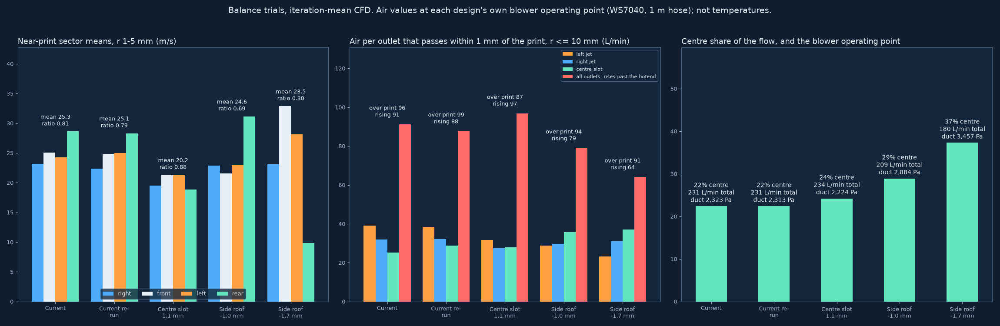

- **A bigger centre slot weakens every sector.** It lowers the plenum pressure and slows the centre jet. The
  sectors look more even (0.88) only because the strongest one falls. This confirms the earlier snapshot
  rejection of D11 with averaged data.
- **Closing the upper side jet cuts the waste.** Rising air falls 30% and the side jets reach 60 m/s, but the
  duct becomes 2.4 times more restrictive: total flow drops to 180 L/min. The faster side jets also meet the
  centre jet behind the nozzle and turn it aside, so the rear sector collapses to 9.9 m/s
  ([visor field](images/r43_outlet_balance_visor_screen.png)). Air over the print does not improve: 91 vs
  96 L/min is inside the 4% repeat spread.
- **Half the drop is a smaller version of the same trade.** Rising air falls about 12% and the side jets reach
  47 m/s. Total flow drops 10%, and air over the print is unchanged (94 vs 96-99 L/min). The centre now carries
  29%: the rear sector grows while the front weakens, so the weakest/strongest ratio falls to 0.69.

**Keep the current outlets and the 78/22 side/centre split.** There is no room to keep the side-jet area while
lowering its roof: the floor is already 0.8 mm above P22's underside, and the heater block spans the jets' full
length (Y 18.4-28.6). Any lower roof therefore costs total flow, and the WS7040 with a 1 m hose gives up about as
much air as the roof saves. Further gains need a reshaped outlet rather than a smaller one. For example, a roof
that turns the upper jet down under the block instead of closing it, tuned together with the centre slot's
landing point. Judge that with a printed thermal test, not only more single-parameter CFD.

Evidence: [verification_outlet_balance_r43.json](verification_outlet_balance_r43.json). Reproduce with
`cfd_outlet_balance_r43.py <case> --mean`, `render_outlet_balance_r43.py` and `report_outlet_balance_r43.py`.
The averaged cases are `r43avgV5d_bambu_bed`, `r43avgV5dRep_bambu_bed`, `r43avgV5dD11_bambu_bed`,
`r43avgV5dVisor_bambu_bed` and `r43avgV5dVisorMild_bambu_bed`. The session's `build_visor_variant.py` builds the
visor screens from the audited v5d P22.

## Flow-neutral user-post retainer

**Current Bambu mechanical candidate: review parts, not a print release.** This is your
document-53 post, tweaked so it does not cost airflow. The post and its P22 socket stay
inside the clean C28 spine, behind a 0.84 mm P22 skin and 0.18 mm slip. The one
exception is directly under P21's own cable boss, whose wake the post may fill. The
underside M3x10 screw, the M3x4 insert (X0, Y-28.2 mm) and the angled P01/P22 mounts
are unchanged.

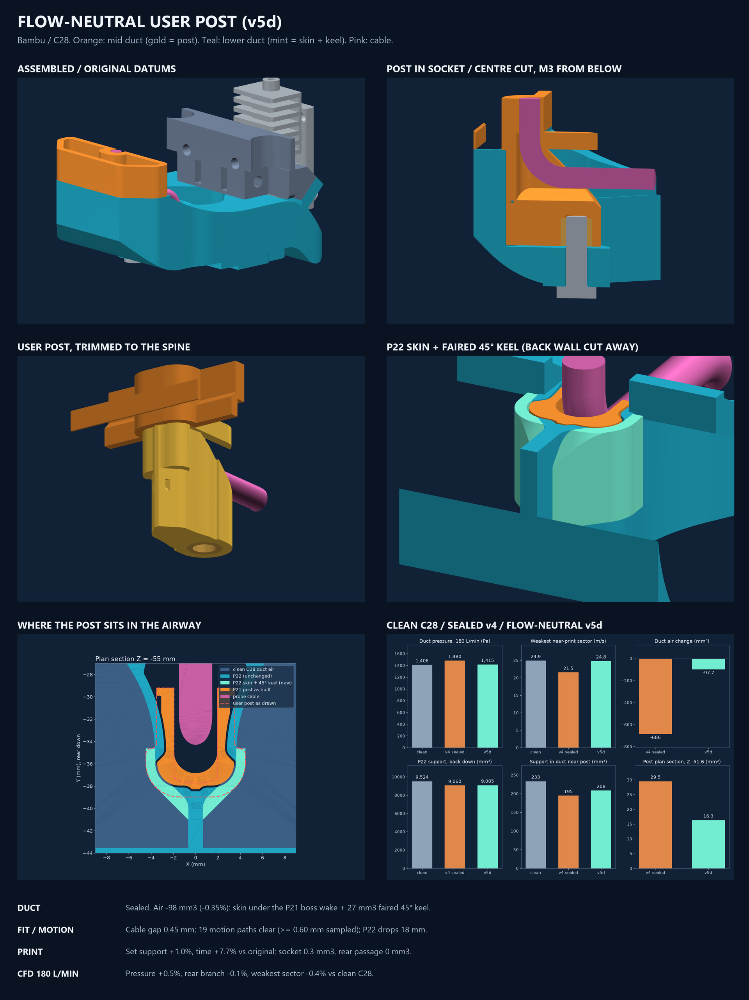

[Share JPEG](images/r43_c28_flow_neutral_retainer_review_share.jpg) |
[Full-size PNG](images/r43_c28_flow_neutral_retainer_review.png) |
[Matched CFD maps](images/r43_flow_neutral_retainer_v5d_cfd.png) |
[Assembly STEP](step/55_C28_Bambu_User_Post_Flow_Neutral_REVIEW.step).

| Change from your post | Volume | Why |
| :--- | ---: | :--- |
| Post trimmed to the clean spine; it keeps P21's boss wake in the cable zone, with a rounded channel back | 891 to 586 mm3 | Removes the lobe intrusion that cost the sealed receiver +5.1% pressure. |
| Post kept 0.18 mm outside the plan shadow of P22 above the joint | included above | P22 drops 18 mm clear of the post, and assembles the same way. |
| P21 recess filled, probe-cable passage kept | +76 mm3 | Gives the post arms a solid root. It replaces your upper block, which overlapped P22. |
| P22 notch boss removed | -40 mm3 | It sat over the post arms. |
| P22 skin under the P21 boss, with a faired 45-degree keel behind it | +89 mm3 in the clean duct (keel 27) | Seals the socket. The keel and 45-degree socket bevels let the back-down print support itself there. |

| Check | Sealed receiver (v4) | Flow-neutral (v5d) |
| :--- | ---: | ---: |
| Duct air vs clean C28 | -686 mm3 (-2.5%) | -98 mm3 (-0.35%) |
| CFD pressure, 180 L/min | +5.1% (1,480 Pa) | +0.5% (1,415 vs 1,408 Pa) |
| Estimated blower flow / side jets / rear branch | -1.0% / +0.2% / -0.4% | -0.1% / -0.1% / -0.1% |
| Weakest near-print sector | -13.6% | -0.4% |
| P22 support, back down (original 9,524 mm3) | 9,060 mm3 | 9,085 mm3 |
| Support in the duct near the post (clean 233 mm3) | 195 mm3 | 208 mm3 |
| Socket / rear-passage support | 2.9 / 0 mm3 | 0.3 / 0 mm3 |
| P21 support, top down (original 643 mm3) | 1,275 mm3 | 1,257 mm3 |
| Three-part set vs original C28 | support +0.9%, time +8.1% | support +1.0%, time +7.7% |
| Post plan section at Z -51.6 mm | 29.5 mm2 (as drawn) | 16.3 mm2 |
| Service and motion | 18 mm drop clear; 19 paths, >= 0.60 mm sampled | 18 mm drop clear; 19 paths, >= 0.60 mm sampled, 0.35 mm bound |

Other checks pass:

- Valid single solids with no part or hardware overlap.
- Cable gaps are 0.45 mm (post) and 2.15 mm (P22).
- All three inserts keep complete 1.2 mm walls.
- No new metal is in either probe's keepouts, and no new plastic in their sensing keepouts.
- The lower jets, probe seat, swept feeds and outlet are unchanged (0 mm3).
- STEP exports round-trip. Fusion document **55 Bambu C28 - flow-neutral user post (REVIEW)** matches the CAD within 0.0023% native volume, and documents 53 and 54 are unchanged. View 3 and a saved X 1.2 mm section show the keel.

How it got here:

- **v5b (skin only):** CFD +0.4%. P22 needed 62 mm3 more support trapped in the rear plenum and 16 mm3 in the socket.
- **v5c (keel and bevels added):** fixed the support; CFD +0.8%. Like v5b, it kept P22's notch-boss nose over the post arms. The 18 mm service sweep caught this: P22 could not drop off or go on.
- **v5d:** fixes it on the dry side. Only a 0.05 mm3 dead-end slip sliver of the duct changes, and its CFD repeats v5c within 0.3% (1,415 vs 1,419 Pa).

These are nominal CAD checks, **not strength, torque, sealing, thermal or print-fit
qualification.** Print P21 top face down and P22 back face down. The post's smallest
section is 45% below your post as drawn: snug the M3, do not torque it.

| Area | Next improvement | Why |
| :--- | :--- | :--- |
| Post root | Print first. If the post flexes, try a stiffer P21 material before adding plastic. | Extra width would re-enter the airway. |
| Near-print airflow | Use time-averaged runs before judging sectors | Single snapshots vary: an exterior-only control moved one sector -15.4%. |
| First article | Check post and socket fit, seal, insert pull-out, cable motion and hot running | The 0.18 mm socket slip and 0.45 mm cable gap are nominal. |

Review parts:
[P21](step/P21_C28_Bambu_User_Post_Flow_Neutral_REVIEW.step) |
[P22 Beacon](step/P22_C28_Bambu_Flow_Neutral_Receiver_Beacon_REVIEW.step) |
[P22 Cartographer](step/P22_C28_Bambu_Flow_Neutral_Receiver_Cartographer_REVIEW.step) |
[P01](step/P01_C28_Bambu_45deg_Mounts_REVIEW.step); print-oriented STLs share these names in `stl/`.

Evidence:
[geometry, seal and service](verification_c28_flow_neutral_retainer_geometry_r43.json) |
[real-scene movement](verification_c28_flow_neutral_retainer_motion_r43.json) |
[matched slicing](verification_c28_flow_neutral_retainer_slicing_r43.json) |
matched CFD [v5d](verification_flow_neutral_retainer_v5d_cfd_r43.json),
[v5c](verification_flow_neutral_retainer_v5c_cfd_r43.json) and
[v5b](verification_flow_neutral_retainer_v5b_cfd_r43.json) |
[Fusion review](verification_c28_flow_neutral_retainer_fusion_r43.json).
Reproduce with `audit_c28_flow_neutral_retainer_r43.py`, then with
`--variant flow-neutral`: `audit_c28_user_retainer_motion_r43.py` and
`audit_c28_user_retainer_slicing_r43.py`. Then run
`cfd_direct_mount_r43.py --flow-neutral v5d` and `render_c28_flow_neutral_retainer_r43.py`.
`r43_c28_user_joint.flow_neutral_parts` rebuilds v5b and v5c through its
`print_bevels` and `full_recess` flags.

## User-post retainer review

**Superseded by the [flow-neutral retainer](#flow-neutral-user-post-retainer)**, which
uses the same post idea without the airflow penalty. Kept as the sealed-receiver (v4)
record. Review parts, not a print release. The
user's Fusion P21 post (document 53) is kept as drawn above Z -58.5 mm and retained
by the same underside M3x10 screw and M3x4 insert (axis X0, Y-28.2 mm). The angled
P01/P22 mounts from the [mechanical review](#mechanical-review) are unchanged.

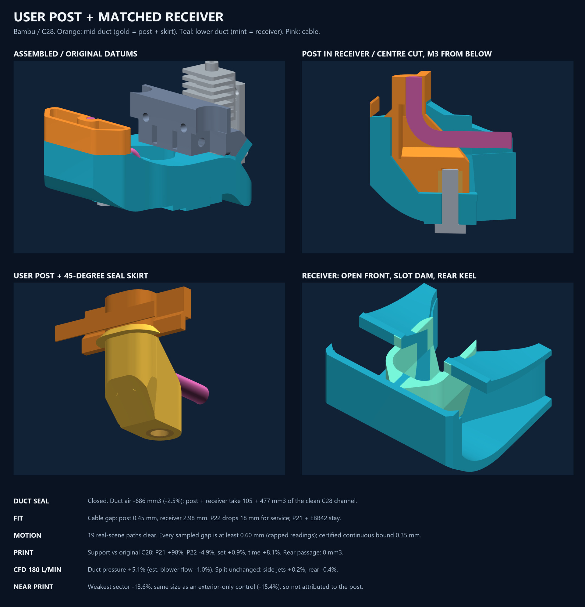

[Share JPEG](images/r43_c28_user_retainer_review_share.jpg) |
[Full-size PNG](images/r43_c28_user_retainer_review.png) |
[Matched CFD maps](images/r43_user_retainer_cfd.png) |
[Assembly STEP](step/54_C28_Bambu_User_Post_Retainer_REVIEW.step) |
[User's Fusion snapshot](53_C28_User_P21_Direction_FUSION_SNAPSHOT.f3d).

| Change to the user's direction | Volume | Reason |
| :--- | ---: | :--- |
| Lower rear/side relief on the post, below Z -58.5 mm | -126.6 mm3 | Leaves room for printable receiver walls; the upper connection is untouched. |
| 45-degree seal skirt on P21 | +15.9 mm3 | Lands on the receiver top in the original sleeve-bottom plane, so the socket cannot open the duct. |
| Matched P22 receiver: 0.25 mm socket clearance, 1.25 mm walls, open front into the dry bay, slot dam and 45-degree rear keel | P22 +883 / -1,262 mm3 vs clean C28, including the angled mount | Locates and seals the post. The open front stays 1.21 mm from the remaining channel air. |

| Check | Result |
| :--- | :--- |
| Duct seal | Closed. Duct air 27,090 mm3 vs 27,776 mm3 (-686 mm3, -2.5%); the post and receiver occupy 105 + 477 mm3 of the clean C28 channel. |
| Fit | Valid single solids, no part or hardware overlap. New-material cable gaps 0.45 mm (post) and 2.98 mm (receiver). Complete 1.2 mm walls around all three inserts. Lower jets, probe seat, swept feeds and outlet unchanged (0 mm3). No new metal in either probe's keepouts and no new plastic in their sensing keepouts. |
| Service | P22 lowers 18 mm (73 samples) clear of P01, P21 and the cable; P21 and the EBB42 stay on the carriage. |
| Motion | 19 real-scene paths clear for all new material and fasteners. Every sampled gap is at least 0.60 mm, and at least 1.10 mm to the X gantry (the forked tongue reached 0.72 mm). Certified continuous bound: 0.35 mm. |
| Printing, H2D ABS, matched settings | Support: P01 -0.7%, P21 +98% (643 to 1,275 mm3), P22 -4.9%. Three-part set: support +0.9%, time +8.1% vs the original C28 parts; -0.8% and -1.2% vs the forked tongue. Rear passage 0 mm3; socket 2.9 mm3. |
| CFD, 180 L/min, matched | Duct pressure +5.1% (1,480 vs 1,408 Pa); estimated blower flow -1.0%. Side jets +0.2%, rear branch -0.4%. The X = 10 mm section shows a longer low-speed zone on the elbow's inner side beside the receiver. |
| Near-print sectors | Weakest sector -13.6%. The exterior-only printability control moved it -15.4%, so this is not attributed to the post. |
| Exports and Fusion | Both receivers round-trip exactly. The exchange-derived P21 matches within 1e-5 mm by tessellation congruence (its own exact self-difference is invalid). Fusion document **54 Bambu C28 - user post retainer (REVIEW)** imports within 0.0023% native volume; document 53 is unchanged. |

Print P21 top face down and P22 back face down; do not use the P22 inlet-face-down
pose. Install all inserts before assembly. These are nominal CAD checks, **not
strength, torque, sealing, thermal or print-fit qualification**.

| Area | Next improvement | Why |
| :--- | :--- | :--- |
| Duct pressure | Slim the receiver walls where they narrow the elbow lobes | The +5.1% comes from the narrowed inner side; the jet split is unchanged. |
| P21 support | Shape the post underside for top-down printing, or accept the extra 0.63 cm3 | P21 support roughly doubles; P22 saves 0.46 cm3. |
| Near-print airflow | Use time-averaged or longer runs before judging sector changes | Single-snapshot sector metrics move about 15% with exterior-only changes. |
| First article | Print, then check post/socket fit, seal, insert pull-out, cable motion and hot operation | Gaps of 0.45 mm (cable) and 0.25 mm (socket) are nominal. |

Review parts:
[P21](step/P21_C28_Bambu_User_Post_Sealed_REVIEW.step) |
[P22 Beacon](step/P22_C28_Bambu_User_Post_Receiver_Beacon_REVIEW.step) |
[P22 Cartographer](step/P22_C28_Bambu_User_Post_Receiver_Cartographer_REVIEW.step) |
[P01](step/P01_C28_Bambu_45deg_Mounts_REVIEW.step); print-oriented STLs share these names in `stl/`.

Evidence:
[geometry, seal and service](verification_c28_user_retainer_geometry_r43.json) |
[real-scene movement](verification_c28_user_retainer_motion_r43.json) |
[matched slicing](verification_c28_user_retainer_slicing_r43.json) |
[matched CFD](verification_user_retainer_cfd_r43.json) |
[Fusion review](verification_c28_user_retainer_fusion_r43.json).
Reproduce with `audit_c28_user_retainer_r43.py`, `audit_c28_user_retainer_motion_r43.py`,
`audit_c28_user_retainer_slicing_r43.py`, `cfd_direct_mount_r43.py --user-retainer`
and `render_c28_user_retainer_r43.py`.

## Mechanical review

**Separate matched P01/P21/P22 replacements, not a P22-only drop-in or a new
cooling winner.** The proposed angled tabs and underside-screwed tongue are now
modelled. Frozen cleaned C28 remains the airflow baseline; neither released R43
nor the user's existing Fusion documents are replaced.

**Live Fusion edits are preserved separately.** After this study was imported,
document **53 Bambu C28 - angled mounts and lower retainer** received additional
extrusions, sketches, a fillet and face deletions. Its edited state is **not
covered by the checks below**. It was left active and unchanged; a native snapshot
was saved as `53_C28_Live_Edits_Preserved.f3d` in the session artifacts. The checked
pre-edit STEP/STL files remain separate. Those edits must be reconciled before
adopting a new baseline; they were not overwritten or silently accepted.

**User P21 direction: adopted.** The user then confirmed the edited P21 (a sloped
post retained by the underside M3 screw) as the intended printable direction, with
tweaks allowed. Its 25-feature native document is archived in this repository as
[`53_C28_User_P21_Direction_FUSION_SNAPSHOT.f3d`](53_C28_User_P21_Direction_FUSION_SNAPSHOT.f3d)
(P21 12,160.35 mm3; the open document was unchanged when archived). Its matched
receiver and checks are in the [user-post retainer review](#user-post-retainer-review).
The forked-tongue tables below do not describe it.

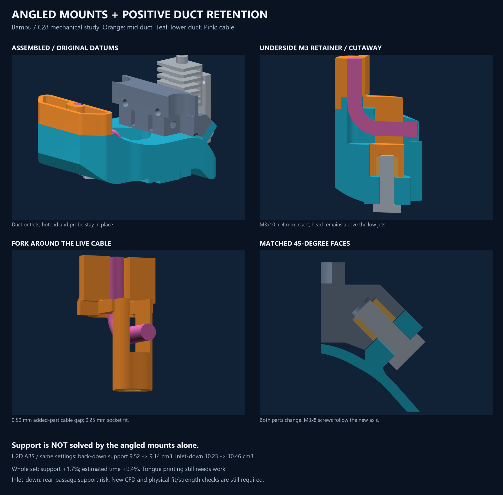

[Share JPEG](images/r43_c28_mechanical_review_share.jpg) |
[Full-size PNG](images/r43_c28_mechanical_review.png) |
[Bambu mechanical assembly STEP](step/53_C28_Bambu_Angled_Mounts_And_Retainer_REVIEW.step).

| Interface | New review geometry | Reason |
| :--- | :--- | :--- |
| P01 to P22 | Matched 45-degree faces; X +/-18 mm spacing; new face centres Y17, Z-55.5 mm; two M3x8 button-head screws and M3x4 inserts | Both printed parts and fastener axes change together. Nozzle, probe and tool positions do not move. |
| P21 to P22 | Integral forked tongue, 7 mm lower barrel, M3x4 insert; one M3x10 button-head screw driven upward from P22 | Positively retains the mid/lower joint instead of relying on the sleeve fit and the separate carriage mounts. |
| Cable bend | Open 4 mm fork around the 3 mm cable reference | The S-shaped feature is the live cable, not disposable material. New tongue material clears it by 0.50 mm. The tighter inherited cable-groove fit is unchanged. |
| Retainer location | Screw axis X0, Y-28.2 mm, underside seat Z-70.8 mm | Slightly forward of the narrow solid core, still below the cable bend. This leaves 1.23 mm around the insert rather than forcing an insert, tongue, fit gap and two walls into the narrowest core. |
| Receiver | 0.25 mm radial and end clearance; approximately 1.19 mm minimum separation from the channel | The existing sleeve remains the main registration feature. Small rounded/chamfered floor reinforcements prevent thin root-pocket walls. |

Nominal thread engagement is 4 mm for all three new screws. Each tongue root is
2 mm wide and 2.2 mm deep before its blend; the combined nominal section is
8.8 mm2. These are geometric dimensions, **not an allowable tightening torque or
strength rating**. Inserts must be installed before assembling the joint.

**Movement and service:** the added material and new hardware clear the actual
Monolith geometry over the checked X travel, rear limits, ten rack approaches,
both adjacent Bambu bays and 60 mm tool withdrawal. Closest sampled new-material
X-gantry clearance is **0.721 mm**, at the tongue-root blend. The exact-distance
translation checks include conservative between-sample clearance bounds; they
do not include printed distortion, cable dynamics or thermal growth. The new
underside screw remains **6.63 mm above the bed** with the nozzle at 0.2 mm;
the complete P22's original 1.23 mm minimum bed gap is unchanged. No new metal
occupies either probe's modelled sensing keepouts.

For service, park/remove the Bambu tool and raise Z for underside access. Free or
disconnect the probe lead, remove the two angled screws and the underside screw,
then lower P22 **18 mm** to release the tongue and sleeve. P21 and the EBB42 stay
on the carriage. The downward path clears P01, P21 and the rigid cable reference;
real connector access and cable slack still need a bench check.

### Printing result: retention improved, support reduction not solved

Matched H2D, ABS/Support for ABS, 0.20 mm, five-wall runs use identical machine,
process and all filament settings. Values below are deposited support, excluding
prime-tower/waste, not physical measurements.

| Part / pose | Original support, cm3 | Mechanical review, cm3 | Change |
| :--- | ---: | ---: | ---: |
| P01, back down | 4.808 | 4.775 | -0.7% |
| P21, top down | 0.643 | 1.318 | +105.0% |
| P22, back down | 9.524 | 9.136 | -4.1% |
| P22, inlet mating face down | 10.230 | 10.463 | +2.3% |
| Three-part set, using back-down P22 | 14.974 | 15.229 | **+1.7%** |

The tongue shifts support into P21. Total predicted time across the three
separate jobs rises **9.4%**. The angled tabs alone therefore do **not** make this
a whole-assembly printing improvement.

**Do not use the inlet-face-down P22 pose with this support setup.** The deposition
screen finds about **328 mm3 of support inside the narrow rear passage** in that
pose, with exact-CAD witness points. Back-down gives zero sampled deposition in
that passage. This is a trapped-support risk screen, not proof of physical
removability. The supplied P22 review STLs use **back down**; P21 uses its flat top
and P01 its back. No generated machine G-code is approved for printing.

### Remaining improvements and why

| Area | Next improvement | Why it remains necessary |
| :--- | :--- | :--- |
| Tongue printing | Rework the initial cantilever into a self-supporting ramp below the gantry, without weakening its roots or the receiver walls | The current tongue adds more support than the inclined mounts save. A preliminary alternative did not produce valid CAD and is not included in the review. |
| Inlet-down printing / curved fins | Redesign internal bridge support only after inspecting the actual deposition paths | The earlier two inlet fins did not reduce support, and this pose puts support in the rear branch. Neither two- nor three-fin trials are adopted here. |
| Cooling | Run fresh CFD with **all three revised P01/P21/P22 bodies** represented | The root-floor reinforcements add 5.01 mm3 inside the original main-channel air region, and external boundaries change. The swept feeds, 0.9 mm outlet, aim and probe seat remain unchanged, but old C28 CFD cannot be relabelled. |
| Fit and durability | Print a first article; check cable movement, insert pullout, seating/sealing and hot operation | The 0.50 mm added-part cable gap and 0.721 mm sampled gantry gap are small nominal clearances. Strength, tightening and thermal behaviour are unqualified. |

Review parts:
[P01](step/P01_C28_Bambu_45deg_Mounts_REVIEW.step) |
[P21](step/P21_C28_Bambu_Forked_Retainer_REVIEW.step) |
[P22 Beacon](step/P22_C28_Bambu_45deg_Mounts_Retainer_Beacon_REVIEW.step) |
[P22 Cartographer](step/P22_C28_Bambu_45deg_Mounts_Retainer_Cartographer_REVIEW.step).

Evidence:
[geometry, hardware and service](verification_c28_mechanical_geometry_r43.json) |
[real-scene movement](verification_c28_mechanical_motion_r43.json) |
[matched slicing](verification_c28_mechanical_slicing_r43.json) |
[support access](verification_c28_mechanical_support_access_r43.json) |
[delivery and preserved-edit provenance](verification_c28_mechanical_delivery_r43.json).
P01's frozen source also fails an exact OCC self-difference; the export audit
explicitly uses matching CAD properties, complete mesh vertices and sampled
retriangulation-patch agreement for that part, rather than trusting invalid
Boolean volumes.

## Finding and completed cleanup

**The circled feature really was unnecessary material in the airflow path.** The
previous identification from the selected Fusion face was incorrect: that face
defined the section plane, not the feature circled in the screenshot.

The new swept feed was clipped against `r43_rear_jet.duct_air()`, a helper intended
for the lower heel region and bounded above at Z -60 mm. Raising the feed roof put
part of its outer wall above that limit. This left a small roof-like obstruction
inside each existing side channel, with about 0.1 mm nominal clearance to the
original duct ceiling at its highest point.

The cleanup clips **only the added feed envelope** against the full-height original
channel. It does not indiscriminately hollow out P22. In particular, the original
cable-support rib, which has a printing purpose, stays in place.

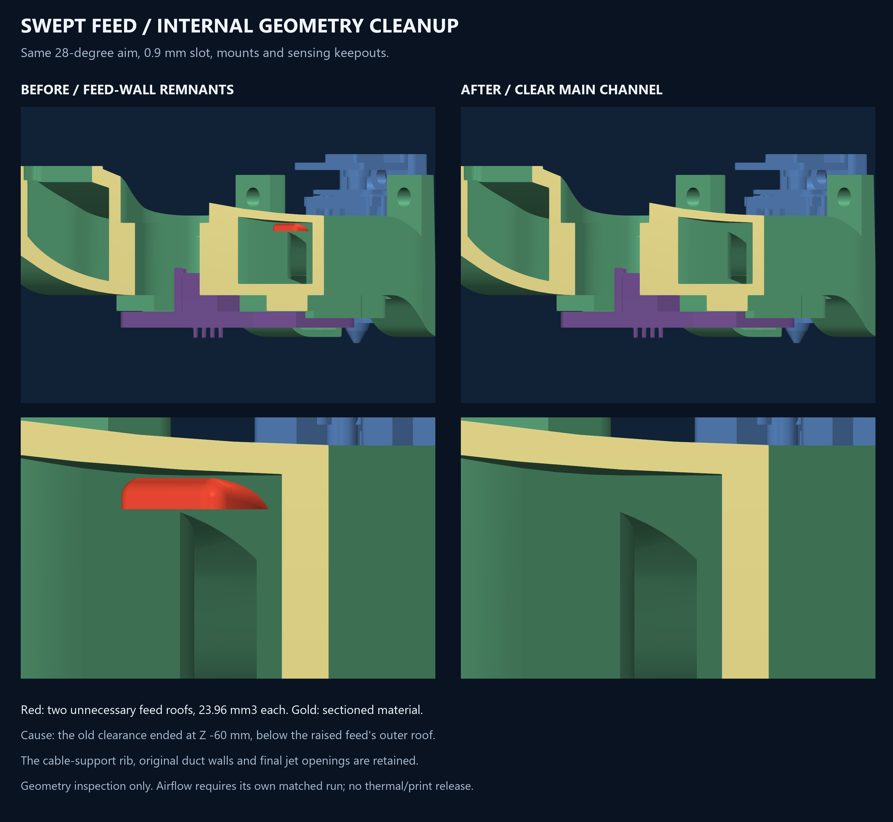

| Completed change | Evidence | Why it is appropriate |
| :--- | :--- | :--- |
| Remove both feed-roof remnants | Approximately 23.96 mm3 each; only within X +/-12.85-18.9, Y -10.8 to -4.41, Z -60 to -58.7 mm | They occupy an intended main-channel air volume and have no mounting or required wall function there. |
| Restore the obstructed feed-entry section | At Y -10 mm: 78.84 to 85.07 mm2 open area per main side channel, a 7.9% local increase | Restores the original channel instead of enlarging the entire duct or redirecting the final jets. This is area recovery, not a 7.9% flow/cooling prediction. |
| Reduce unnecessary surface complexity | Both probe variants: 383 to 351 faces | Removes the actual redundant feature rather than deleting small faces solely because they look suspicious. |
| Preserve critical geometry | No added material; no released-duct or cable-rib material removed; changes confined to the two entry regions | Mounts, screw seats, cable route, side jets, rear slot, probe datums and the exterior envelope are outside the changed regions. |
| Improve the geometric support screen | Down-facing area requiring support: 519.3 to 510.2 mm2 in the established back-face-down orientation | Removes some internal overhang, but this modest 1.8% reduction is not slicer or print qualification. |

The nominal swept-air cutter itself is unchanged. **The connected fluid domain is
not unchanged:** removing the obstructions exposes additional main-channel air.
Accordingly, old CFD is not relabelled as a result for this cleanup.

## Follow-on trial: a larger slot without lowering its floor

**D11 was tested and not adopted; retain C28's 0.9 mm slot for Bambu.** The rear opening grows from nominal
0.9 to 1.1 mm by raising the upper lip only. The 28-degree aim, 3 mm raised feed,
cleaned entries, side jets and mounting datums remain fixed. The complete lower
air-wall surfaces coincide with the C28 baseline, not just their endpoints.

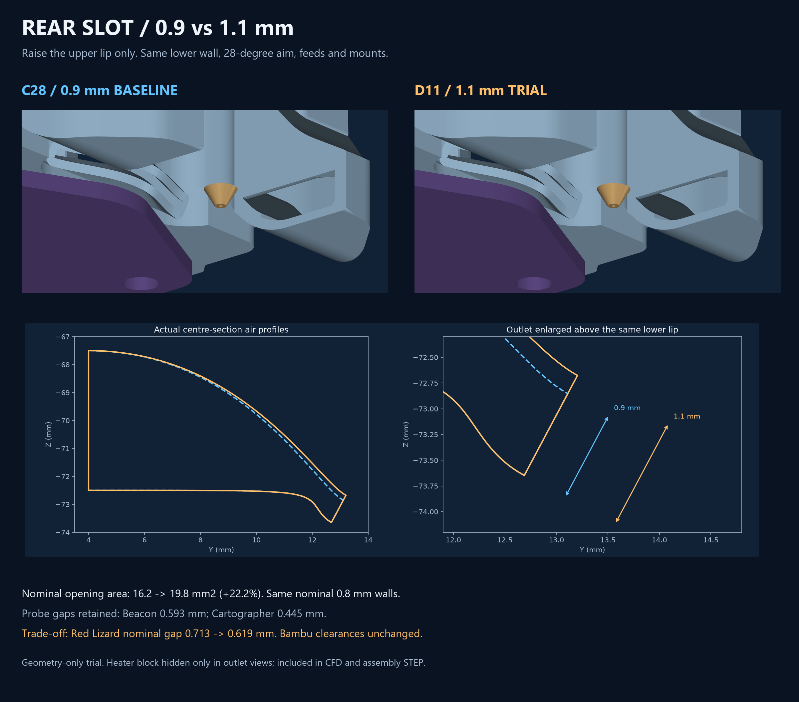

| Geometry | Cleaned C28 baseline | D11 trial |
| :--- | ---: | ---: |
| Rear slot height | 0.9 mm | 1.1 mm |
| Nominal projected mouth area | 16.2 mm2 | 19.8 mm2 |
| Beacon / Cartographer outlet gaps | 0.593 / 0.445 mm | unchanged |
| Bambu hotend / sock gaps | 1.918 / 3.2 mm | unchanged |
| Red Lizard nominal hotend gap | 0.713 mm | 0.619 mm |
| Geometric support-screen area | 510.2 mm2 | 510.2 mm2 |

Both probe variants pass the geometric checks, four wall-normal sampling offsets
and STEP round trips. The larger nominal opening is not evidence of easier printing:
the support screen is unchanged and no slice or coupon has been printed.
The reduced Red Lizard gap is an explicit disadvantage, not a released thermal allowance.

The matched Bambu CFD case `r43directD11_bambu_bed` completed against
`r43directC28clean_bambu_bed`, at 180 L/min and 1,200 iterations. Seventeen solver,
boundary, material and mesh dictionaries are identical; only a human-readable
refinement description differs in the stage metadata.

| Bambu airflow diagnostic | C28 / 0.9 mm | D11 / 1.1 mm |
| :--- | ---: | ---: |
| Pressure at 180 L/min | 1,408.2 Pa | 1,315.9 Pa |
| Estimated total flow, 1 m hose | 231.1 L/min | 234.4 L/min |
| Rear branch at 180 L/min | 39.95 L/min | 45.54 L/min (+14.0%) |
| Mean speed, radius 1-5 mm | 26.31 m/s | 22.67 m/s (-13.8%) |
| Mean speed, radius 1-10 mm | 30.95 m/s | 28.97 m/s (-6.4%) |
| Mean speed, radius 1-14 mm | 29.34 m/s | 27.28 m/s (-7.0%) |
| Weakest/strongest sector mean-speed ratio | 0.839 | 0.902 |
| Net radial flow, radius 8 mm | 45.45 L/min | 43.10 L/min |

Speed/coverage/radial values scale to estimated blower operation. D11 is more even
but weaker across these near-print speed measures; the lowest sector mean also falls
12.8%. Its lower restriction and extra rear flow are not enough to justify replacing
the C28 baseline for today's Bambu objective. This choice is based on Bambu airflow,
**not** the reduced Red Lizard clearance. Neither trial proves thermal superiority.
Last-500 pressure peak-to-peak is 2.02% / 3.19%; mesh/time sensitivity remains.

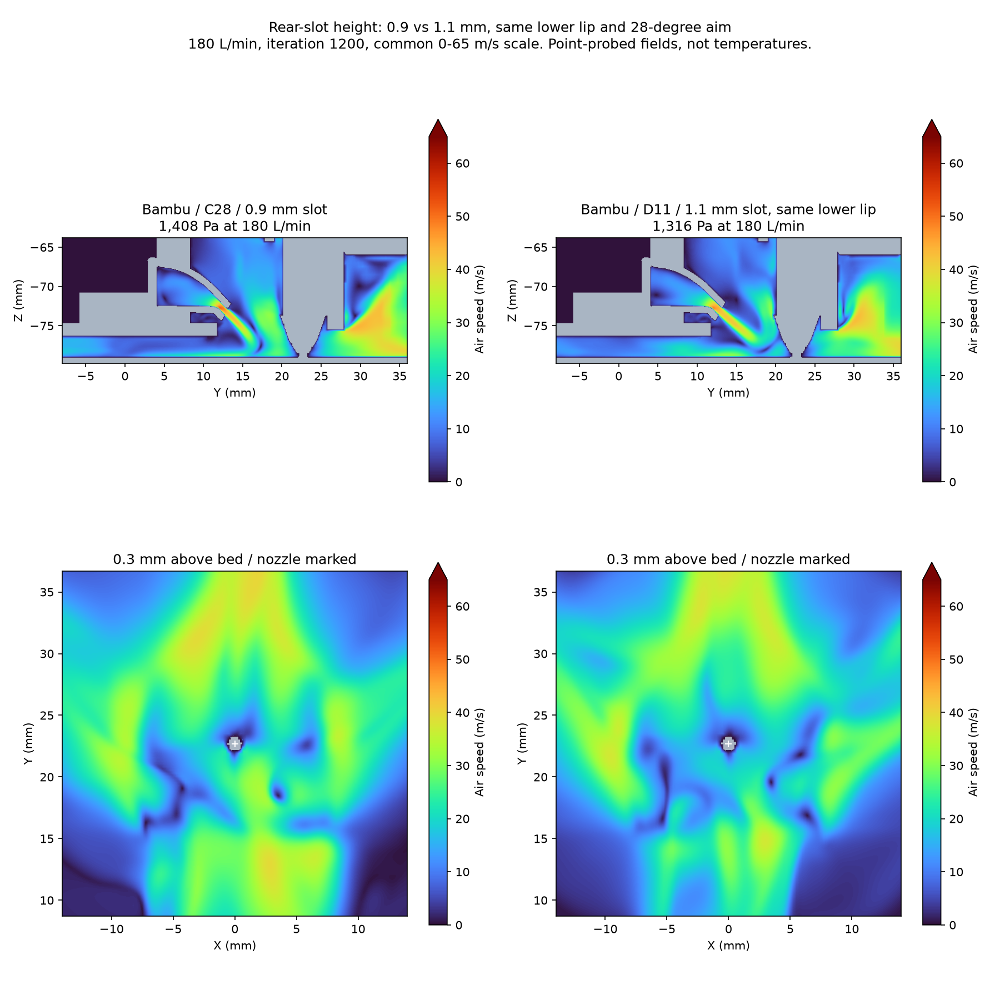

[Full slot-height CFD evidence](verification_slot_height_cfd_r43.json).

[Trial Beacon STEP](step/P22_Swept_D11_Fixed_Floor_Beacon_REVIEW.step) |
[Trial Cartographer STEP](step/P22_Swept_D11_Fixed_Floor_Cartographer_REVIEW.step) |
[C28/D11 comparison assembly](step/P22_C28_D11_Slot_Height_Comparison_REVIEW.step) |
[Geometry and invariant-floor audit](verification_slot_height_geometry_r43.json) |
[Matched numerical controls](verification_slot_height_controls_r43.json).
Fusion document **52 Slot-height study - 0.9 vs 1.1 mm** shows both variants.

## Bambu one-piece printability pass

A separate C28 candidate adds 45-degree ramps behind the direct-mount legs,
chamfers the relief steps, and replaces the seat's flat rear window edge with a
protected truncated-V notch. The original upper fillet remains: a smaller-fillet
trial produced a non-watertight tessellation and was rejected, not repaired by
filling arbitrary mesh holes.

Both probe variants preserve the 0.9 mm airway, original main-channel material,
live mount/inlet regions, outer bounds and previous Bambu/probe clearances.
They pass watertight STEP/STL round trips and the four-offset wall screen.

**Actual slicing gives a smaller improvement than the overhang map.** Assessment
uses the saved H2D 0.4 mm ABS / Support for ABS profiles, 0.2 mm layers, five walls,
automatic trees, support allowed on the part and small-overhang removal disabled.
These measurements are for the Beacon-seat model.

| Candidate / print pose | Deposited support | Estimated total time | Narrow rear-passage support |
| :--- | ---: | ---: | :--- |
| Original C28, back face down | 9.524 cm3 | 3.11 h | None in sampled toolpaths |
| Printability C28, back face down | 9.208 cm3 (-3.3%) | 2.90 h (-6.8%) | None in sampled toolpaths |
| Printability C28, rear-corner face down | 5.570 cm3 (-41.5%) | 3.69 h | Approximately 30 mm3 detected; reject for the current ABS support-body setup |

Geometric overhang area falls from 510.2 to 369.7 mm2 (-27.5%), but that is not
the same as support material saved. The remaining support trees are dominated by
other cantilevers, particularly the mounting faces. Disabling support for recognized
bridges made no meaningful change in either geometry. The angled pose is not an
acceptable shortcut if it leaves support inside the narrow passage.

The exterior-flow recheck also shows a trade-off: pressure changes +0.46%, rear
branch flow is essentially unchanged, and within-5-mm mean speed changes +2.35%.
However, the weakest/strongest sector ratio falls from 0.839 to 0.642, the weakest
sector mean falls 15.4%, and radius-8-mm net radial flow falls from 45.45 to
41.82 L/min. These are single oscillating steady snapshots, not thermal results.
The low-support candidate is therefore a manufacturing study, not a proven overall
upgrade over the airflow baseline.

[Beacon review STEP](step/P22_C28_Bambu_Low_Support_Beacon_REVIEW.step) |
[Beacon back-face-down STL](stl/P22_C28_Bambu_Low_Support_Beacon_REVIEW_PRINT_ORIENTED.stl) |
[Cartographer review STEP](step/P22_C28_Bambu_Low_Support_Cartographer_REVIEW.step) |
[Cartographer back-face-down STL](stl/P22_C28_Bambu_Low_Support_Cartographer_REVIEW_PRINT_ORIENTED.stl).

[Geometry audit](verification_swept_printable_geometry_r43.json) |
[Slicer comparison](verification_swept_printable_slicing_r43.json) |
[Sampled support-access check](verification_swept_support_access_r43.json) |
[Airflow recheck](verification_printability_cfd_r43.json) |
[Matched CFD fields](images/r43_printability_cfd.png).

The slicer outputs are analysis artifacts, **not approved machine G-code**; generate
printing instructions with the user's validated printer startup/nozzle settings.
No physical print has been performed. A larger reduction without inaccessible
supports may require a split, sealed construction rather than further cosmetic
chamfers on the same one-piece topology.

## Areas still needing improvement

Priorities below are engineering recommendations. Except for the feed-roof removal
and the D11/one-piece printability trials above, they have **not** been implemented
or claimed as performance improvements.

| Priority / area | Current evidence or concern | How I would improve it | Why / acceptance evidence |
| :--- | :--- | :--- | :--- |
| High: printed rear slot and internal finish | Nominal 0.9 mm slot; 0.8 mm new passage walls; internal access is limited. Neither variant is sliced or printed. | Slice the cleaned part in the intended material/profile and inspect every slot/bridge layer. Print a representative outlet coupon before a complete part. Avoid inaccessible internal support; tune bridging/flow or reshape the local roof only if the coupon requires it. | A sagged or over-extruded slot can change the effective area more than a small CAD optimization. Require an open, continuous slot with measured dimensions and no trapped support. |
| High: clearance and thermal/tolerance allowance | Minimum new outlet-to-probe gaps: Beacon 0.593 mm, Cartographer 0.445 mm. Red Lizard gap: 0.713 mm. These are nominal CAD clearances. | Measure actual boards, installed fasteners and hotends; define a tolerance/thermal stack. If inadequate, reroute or locally relieve the duct away from the constraint while retaining the sensor datum and a justified wall thickness. | Collision-free CAD is not a safe operating allowance for print error, warpage and hot components. Do not solve a duct conflict by moving the probe without requalifying its sensing height. |
| High: reliable cooling comparison | Existing results are steady, oscillating airflow fields, not temperature or heat-transfer measurements. | First repeat the cleaned geometry at additional local resolutions and examine several late fields. For thermal ranking, use a controlled heated-bead/coupon test or a thermal model with realistic material, temperatures and boundary conditions. | More speed, a better sector ratio or lower inlet pressure alone does not establish better part cooling. Require repeatable temperature/print outcomes, not a single velocity snapshot. |
| Medium: branch take-off and merge | The caps are removed, but the main-channel-to-branch intersection still has a distinct lip and curved turn. | Inspect velocity and total-pressure changes across that junction; test a smooth entry blend or a gentler take-off in one controlled variant. Keep the final slot and aim fixed. | Reduce separation/turning loss without simply drawing more air away from the side jets. Retain only a change that improves delivery/coverage at comparable blower conditions and passes walls/keepouts. |
| Medium: rear/side flow balance and aim | The previous 28-degree case improved sector evenness relative to 32 degrees but reduced radius-8-mm signed net outflow. | Use the cleaned geometry as the new baseline. If its branch balance still warrants it, compare 0.9 mm against one modest 1.1 mm slot variant at the same aim; change only one variable. | A larger rear outlet lowers that branch's resistance and changes the entire flow split. It is not automatically better cooling. Compare total pressure, rear/side flow, weak sectors and near-print transport together. |
| Medium: entry-region CFD resolution | The old cap-to-ceiling clearance was about 0.1 mm; matching mesh settings does not prove this small gap was resolved. | Add the same focused entry refinement to both geometries for a follow-up sensitivity study. Keep quality limits unchanged and monitor section closure as well as near-print results. | The cleanup's geometric benefit is clear, but a CFD percentage can contain both physical and under-resolution effects. A passing `checkMesh` is necessary, not a mesh-independence certificate. |
| Medium: tool/probe coverage | Current-angle airflow evidence is for Bambu with the Beacon scene. Red Lizard and Cartographer have geometry checks, not all corresponding CFD combinations. | Cross-check the leading cleaned geometry with the other hotend and the actual alternative probe envelope before making a shared performance claim. | The hotend and probe influence impingement, recirculation and blocked paths. A common mounting interface does not guarantee common cooling behavior. |
| Low: tiny residual CAD faces | Eighteen faces below 0.01 mm2 remain in each variant; the count is unchanged by the cleanup. The bodies are valid and watertight. | Investigate only those that produce thin material, bad export, poor meshing or slicer defects. Merge equivalent faces only with shape-equivalence checks. | Small trimmed faces are not the same as detached debris. Blanket healing or deletion risks moving the narrow slot or changing walls. |
| Medium (noted 2026-10-31, not changed): top-surface wedge under the P01 mount | On each side (\|X\| 14.5-21.5) P22's top falls away from the P01 45-degree mount into a wedge-shaped valley, 0.6 mm deep at Y 10 and 1.4 mm at Y 14.3, where it ends at P22's riser. Printed back-down, the riser's underside is a flat 1.1-1.4 mm overhang over that valley. | Fill the valley so P22's top runs straight into the riser, keeping a small even gap to P01. | The user flagged it as a large printability gain. It is outside the airway, so airflow is unaffected; recheck the P01 gap and the slicer's support afterwards. |

**Opening-size recommendation:** retain the 0.9 mm final slot as the Bambu baseline.
The controlled 1.1 mm trial increased rear flow but reduced the near-print speed and
radius-8-mm transport diagnostics. The printability pass will preserve the selected
0.9 mm airway instead of enlarging the outlet as a shortcut.

## Geometry and export evidence

Both probe variants are one valid solid with one shell. Their tessellations are
watertight with consistent winding. Wall-normal material checks at 0.1, 0.35, 0.6
and 0.75 mm pass; suspect tessellation classifications are resolved against exact
CAD, excluding deliberate main-channel connections and the open outlet.

The sampled 60 mm -Y withdrawal retains the previous minimum clearances: Bambu
1.918 mm, Red Lizard 0.713 mm; the Bambu silicone-sock gap remains 3.2 mm. The
sampling step is 0.5 mm, not a continuous-motion guarantee. Probe sensing keepouts
and modeled mounting hardware remain clear. Removal inside the channel cannot
enlarge the gantry envelope; this does not replace an actual machine fit test.

The standalone STEP round trips have no detected geometric difference under the
audit's comparison tolerance. Fusion document **51 Cleaned C28 feed - both probes -
REVIEW** contains the new assembly; the previous documents were preserved.

[Beacon STEP](step/P22_Swept_C28_Clean_Feed_Beacon_REVIEW.step) |
[Cartographer STEP](step/P22_Swept_C28_Clean_Feed_Cartographer_REVIEW.step) |
[Assembly and air-route cutaway STEP](step/P22_Swept_C28_Clean_Feed_Assembly_REVIEW.step).

## Matched CFD pass

The new case is `r43directC28clean_bambu_bed`, compared against the frozen
`r43directC28q_bambu_bed`. It retains 180 L/min, the 1,200-iteration schedule,
46-way decomposition, original obstacle exclusions and local refinement. Seventeen
meshing, solver, transport and initial-boundary dictionaries were compared byte for
byte; the stage metadata and ambient-domain controls also match.

**Completed:** the cleaned mesh passes with 2,479,266 cells and maximum skewness
3.32; the solver reached iteration 1,200 normally.

| Same 28-degree aim | Before inlet cleanup | After inlet cleanup |
| :--- | ---: | ---: |
| Pressure at 180 L/min | 1,461.4 Pa | 1,408.2 Pa (-3.64%) |
| Estimated blower flow, 1 m hose | 229.4 L/min | 231.1 L/min |
| Rear branch at 180 L/min | 39.45 L/min | 39.95 L/min |
| Mean speed, radius 1-5 mm | 24.20 m/s | 26.31 m/s (+8.70%) |
| Mean speed, radius 1-10 mm | 28.50 m/s | 30.95 m/s (+8.63%) |
| Weakest/strongest sector mean-speed ratio | 0.883 | 0.839 |
| Net radial flow, radius 8 mm | 33.14 L/min | 45.45 L/min |

Speed, sector and radial-flow values scale to estimated blower operation, not measured
blower performance. The cleanup reduces modeled restriction and improves these speed/
transport diagnostics; its sector ratio is slightly less even than the prior C28
snapshot. Pressure peak-to-peak over the last 500 iterations is 2.02%; approximate
side-plus-rear section closure is +0.24%. The entry's former sub-cell ceiling gap,
oscillating steady fields and resolution limits still prevent a thermal conclusion.

Against accepted released R43, cleaned C28 has 35.8% lower pressure at 180 L/min,
11.4% more estimated blower flow, 21.1% lower within-5-mm mean speed, 10.7% higher
within-14-mm mean speed and 4.5% lower radius-8-mm net radial flow. The sector ratio
is 0.839 versus 0.672. This is a trade-off, not an overall cooling winner. The direct
R43 comparison has different local mesh refinement/decomposition (1.64M vs 2.48M
cells), unlike the matched C28 before/after cleanup pair.

[Cleaned-feed CFD report](verification_feed_cleanup_cfd_r43.json) |
[Matched entry/nozzle/near-bed fields](images/r43_feed_cleanup_cfd.png).

## Reproducibility and records

Generate the cleaned geometry with
`r43_swept_feed.p22(base, probe, roof_raise=3, mouth_height=0.9, angle_deg=28,
remove_rear_mounts=True, conformal_outlet=True, clear_feed_intrusions=True)`.
The new flag defaults to false, preserving historical variant geometry.
For the D11 trial, use `mouth_height=1.1, floor_reference_height=0.9` with the same
other arguments. Omitting `floor_reference_height` preserves the old centered-slot
behavior; its default regression against frozen C28 is recorded in the trial audit.

- [Confined-removal, wall and STEP audit](verification_swept_feed_cleanup_r43.json)
- [Assembly, probe and withdrawal qualification](verification_swept_feed_optC28_clean_r43.json)
- [Matched CFD controls](verification_feed_cleanup_controls_r43.json)
- [New Fusion review record](verification_clean_feed_fusion_r43.json)
- `python audit_swept_feed_cleanup_r43.py` and
  `python render_swept_feed_cleanup_r43.py` reproduce the audit/visuals when the
  frozen session inputs are available.
- After the accepted result is retrieved and analyzed:
  `python cfd_direct_mount_r43.py --feed-cleanup`.
- **On another machine:** builders read frozen working inputs from `acc.WORK` and
  vendor probe models from `acc.SENSOR_DIR`. Set `SPARKSHIFT_WORK` and
  `SPARKSHIFT_SENSOR_DIR` to copies of those folders; the defaults are this
  workstation's session paths. A copy of the working inputs is in the data-only
  branch `nisparks-beacon-cpap-ebb42-workdata`; its README lists the setup and the
  vendor probe models to add.
