# Swept-feed geometry cleanup and improvement review

**Review date:** 2026-10-30. **Scope:** the separate 28-degree, 3 mm raised-feed,
nominal 18 x 0.9 mm rear-slot variant, with cleaned direct mounts for Beacon and
Cartographer. Released R43, frozen candidate A and the previous C28 CFD geometry
remain unchanged. These are review parts, not print-qualified releases.

**Current user-directed hotend scope: Bambu Lab only.** Red Lizard clearances below
are historical comparison data, not selection criteria or a constraint on today's
optimization. Both probe mounting variants remain available. Printability and
positive duct retention are the current priorities.

**Latest share image, without branding:** [R43 vs cleaned C28 JPEG](images/r43_vs_latest_c28_share.jpg)
| [Full-size PNG](images/r43_vs_latest_c28.png).
Matched outlet views, 3D streamlines, near-bed and center-plane velocity maps, and
direct numerical comparison use the completed cleaned-geometry CFD.
The [earlier decision-summary image](images/sparkshift_c28_design_review_share.jpg)
is retained as a historical 32/28-degree comparison and explicitly labels its
pre-inlet-cleanup CFD.

## R&D audit and design review

**2026-10-31: the earlier RVM/RVMS ranking is being re-evaluated, not accepted as a printing result.**
The audit found a post-processing error, a target-definition error and a misleading interpretation of the
velocity plot. These are separate from the initially broken angle-edit script.

- **The rear mask was fixed at 0.9 mm.** Applying it to RVMS's 2.0 mm opening measured only 52.29 L/min of rear
  flow at the simulated 180 L/min inlet. Using the actual passage measures 77.95 L/min. The three measured
  outlets then sum to 177.98 rather than 152.32 L/min. The earlier "66 / 63 / 63 L/min, balanced outlets" claim
  is withdrawn; at the estimated blower point the rear branch is about 99 L/min, not 66. The pressure-derived
  total flow and velocity field did not change, but rear-seeded delivery and weighted scores need recomputing.
- **The 9.2 vs 6.0 L/min "fresh bead" comparison was not below the tip.** That historical envelope extends
  1 mm above the print, hence 0.8 mm ABOVE this nozzle tip. The 0.3 mm speed maps are also 0.1 mm above the tip.
  The user's own-side target is below the tip; the flat-bed CFD can represent only its bottom-truncated
  0.2 mm air layer. New section overlays stop at the tip, and own-side paths stop at their first centre crossing.
- **The peak-speed scan did not track the rear jet.** Several claimed downstream core samples actually had
  negative Y velocity: return flow moving toward the rear. A low-speed point beside a solid also does not by
  itself establish poor heat transfer. The earlier confident "not the sock" diagnosis and prediction that a
  40-42 degree tilt would preserve 228 L/min and restore RVM-like bead speed were unsupported.
- **The initial angle script omitted the angle argument.** Its reference and trials used the generator's
  32-degree default. Its checks failed and those failed attempts were not submitted to CFD. The new builder
  passes the angle explicitly, compares the emitted local shape, and refuses to overwrite an experiment.
- **OCC operations need isolated references.** A fuzzy fuse can mutate shared in-memory topology, making a
  previously valid reference invalid and corrupting subsequent difference checks. Deep-copying operands
  reproduces valid differences without changing the saved source. New builds check input validity as well
  as the result; invalid signed boolean volumes are not accepted as clearance or shape evidence.

The corrected analysis uses case-specific passage dimensions, a 3% inlet/outlet measurement-closure gate,
content fingerprints for fields and derived caches, and unique VTK dataset selection. Trimmed outlets with
genuine unmeasured spill require an explicit override and are not represented as a closed three-outlet balance.
Historical figures/tables below are retained for traceability; their old "bead" labels and enlarged-rear-slot
delivery values must not be used as current evidence.

**Research direction, verified against original sources.** There is no supported universal "magic" angle.
[Dragon Burner's original CFD/print comparison](https://github.com/chirpy2605/voron/tree/main/V0/Dragon_Burner/cfd)
emphasizes escape of spent air and opposed-jet interaction, and explicitly uses angled **baffles**. Its result
cannot be claimed for our no-baffle walls without testing them. [Seregi and Ficzere (2025)](https://doi.org/10.3311/PPme.42624)
report CFD benefits from two-sided flow but still call for experimental validation. [Keim's Purdue thesis
(2026)](https://doi.org/10.25394/PGS.33104093.v1) experimentally finds nonuniform effects of fan cooling on
geometry, crystallinity and interlayer weld behavior: more blower flow is not automatically a better print.
The [Zuckerman/Lior review](https://doi.org/10.1016/S0065-2717(06)39006-5) and
[inclined-jet review](https://doi.org/10.1007/s11630-019-1200-y) provide context on impingement and model limitations,
not a validated outlet angle for this toolhead.

**Corrected historical comparison.** These cases use the same original mesh settings, now reprocessed with
1,800 requested streamlines per outlet, complete rear masks, first-crossing own-side rules and a strict
below-tip boundary (only 0.00001 mm coordinate tolerance, not the former 0.02 mm band above the tip).
The target is r <= 4 mm on each outlet's own side, between the print and tip, not the old 1 mm-high envelope.

| Historical geometry | Estimated blower L/min | Own-side below-tip target L/min | All-air path score | Cone-adjacent speed m/s |
| :--- | ---: | ---: | ---: | ---: |
| Current v5d | 230.7 | 3.89 | -15.99 | 27.3 |
| Byte-identical current repeat | 231.0 | 3.25 | -15.58 | 27.2 |
| RVM | 205.4 | 4.10 | -8.45 | 28.1 |
| RVMS | 227.9 | 3.31 | -9.50 | 13.4 |
| RS20, wider rear only | 247.1 | 3.35 | -18.07 | 15.2 |
| CH, floor chamfer only | 231.9 | 3.99 | -16.90 | 27.4 |

RVM steers the high side-jet air better, but its below-tip delivery gain is much smaller than the former
"9.2 versus 6.0 L/min" argument suggested. The current/repeat difference is 0.64 L/min: an observed numerical
and sampling spread, not a statistical confidence interval. RS20 wins total volume but not the user's high-air
penalty. RVMS is still a reasonable high-volume starting point, not a demonstrated printing/bridging winner.

**Implemented, geometrically qualified candidate:** RVM's side-wall ramp and gentle bevel, a 2.0 mm rear opening,
and 40-degree rear terminal walls. The change is confined to the rear nozzle; the gantry envelope, retainer,
side jets and hardware are unchanged. The matched fine-mesh CFD comparison is the adoption gate, not the
construction angle alone. **Outcome: not adopted.** On the fine mesh it put 1.97 L/min on target against RVMS's
3.19; see [Collaborative outlets](#collaborative-outlets-what-opposes-the-rear-jet) for the adopted FR1.

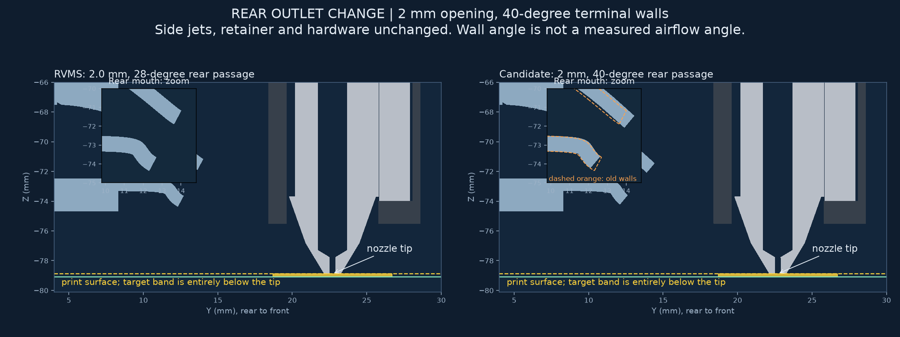

The candidate is one valid solid/shell; its STEP round trip and outside-edit-zone differences are zero.
Its exact lower bound stays at Z -77.85 mm. Mounted and 60 mm withdrawal clearances (0.5 mm steps) retain every
released hotend gap. Rear-nozzle-to-probe gaps increase from 0.5926 to 0.6025 mm for Beacon and 0.4445 to
0.4613 mm for Cartographer. Wall-normal material samples pass through 0.75 mm of the nominal 0.8 mm wall.
These small probe gaps still require first-article fit checks; unchanged nominal clearance is not a tolerance
or thermal-deformation qualification.

Matched H2D ABS slicing (0.2 mm layers, five walls, ABS support interface) predicts 4.646 cm3 support and
78.39 min, against RVMS's 4.672 cm3 and 78.93 min. Both have zero sampled support deposition inside the rear
airway. The native mesh export is watertight with consistent winding. No print was sent.
See [geometry and slicing evidence](verification_cooling_review_geometry_r43.json).

**Controlled re-test.** The new RVMS control, RVM and 40-degree candidate share byte-identical P21, hardware,
boundaries, fluid properties, solver settings and an added 0.0625 mm cell-size region around the below-tip
target. The earlier cases used 0.25 mm cells there, too coarse to treat a 0.2 mm air layer as mesh-independent.
This is a local sensitivity test, not global mesh independence. Case inputs are hash-checked before solving;
all downloaded solver outputs are verified before cleaning only that run's remote scratch files.
The first fine RVMS control closes native ambient flow to within 0.003% of 180 L/min; cut-section accounting
closes to 1.31%, reflecting post-processing integration error rather than a 15% lost branch.

All conclusions remain airflow-screening conclusions: this solver has no temperature equation, moving
deposited bead or unsupported bridge, and averaging SIMPLE iterations is not a transient simulation.
The below-tip air gap is a target region, not a simulated solid filament. A low local air speed is not,
on its own, evidence of poor heat transfer.

### Collaborative outlets: what opposes the rear jet

**Question (user):** is the rear outlet too weak against the sides, and should the outlets work together
rather than against each other? Analysed with `cfd_flow_opposition_r43.py` (centreline velocity, Y-plane
fluxes in the 0.2 mm tip-to-print gap and a 2 mm band, side inflow behind the nozzle) plus per-outlet
streamline attribution and the pressure field.

**Mechanism.** The rear and side jets do fight, but through pressure, not side air flowing backward. In RVMS
the converging side jets build a ~1.4-1.5 kPa pad under the nozzle (X +-8, Y 19-28), falling to ~0 by Y 14.
That adverse gradient exceeds the rear jet's ~730 Pa dynamic pressure, so the rear jet lands at Y ~17-18 and
~22% of its traced lines splash back. 95-100% of the reverse flow behind the nozzle is the rear jet's own air.
The side jets already lean forward (~13-25 degrees) and down (~21 degrees). That lean keeps their collision off
the nozzle cone; removing it (earlier toe-in tests) put 42 m/s on the cone.

**Why not a literal aft shift.** The aft end of each side opening is the feed's descending floor
(Z -76.6 at Y 20 to -74.2 at Y 17), so moving the side outlets aft needs a feed-chamber redesign.
Noted as a future change, not done. Instead, the front end wall of each side passage is raked forward
(44.4 degrees, a <=45-degree overhang when printed back-down). This only adds material inside the existing
side air, outboard of |X| 10.2.
`build_side_rake_r43.py`: **FR1** rakes (|X| 12.65, Y 25.0) to (10.15, 27.45); **FR2** moves the exit front aft
to (10.15, 25.85), a U that sends more air to the rear.

| Matched fine mesh, own blower point | RVMS | RVM | RVMS 40 deg | **FR1** | FR2 |
| --- | --- | --- | --- | --- | --- |
| Blower estimate, L/min | 227 | 206 | 227 | **218** | 200 |
| Left / right / centre, L/min | 63/63/99 | 72/71/62 | 63/64/98 | **56/56/105** | 44/44/110 |
| Own-side below-tip target (r 4 mm), L/min | 3.19 | 4.99 | 1.97 | **5.12** | 3.70 |
| Below-tip ring r 0.6-2 mm, mean / rear sector, m/s | 9.7 / 7.5 | 22.1 / 32.7 | 7.3 / 7.3 | **15.7 / 9.8** | 23.7 / 15.7 |
| Gap net flux at Y 20 / nozzle, L/min | -0.74 / +0.54 | -1.23 / -0.85 | +0.02 / +0.60 | **-0.32 / +1.62** | +1.17 / +2.79 |
| 2 mm band at Y 20: net / reverse, L/min | 6.0 / 6.4 | 0.1 / 12.2 | 18.4 / 3.2 | **27.0 / 1.8** | 37.6 / 0.0 |
| Side air turned inward behind nozzle, L/min | 8.4 | 16.2 | 5.4 | **7.0** | 7.3 |
| Tip-to-1 mm / heater-block air speed, m/s | 11.1 / 13.7 | 26.8 / 18.4 | 7.2 / 14.5 | **19.2 / 12.8** | 23.1 / 11.1 |
| H2D ABS support, cm3 / time, min | 4.672 / 78.9 | - | 4.646 / 78.4 | **4.522 / 78.3** | 4.519 / 78.5 |
| Support sampled in side-jet region, mm3 | 24.5 | - | - | **24.6** | 34.3 |

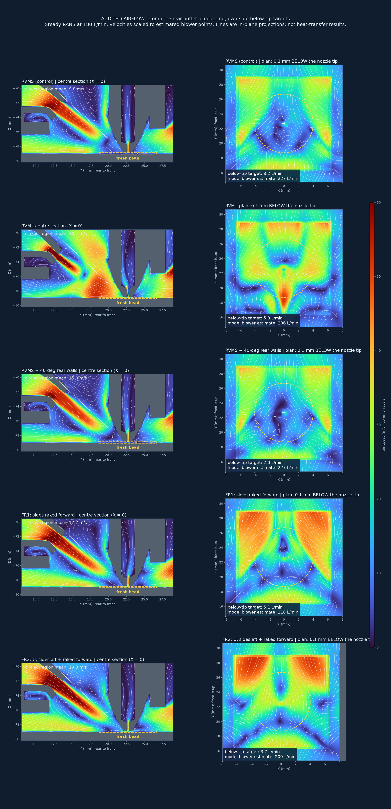

**Result.** Both rakes turn the shared flow under and just behind the nozzle forward. Reverse flux in the
2 mm band at Y 20 falls from 6.4 to 1.8 L/min (FR1) and 0 (FR2), and net forward flux rises 4.5-6x. FR1 puts the most
air on the own-side below-tip targets of any design (5.12 L/min) and raises the below-tip ring speed by 60% while
lowering heater-block air speed. Its blower point drops only 4%, and it slices with slightly less support and no
added support in the side jets. FR2 is the most cooperative and rear-dominant, but costs 12% blower flow, 30% side
flow, and puts 30% less air on target than FR1.

**Recommendation: FR1** (`step/P22_C28_Bambu_Forward_Rake_FR1_REVIEW.step`,
`stl/P22_C28_Bambu_Forward_Rake_FR1_REVIEW_PRINT_ORIENTED.stl`). It is a geometry-qualified review candidate:
- One valid mirror-exact solid, lowest Z -77.85.
- Exact STEP round trip.
- Every released hotend gap is unchanged, mounted and over a 60 mm -Y withdrawal in 0.5 mm steps.
- Probe gaps are unchanged.

Watch-outs for the thermal A/B print:
- Air speed over the last 1 mm of nozzle rises from 11 to 19 m/s; that is a 0.14 mm2 tip area, but check
  nozzle temperature droop.
- The rear sector of the below-tip ring is still the weakest (9.8 m/s).
- This is airflow and slicer evidence only; it is not a temperature or print qualification.

Evidence: [collaborative-outlet study](verification_cooling_collaborative_r43.json).

### The two low-speed spots under the nozzle

The plan 0.1 mm below the tip shows two slow spots, one behind and one in front of the nozzle.
`cfd_dead_spots_r43.py` samples them on a 0.25 mm grid. Speeds are at each design's own blower point (mean / 10th
percentile, m/s):

| Design | Blower | Behind, X ±2, Y 19-21: bed +0.1 / +0.4 mm | In front, X ±1.5, Y 23.5-26.5: +0.1 / +0.4 mm | Tip to 1 mm | Below-tip target |
|---|---|---|---|---|---|
| RVMS | 227 L/min | 8.2 / 8.3 | 12.8 / 17.7 | 11.1 m/s | 3.19 L/min |
| RVM (0.9 mm rear) | 206 L/min | 30.3 / 31.6 | 17.2 / 23.6 | **26.8 m/s** | 4.99 L/min |
| **FR1** (2.0 mm rear) | 218 L/min | 9.3 / 8.9 | 17.9 / 26.4 | 19.2 m/s | **5.12 L/min** |
| FR2 | 200 L/min | 10.7 / 11.3 | 20.9 / 26.7 | 23.1 m/s | 3.70 L/min |
| FR1 + 1.4 mm rear | 205 L/min | 9.5 / 15.6 | 16.7 / 23.9 | 8.4 m/s | 5.11 L/min |
| FR1 + 0.9 mm rear | 191 L/min | 10.6 / 8.4 | 17.8 / 29.4 | 15.1 m/s | 4.40 L/min |

**Cause.**
- **Behind (Y ~20):** a stagnation line. The rear jet lands at Y ~17 and splits: part runs back along the bed at
  13-34 m/s, and the rest lifts 1-2 mm over the side jets' ~1.35 kPa pressure pad instead of hugging the bed.
- **In front (Y 24-26):** the nozzle and sock wake, plus air coming down off the front of the heater. The side jets
  pass at X ±1.5-3 at about 30 m/s and leave the centreline empty.

**Tried: a faster, narrower rear jet on FR1.** RVM's 0.9 mm slot is the only design with no rear spot. The rear slot
was narrowed to 1.4 mm and 0.9 mm with `build_rvms_review_r43.py`, then FR1's rake was applied with
`build_side_rake_r43.py --source`. Both pass every geometry check, but **neither clears either spot.** The 1.4 mm
slot drops the below-tip ring to 7.5 m/s (rear sector 2.7 m/s), and the 0.9 mm slot loses 27 L/min of blower flow.

The centre sections ([figure](images/r43_cooling_review_cfd_rear_slot_fr1.png),
[data](verification_cooling_review_r43_rear_slot_fr1.json), [spots](verification_dead_spots_r43.json)) show why RVM
looks clean: its rear jet runs straight into the nozzle tip. With FR1's side jets the narrower rear jet still lifts
off before the nozzle.

**Outcome: FR1 is kept; the narrower slots are not adopted.**
- Within the constraints (no material inboard of |X| 10.2 or below Z -77.85, no vanes, unchanged hotend gaps),
  filling either spot means aiming air within ~2 mm of the nozzle axis at bed level, which is the nozzle tip.
  The earlier toe-in trials (RFT/RVMT) showed the same trade: 42 m/s on the nozzle cone.
- These spots are 0.1 mm off a no-slip bed, so part of the low speed is the boundary layer. In a print the bead
  fills that layer.
- A thermal A/B print, not more airflow tuning, is the next useful test.

### Converging rear outlet: the two halves merge at the nozzle

The rear slot's ends were filled with solid end walls (no vanes) so the edge air turns inward and the two halves
meet on the centreline. A true 120/240-degree approach is not reachable: the slot spans only X +-9, so the
steepest approach from its ends is about 149/211 degrees. Builder: `build_rear_converge_r43.py` on FR1; both
variants keep every hotend, probe and withdrawal gap ([design](images/r43_rear_converge_design.png)).

| Fine mesh, scaled to blower | FR1 | A: 24.4 deg, merge at nozzle | B: 36 deg, merge at Y 20 |
|---|---:|---:|---:|
| Centre share of outlet air | 48% | 37% | 43% |
| Below-tip ring r 2-4 mm, mean / rear (m/s) | 19.7 / 9.2 | **30.2 / 20.3** | 19.7 / 11.6 |
| Rear / front low-speed spot at bed +0.1 mm (m/s) | 9.3 / 17.9 | **20.3 / 31.7** | 11.6 / 24.5 |
| Air onto print r 2-5 mm, down / up (L/min) | 13.5 / 10.5 | **15.6 / 3.8** | 7.8 / 4.3 |
| Nozzle tip to 1 mm / cone / sock (m/s) | 19.2 / 15.9 / 12.8 | 39.9 / 26.2 / 13.3 | 30.9 / 22.8 / 14.1 |

([figure](images/r43_cooling_review_cfd_rear_converge.png),
[data](verification_cooling_review_r43_rear_converge.json))

**Outcome: A is the best print-side airflow so far; B is not adopted.**
- A clears both low-speed spots, gives the most downward air on the print and cuts lift-off by about two thirds.
- Its cost is air on the nozzle: tip and cone speeds roughly double. The sock and heater block see no change.
- B's earlier merge does not fill the gap: the merged jet lifts at Y 20 and less air reaches the print.
- Airflow, not temperature. A thermal A/B print of FR1 versus A (nozzle temperature hold and overhang/bridge
  quality) decides whether the extra nozzle air matters.

## Part-cooler scorecard: choosing the best design

**Choice: A (converging rear outlet on FR1).** Review part:
`step/P22_C28_Bambu_Converging_Rear_A_REVIEW.step`,
`stl/P22_C28_Bambu_Converging_Rear_A_REVIEW_PRINT_ORIENTED.stl`.
[3D views of A](images/r43_design_a_views.png) (`render_design_a_r43.py`).

### What a part cooler should do (research basis)
- Put air on the fresh bead and the layer just below it, from more than one side. Two-sided and ring-style
  delivery cools more evenly than one side; uneven outlets and flow separation leave hot spots
  (Seregi & Ficzere 2025, Periodica Polytechnica Mech. Eng., doi:10.3311/PPme.42624).
- Cool the same in every print direction, so overhangs and bridges do not depend on which way the head moves
  (common practice in CFD-designed ducts).
- Do not blow air back up off the print. Air that glances upward cools nothing and carries heat back to the nozzle.
- Keep air off the heater block and nozzle. Air on them drops the nozzle temperature; a silicone sock and a
  PID retune at the working fan speed are the standard fix (CNC Kitchen and printer-forum measurements).
  Cylinder heat loss grows with about speed^0.5 (Hilpert / Churchill-Bernstein), so doubling the air speed on
  the nozzle adds about 40% to that loss, not 100%.

### Method
`evaluate_part_cooler_r43.py` scores all thirteen matched fine-mesh cases (the four
side-aft and combined variants below were added later; scores are min-max normalised over the set, so they shift when
cases are added, while the ranking of the original nine is unchanged) at their own blower estimate:
delivery 40% (downward L/min r 0.6-5 mm plus below-tip ring speeds and the low-speed spots),
uniformity 25% (weakest sector / mean around the nozzle), lift-off 15% (up / down, r 2-5 mm), and
nozzle heat 20% (Churchill-Bernstein cylinder, 4 mm nozzle at 250 C in 35 C air, over the 50.8 mm2 of bare
nozzle below the sock). Every weight was moved +-10 points as a sensitivity check.

| Rank | Case | Score | Down onto bead + print (L/min) | Ring r 0.6-2 (m/s) | Uniformity | Up / down | Bare nozzle (W) | Blower (L/min) | Centre share |
|---:|---|---:|---:|---:|---:|---:|---:|---:|---:|
| 1 | **A** | **0.69** | **18.6** | **33.9** | 0.73 | **0.25** | 3.00 | 195 | 37% |
| 2 | A aft F | 0.65 | 12.7 | 41.2 | 0.78 | 0.64 | 3.03 | 180 | 43% |
| 3 | A wide C | 0.65 | 10.2 | 34.3 | **0.84** | 0.44 | 2.80 | 204 | 34% |
| 4 | A aft C | 0.64 | 13.4 | 38.5 | 0.71 | 0.48 | 2.87 | 195 | 37% |
| 5 | A wide F | 0.61 | 10.3 | 27.8 | 0.82 | 0.61 | 2.63 | 208 | 33% |
| 6 | FR2 | 0.55 | 13.4 | 23.7 | 0.57 | 0.39 | 2.39 | 200 | 56% |
| 7 | RVMS | 0.52 | 10.9 | 9.7 | 0.70 | 0.70 | 2.05 | 227 | 44% |
| 8 | FR1 | 0.46 | 14.0 | 15.7 | 0.55 | 0.87 | 2.33 | 218 | 48% |
| 9 | RVMS 40 | 0.46 | 8.9 | 7.3 | 0.69 | 0.78 | 2.11 | 227 | 44% |
| 10 | B | 0.45 | 9.5 | 24.7 | 0.67 | 0.57 | 2.78 | 204 | 43% |
| 11 | FR1 0.9 mm | 0.40 | 8.5 | 17.2 | 0.50 | 1.24 | 2.11 | 191 | 34% |
| 12 | RVM | 0.33 | 7.3 | 22.1 | 0.59 | 1.55 | 2.66 | 206 | 30% |
| 13 | FR1 1.4 mm | 0.32 | 9.7 | 7.5 | 0.41 | 1.36 | 2.04 | 205 | 42% |

([figure](images/r43_part_cooler_scorecard.png), [data](verification_part_cooler_scorecard_r43.json))

### Why A
- A ranks first under every weighting tested, including nozzle heat at 30%.
- It is best on all three print-side goals: 33% more downward air than FR1, the most even ring, and about a
  quarter as much air glancing back up.
- Its one cost is the nozzle: about +0.7 W over FR1 on the bare nozzle, roughly 1% of a ~60 W heater.
  That fits within normal heater headroom after a PID retune at the working fan speed. The sock and
  heater block see about the same air as FR1 (13.3 vs 12.8 m/s).
- Its blower estimate is 11% lower than FR1's (195 vs 218 L/min), but it puts more of that air where it counts.
- The centre share (37%) is inside the 33-50% target.

### Export and printability
- The export uses a rebuild of A (`review_fr1_rc24m`). The builder's fill now uses the shell's own extended
  passage loft and mouth trim. A flush, differently lofted mouth had left knife-edge slivers at the slot corners,
  so the first STL was not one watertight body.
- The rebuilt part differs from the CFD'd A by 0.28 mm3, all in those corner slivers. It passed every builder
  check again.
- STL: one watertight body. STEP round trip: matching volume.
- Faces steeper than 45 degrees in the print orientation: 1385 mm2 for A vs 1380 mm2 for FR1, so supports are
  essentially unchanged. Mesh screen only, not yet slicer screened.

### Caveats and next test
- Airflow, not temperature. The nozzle figure is an engineering estimate (assumed 4 mm nozzle; the Bambu heater
  rating is from forum reports), not a thermal simulation.
- Print and thermal A/B, FR1 vs A at the same fan setting:
  - nozzle temperature hold;
  - overhang and bridge quality in all four print directions.
- Retune PID with the fan running.
- If A's nozzle temperature droops visibly, the fallback is FR2 (rank 2).

### Side outlets moved aft (tested, not adopted)
The user asked to try the side openings further back, with nothing closer to the hotend. Both variants keep A's
rear outlet and add material only outboard of the slot face (|X| >= 10.2), above Z -77.85, and outside the
withdrawal path. All builder checks passed. `build_side_aft_r43.py` cuts a pocket under the feed shell at
|X| 10.15-12.65, then rakes the front of the opening (`build_side_rake_r43.rake`) so the opening moves aft at
about the same area instead of only growing.

| Variant | Opening at the slot face | Opening centroid | Printing |
|---|---|---|---|
| A | 22.1 mm2, Y 17.5-27.4 | Y 23.2 | 1385 mm2 steeper than 45 deg |
| A aft C | 22.9 mm2, Y 16.8-26.6 | Y 22.4 (0.85 mm aft) | 45-degree pocket end, self-supporting; 1363 mm2 |
| A aft F | 23.3 mm2, Y 16.5-25.1 | Y 20.8 (2.4 mm aft) | vertical pocket end, needs a small support; 1393 mm2 |

Fine CFD, matched settings ([figure](images/r43_cooling_review_cfd_side_aft.png),
[data](verification_cooling_review_r43_side_aft.json)):

| | A | A aft C | A aft F |
|---|---:|---:|---:|
| Score (13-case set) | **0.69** | 0.64 | 0.65 |
| Down onto bead + print (L/min) | **18.6** | 13.4 | 12.7 |
| Ring r 0.6-2 mm (m/s) | 33.9 | 38.5 | **41.2** |
| Uniformity | 0.73 | 0.71 | **0.78** |
| Up / down | **0.25** | 0.48 | 0.64 |
| Blower estimate (L/min) | **195** | 195 | 180 |
| Outlets at 180 L/min, left / right / centre | - | 57 / 57 / 66 | 50 / 50 / 75 |

- Moving the jets aft makes the air right at the nozzle faster and more even, but sends much less of it down
  onto the bead and print (-28% and -32%) and roughly 2x (C) and 2.6x (F) as much back up.
- Why: the side jets now meet behind the nozzle. In A aft C's centre section a fast layer runs backward along
  the print from Y 20 to Y 8. The jets' stagnation pad sits behind the tip and pushes air aft and up instead of
  down and forward. This is the opposition found earlier, moved to the wrong side of the nozzle.
- A aft F's narrower, longer pocket is also more restrictive: blower estimate 180 vs 195 L/min, and the
  side share falls to 57%.
- Some side-jet air now turns back along the slot face aft of Y 16.5, so both cases were measured over the
  long-jet window (Y 12.3-29), as the earlier long-jet studies were. Outlet closure: +0.1% (C), -2.9% (F).
- A stays the chosen design under every weighting tested. Within these limits, further aft only trades
  delivery for speed at the tip.

### A with an aft extension (tested, not adopted)
Aft F has the fastest, most even air at the nozzle; A puts the most air down onto the print. The combined
variants keep A's full opening front edge (unraked) and add the aft pocket, hoping for both. Same builder,
no rake (`build_side_aft_r43.py --floor chamfer|flat --y-aft ...`); all builder checks passed.

| Variant | Opening at the slot face | Steeper than 45 deg |
|---|---|---|
| A wide C | 25.0 mm2, Y 16.8-27.4, centroid Y 22.7 | 1386 mm2 |
| A wide F | 29.4 mm2, Y 16.5-27.4, centroid Y 21.9 | 1407 mm2, small support |

Fine CFD, matched settings ([figure](images/r43_cooling_review_cfd_side_combo.png),
[data](verification_cooling_review_r43_side_combo.json)):

| | A | A aft F | A wide C | A wide F |
|---|---:|---:|---:|---:|
| Score (13-case set) | **0.69** | 0.65 | 0.65 | 0.61 |
| Down onto bead + print (L/min) | **18.6** | 12.7 | 10.2 | 10.3 |
| Down / up at the bead, r 0.6-2 (L/min) | 3.0 / 0.9 | **3.5** / 0.3 | 2.9 / 0.3 | 3.1 / **0.2** |
| Down / up on the print, r 2-5 (L/min) | **15.6 / 3.8** | 9.1 / 7.7 | 7.3 / 4.1 | 7.2 / 6.1 |
| Ring r 0.6-2 mm (m/s) | 33.9 | **41.2** | 34.3 | 27.8 |
| Uniformity | 0.73 | 0.78 | **0.84** | 0.82 |
| Blower estimate (L/min) | 195 | 180 | 204 | **208** |
| Outlets at 180 L/min, left / right / centre | 57 / 57 / 66 | 50 / 50 / 75 | 59 / 59 / 61 | 58 / 59 / 59 |

- The combination got neither benefit. A bigger side opening moves more air through the sides (centre share
  falls to 33-34%), but at lower jet speed, so the jets lose momentum before the print: the ring speed falls
  back to A's (C) or below it (F), and r 2-5 delivery is under half of A's.
- They are more even around the nozzle only because every sector is slower.
- Aft F's speed at the tip came from a narrow, fast, aft-aimed jet. Keeping A's front edge removes that, and the
  aft half then mainly adds area. A's forward-landing side jets are what make its broad delivery.
- A stays the chosen design under every weighting tested. Within these limits, the jet trades speed at the tip
  for delivery onto the print; it cannot have both by adding area.

## Temperature analysis: A, FR1, FR2 and A aft F

The completed thermal comparison changes the airflow-only selection: **A aft F is
the leading candidate for immediate bead heat extraction, not an unconditional
overall winner.** No released geometry or Fusion document was changed.

[Thermal comparison](images/r43_thermal_compare.png) |
[Boundary conditions and results](verification_thermal_r43_compare.json)

Each fine airflow case restarts at its nominal 180 L/min inlet condition and
solves air momentum and energy with OpenFOAM v2512 `buoyantSimpleFoam`,
k-omega SST, Sutherland transport and Jayatilleke thermal wall functions
(turbulent Prandtl number 0.85). Air enters at 35 C. Exposed nozzle walls below
Z -75.45 mm and within 4 mm of the nozzle axis are held at 250 C; all other
walls, including the sock, are adiabatic. The flat print surface is held at
210 C within radius 2 mm, ramps linearly to 60 C at radius 5 mm, and remains
at 60 C farther out. Results average iterations 800-1400.

| Design | Bead r 0.6-2 mm heat (W) | Bead h (W/m2K) | Weakest bead sector / mean | r 2-5 mm heat (W) | Weakest r 2-5 sector / mean | Nozzle loss (W) |
|---|---:|---:|---:|---:|---:|---:|
| A | 0.994 | 498 | 60% | 2.261 | 16% | 5.061 |
| FR1 | 0.668 | 335 | 36% | 2.548 | 36% | 3.616 |
| FR2 | 0.826 | 414 | 36% | 2.552 | 29% | 4.192 |
| A aft F | 1.369 | 686 | 72% | 2.784 | 10% | 5.333 |

Heat is positive from the prescribed hot surface into the air. Sector balance
uses four 90-degree sectors (front, right, rear, left), not a minimum over every
individual face. The coefficient h uses surface temperature minus inlet
temperature, so it is an effective comparison coefficient, not a local
air-temperature-based material property.

A aft F extracts 38% more heat from the immediate bead annulus than A, with
better balance there, for 5% more nozzle heat loss. Its weakest bead-sector h
is approximately 491 versus A's 299 W/m2K. However, the surrounding 2-5 mm ring
has a worse directional weak spot. FR1 and FR2 reduce nozzle cooling and
improve balance in that outer ring, but neither matches A or A aft F in
immediate bead heat extraction. Total bed heat alone would have hidden this:
the whole-bed averages are A 15.90, FR1 16.02, FR2 16.21 and A aft F 15.00 W.
The earlier airflow scorecard remains an airflow-only result; it is not proof
that A is the best thermal design.

The standard deviations of whole-bed heat over the averaging window are
0.25, 0.12, 0.08 and 0.26 W respectively. The final 200-iteration mean differs
from the window mean by -0.12, -0.04, -0.08 and -0.23 W. This indicates modest
remaining drift, particularly for A aft F, not a thermal mesh-independence or
absolute-accuracy validation. A's simulated nozzle loss of 5.06 W also differs
from the earlier 3.00 W correlation estimate; the two methods should not be
treated as interchangeable.

**Limitations:** this is a fixed-temperature air-side comparison, not a moving
filament or conjugate solid heat-transfer model. The hot annulus is a flat
prescribed patch, not an actual extruded line. There is no polymer conduction,
crystallization, radiation, heater-control model or real sock conduction.
Consequently these watts do not establish an extrusion-rate limit, cooling
time, layer strength, percentage of ideal performance, or superiority to a
stock Bambu printer. Delivered airflow and assumed temperatures need hardware
confirmation. The next design decision should retain A and A aft F as the
principal comparison pair, with attention to the front-side outer-ring weak
spot and four-direction printing behavior.

Reproduce with `cfd_thermal_r43.py prepare`, `run`, `analyse` and `render`;
the script help and module docstring describe the case names and optional
larger remote volume. Raw meshes and fields remain in session artifacts,
not the repository.

## Aiming at the bead within the hotend clearance limits

**Screening round, 2026-10-31.** The question was how to make the air average just below the nozzle tip without
coming any nearer the silicone sock or hotend. Iteration-mean CFD at each design's own blower point. This is
airflow, not temperature, and none of these parts is print-qualified.

**Hard limit.** No P22 material may be nearer any Bambu hotend part than the released P22, mounted and along the
60 mm withdrawal. Those gaps are heater cradle 1.918, wire bail 2.10, silicone sock 3.20, ceramic block 4.592,
and nozzle and melt block 5.20 mm. So nothing is added inside the hotend slot (|X| < 10.2 mm) or below P22's
underside. The session's `build_aim_variant.py` measures this with exact BREP distances and refuses to export a
variant that breaks it. `aim_withdrawal.py` rechecks the withdrawal in 1 mm steps. Every variant in the tables
matches the released gaps exactly, mounted and withdrawn.

**Rejected.** The first trials extended each side jet into the hotend slot, to |X| 8.2-8.3 mm, as downturned
nozzles or deflector lips. They came within 1.20-1.27 mm of the sock and 3.22-3.27 mm of the nozzle, so they are
discarded. Their CFD is kept only as evidence: even they left the air passing 2.3-2.5 mm up.

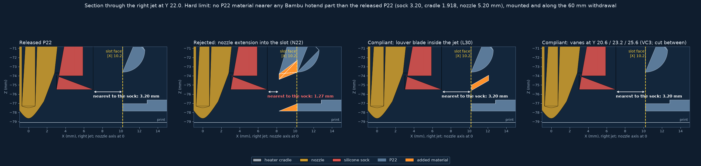

**Two measures.** *Aim* is where each outlet's mean exit direction, extended in a straight line, passes the nozzle
axis: what the outlet points at. *Passes* is where the air actually comes closest to the bead after it bends and
collides, as in the [next section](#where-the-air-passes-the-nozzle-tip). The tip is 0.2 mm above the print.

| Outlet change | Blower flow | Duct at 180 L/min | Side jets leave (down / forward) | Side jets aim at the nozzle axis (front / up) | Side jets pass (front / up) | All the air passes (front / up) |
| :--- | ---: | ---: | ---: | ---: | ---: | ---: |
| Current (released v5d) | 231 L/min | 1420 Pa | 12 / 15 deg | +3.2 / +1.8 mm | +2.6 / 2.3 mm | +0.8 / 2.3 mm |
| Floor lip trimmed 1.5 mm | 234 L/min | 1333 Pa | 17 / 18 deg | +3.4 / +0.9 mm | +2.6 / 2.5 mm | +0.7 / 2.4 mm |
| Side-jet roof lowered 1.0 mm | 209 L/min | 2151 Pa | 10 / 13 deg | +3.2 / +1.7 mm | +2.9 / 1.8 mm | +0.9 / 1.8 mm |
| Side-jet roof lowered 1.7 mm | 180 L/min | 3442 Pa | 8 / 12 deg | +3.0 / +1.6 mm | +3.1 / 1.6 mm | +0.6 / 1.6 mm |
| Vanes in the side passages (VC3) | 218 L/min | 1836 Pa | 11 / 2 deg | +0.4 / +1.8 mm | +0.6 / 2.7 mm | -1.2 / 2.6 mm |
| Louver blade in each jet (L30) | 214 L/min | 1969 Pa | 19 / 11 deg | +2.2 / +0.5 mm | +2.1 / 2.2 mm | +0.3 / 2.1 mm |
| **45-degree roof ramp (R45)** | 204 L/min | 2328 Pa | 19 / 14 deg | +3.2 / **-0.1 mm** | +2.9 / **1.4 mm** | +0.6 / 1.6 mm |
| **Louver + vanes (LV3)** | 199 L/min | 2509 Pa | 19 / 3 deg | **+0.7 / +0.3 mm** | +1.3 / 2.2 mm | -0.7 / 2.1 mm |
| Ramp + vanes (RV3) | 191 L/min | 2884 Pa | 20 / 2 deg | +1.2 / -0.4 mm | +1.8 / 1.7 mm | -0.5 / 1.8 mm |
| User's U end in each side chamber (U1) | 229 L/min | 1479 Pa | 12 / 21 deg | +3.6 / +1.9 mm | +2.9 / 2.4 mm | +1.1 / 2.2 mm |
| Front reach: chamber front wall thinned to 0.8 mm (F08) | 231 L/min | 1417 Pa | 12 / 15 deg | +2.8 / +1.7 mm | +2.2 / 2.3 mm | +0.5 / 2.2 mm |
| Ramp + floor-lip chamfer (RC) | 208 L/min | 2177 Pa | 24 / 17 deg | +3.7 / -0.9 mm | +3.3 / 1.7 mm | +0.9 / 1.7 mm |
| Louver + floor-lip chamfer (LC) | 218 L/min | 1857 Pa | 21 / 14 deg | +2.7 / -0.1 mm | +2.5 / 2.3 mm | +0.6 / 2.1 mm |
| Divider 0.8 mm, 30 deg (L30t) | 199 L/min | 2515 Pa | 18 / 10 deg | +2.0 / +0.5 mm | +2.1 / 2.2 mm | +0.3 / 2.1 mm |
| Divider 0.8 mm, 40 deg (L40t) | 152 L/min | 5689 Pa | 16 / 11 deg | +2.7 / -0.2 mm | +3.1 / 1.3 mm | +0.5 / 1.4 mm |
| Airfoil divider, 0.8 to 0.5 mm (L30a) | 210 L/min | 2105 Pa | 19 / 11 deg | +2.2 / +0.4 mm | +2.1 / 2.1 mm | +0.3 / 2.1 mm |
| Nose cut, 28-degree edge (NC28) | 226 L/min | 1563 Pa | 14 / 16 deg | +3.3 / +1.4 mm | +2.6 / 2.2 mm | +0.8 / 2.2 mm |
| Front-only airfoil divider, Y 20.5 on (L30aF) | 218 L/min | 1846 Pa | 17 / 10 deg | +1.9 / +0.8 mm | +1.6 / 2.1 mm | -0.3 / 2.1 mm |
| Nose cut + airfoil divider (NCL) | 202 L/min | 2400 Pa | 23 / 12 deg | +2.4 / -0.6 mm | +2.3 / 1.8 mm | +0.1 / 1.9 mm |
| Straight roof, 32 deg (SR32) | 229 L/min | 1461 Pa | 15 / 16 deg | +3.1 / +1.2 mm | +2.4 / 2.1 mm | +0.7 / 2.0 mm |
| Straight roof, 36 deg (SR36) | 229 L/min | 1479 Pa | 15 / 16 deg | +3.3 / +1.2 mm | +2.6 / 2.1 mm | +0.8 / 2.1 mm |
| Split roof (SPR) | 221 L/min | 1735 Pa | 13 / 15 deg | +3.6 / +1.4 mm | +3.2 / 2.0 mm | +1.2 / 1.9 mm |
| Split roof, deeper (SPD) | 216 L/min | 1922 Pa | 13 / 14 deg | +3.4 / +1.4 mm | +3.1 / 2.0 mm | +1.1 / 1.9 mm |
| Split roof, ends ramped at the slot face (SPRT) | 216 L/min | 1913 Pa | 12 / 16 deg | +3.5 / +1.6 mm | +3.1 / 2.0 mm | +1.2 / 1.9 mm |
| Split roof, rear end ramped at the slot face (SPRR) | 219 L/min | 1817 Pa | 13 / 16 deg | +3.6 / +1.5 mm | +3.2 / 2.0 mm | +1.4 / 1.9 mm |
| Split roof, ends faded out (SPF) | 219 L/min | 1819 Pa | 12 / 15 deg | +3.6 / +1.6 mm | +3.3 / 2.1 mm | +1.3 / 2.0 mm |
| Floor-lip chamfer, 22 deg (CH) | 232 L/min | 1383 Pa | 15 / 17 deg | +3.4 / +1.3 mm | +2.7 / 2.6 mm | +0.9 / 2.4 mm |
| Ramp + 12-degree lip bevel (RMC) | 207 L/min | 2197 Pa | 23 / 16 deg | +3.6 / -0.7 mm | +3.2 / 1.7 mm | +1.0 / 1.7 mm |
| Ramp + 6-degree lip bevel (RVM) | 205 L/min | 2266 Pa | 20 / 15 deg | +3.3 / -0.3 mm | +2.9 / 1.5 mm | +0.5 / 1.7 mm |
| Ramp + 15-degree long chamfer (RCX) | 210 L/min | 2096 Pa | 24 / 17 deg | +3.7 / -0.8 mm | +3.3 / 1.9 mm | +0.9 / 1.9 mm |
| Ramp + lip trimmed 1.5 mm (RT15) | 213 L/min | 2014 Pa | 27 / 18 deg | +4.0 / -1.4 mm | +3.5 / 1.9 mm | +1.0 / 1.9 mm |
| Ramp + front wall toed in (RFT) | 182 L/min | 3360 Pa | 18 / 0 deg | -0.2 / +0.0 mm | +0.6 / 1.9 mm | -1.5 / 2.0 mm |
| RVM + front wall toed in (RVMT) | 183 L/min | 3284 Pa | 19 / 1 deg | -0.1 / -0.2 mm | +0.6 / 1.9 mm | -1.6 / 2.0 mm |
| Rear slot 2.0 mm (RS20) | 247 L/min | 1042 Pa | 12 / 16 deg | +3.2 / +1.8 mm | +2.7 / 2.7 mm | +0.7 / 2.4 mm |
| RVM + 2.0 mm rear slot (RVMS) | 228 L/min | 1508 Pa | 21 / 14 deg | +3.3 / -0.4 mm | +3.0 / 1.6 mm | +0.8 / 1.6 mm |

| Outlet change | Through the fresh bead | Speed at the bead, r 0.6-2 mm | Over the print, r <= 10 mm | Aimed at the hotend | Passing above 3.6 mm | Sectors R / F / L / Re |
| :--- | ---: | ---: | ---: | ---: | ---: | ---: |
| Current (released v5d) | 6.0 L/min | 17.6 m/s | 96 L/min | 62 L/min | 64 L/min | 23 / 25 / 24 / 29 m/s |
| Floor lip trimmed 1.5 mm | 5.1 L/min | 11.3 m/s | 67 L/min | 40 L/min | 54 L/min | 16 / 17 / 17 / 22 m/s |
| Side-jet roof lowered 1.0 mm | 6.1 L/min | 20.7 m/s | 94 L/min | 30 L/min | 25 L/min | 23 / 22 / 23 / 31 m/s |
| Side-jet roof lowered 1.7 mm | 3.5 L/min | 17.7 m/s | 91 L/min | 25 L/min | 18 L/min | 23 / 33 / 28 / 10 m/s |
| Vanes in the side passages (VC3) | 5.7 L/min | 12.2 m/s | 82 L/min | 57 L/min | 70 L/min | 9 / 20 / 11 / 21 m/s |
| Louver blade in each jet (L30) | 6.0 L/min | 20.4 m/s | 100 L/min | 34 L/min | 50 L/min | 31 / 32 / 32 / 13 m/s |
| **45-degree roof ramp (R45)** | 7.4 L/min | **22.7 m/s** | 98 L/min | **2 L/min** | **21 L/min** | 34 / 28 / 31 / 23 m/s |
| **Louver + vanes (LV3)** | **8.0 L/min** | 20.6 m/s | 94 L/min | 16 L/min | 46 L/min | 29 / 29 / 29 / 16 m/s |
| Ramp + vanes (RV3) | 6.3 L/min | 15.3 m/s | 85 L/min | 2 L/min | 22 L/min | 18 / 31 / 20 / 22 m/s |
| User's U end in each side chamber (U1) | 5.3 L/min | 16.1 m/s | 88 L/min | 54 L/min | 56 L/min | 22 / 23 / 22 / 24 m/s |
| Front reach: chamber front wall thinned to 0.8 mm (F08) | 7.0 L/min | 17.9 m/s | 95 L/min | 63 L/min | 61 L/min | 23 / 26 / 25 / 30 m/s |
| Ramp + floor-lip chamfer (RC) | 6.0 L/min | 19.2 m/s | 83 L/min | 2 L/min | 19 L/min | 18 / 23 / 18 / 24 m/s |
| Louver + floor-lip chamfer (LC) | 6.5 L/min | 17.1 m/s | 90 L/min | 31 L/min | 50 L/min | 24 / 28 / 25 / 11 m/s |
| Divider 0.8 mm, 30 deg (L30t) | 8.0 L/min | 18.6 m/s | 102 L/min | 30 L/min | 49 L/min | 34 / 33 / 34 / 16 m/s |
| Divider 0.8 mm, 40 deg (L40t) | 3.4 L/min | 11.3 m/s | 96 L/min | 4 L/min | 9 L/min | 30 / 36 / 31 / 17 m/s |
| Airfoil divider, 0.8 to 0.5 mm (L30a) | 6.4 L/min | 21.9 m/s | 104 L/min | 30 L/min | 49 L/min | 33 / 33 / 35 / 12 m/s |
| Nose cut, 28-degree edge (NC28) | 5.6 L/min | 18.9 m/s | 94 L/min | 35 L/min | 58 L/min | 25 / 25 / 25 / 26 m/s |
| Front-only airfoil divider, Y 20.5 on (L30aF) | 4.2 L/min | 15.4 m/s | 99 L/min | 45 L/min | 49 L/min | 29 / 29 / 29 / 24 m/s |
| Nose cut + airfoil divider (NCL) | 5.9 L/min | 21.7 m/s | 94 L/min | 2 L/min | 33 L/min | 33 / 30 / 34 / 19 m/s |
| Straight roof, 32 deg (SR32) | 7.7 L/min | 18.5 m/s | 98 L/min | 28 L/min | 51 L/min | 25 / 24 / 25 / 28 m/s |
| Straight roof, 36 deg (SR36) | 6.9 L/min | 18.2 m/s | 93 L/min | 23 L/min | 51 L/min | 25 / 24 / 24 / 28 m/s |
| Split roof (SPR) | 5.1 L/min | 19.6 m/s | 93 L/min | 8 L/min | 42 L/min | 23 / 23 / 23 / 24 m/s |
| Split roof, deeper (SPD) | 4.0 L/min | 15.6 m/s | 93 L/min | 4 L/min | 37 L/min | 22 / 25 / 23 / 18 m/s |
| Split roof, ends ramped at the slot face (SPRT) | 5.9 L/min | 20.1 m/s | 96 L/min | 13 L/min | 43 L/min | 25 / 28 / 27 / 19 m/s |
| Split roof, rear end ramped at the slot face (SPRR) | 5.0 L/min | 21.7 m/s | 94 L/min | 7 L/min | 42 L/min | 24 / 25 / 24 / 20 m/s |
| Split roof, ends faded out (SPF) | 4.2 L/min | 20.7 m/s | 90 L/min | 14 L/min | 41 L/min | 24 / 22 / 23 / 24 m/s |
| Floor-lip chamfer, 22 deg (CH) | 4.8 L/min | 13.9 m/s | 78 L/min | 58 L/min | 65 L/min | 12 / 21 / 13 / 26 m/s |
| Ramp + 12-degree lip bevel (RMC) | 6.1 L/min | 20.4 m/s | 86 L/min | 2 L/min | 16 L/min | 22 / 24 / 22 / 21 m/s |
| **Ramp + 6-degree lip bevel (RVM)** | **9.2 L/min** | 21.4 m/s | 96 L/min | 4 L/min | 18 L/min | 28 / 26 / 27 / 25 m/s |
| Ramp + 15-degree long chamfer (RCX) | 6.2 L/min | 18.4 m/s | 75 L/min | 4 L/min | 21 L/min | 16 / 22 / 15 / 24 m/s |
| Ramp + lip trimmed 1.5 mm (RT15) | 4.9 L/min | 16.1 m/s | 68 L/min | 3 L/min | 20 L/min | 16 / 18 / 17 / 20 m/s |
| Ramp + front wall toed in (RFT) | 9.0 L/min | 23.2 m/s | 80 L/min | 11 L/min | 32 L/min | 32 / 46 / 31 / 31 m/s |
| RVM + front wall toed in (RVMT) | 8.0 L/min | 20.3 m/s | 80 L/min | 7 L/min | 30 L/min | 27 / 44 / 26 / 29 m/s |
| Rear slot 2.0 mm (RS20) | 2.0 L/min | 11.3 m/s | 80 L/min | 85 L/min | 60 L/min | 16 / 21 / 17 / 14 m/s |
| RVM + 2.0 mm rear slot (RVMS) | 4.7 L/min | 11.1 m/s | 95 L/min | 21 L/min | 13 L/min | 19 / 24 / 19 / 12 m/s |

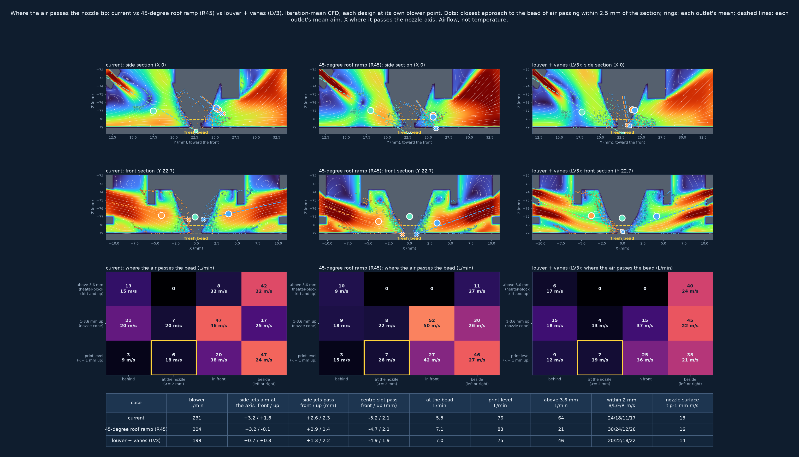

**Hot nozzle, cold bead.** The goal is to cool the bead the moment it leaves the tip while keeping air off the
nozzle and heater block, which the heater must make up. The hotend fan cools the heatsink above. Convective cooling
grows with the air speed next to a surface, so the next table compares mean air speed 0.4 mm off the CFD's walls
with the speed at the bead. *Aimed below the tip* is the share of all the air whose exit direction passes the
nozzle axis below the tip, or meets the print first.

| Outlet change | Aimed below the tip | Bead, r 0.6-2 mm | Nozzle, tip to 1 mm | Nozzle, 1 mm to the sock | Sock and heater block | Bead / nozzle above 1 mm |
| :--- | ---: | ---: | ---: | ---: | ---: | ---: |
| Current (released v5d) | 13% | 17.6 m/s | 19.3 m/s | 27.3 m/s | 25.7 m/s | 0.65 |
| Floor lip trimmed 1.5 mm | 27% | 11.3 m/s | 13.1 m/s | 22.0 m/s | 23.5 m/s | 0.51 |
| Side-jet roof lowered 1.0 mm | 16% | 20.7 m/s | 21.3 m/s | 27.3 m/s | 20.2 m/s | 0.76 |
| Side-jet roof lowered 1.7 mm | 21% | 17.7 m/s | 13.6 m/s | 20.7 m/s | 17.6 m/s | 0.86 |
| Vanes in the side passages (VC3) | 18% | 12.2 m/s | 16.6 m/s | 22.6 m/s | 21.9 m/s | 0.54 |
| **Louver blade in each jet (L30)** | 39% | 20.4 m/s | 19.1 m/s | **19.0 m/s** | 22.4 m/s | **1.08** |
| **45-degree roof ramp (R45)** | **59%** | **22.7 m/s** | 23.8 m/s | 27.8 m/s | 19.0 m/s | 0.82 |
| Louver + vanes (LV3) | 46% | 20.6 m/s | 21.9 m/s | 21.3 m/s | **18.4 m/s** | 0.97 |
| Ramp + vanes (RV3) | 57% | 15.3 m/s | 21.6 m/s | 33.6 m/s | 16.1 m/s | 0.45 |
| User's U end (U1) | 14% | 16.1 m/s | 16.6 m/s | 24.1 m/s | 23.7 m/s | 0.67 |
| Front reach (F08) | 11% | 17.9 m/s | 19.9 m/s | 28.1 m/s | 25.9 m/s | 0.64 |
| Ramp + floor-lip chamfer (RC) | **84%** | 19.2 m/s | 22.7 m/s | 27.0 m/s | 18.8 m/s | 0.71 |
| Louver + floor-lip chamfer (LC) | 55% | 17.1 m/s | 16.6 m/s | **15.9 m/s** | 22.4 m/s | 1.07 |
| Divider 0.8 mm, 30 deg (L30t) | 35% | 18.6 m/s | 19.3 m/s | 20.5 m/s | 22.1 m/s | 0.91 |
| Divider 0.8 mm, 40 deg (L40t) | 72% | 11.3 m/s | 12.7 m/s | 16.4 m/s | 15.9 m/s | 0.69 |
| **Airfoil divider, 0.8 to 0.5 mm (L30a)** | 37% | 21.9 m/s | 21.2 m/s | 19.9 m/s | 23.1 m/s | **1.10** |
| Nose cut, 28-degree edge (NC28) | 17% | 18.9 m/s | 20.2 m/s | 26.3 m/s | 24.3 m/s | 0.72 |
| Front-only airfoil divider, Y 20.5 on (L30aF) | 28% | 15.4 m/s | **13.6 m/s** | 24.6 m/s | 21.6 m/s | 0.63 |
| Nose cut + airfoil divider (NCL) | 54% | 21.7 m/s | 22.1 m/s | 25.0 m/s | 18.2 m/s | 0.87 |
| Straight roof, 32 deg (SR32) | 16% | 18.5 m/s | 20.2 m/s | 26.6 m/s | 23.4 m/s | 0.70 |
| Straight roof, 36 deg (SR36) | 17% | 18.2 m/s | 19.9 m/s | 26.3 m/s | 23.3 m/s | 0.69 |
| Split roof (SPR) | 20% | 19.6 m/s | 17.1 m/s | 20.6 m/s | 22.6 m/s | 0.95 |
| Split roof, deeper (SPD) | 21% | 15.6 m/s | 13.2 m/s | 17.6 m/s | 19.7 m/s | 0.89 |
| Split roof, ends ramped at the slot face (SPRT) | 23% | 20.1 m/s | 16.7 m/s | 20.0 m/s | 22.4 m/s | 1.00 |
| Split roof, rear end ramped at the slot face (SPRR) | 21% | 21.7 m/s | 19.2 m/s | 20.6 m/s | 22.3 m/s | 1.05 |
| Split roof, ends faded out (SPF) | 17% | 20.7 m/s | 17.6 m/s | 19.9 m/s | 22.5 m/s | 1.04 |
| Floor-lip chamfer, 22 deg (CH) | 21% | 13.9 m/s | 17.7 m/s | 27.4 m/s | 24.9 m/s | 0.51 |
| Ramp + 12-degree lip bevel (RMC) | 83% | 20.4 m/s | 22.0 m/s | 26.2 m/s | 19.5 m/s | 0.78 |
| Ramp + 6-degree lip bevel (RVM) | 78% | 21.4 m/s | 23.7 m/s | 28.1 m/s | 19.1 m/s | 0.76 |
| Ramp + 15-degree long chamfer (RCX) | 83% | 18.4 m/s | 21.5 m/s | 27.0 m/s | 18.9 m/s | 0.68 |
| Ramp + lip trimmed 1.5 mm (RT15) | 86% | 16.1 m/s | 18.0 m/s | 25.0 m/s | 17.9 m/s | 0.64 |
| Ramp + front wall toed in (RFT) | 55% | 23.2 m/s | 28.9 m/s | 41.7 m/s | 17.7 m/s | 0.56 |
| RVM + front wall toed in (RVMT) | 67% | 20.3 m/s | 27.1 m/s | 41.2 m/s | 17.8 m/s | 0.49 |
| Rear slot 2.0 mm (RS20) | 15% | 11.3 m/s | 10.4 m/s | **15.2 m/s** | 21.0 m/s | 0.74 |
| RVM + 2.0 mm rear slot (RVMS) | 66% | 11.1 m/s | **10.1 m/s** | **13.4 m/s** | **15.1 m/s** | 0.83 |

The bead trails the nozzle in whichever direction the head moves, so the weakest direction matters as much as the
mean. Speed 0.3 mm above the print:

| Outlet change | Bead ring, r 0.6-2 mm: behind / left / front / right | Weakest | Print, r 2-5 mm: behind / left / front / right | Weakest |
| :--- | :--- | ---: | :--- | ---: |
| Current (released v5d) | 23.7 / 17.9 / 11.1 / 17.5 m/s | 11.1 m/s | 29.4 / 25.1 / 26.6 / 24.2 m/s | 24.2 m/s |
| 45-degree roof ramp (R45) | 29.7 / 23.7 / 11.9 / 25.8 m/s | 11.9 m/s | 22.3 / 31.2 / 29.7 / 34.6 m/s | 22.3 m/s |
| Louver blade in each jet (L30) | 20.3 / 23.2 / 15.9 / 22.3 m/s | 15.9 m/s | 12.1 / 33.2 / 33.2 / 32.1 m/s | 12.1 m/s |
| Louver + vanes (LV3) | 19.9 / 22.4 / 18.4 / 21.8 m/s | **18.4 m/s** | 14.8 / 29.7 / 30.5 / 30.2 m/s | 14.8 m/s |
| Ramp + floor-lip chamfer (RC) | 27.3 / 19.6 / 10.6 / 19.6 m/s | 10.6 m/s | 23.5 / 17.8 / 23.8 / 17.7 m/s | 17.7 m/s |
| Louver + floor-lip chamfer (LC) | 16.9 / 19.1 / 13.1 / 19.4 m/s | 13.1 m/s | 10.0 / 25.0 / 29.2 / 25.0 m/s | 10.0 m/s |
| Divider 0.8 mm, 30 deg (L30t) | 15.1 / 20.8 / 16.7 / 22.3 m/s | 15.1 m/s | 16.0 / 35.3 / 34.9 / 35.2 m/s | 16.0 m/s |
| Airfoil divider, 0.8 to 0.5 mm (L30a) | 21.0 / 24.9 / 17.3 / 24.5 m/s | 17.3 m/s | 10.9 / 35.3 / 34.5 / 34.4 m/s | 10.9 m/s |
| Nose cut, 28-degree edge (NC28) | 26.1 / 19.6 / 9.7 / 20.1 m/s | 9.7 m/s | 26.4 / 25.2 / 26.5 / 25.9 m/s | 25.2 m/s |
| Front-only airfoil divider, Y 20.5 on (L30aF) | 15.1 / 15.6 / 14.6 / 16.1 m/s | 14.6 m/s | 25.0 / 30.2 / 30.8 / 30.7 m/s | **25.0 m/s** |
| Nose cut + airfoil divider (NCL) | 24.1 / 23.8 / 15.0 / 23.9 m/s | 15.0 m/s | 18.8 / 35.0 / 31.3 / 34.5 m/s | 18.8 m/s |
| Straight roof, 32 deg (SR32) | 24.8 / 18.7 / 11.1 / 19.2 m/s | 11.1 m/s | 28.8 / 25.4 / 25.9 / 25.7 m/s | 25.4 m/s |
| Straight roof, 36 deg (SR36) | 24.6 / 18.4 / 10.9 / 18.9 m/s | 10.9 m/s | 29.2 / 25.2 / 25.7 / 26.5 m/s | 25.2 m/s |
| Split roof (SPR) | 22.8 / 24.5 / 8.2 / 23.7 m/s | 8.2 m/s | 23.6 / 22.5 / 24.7 / 23.2 m/s | 22.5 m/s |
| Split roof, deeper (SPD) | 18.2 / 17.6 / 8.9 / 18.1 m/s | 8.9 m/s | 17.4 / 22.9 / 27.4 / 22.8 m/s | 17.4 m/s |
| Split roof, ends ramped at the slot face (SPRT) | 21.3 / 25.1 / 11.6 / 23.2 m/s | 11.6 m/s | 18.1 / 26.5 / 29.4 / 25.1 m/s | 18.1 m/s |
| Split roof, rear end ramped at the slot face (SPRR) | 23.9 / 25.3 / 10.8 / 27.8 m/s | 10.8 m/s | 18.8 / 23.8 / 26.3 / 23.9 m/s | 18.8 m/s |
| Split roof, ends faded out (SPF) | 22.8 / 26.5 / 7.6 / 26.7 m/s | 7.6 m/s | 23.4 / 22.8 / 23.9 / 23.3 m/s | 22.8 m/s |
| Floor-lip chamfer, 22 deg (CH) | 20.2 / 12.3 / 10.8 / 12.3 m/s | 10.8 m/s | 26.5 / 13.4 / 22.3 / 12.4 m/s | 12.4 m/s |
| Ramp + 12-degree lip bevel (RMC) | 28.5 / 22.4 / 8.8 / 22.2 m/s | 8.8 m/s | 20.2 / 21.9 / 26.2 / 22.3 m/s | 20.2 m/s |
| Ramp + 6-degree lip bevel (RVM) | 29.9 / 22.0 / 10.6 / 23.3 m/s | 10.6 m/s | 24.0 / 27.3 / 27.2 / 28.4 m/s | 24.0 m/s |
| Ramp + 15-degree long chamfer (RCX) | 25.8 / 18.9 / 9.6 / 19.6 m/s | 9.6 m/s | 23.8 / 14.7 / 23.7 / 15.5 m/s | 14.7 m/s |
| Ramp + lip trimmed 1.5 mm (RT15) | 19.2 / 19.6 / 8.4 / 17.8 m/s | 8.4 m/s | 20.1 / 16.8 / 19.5 / 15.8 m/s | 15.8 m/s |
| Ramp + front wall toed in (RFT) | 26.1 / 21.0 / 24.5 / 21.2 m/s | **21.0 m/s** | 31.6 / 32.6 / 48.9 / 33.4 m/s | **31.6 m/s** |
| RVM + front wall toed in (RVMT) | 23.0 / 17.4 / 23.8 / 16.9 m/s | 16.9 m/s | 30.5 / 26.8 / 46.0 / 28.0 m/s | 26.8 m/s |
| Rear slot 2.0 mm (RS20) | 8.3 / 14.3 / 9.7 / 13.2 m/s | 8.3 m/s | 14.0 / 16.5 / 22.6 / 16.1 m/s | 14.0 m/s |
| RVM + 2.0 mm rear slot (RVMS) | 6.9 / 13.0 / 10.8 / 13.4 m/s | 6.9 m/s | 11.8 / 18.6 / 25.2 / 19.2 m/s | 11.8 m/s |

- **The louver keeps the nozzle hottest for the most bead air.** It halves the air on the sides of the cone,
  where the side jets hit (22.8 to 10.1 m/s on the left, 22.7 to 12.7 on the right), and still adds 16% at the
  bead. It costs 7% of the blower flow.
- **The ramp puts the most air at the bead and the least on the sock, but not off the nozzle.** Its lower,
  faster side jets collide and drive air up the back of the cone (22.5 to 27.5 m/s).
- **Removing the lean is worst for the nozzle.** With ramp and vanes the jets collide on the nozzle, and the cone
  sees 34 m/s.
- **Aiming steeper is not more air at the bead.** Adding a floor-lip chamfer to the ramp (RC) aims 84% of all the
  air, and 97% of the side jets, below the tip. But the jets land short of the nozzle and spread, as with the lip
  trim. The bead gets 19 m/s against 23 with the ramp alone, and the print 2-5 mm out gets 21 m/s against 26 today.
  The same chamfer under the louver (LC) cut the bead to 17 m/s from 20. Aim the jets at tip height, not into the
  print short of it.
- **The louver designs give the most even bead ring.** With louver and vanes every direction at the bead gets at
  least 18 m/s, against 11 now. Their weak point is the print 2-5 mm behind the nozzle (12-15 m/s against 29),
  where the centre slot's air is pushed aside.

- **The centre slot already aims at the bead.** In every design its aim line meets the print 0.3-0.8 mm short of
  the nozzle axis, just behind the tip. Its air still passes about 5 mm behind, because the side jets and the
  nozzle cone turn it.
- **The side jets aim 3.2 mm in front and 1.8 mm up.** Height and lean have separate causes, and each has its own
  fix inside the duct.
- **Height: the 45-degree roof ramp.** The last 1.7 mm of each jet's roof becomes a straight 45-degree ramp from
  the slot face into the bell-mouth round, 0.92 mm lower at the exit. The aim line drops to print level at the
  axis. The side jets pass 1.4 mm up instead of 2.3, and air aimed at the hotend falls from 62 to 2 L/min.
- **Lean: vanes across each passage.** Three 0.45 mm vanes cut the forward lean from 15 to 2 degrees but leave
  the height. It comes from the side chamber's forward flow, not from the outlet.
- **Both: louver + vanes.** A 0.5 mm louver blade turns each jet's upper half down. With the vanes, each jet aims
  0.7 mm in front of the axis and 0.3 mm above the print, at the bead. It puts the most air through the bead of
  any design: 8.0 L/min, up a third.
- **The mean of all the air still passes about 2 mm up.** In every design, compliant or not, the two side jets
  meet head-on at the nozzle, and the collision turns part of each upward. Aiming moves where they meet, not
  that they meet.
- **Aiming the two side jets exactly at the bead backfires.** With the ramp and the vanes together (RV3), each
  jet aims 1.2 mm in front at print level, and all the air passes nearest the bead (-0.5 / 1.8 mm). But the jets
  now collide on the bead itself, so the air there slows to 15 m/s against 23 with the ramp alone. With the ramp
  alone they meet about 3 mm in front, and the air sweeps across the bead at speed.
- **Every redirecting change costs air.** Blower flow falls to 191-218 L/min from 231. The faster side jets also
  push the centre slot's air aside: the rear sector drops to 13-23 m/s from 29 while the sides rise.

**User's U end (U1).** The user's sketch rounded the side chamber's lower-front corner into a U and curled the
front wall back to the ceiling ([sketch on the R43 and current ducts](images/r43_user_u_bowl_flow.png)). On
today's duct its bottom matches the floor within 0.5 mm, so the new parts are the rounded corner and the curl. It
was built inside each chamber from |X| 12.6 outward, following the front wall forward where the chamber reaches
further. It stays within the hard limits and leaves the jet exits unchanged.

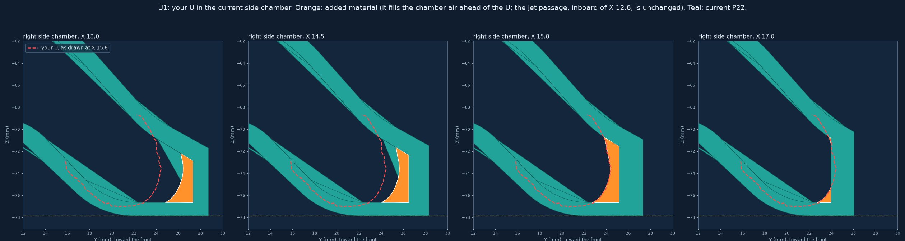

It costs almost no air (229 L/min) and evens the sectors, but it leans the jets further forward: 21 degrees
instead of 15. Air through the bead falls 12%. The fill takes chamber volume from the front of each jet passage.
Only 29% of the passage's inflow now enters ahead of Y 24, against 38%, so the front of each jet is fed by air
running forward along the passage. To bring the jets rearward the front of the passage needs more direct feed,
not less. The inverse test (F08) thins each chamber's front wall to 0.8 mm from the inside, so more chamber air
sits ahead of the passage. It moves the jets 0.4 mm rearward at no cost: the right direction, but a small effect.
Printed back-down, the U's curl would also be a 63-degree overhang inside the chamber.

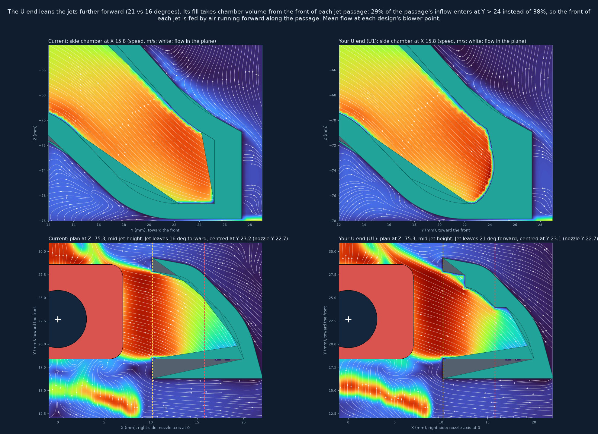

### Dividers: why they choke, and a printable one

The divider is outlet geometry: a fin printed with P22 that splits each jet's opening into two stacked slots. The
lower slot keeps the flat floor and feeds the bead. The upper slot gets its own floor at 30 degrees and passes under
the nozzle cone. A reshaped roof or floor alone cannot give the top and bottom of one jet different angles: the ramp
shrinks the opening, and floor chamfers land the bottom short of the bead. So far the divider is the only change
that takes air off the nozzle.

The air reaches the divider's leading edge already heading 24-34 degrees down, so a 30-degree fin meets it
head-on. The choking comes from the slot shape. Each fin rises outward faster than the bell-mouth roof above it, so
the upper slot is narrowest upstream rather than at the exit:

| Divider | Upper slot at X 11.6 / at the exit | Duct at 180 L/min | Blower flow |
| :--- | ---: | ---: | ---: |
| None (current; one 3.44 mm opening) | - | 1420 Pa | 231 L/min |
| 0.5 mm flat, 30 deg (L30) | - | 1969 Pa | 214 L/min |
| 0.8 mm flat, 30 deg (L30t) | 0.88 / 1.20 mm | 2515 Pa | 199 L/min |
| 0.8 mm flat, 40 deg (L40t) | 0.48 / 1.12 mm | 5689 Pa | 152 L/min |
| Airfoil, 0.8 mm tapering to 0.5 mm, 30 deg (L30a) | 0.90 / 1.36 mm | 2105 Pa | 210 L/min |

- **At 40 degrees the upper slot's inlet closes to 0.48 mm** and the duct pressure quadruples. Rejected.
- **A square-ended 0.8 mm fin separates the flow at both ends.** At 180 L/min the side jets' exit dynamic
  pressure rises from 977 to 1,579 Pa on 12% less flow, and the loss between the side channels and the exits
  rises from 156 to 626 Pa.
- **A round leading edge and a taper to 0.5 mm at the exit recover most of that (L30a).** It is now the best
  divider: bead 21.9 m/s, weakest bead direction 17.3 m/s against 11.1 today, nozzle cone 19.9 m/s against 27.3,
  and the most air over the print of any design (104 L/min).
- **Every divider weakens the print 2-5 mm behind the nozzle** (11-16 m/s against 29 today), where the centre
  slot's air lands. The divider's rear part turns air down onto the print just behind the nozzle, which stalls the
  centre slot's air. With the divider on the front part only (Y 20.5 on, L30aF), the print 2-5 mm out is the most
  even of any design (25-31 m/s every way) and the tip sees the least air (13.6 m/s). But the fresh-bead ring drops
  to 15.4 m/s: the rear part of the divided jet is also what feeds the bead.
- **The fins print.** The matched H2D ABS slices extrude them on every layer of each side: 90% of the CAD volume
  for the flat 0.8 mm fin, 82% for the airfoil, whose 0.5 mm tail prints slightly thin. Support (4.73 and 4.20
  against 4.62 cm3) and time (1.31-1.32 h) barely change.

### Steering without blocking: the nose cut

Every device placed in the outlet sits in the fastest air of the duct, about 50 m/s, and losses grow with the
square of speed. The side chamber's air moves at 10-15 m/s. So the cheapest way to steer is with the shape of the
walls the air already follows. The jet's roof is a convex bell-mouth round whose last tangent at the exit is
horizontal. The nose cut removes the round's lower part inboard of the point where it points 28 degrees down,
leaving a sharp edge there (X 11.33, Z-73.32) and a face rising 30 degrees to the slot face. It removes 6.4 mm3 per
side and adds nothing, so every hotend clearance is unchanged, and the exit area grows 12%.

| At the exit (X 10.3), inward-flux-weighted over Y 18-27, both jets | Bottom to top quarter | Mean |
| :--- | :--- | ---: |
| Current (released v5d) | 9 / 13 / 15 / 15 deg | 13 deg |
| Nose cut, 28-degree edge (NC28) | 10 / 16 / 19 / 20 deg | 16 deg |
| Airfoil divider (L30a) | 11 / 16 / 30 / 22 deg | 19 deg |

The nose cut costs only 2% of the blower flow and keeps the region behind the nozzle intact (26 m/s at 2-5 mm),
with all four sectors at 25-26 m/s. But it steers only about 3 degrees: the air already leaves the round at about
15 degrees today, and the 2.65 mm flat floor sets most of the jet's direction. Bead +7%, nozzle cone -4%, sock -5%.
It is a near-free improvement, not the step change the divider gives. Adding it to the airfoil divider (NCL) made
the divider worse: 202 against 210 L/min, and the nozzle cone 25.0 against 19.9 m/s.

**Direction after review: no fins, vanes or louvers in the outlet.** Only the outlet's own walls change from here.

### Walls only: close the window the nozzle's air comes from

**A steeper roof steers only the top of the jet.** The straight roof (SR32) replaces the last 2.5 mm of the
bell-mouth round with a straight roof rising 32 degrees outward from the existing exit edge. It only removes
material, so the exit opening and every clearance are unchanged. Like the nose cut, it turns the top quarter of
each jet down (21 degrees against 15) but leaves the bottom half on the flat floor, and the air under the straight
roof is slow. At 36 degrees (SR36) nothing changes further. Both keep the flow and cut the air aimed at the hotend
from 62 to 23-28 L/min, but the nozzle cone still sees 26 m/s. The 45-degree ramp leaves the steepest jets of any
wall change, 21 degrees on average, and scrubs the cone the most.

**Where the cone's air comes from.** Each side-jet streamline was traced back to where it leaves the opening. In
every design, the air that passes within 0.5 mm of the nozzle cone leaves through one stripe of the opening: Z-74.3
to -75.4, from Y 19 to 24, the rear-middle of its upper half (red below). Air above the stripe passes over the cone
onto the sock. Air below it passes under the cone or in front. Steering the roof does not move the stripe.

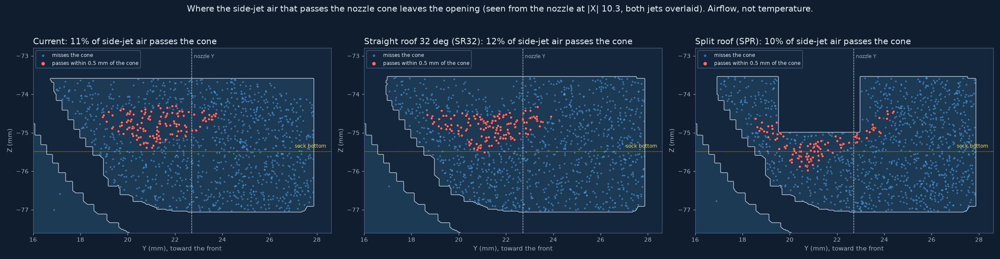

| Outlet change | Exit angle, bottom to top quarter | Side-jet air within 0.5 mm of the cone | Blower flow | Bead, r 0.6-2 mm | Nozzle cone, 1 mm to the sock |
| :--- | :--- | ---: | ---: | ---: | ---: |
| Current (released v5d) | 9 / 13 / 15 / 15 deg (mean 13) | 11% | 231 L/min | 17.6 m/s | 27.3 m/s |
| Nose cut, 28-degree edge (NC28) | 10 / 16 / 19 / 20 deg (16) | 12% | 226 L/min | 18.9 m/s | 26.3 m/s |
| Straight roof, 32 deg (SR32) | 10 / 15 / 18 / 21 deg (16) | 12% | 229 L/min | 18.5 m/s | 26.6 m/s |
| Straight roof, 36 deg (SR36) | 10 / 15 / 19 / 22 deg (17) | 13% | 229 L/min | 18.2 m/s | 26.3 m/s |
| 45-degree roof ramp (R45) | 11 / 18 / 25 / 32 deg (21) | 16% | 204 L/min | 22.7 m/s | 27.8 m/s |
| Side-jet roof lowered 1.0 mm | 7 / 10 / 12 / 12 deg (10) | 13% | 209 L/min | 20.7 m/s | 27.3 m/s |
| Side-jet roof lowered 1.7 mm | 5 / 7 / 9 / 11 deg (8) | 10% | 180 L/min | 17.7 m/s | 20.7 m/s |
| **Split roof (SPR)** | 7 / 12 / 16 / 20 deg (14) | 10% | 221 L/min | **19.6 m/s** | **20.6 m/s** |
| Split roof, deeper (SPD) | 7 / 11 / 15 / 20 deg (13) | 8% | 216 L/min | 15.6 m/s | 17.6 m/s |
| Airfoil divider (L30a, excluded) | 11 / 16 / 30 / 22 deg (19) | 4% | 210 L/min | 21.9 m/s | 19.9 m/s |

**The split roof (SPR)** lowers the roof only over that window and keeps the 32-degree straight roof elsewhere.
Over Y 19.5-23.0 the bell-mouth round moves down 1.45 mm with the roof, to Z-75.0 at the exit. The window stops at
Y 19.5 because the heel's floor climbs behind it, and at least 1.35 mm stays open there. It adds 11.8 mm3 per side
inside the jet passage, all at |X| >= 10.2, and the opening shrinks 5.5%. Every hotend clearance is unchanged,
mounted and along the 60 mm withdrawal.

| At each design's blower point | Current | Straight roof (SR32) | Split roof (SPR) | Deeper (SPD) |
| :--- | ---: | ---: | ---: | ---: |
| Blower flow | 231 L/min | 229 L/min | 221 L/min | 216 L/min |
| Bead, r 0.6-2 mm | 17.6 m/s | 18.5 m/s | **19.6 m/s** | 15.6 m/s |
| Bead ring, weakest direction | 11.1 m/s (front) | 11.1 m/s (front) | 8.2 m/s (front) | 8.9 m/s (front) |
| Nozzle tip to 1 mm | 19.3 m/s | 20.2 m/s | 17.1 m/s | 13.2 m/s |
| Nozzle cone, 1 mm to the sock | 27.3 m/s | 26.6 m/s | **20.6 m/s** | 17.6 m/s |
| Sock and heater block | 25.7 m/s | 23.4 m/s | 22.6 m/s | 19.7 m/s |
| Bead / nozzle above 1 mm | 0.65 | 0.70 | **0.95** | 0.89 |
| Air aimed at the hotend | 62 L/min | 28 L/min | 8 L/min | 4 L/min |
| Print 2-5 mm out, weakest direction | 24.2 m/s | 25.4 m/s | 22.5 m/s | 17.4 m/s |

- **The split roof takes as much air off the nozzle as the louvers did, with no blade.** The cone sees 20.6 m/s
  against 27.3 today and 19.0-20.5 with the louver and dividers (L30, L30t, L30a). Lowering the whole roof to the
  same cone speed cost 22% of the flow; the split roof costs 4%.
- **The bead gets 11% more air,** and the left and right of the bead ring 24 m/s against 18. Air aimed at the
  hotend falls from 62 to 8 L/min.
- **Its weak point is the front of the bead ring,** 8.2 m/s against 11.1. With the window closed, the jets' air is
  weighted to the front of the opening. They meet further forward (3.2 mm against 2.6), and the slow pocket in
  front of the tip grows.
- **Going deeper costs the bead.** Lowering the roof to Z-75.4 over Y 20-24 (SPD) cuts the cone to 17.6 m/s but
  the bead to 15.6 m/s. The air under the window is also what feeds the sides of the bead.
- **The rest of the cone's air now leaves just under the lowered roof and at the window's two ends** (map). It
  meets the cone lower and slower.

### Re-scored: air delivered onto the bead

**The bead measure above favours jets that collide.** "Bead, r 0.6-2 mm" is the mean air speed 0.3 mm above the
print. It counts air moving sideways past the bead. Where a jet strikes the print the air turns and slows, yet
that is where impingement cooling is strongest and the air is fresh. So this round also measures the air arriving
onto the print around the nozzle. It is the downward flow through a plane 0.5 mm above the print in the bead ring
(r 0.6-2 mm) and in the print around it (r 2-5 mm), together with the flow rising through the same rings. The
byte-identical repeat run agrees within 5% for the arriving flow and 17% for the rising flow at r 2-5 mm.

| Outlet change | Arriving onto the bead ring | Rising off the bead ring | Print r 2-5 mm, arriving / rising | Nozzle cone, 1 mm to the sock | Blower flow |
| :--- | ---: | ---: | ---: | ---: | ---: |
| Current (released v5d) | 1.5 L/min | 0.0 L/min | 7.4 / 7.7 L/min | 27.3 m/s | 231 L/min |
| Floor lip trimmed 1.5 mm | 2.6 L/min | 0.0 L/min | 5.1 / 3.2 L/min | 22.0 m/s | 234 L/min |
| Side-jet roof lowered 1.0 mm | 2.8 L/min | 0.0 L/min | 8.3 / 4.7 L/min | 27.3 m/s | 209 L/min |
| Side-jet roof lowered 1.7 mm | 0.1 L/min | 1.2 L/min | 9.0 / 5.6 L/min | 20.7 m/s | 180 L/min |
| Vanes in the side passages (VC3) | 3.1 L/min | 0.0 L/min | 6.0 / 2.4 L/min | 22.6 m/s | 218 L/min |
| Louver blade in each jet (L30) | 0.0 L/min | 2.9 L/min | 3.5 / 10.2 L/min | 19.0 m/s | 214 L/min |
| 45-degree roof ramp (R45) | 0.4 L/min | 0.9 L/min | 5.4 / 10.4 L/min | 27.8 m/s | 204 L/min |
| Louver + vanes (LV3) | 0.0 L/min | 1.7 L/min | 4.0 / 11.5 L/min | 21.3 m/s | 199 L/min |
| Ramp + vanes (RV3) | 3.5 L/min | 0.0 L/min | 7.0 / 8.7 L/min | 33.6 m/s | 191 L/min |
| User's U end (U1) | 1.3 L/min | 0.0 L/min | 7.0 / 3.9 L/min | 24.1 m/s | 229 L/min |
| Front reach (F08) | 1.5 L/min | 0.0 L/min | 7.7 / 7.3 L/min | 28.1 m/s | 231 L/min |
| Ramp + floor-lip chamfer (RC) | 2.9 L/min | 0.1 L/min | 6.5 / 6.7 L/min | 27.0 m/s | 208 L/min |
| Louver + floor-lip chamfer (LC) | 0.0 L/min | 2.1 L/min | 5.0 / 5.7 L/min | 15.9 m/s | 218 L/min |
| Divider 0.8 mm, 30 deg (L30t) | 0.0 L/min | 3.5 L/min | 1.9 / 14.4 L/min | 20.5 m/s | 199 L/min |
| Divider 0.8 mm, 40 deg (L40t) | 0.5 L/min | 1.0 L/min | 5.9 / 13.9 L/min | 16.4 m/s | 152 L/min |
| Airfoil divider, 0.8 to 0.5 mm (L30a) | 0.0 L/min | 3.4 L/min | 3.6 / 11.0 L/min | 19.9 m/s | 210 L/min |
| Nose cut, 28-degree edge (NC28) | 1.1 L/min | 0.1 L/min | 6.7 / 7.5 L/min | 26.3 m/s | 226 L/min |
| Front-only airfoil divider, Y 20.5 on (L30aF) | 0.3 L/min | 1.0 L/min | 4.5 / 8.4 L/min | 24.6 m/s | 218 L/min |
| Nose cut + airfoil divider (NCL) | 0.0 L/min | 2.2 L/min | 3.7 / 11.6 L/min | 25.0 m/s | 202 L/min |
| Straight roof, 32 deg (SR32) | 1.1 L/min | 0.1 L/min | 7.2 / 7.7 L/min | 26.6 m/s | 229 L/min |
| Straight roof, 36 deg (SR36) | 1.2 L/min | 0.1 L/min | 7.1 / 6.8 L/min | 26.3 m/s | 229 L/min |
| Split roof (SPR) | 0.8 L/min | 0.5 L/min | 6.7 / 3.6 L/min | 20.6 m/s | 221 L/min |
| Split roof, deeper (SPD) | 0.7 L/min | 1.0 L/min | 6.0 / 4.8 L/min | 17.6 m/s | 216 L/min |
| Split roof, ends ramped at the slot face (SPRT) | 0.3 L/min | 1.2 L/min | 7.9 / 5.7 L/min | 20.0 m/s | 216 L/min |
| Split roof, rear end ramped at the slot face (SPRR) | 0.3 L/min | 1.3 L/min | 8.6 / 5.2 L/min | 20.6 m/s | 219 L/min |
| Split roof, ends faded out (SPF) | 0.6 L/min | 0.3 L/min | 6.7 / 3.2 L/min | 19.9 m/s | 219 L/min |
| **Floor-lip chamfer alone (CH)** | **3.4 L/min** | 0.0 L/min | 7.1 / 4.3 L/min | 27.4 m/s | **232 L/min** |
| Ramp + 12-degree lip bevel (RMC) | 1.4 L/min | 0.4 L/min | 6.7 / 7.9 L/min | 26.2 m/s | 207 L/min |
| Ramp + 6-degree lip bevel (RVM) | 1.2 L/min | 0.2 L/min | 5.9 / 10.5 L/min | 28.1 m/s | 205 L/min |
| Ramp + 15-degree long chamfer (RCX) | 3.4 L/min | 0.1 L/min | 7.9 / 6.2 L/min | 27.0 m/s | 210 L/min |
| **Ramp + lip trimmed 1.5 mm (RT15)** | **4.0 L/min** | 0.0 L/min | 6.9 / 6.2 L/min | 25.0 m/s | 213 L/min |
| Ramp + front wall toed in (RFT) | 2.9 L/min | 0.0 L/min | 9.8 / 9.5 L/min | 41.7 m/s | 182 L/min |
| RVM + front wall toed in (RVMT) | 4.3 L/min | 0.0 L/min | 8.8 / 9.2 L/min | 41.2 m/s | 183 L/min |
| RVM + 2.0 mm rear slot (RVMS) | 0.0 L/min | 2.2 L/min | 9.5 / 2.6 L/min | **13.4 m/s** | 228 L/min |
| Rear slot 2.0 mm (RS20) | 0.8 L/min | 0.2 L/min | **10.7 / 1.8 L/min** | 15.2 m/s | 247 L/min |

- **Cutting the floor lip delivers the most air onto the bead of any blade-free outlet.** The chamfer alone (CH)
  drops the lip's top from |X| 11.2 to 0.4 mm lower at the slot face, over Y 22.4-28.6. It puts 3.4 L/min onto the
  bead ring against 1.5 today, with nothing rising there, at no cost in flow. Both jets' aim lines now cross at
  the bead. The lip trim (2.6 L/min), the chamfer under the ramp (RC, 2.9; RCX, 3.4) and the ramp with the lip
  trimmed (RT15, 4.0) do the same. The speed measure ranked all of them down.
- **The louvers and dividers put no air onto the bead.** Their jets meet at the nozzle and turn up it: 2-3.5 L/min
  rises off the bead ring. Their high bead speed is that collision.
- **The split roofs keep air off the nozzle but deliver little onto the bead** (0.3-0.8 L/min).
- **The chamfer leaves the nozzle cone as exposed as today** (27.4 m/s). Only the lip trim, among blade-free
  outlets, has both: 2.6 L/min onto the bead and the cone at 22.0 m/s.

### Scored by the user's target zones: hit the bead, punish high exponentially, low quadratically

**The user's rule, 2026-10-31.** Love hitting the bead, punish air passing higher exponentially and air passing
lower quadratically, and prefer more low to more high. The bead is taken as 0-0.4 mm below the nozzle tip, so it
does not overlap the nozzle. Each outlet has its own target and nothing crosses the centre: the left jet's is the
half-disc left of the nozzle, the right jet's is the right half, and the rear slot's is the half behind it.
`cfd_bead_zones_r43.py` scores every flux-weighted streamline against its own zone, here 4 mm in radius.

- Inside the zone it scores +1.
- Passing D above tip level over the zone, it scores 1 - (e^(D/1 mm) - 1).
- Reaching tip level short of the zone, it scores 1 - (D/1 mm)^2. D is the drop a 20-degree jet makes over the
  shortfall.

*Path* follows the real streamline; *aim* extends its exit direction straight. A score of 1 puts every litre in
its zone. The byte-identical repeat agrees within 0.2 on the side-jet path score. Air in the zones varies by up
to 0.8 L/min between identical runs, because only 1-3% of the streamlines enter them.

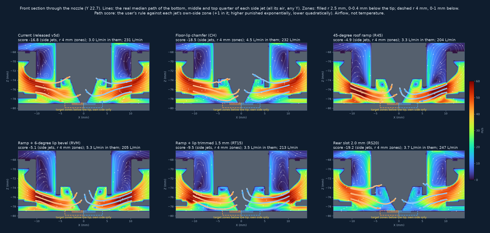

| Outlet change | Side jets, path score | Side jets, aim score | Side-jet exit angle, bottom to top quarter (mean) | Air in the zones | Arriving on the bead ring | Side-jet air passing the cone | Nozzle cone, 1 mm to the sock | Blower flow |
| :--- | ---: | ---: | :--- | ---: | ---: | ---: | ---: | ---: |
| Current (released v5d) | -16.8 | -3.8 | 9 / 13 / 15 / 15 deg (13) | 3.0 L/min | 1.5 L/min | 11% | 27.3 m/s | 231 L/min |
| Current, byte-identical repeat | -16.6 | -3.8 | 9 / 13 / 15 / 15 deg (13) | 3.8 L/min | 1.4 L/min | 10% | 27.2 m/s | 231 L/min |
| Floor lip trimmed 1.5 mm | -17.6 | -1.4 | 23 / 19 / 18 / 17 deg (19) | 2.8 L/min | 2.6 L/min | 11% | 22.0 m/s | 234 L/min |
| Floor-lip chamfer, 22 deg (CH) | -18.5 | -2.5 | 17 / 16 / 17 / 15 deg (16) | 4.5 L/min | 3.4 L/min | 11% | 27.4 m/s | 232 L/min |
| Side-jet roof lowered 1.0 mm | -8.9 | -2.7 | 7 / 10 / 12 / 12 deg (10) | 4.6 L/min | 2.8 L/min | 13% | 27.3 m/s | 209 L/min |
| Side-jet roof lowered 1.7 mm | -7.9 | -2.0 | 5 / 7 / 9 / 11 deg (8) | 2.2 L/min | 0.1 L/min | 10% | 20.7 m/s | 180 L/min |
| Nose cut, 28-degree edge (NC28) | -15.7 | -1.7 | 10 / 16 / 19 / 20 deg (16) | 4.4 L/min | 1.2 L/min | 12% | 26.3 m/s | 226 L/min |
| Straight roof, 32 deg (SR32) | -14.1 | -1.0 | 10 / 15 / 18 / 21 deg (16) | 4.4 L/min | 1.1 L/min | 12% | 26.6 m/s | 229 L/min |
| Split roof (SPR) | -13.3 | -1.7 | 7 / 12 / 16 / 20 deg (14) | 2.5 L/min | 0.8 L/min | 10% | 20.6 m/s | 221 L/min |
| Split roof, ends faded out (SPF) | -13.4 | -2.7 | 6 / 10 / 14 / 18 deg (12) | 2.1 L/min | 0.6 L/min | 10% | 19.9 m/s | 219 L/min |
| 45-degree roof ramp (R45) | **-4.9** | +0.7 | 11 / 18 / 25 / 31 deg (21) | 3.3 L/min | 0.4 L/min | 16% | 27.8 m/s | 204 L/min |
| **Ramp + 6-degree lip bevel (RVM)** | **-5.1** | **+0.8** | 14 / 19 / 25 / 32 deg (22) | **5.3 L/min** | 1.2 L/min | 18% | 28.1 m/s | 205 L/min |
| Ramp + 12-degree lip bevel (RMC) | -6.9 | +0.7 | 17 / 21 / 26 / 32 deg (24) | 4.4 L/min | 1.4 L/min | 13% | 26.2 m/s | 207 L/min |
| Ramp + 22-degree lip chamfer (RC) | -7.1 | +0.5 | 21 / 23 / 27 / 33 deg (26) | 3.9 L/min | 2.9 L/min | 13% | 27.0 m/s | 208 L/min |
| Ramp + 15-degree long chamfer (RCX) | -9.0 | +0.6 | 20 / 23 / 27 / 33 deg (26) | 4.1 L/min | 3.4 L/min | 14% | 27.0 m/s | 210 L/min |
| Ramp + lip trimmed 1.5 mm (RT15) | -9.5 | +0.3 | 29 / 27 / 29 / 34 deg (30) | 3.5 L/min | 4.0 L/min | 12% | 25.0 m/s | 213 L/min |
| Ramp + front wall toed in (RFT) | -8.2 | +0.8 | 10 / 16 / 22 / 30 deg (19) | 4.7 L/min | 2.9 L/min | 31% | 41.7 m/s | 182 L/min |
| RVM + front wall toed in (RVMT) | -8.2 | +0.9 | 12 / 17 / 22 / 30 deg (20) | 5.5 L/min | 4.3 L/min | 29% | 41.2 m/s | 183 L/min |
| RVM + 2.0 mm rear slot (RVMS) | -8.3 | +0.7 | 15 / 20 / 25 / 32 deg (23) | 4.4 L/min | 0.0 L/min | 0% | **13.4 m/s** | 228 L/min |
| Rear slot 2.0 mm (RS20) | -19.2 | -5.1 | 10 / 13 / 14 / 14 deg (13) | 3.7 L/min | 0.8 L/min | 4% | **15.2 m/s** | **247 L/min** |
| Louver blade (L30, excluded) | -16.6 | +0.0 | 12 / 18 / 26 / 20 deg (18) | 4.1 L/min | 0.0 L/min | 6% | 19.0 m/s | 214 L/min |
| Airfoil divider (L30a, excluded) | -16.5 | +0.1 | 11 / 16 / 30 / 22 deg (19) | 4.4 L/min | 0.0 L/min | 4% | 19.9 m/s | 210 L/min |
| Ramp + vanes (RV3, excluded) | -6.9 | +0.7 | 9 / 17 / 25 / 32 deg (21) | 4.1 L/min | 3.5 L/min | 22% | 33.6 m/s | 191 L/min |

- **Make each side jet converge: steer the roof hard and the floor gently.** The two best scores, the 45-degree
  roof ramp (R45, -4.9) and the ramp with a 6-degree lip bevel (RVM, -5.1), have the most convergent jets. Their top
  quarter leaves 31-32 degrees down and their bottom quarter 11-14, a spread of 18-20 degrees, so the layers close
  on the zone. Every steeper floor cut shrinks that spread and lands the bottom short: a 12-degree bevel scores
  -6.9, the 22-degree chamfer -7.1, the long chamfer -9.0 and the lip trim -9.5. Floor cuts without the ramp leave
  the top at 15-17 degrees and score no better than today (-17.6, -18.5), although they put the most air onto the
  bead ring. The nose cut with the long chamfer (NCX, removal only) confirms it: -18.3, 4.3 L/min in the zones,
  2.2 L/min onto the bead ring, 12% cone scrub at 229 L/min.
- **RVM is the most promising wall-only design.** It pairs the best score with the most air in the zones, 5.3 L/min
  against 3.0 today, and the most through the fresh bead of any design, 9.2 L/min against 6.0 (louvers included).
  It costs 11% of the blower flow, and like every ramp it leaves the nozzle cone as exposed as today (28 m/s).
- **In every design, 81-95% of the side-jet air still passes above the zones.** The jets meet under the nozzle and
  the collision lifts both. Doing better needs each jet to reach the print on its own side before the jets meet.
- **Removing the forward lean outright makes the jets collide on the nozzle.** RFT toes each passage's front end
  wall in, so the exit ends at Y 25.6 instead of 27.55. The jets then leave straight across, 0 degrees forward
  against 14, and the weakest bead direction rises to 21 m/s. But the narrower exit chokes the duct (182 L/min),
  and the jets now meet head-on at the nozzle: 31% of their air passes the cone, at 42 m/s, and the score falls to
  -8.2. The same toe-in on RVM (RVMT) does the same: 183 L/min, 41 m/s on the cone, score -8.2. The lean is what
  keeps today's collision off the nozzle, as the vanes showed earlier (RV3).
- **A bigger rear slot reaches its zone but slows the side jets.** Raising its upper lip to 2.0 mm (RS20) lets it
  carry 60 L/min against 52, 28% of 247 L/min against 22% of 231. Its air now reaches the rear zone: 2.9 L/min,
  score -10.1 against -16.1. It also puts the most air onto the print 2-5 mm out of any design (10.7 L/min arriving,
  1.8 rising). The nozzle cone sees 15 m/s against 27, and only 4% of the side-jet air passes it. But the side
  jets slow down: they score -19.2 and the bead ring falls to 11 m/s.
- **With RVM's side jets, the 2.0 mm rear slot balances the three outlets (RVMS).** The rear slot carries 66 L/min
  and each side jet 63, at 228 L/min in total, close to today's 231. The rear jet reaches its zone, and the nozzle
  cone sees 13.4 m/s with almost no side-jet air passing it, the least of any design. On all the air it ties RVM.
  The cost is aim and air at the bead: the side jets score -8.3 against -5.1, and the bead ring's air speed falls
  to 11 m/s against 21.

| At each design's blower point | Current | RVM | Rear slot 2.0 mm (RS20) | RVM + 2.0 mm rear slot (RVMS) |
| :--- | ---: | ---: | ---: | ---: |
| Blower flow | 231 L/min | 205 L/min | 247 L/min | 228 L/min |
| Rear slot / each side jet | 52 / 90 L/min | 62 / 71 L/min | 60 / 78 L/min | **66 / 63 L/min** |
| Rear zone: path score (air in it) | -16.0 (0.0 L/min) | -14.8 (0.7) | -10.1 (2.9) | **-5.2 (2.8)** |
| Side jets: path score | -16.8 | **-5.1** | -19.2 | -8.3 |
| All the air: path score | -16.6 | -8.1 | -16.7 | -7.2 |
| Nozzle cone, 1 mm to the sock | 27.3 m/s | 28.1 m/s | 15.2 m/s | **13.4 m/s** |
| Sock and heater block | 25.7 m/s | 19.1 m/s | 21.0 m/s | **15.1 m/s** |
| Bead ring, r 0.6-2 mm | 17.6 m/s | **21.4 m/s** | 11.3 m/s | 11.1 m/s |
| Through the fresh bead | 6.0 L/min | **9.2 L/min** | 2.0 L/min | 4.7 L/min |

Identical runs differ by 0.2 in the side-jet score, 0.8 in the all-air score and 2.8 in the rear-zone score, so
RVM and RVMS tie on all the air, and the rear zone's gain and the side jets' loss are real.

### What the literature adds

A research pass found no validated rule such as "aim N mm below the tip": the common 30-45-degree and 5-10 mm
figures are forum consensus. Some findings do bear on this duct:

- **Opposed jets that meet head-on choke and oscillate.** The Voron Dragon Burner's CFD redesign fixed it by turning
  its ducts and opening them, not by stopping the jets meeting
  ([chirpy2605/voron, Dragon Burner CFD](https://github.com/chirpy2605/voron/tree/main/V0/Dragon_Burner/cfd)). With
  mirror symmetry, the jets' angle in plan is the free lever.
- **A slot fed from the side leans downstream, roughly by tan(lean) = feed speed / exit speed.** This is
  handbook-level guidance; the side jets' 15-degree lean implies chamber air at about 27% of the exit speed. The
  standard wall-only fix tapers the feed so its speed stays even along the slot
  ([manifold flow uniformity, JAFM](https://www.jafmonline.net/article_2401_cfc36d2a6d698682e3bd7f2e5ef9ead4.pdf)).
- **Without vanes, a jet turns by wall curvature or by an asymmetric exit lip.** Curvature works in proportion to
  jet thickness over wall radius, and a bevelled lip deflects the jet toward the shorter side (Coanda and bevelled
  nozzle studies). This matches the ramp and the bevels here. A short straight roof turns only the layer next to it,
  as SR32, SR36 and the nose cut showed.
- **A convergent passage speeds up and collimates the jet.** A 3D-printer duct study measured 23% higher exit
  velocity with a convergent-divergent passage
  ([Choudhary et al., Mater. Today Proc. 2022](https://www.sciencedirect.com/science/article/pii/S2214785321069534)).
- **The classic impingement optimum (slot-to-surface distance of 5-8 slot heights) does not apply.** These jets work
  at 1-3 slot heights, where a second heat-transfer peak forms away from the stagnation point (Lytle and Webb
  1994; Zuckerman and Lior 2006).

**Historical recommendation, superseded by the [R&D audit](#rd-audit-and-design-review).** Under the old
post-processing, two designs led, and they differ only in the
rear slot. Both take each side jet's roof down in a 45-degree ramp and bevel its floor lip 6 degrees.

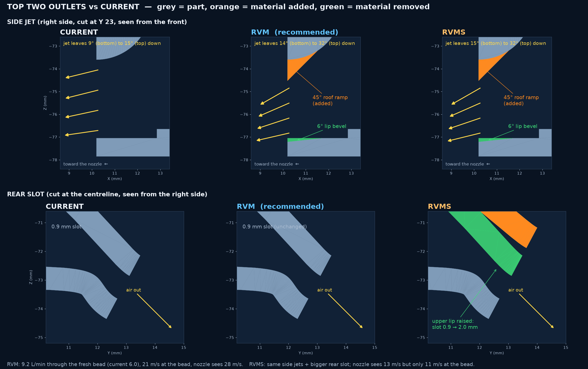

- **RVM** keeps today's 0.9 mm rear slot. It aims the side jets best (-5.1 against -16.8) and puts the most air
  through the fresh bead (9.2 L/min). It costs 11% of the blower flow, and it brushes the nozzle as hard as today.
- **RVMS** opens the rear slot to 2.0 mm. The three outlets carry equal flow, the blower flow is today's, the rear
  jet reaches its zone, and the nozzle cone sees half today's air speed. But the bead sees less air speed.

Print both for a thermal A/B: one P22 with two rear-slot heights. Both slice like today's part: matched H2D ABS
slicing gives support 4.67 against 4.62 cm3 and 1.31-1.32 h, with no new support in the jets or the rear slot. The
bevel only removes material, and the slot raises its upper lip as the earlier D11 trial did. Removing the jets'
forward lean (RFT, RVMT) put their collision on the nozzle and is not recommended. This is airflow, not
temperature: the printed test decides.

Evidence: the `side_jet_*`, `side_chamber_*`, `rear_slot_*` and `rejected_*` cases in
[verification_outlet_balance_r43.json](verification_outlet_balance_r43.json), each with its `tip_approach` and
`bead_zones` blocks, and `hotend_clearance_limits`. Reproduce the geometry with the session's
`build_aim_variant.py`: `--ramp-angle 45` (R45); `--ramp-angle 45 --floor-chamfer 11.7,-77.21` (RVM);
`--floor-chamfer 11.2,-77.45` (CH); `--ramp-angle 45 --lip-trim 1.5` (RT15); `--roof-secant 32` (SR32);
`--visor=-75.0,19.5,23.0 --visor-taper both --roof-secant 32 --roof-secant-y 24.45,27.55` (SPF);
`--ramp-angle 45 --front-toe 25.6` (RFT). The rear slot uses `build_rear_slot_variant.py <name> 2.0 [source
folder]`, with source `aim_v5d_RVM` for RVMS. Then run the CFD as in the earlier sections,
`cfd_tip_approach_r43.py` and `cfd_bead_zones_r43.py`.

## Where the air passes the nozzle tip

**Current Bambu set, 2026-10-31.** Same iteration-mean CFD at the 231 L/min blower point, analysed with
`cfd_tip_approach_r43.py`. Each of 1,785 flux-weighted streamlines is placed where it comes closest to the bead,
on the nozzle axis midway between the tip and the print. This is airflow, not temperature.

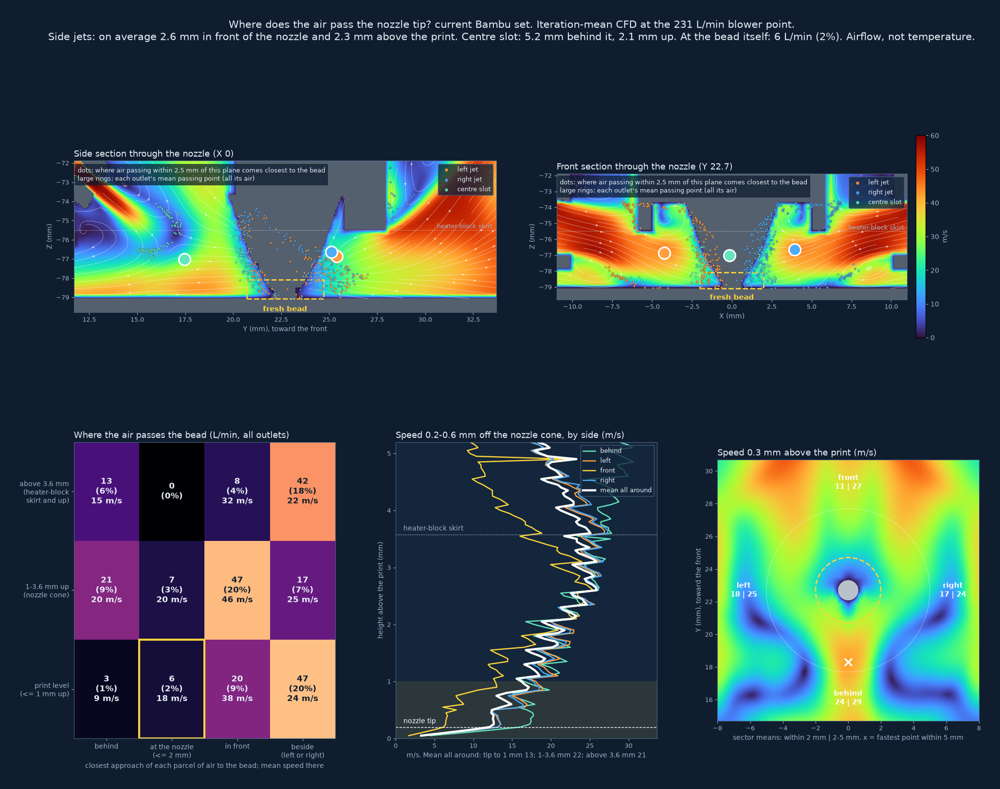

| Passes the bead (L/min) | Behind | At the nozzle, <= 2 mm | In front | Beside |
| :--- | ---: | ---: | ---: | ---: |
| Above 3.6 mm (heater-block skirt and up) | 13 | 0 | 8 | 42 |
| 1-3.6 mm up (nozzle cone) | 21 | 7 | **47, at 46 m/s** | 17 |
| Print level, <= 1 mm up | 3 | **6, at 18 m/s** | 20, at 38 m/s | 47 |

- **Side jets: in front and above.** Their air passes on average 2.6 mm in front of the nozzle axis and 2.3 mm
  above the print. The largest and fastest stream is their cores meeting 1-3.6 mm up in front of the nozzle. That
  follows from their 15-degree forward lean and 12-degree drop. Their top quarter passes beside the hotend at
  heater-block height.
- **Centre slot: behind and above.** Its air passes on average 5.2 mm behind the nozzle axis and 2.1 mm up. The
  middle of the slot meets the back of the nozzle cone 2.5-4.5 mm up; the rest lands behind and beside it. None
  of it passes at the bead.
- **The tip sits in a slow pocket.** 0.2-0.6 mm off the nozzle cone the air averages 13 m/s from the tip to 1 mm
  up and 22 m/s higher up. The front of the tip is slowest, 8 m/s. At print level within 2 mm of the axis the
  air runs 24 m/s behind, 18 left, 17 right and 11 in front. The fastest print-level air within 5 mm is 4.4 mm
  behind the nozzle, at 42 m/s.

Putting the mean flow on the bead would take side jets with no forward lean, leaving about 20 degrees down so
that they meet at the bead, and a centre slot that lands 1-2 mm behind the tip instead of meeting the cone.
These are P22 outlet changes and are untested. The side jets would still meet head-on, so they need CFD before
any decision. (Tested since, within the hotend clearance limits: see
[aiming at the bead](#aiming-at-the-bead-within-the-hotend-clearance-limits).)

Evidence: the `tip_approach` block of each case in
[verification_outlet_balance_r43.json](verification_outlet_balance_r43.json). Reproduce with
`cfd_tip_approach_r43.py <case> <out.png>` after `cfd_outlet_balance_r43.py <case> --mean` and
`cfd_nozzle_focus_r43.py <case> <out.png>`.

## Aim at the fresh bead, and the side-jet floor lip

**Review of the current Bambu set, 2026-10-31.** The question was whether it gives "a focused, laminar and precise
stream of air directed exactly at the extruded filament just below the nozzle tip". The method is iteration-mean
CFD at the set's 231 L/min blower point, analysed with `cfd_nozzle_focus_r43.py`. The fresh bead is taken as
within 2 mm of the nozzle axis and 1 mm of the print. This is airflow, not temperature.

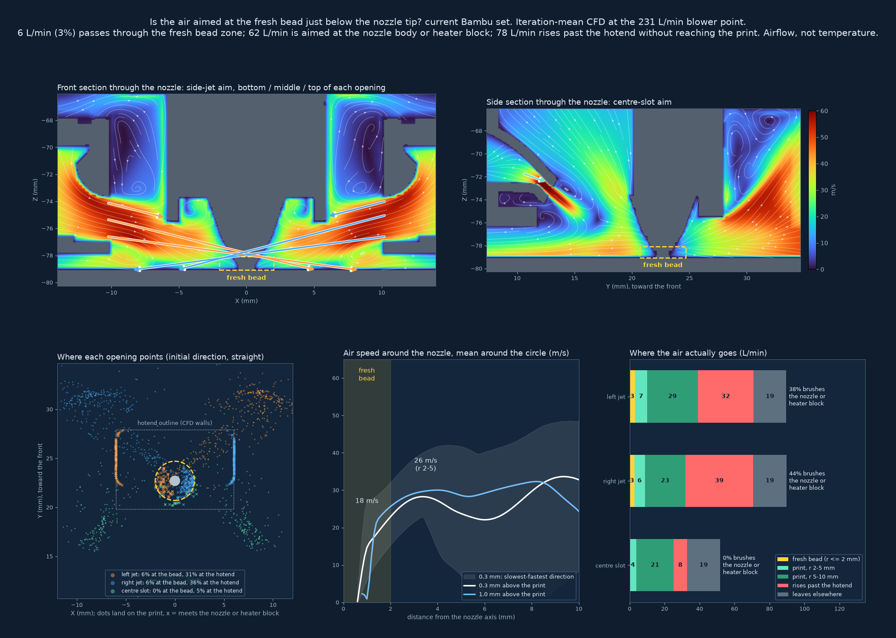

| Criterion | Current set |
| :--- | :--- |
| Air aimed at the fresh bead | 11 L/min (5%) |
| Air aimed at the nozzle body or heater block | 62 L/min (27%) |
| Air that passes through the fresh bead zone | 6 L/min (3%) |
| Air over the print within 10 mm | 96 L/min (42%) |
| Air that rises past the hotend without reaching the print | 78 L/min (34%) |
| Air that passes within 0.5 mm of the nozzle body or heater block | 74 L/min (32%) |
| Mean speed 0.3 mm above the print | 18 m/s at r 0.6-2 mm, 26 m/s at r 2-5 mm |
| Laminar | No. Reynolds number about 8,700 on the side jets' 3.45 mm height and 3,200 on the 0.9 mm centre slot; 5-7% turbulence at the openings |

- **Focused only from the sides.** Each side jet reaches the nozzle about 3 opening heights (10 mm) from its
  exit, so it arrives still coherent. The centre slot is about 13 slot heights (12 mm) from the bead. Its jet has
  spread out before it lands behind the nozzle.
- **Not precise.** Each side jet leaves 12 degrees down and 15 degrees forward, because the side channels feed it
  from the rear. Its bottom quarter leaves about 7 degrees down along the flat floor lip and skims the print.
  Its middle points past the nozzle, and its top quarter points at the heater block.
- **Slowest air at the bead.** The two side jets meet head-on just in front of the nozzle (see
  [where the air passes the nozzle tip](#where-the-air-passes-the-nozzle-tip)), so the slowest near-print air is
  right at the tip.
- **Laminar is not achievable at this flow.** Every opening of a CPAP cooler runs turbulent at 231 L/min. The
  useful part of the rule is a coherent jet aimed at the bead and kept off the hotend.

### Floor lip trimmed back 1.5 mm (screening)

The 0.75 mm floor lip under each side jet runs flat from X 12.85 to the exit at X 10.2. That flattens the jet's
bottom. This screening trial trims it back 1.5 mm where the jet is full height (Y 21.9-27.5) and changes nothing
else. The session's `build_lip_variant.py` builds it from the audited v5d P22.

| At each design's blower point | Current | Lip trimmed 1.5 mm |
| :--- | ---: | ---: |
| Total flow (duct pressure) | 231 L/min (2.32 kPa) | 234 L/min (2.24 kPa) |
| Side-jet aim | 12 degrees down, 15 forward | 17 degrees down, 19 forward |
| Side-jet air aimed at the print within 10 mm | 29% | 76% |
| Side-jet air aimed at the nozzle body or heater block | 33% | 23% |
| Air over the print within 10 mm | 96 L/min | 67 L/min |
| Air that rises past the hotend without reaching the print | 78 L/min | 89 L/min |
| Mean speed at the fresh bead, r 0.6-2 mm | 18 m/s | 11 m/s |
| Near-print sectors R / F / L / Re | 23 / 25 / 24 / 29 m/s | 16 / 17 / 17 / 22 m/s |
| Air dropping through the trimmed floor | none | 10 L/min |
| Air flowing outward under P22 | 25 L/min | 24 L/min |

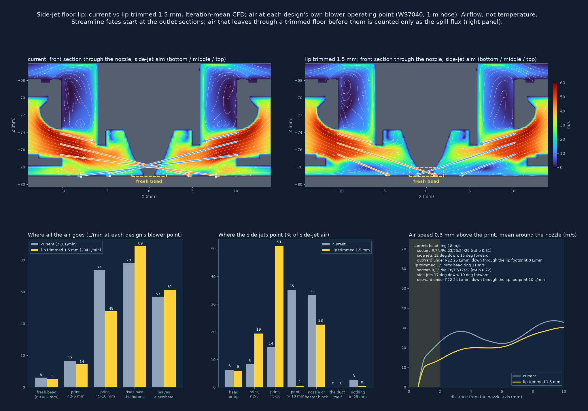

**Keep the lip.** The trim aims the jets lower as intended, but it cools worse. With the lip, the bottom of each
jet stays level and skims across the print into the bead zone at speed. Trimmed, the jets land on the print 4-6 mm
from the nozzle and spread. Some of the air drops through the opened floor, and the inward flows meet under the
nozzle and rise. The near-print sectors lose 23-32%.

The exit angle comes from the duct itself, not from the CFD's print surface: removing the lip alone turned it 5
degrees further down. The print surface, 0.2 mm below the tip across the whole CFD box, shapes the jets after they
leave. That is the realistic case for a broad print.

### Left and right

The duct is mirror-symmetric. P20, P21 and P22 have no material without a mirror partner, and the duct splits the
side flow 69.9 / 70.0 L/min. The CFD scene is not symmetric. The Bambu hotend fan sits on the right, with 535 mm3
inside the CFD box, and its underside closes the right half of the open space above the hotend. Smaller
asymmetric parts include the fan screws (41 mm3), hotend details just above the jets (4 mm3), and a chiral pair of
carriage parts.

In that static scene the left jet puts more of its air over the print: 43-44% against 36% in both averaged runs.
In operation the hotend fan runs and the head moves; the steady CFD models neither. The duct's symmetry is the
requirement, and it is met.

`cfd_cpap_r41.py domain --mirror-half` builds an exactly mirrored scene, symmetric to 0.006 mm. Its mesh failed
the skewness check at one face about 23 mm above the jets. The diagnostic run was dropped once the scene
explanation was accepted.

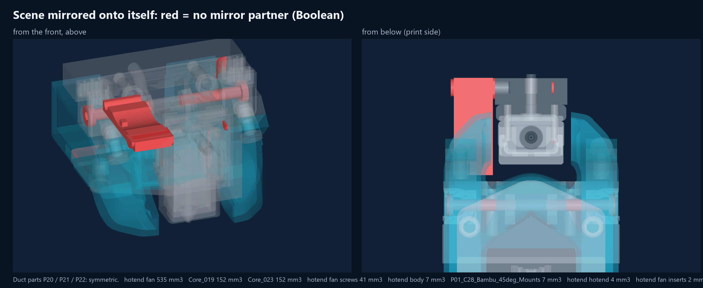

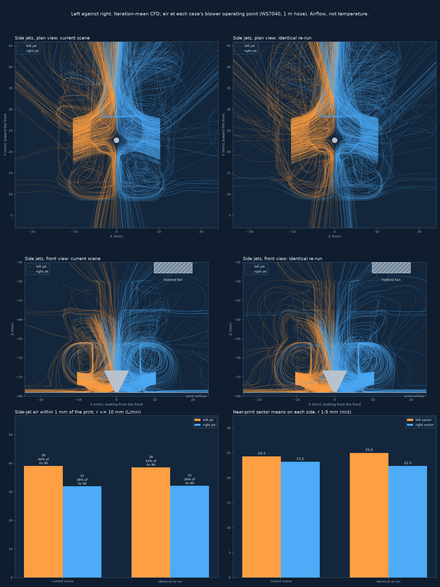

Evidence: the `nozzle_focus` blocks and the `side_jet_lip_trim_1p5` case in
[verification_outlet_balance_r43.json](verification_outlet_balance_r43.json). Reproduce with
`cfd_nozzle_focus_r43.py <case> <out.png>` (after `cfd_outlet_balance_r43.py <case> --mean`), its `--compare` mode,
and `render_outlet_balance_r43.py <out.png> --symmetry`. The lip-trim case is `r43avgV5dLip15_bambu_bed`.

## Printability, bottlenecks and centre/side balance

**Review of the current Bambu set (flow-neutral post, v5d), 2026-10-31.** Matched H2D ABS slices, iteration-averaged
CFD and per-outlet streamline tracing. This is airflow and slicer evidence, not print or thermal qualification.

### Printability: the interface material is the bottleneck, not the geometry

| Part, pose | Support | Print time (of it, prime tower) | ABS used | Support inside the airway |
| :--- | ---: | ---: | ---: | ---: |
| P01, back down | 4.78 → 2.32 cm3 | 2.75 h (0.53) → 2.04 h | 39.8 → 33.3 g | none |
| P21, top down | 1.26 → 0.68 cm3 | 1.32 h (0.46) → 0.72 h | 21.5 → 12.0 g | 0.27 → 0.13 cm3 |
| P22, back down | 9.08 → 4.62 cm3 | 3.10 h (1.16) → 1.31 h | 44.5 → 21.7 g | 1.15 → 0.58 cm3 |
| Three-part set | 15.1 → 7.6 cm3 | **7.17 h → 4.07 h** | 105.8 → 67.0 g | 1.42 → 0.71 cm3 |

The first value is the audited setup: tree supports with a Bambu Support for ABS interface. The second uses
ABS for the interface too, with a 0.2 mm top gap; nothing else changes. The breakaway interface forces a prime
tower and purge on every part. That takes 2.15 h of the 7.2 h set and about 37 g of ABS, more than any geometry
feature costs.

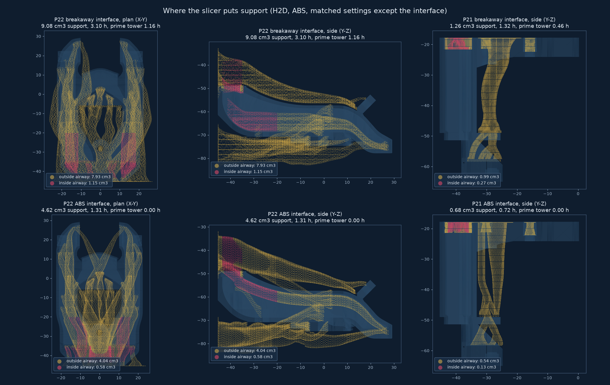

Most of P22's support is trees climbing the outside to the outlet-end overhangs (7.9 cm3). Inside the airway it
stays in the plenum lobes under the open receiver (0.89 cm3) and the start of the side channels (0.21 cm3). There
is none in the jets or the centre passage.

**Recommendation:** print P01 and P21 with single-material supports; all of their support is external or short.
Print one P22 the same way and check that the lobe support comes out through the receiver opening. If it does
not, keep the breakaway interface for P22 only; the set then takes 5.9 h.

### Near-print numbers now use iteration means

| Same geometry and settings | Right / front / left / rear sector (m/s) |
| :--- | :--- |
| Snapshot at iteration 1,200, first run | 27.5 / 24.8 / 25.7 / 33.4 |
| Snapshot, identical re-run | 23.5 / 26.9 / 25.1 / 33.3 |
| Mean of iterations 700-1,200 | 23.2 / 25.1 / 24.3 / 28.6 |
| Mean, identical re-run | 22.3 / 24.9 / 25.0 / 28.3 |

Parallel meshing is not bit-reproducible: the runs have 2,483,116, 2,483,519 and 2,483,235 cells. Near-print
speed also swings 15-21% RMS between iterations. One snapshot therefore carries that much error: the re-runs'
snapshots differ by up to 22% in a sector. That explains earlier sector swings such as the -15.4%
"exterior-only" change. Iteration means repeat within 4% per sector and 0.6% for the sector mean. Air over the
print and rising air repeat within about 4%, inlet pressure within 0.7%. Balance comparisons below use iteration
means. `cfd_cpap_r41.py case --average-from 700` adds the averaging at no extra solver cost.

### Where the air goes (current set, 180 L/min)

| Outlet | Supplied | Passes within 1 mm of the print, r <= 10 mm | r <= 5 mm | Rises past the hotend |
| :--- | ---: | ---: | ---: | ---: |
| Left jet | 69.9 L/min | 30.5 (44%) | 7.8 | 29.8 (43%) |
| Right jet | 70.0 L/min | 24.9 (36%) | 6.8 | 33.3 (48%) |
| Centre slot | 40.5 L/min | 19.7 (49%) | 3.0 | 8.1 (20%) |
| All | 180 L/min | 75.1 (42%) | 17.6 | 71.2 (40%) |

At the 231 L/min blower point this is about 96 L/min over the print and 91 L/min rising past the hotend. Each
side-jet opening is 3.45 mm tall. Its bottom millimetre (18% of the side flow) reaches the print 99% of the time.
Its upper half (54% of the side flow) faces the side of the Bambu heater block, whose bottom is at Z -75.5 mm;
at most 10% of that air reaches the print, and it also cools the heater.

### Bottlenecks, largest first

1. **Side jets into the heater block:** 40% of all the air rises without passing over the print.
2. **Final turn into the side jets: -156 Pa.** This is the largest single pressure loss, 42% of the side path's
   internal loss. Upstream losses are smaller: joint, lobes and elbow -77 Pa, P21 -46 Pa, P20 -27 Pa. The side
   exits keep 1,050 of the 1,416 Pa, 977 Pa of it as jet speed.
3. **Duct versus hose:** at the blower point the duct takes 2.32 of the blower's 2.67 kPa, the 1 m hose 0.35 kPa.
4. **Wake around the nozzle:** a slow ring (5-15 m/s) within about 2 mm of the nozzle.
5. **Printing:** the interface prime tower (above).

### Balance trials

Iteration-mean CFD. Air values are at each design's own blower operating point.

| Trial | Total flow | Centre share | Sectors R / F / L / Re (m/s) | Sector mean | Over the print, r <= 10 mm | Rising |
| :--- | ---: | ---: | :--- | ---: | ---: | ---: |
| Current | 231 L/min | 22% | 23.2 / 25.1 / 24.3 / 28.6 | 25.3 | 96 L/min | 91 L/min |
| Current, identical re-run | 231 L/min | 22% | 22.3 / 24.9 / 25.0 / 28.3 | 25.1 | 99 L/min | 88 L/min |
| Centre slot 1.1 mm (D11 outlet) | 234 L/min | 24% | 19.5 / 21.3 / 21.2 / 18.8 | 20.2 | 87 L/min | 97 L/min |
| Side-jet roof lowered 1.0 mm (screening) | 209 L/min | 29% | 22.9 / 21.6 / 22.9 / 31.2 | 24.6 | 94 L/min | 79 L/min |
| Side-jet roof lowered 1.7 mm (screening visor) | 180 L/min | 37% | 23.1 / 32.9 / 28.2 / 9.9 | 23.5 | 91 L/min | 64 L/min |

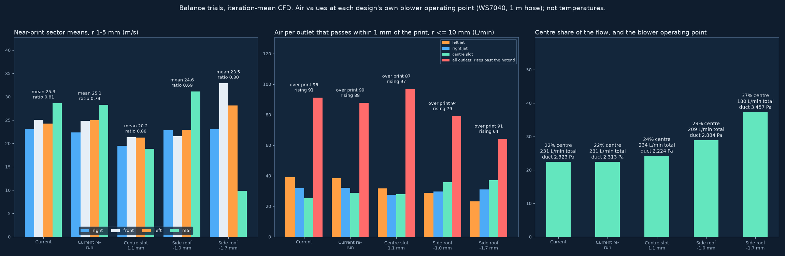

- **A bigger centre slot weakens every sector.** It lowers the plenum pressure and slows the centre jet. The
  sectors look more even (0.88) only because the strongest one falls. This confirms the earlier snapshot
  rejection of D11 with averaged data.
- **Closing the upper side jet cuts the waste.** Rising air falls 30% and the side jets reach 60 m/s, but the
  duct becomes 2.4 times more restrictive: total flow drops to 180 L/min. The faster side jets also meet the
  centre jet behind the nozzle and turn it aside, so the rear sector collapses to 9.9 m/s
  ([visor field](images/r43_outlet_balance_visor_screen.png)). Air over the print does not improve: 91 vs
  96 L/min is inside the 4% repeat spread.
- **Half the drop is a smaller version of the same trade.** Rising air falls about 12% and the side jets reach
  47 m/s. Total flow drops 10%, and air over the print is unchanged (94 vs 96-99 L/min). The centre now carries
  29%: the rear sector grows while the front weakens, so the weakest/strongest ratio falls to 0.69.

**Keep the current outlets and the 78/22 side/centre split.** There is no room to keep the side-jet area while
lowering its roof: the floor is already 0.8 mm above P22's underside, and the heater block spans the jets' full
length (Y 18.4-28.6). Any lower roof therefore costs total flow, and the WS7040 with a 1 m hose gives up about as
much air as the roof saves. Further gains need a reshaped outlet rather than a smaller one. For example, a roof
that turns the upper jet down under the block instead of closing it, tuned together with the centre slot's
landing point. Judge that with a printed thermal test, not only more single-parameter CFD.

Evidence: [verification_outlet_balance_r43.json](verification_outlet_balance_r43.json). Reproduce with
`cfd_outlet_balance_r43.py <case> --mean`, `render_outlet_balance_r43.py` and `report_outlet_balance_r43.py`.
The averaged cases are `r43avgV5d_bambu_bed`, `r43avgV5dRep_bambu_bed`, `r43avgV5dD11_bambu_bed`,
`r43avgV5dVisor_bambu_bed` and `r43avgV5dVisorMild_bambu_bed`. The session's `build_visor_variant.py` builds the
visor screens from the audited v5d P22.

## Flow-neutral user-post retainer

**Current Bambu mechanical candidate: review parts, not a print release.** This is your
document-53 post, tweaked so it does not cost airflow. The post and its P22 socket stay
inside the clean C28 spine, behind a 0.84 mm P22 skin and 0.18 mm slip. The one
exception is directly under P21's own cable boss, whose wake the post may fill. The
underside M3x10 screw, the M3x4 insert (X0, Y-28.2 mm) and the angled P01/P22 mounts
are unchanged.

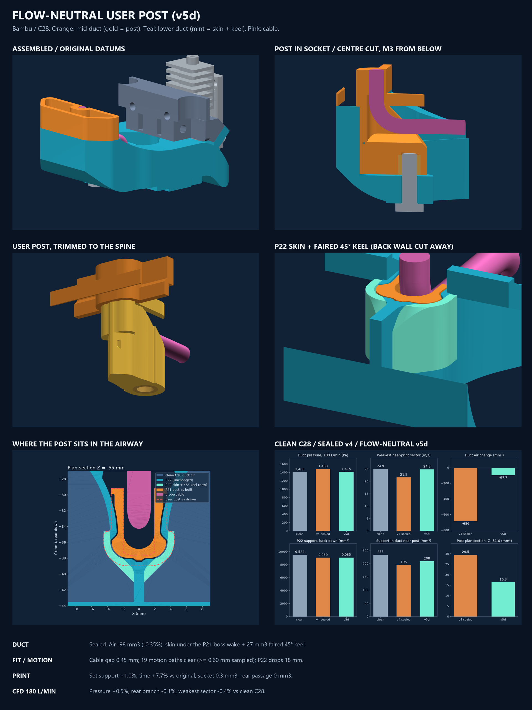

[Share JPEG](images/r43_c28_flow_neutral_retainer_review_share.jpg) |
[Full-size PNG](images/r43_c28_flow_neutral_retainer_review.png) |
[Matched CFD maps](images/r43_flow_neutral_retainer_v5d_cfd.png) |
[Assembly STEP](step/55_C28_Bambu_User_Post_Flow_Neutral_REVIEW.step).

| Change from your post | Volume | Why |
| :--- | ---: | :--- |
| Post trimmed to the clean spine; it keeps P21's boss wake in the cable zone, with a rounded channel back | 891 to 586 mm3 | Removes the lobe intrusion that cost the sealed receiver +5.1% pressure. |
| Post kept 0.18 mm outside the plan shadow of P22 above the joint | included above | P22 drops 18 mm clear of the post, and assembles the same way. |
| P21 recess filled, probe-cable passage kept | +76 mm3 | Gives the post arms a solid root. It replaces your upper block, which overlapped P22. |
| P22 notch boss removed | -40 mm3 | It sat over the post arms. |
| P22 skin under the P21 boss, with a faired 45-degree keel behind it | +89 mm3 in the clean duct (keel 27) | Seals the socket. The keel and 45-degree socket bevels let the back-down print support itself there. |

| Check | Sealed receiver (v4) | Flow-neutral (v5d) |
| :--- | ---: | ---: |
| Duct air vs clean C28 | -686 mm3 (-2.5%) | -98 mm3 (-0.35%) |
| CFD pressure, 180 L/min | +5.1% (1,480 Pa) | +0.5% (1,415 vs 1,408 Pa) |
| Estimated blower flow / side jets / rear branch | -1.0% / +0.2% / -0.4% | -0.1% / -0.1% / -0.1% |
| Weakest near-print sector | -13.6% | -0.4% |
| P22 support, back down (original 9,524 mm3) | 9,060 mm3 | 9,085 mm3 |
| Support in the duct near the post (clean 233 mm3) | 195 mm3 | 208 mm3 |
| Socket / rear-passage support | 2.9 / 0 mm3 | 0.3 / 0 mm3 |
| P21 support, top down (original 643 mm3) | 1,275 mm3 | 1,257 mm3 |
| Three-part set vs original C28 | support +0.9%, time +8.1% | support +1.0%, time +7.7% |
| Post plan section at Z -51.6 mm | 29.5 mm2 (as drawn) | 16.3 mm2 |
| Service and motion | 18 mm drop clear; 19 paths, >= 0.60 mm sampled | 18 mm drop clear; 19 paths, >= 0.60 mm sampled, 0.35 mm bound |

Other checks pass:

- Valid single solids with no part or hardware overlap.
- Cable gaps are 0.45 mm (post) and 2.15 mm (P22).
- All three inserts keep complete 1.2 mm walls.
- No new metal is in either probe's keepouts, and no new plastic in their sensing keepouts.
- The lower jets, probe seat, swept feeds and outlet are unchanged (0 mm3).
- STEP exports round-trip. Fusion document **55 Bambu C28 - flow-neutral user post (REVIEW)** matches the CAD within 0.0023% native volume, and documents 53 and 54 are unchanged. View 3 and a saved X 1.2 mm section show the keel.

How it got here:

- **v5b (skin only):** CFD +0.4%. P22 needed 62 mm3 more support trapped in the rear plenum and 16 mm3 in the socket.
- **v5c (keel and bevels added):** fixed the support; CFD +0.8%. Like v5b, it kept P22's notch-boss nose over the post arms. The 18 mm service sweep caught this: P22 could not drop off or go on.
- **v5d:** fixes it on the dry side. Only a 0.05 mm3 dead-end slip sliver of the duct changes, and its CFD repeats v5c within 0.3% (1,415 vs 1,419 Pa).

These are nominal CAD checks, **not strength, torque, sealing, thermal or print-fit
qualification.** Print P21 top face down and P22 back face down. The post's smallest
section is 45% below your post as drawn: snug the M3, do not torque it.

| Area | Next improvement | Why |
| :--- | :--- | :--- |
| Post root | Print first. If the post flexes, try a stiffer P21 material before adding plastic. | Extra width would re-enter the airway. |
| Near-print airflow | Use time-averaged runs before judging sectors | Single snapshots vary: an exterior-only control moved one sector -15.4%. |
| First article | Check post and socket fit, seal, insert pull-out, cable motion and hot running | The 0.18 mm socket slip and 0.45 mm cable gap are nominal. |

Review parts:
[P21](step/P21_C28_Bambu_User_Post_Flow_Neutral_REVIEW.step) |
[P22 Beacon](step/P22_C28_Bambu_Flow_Neutral_Receiver_Beacon_REVIEW.step) |
[P22 Cartographer](step/P22_C28_Bambu_Flow_Neutral_Receiver_Cartographer_REVIEW.step) |
[P01](step/P01_C28_Bambu_45deg_Mounts_REVIEW.step); print-oriented STLs share these names in `stl/`.

Evidence:
[geometry, seal and service](verification_c28_flow_neutral_retainer_geometry_r43.json) |
[real-scene movement](verification_c28_flow_neutral_retainer_motion_r43.json) |
[matched slicing](verification_c28_flow_neutral_retainer_slicing_r43.json) |
matched CFD [v5d](verification_flow_neutral_retainer_v5d_cfd_r43.json),
[v5c](verification_flow_neutral_retainer_v5c_cfd_r43.json) and
[v5b](verification_flow_neutral_retainer_v5b_cfd_r43.json) |
[Fusion review](verification_c28_flow_neutral_retainer_fusion_r43.json).
Reproduce with `audit_c28_flow_neutral_retainer_r43.py`, then with
`--variant flow-neutral`: `audit_c28_user_retainer_motion_r43.py` and
`audit_c28_user_retainer_slicing_r43.py`. Then run
`cfd_direct_mount_r43.py --flow-neutral v5d` and `render_c28_flow_neutral_retainer_r43.py`.
`r43_c28_user_joint.flow_neutral_parts` rebuilds v5b and v5c through its
`print_bevels` and `full_recess` flags.

## User-post retainer review

**Superseded by the [flow-neutral retainer](#flow-neutral-user-post-retainer)**, which
uses the same post idea without the airflow penalty. Kept as the sealed-receiver (v4)
record. Review parts, not a print release. The
user's Fusion P21 post (document 53) is kept as drawn above Z -58.5 mm and retained
by the same underside M3x10 screw and M3x4 insert (axis X0, Y-28.2 mm). The angled
P01/P22 mounts from the [mechanical review](#mechanical-review) are unchanged.

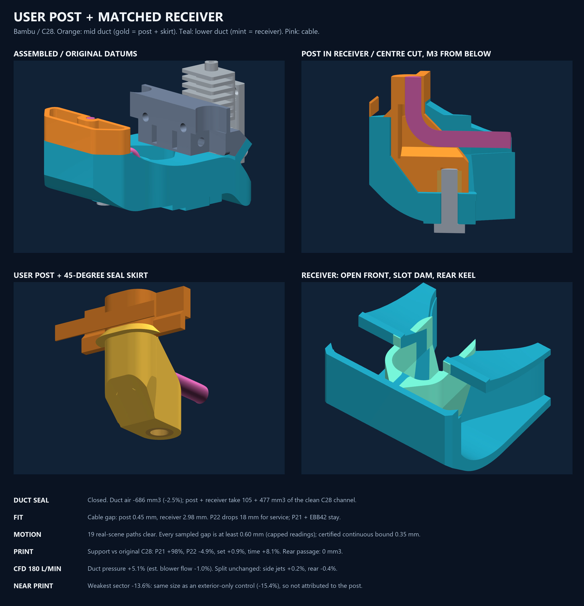

[Share JPEG](images/r43_c28_user_retainer_review_share.jpg) |
[Full-size PNG](images/r43_c28_user_retainer_review.png) |
[Matched CFD maps](images/r43_user_retainer_cfd.png) |
[Assembly STEP](step/54_C28_Bambu_User_Post_Retainer_REVIEW.step) |
[User's Fusion snapshot](53_C28_User_P21_Direction_FUSION_SNAPSHOT.f3d).

| Change to the user's direction | Volume | Reason |
| :--- | ---: | :--- |
| Lower rear/side relief on the post, below Z -58.5 mm | -126.6 mm3 | Leaves room for printable receiver walls; the upper connection is untouched. |
| 45-degree seal skirt on P21 | +15.9 mm3 | Lands on the receiver top in the original sleeve-bottom plane, so the socket cannot open the duct. |
| Matched P22 receiver: 0.25 mm socket clearance, 1.25 mm walls, open front into the dry bay, slot dam and 45-degree rear keel | P22 +883 / -1,262 mm3 vs clean C28, including the angled mount | Locates and seals the post. The open front stays 1.21 mm from the remaining channel air. |

| Check | Result |
| :--- | :--- |
| Duct seal | Closed. Duct air 27,090 mm3 vs 27,776 mm3 (-686 mm3, -2.5%); the post and receiver occupy 105 + 477 mm3 of the clean C28 channel. |
| Fit | Valid single solids, no part or hardware overlap. New-material cable gaps 0.45 mm (post) and 2.98 mm (receiver). Complete 1.2 mm walls around all three inserts. Lower jets, probe seat, swept feeds and outlet unchanged (0 mm3). No new metal in either probe's keepouts and no new plastic in their sensing keepouts. |
| Service | P22 lowers 18 mm (73 samples) clear of P01, P21 and the cable; P21 and the EBB42 stay on the carriage. |
| Motion | 19 real-scene paths clear for all new material and fasteners. Every sampled gap is at least 0.60 mm, and at least 1.10 mm to the X gantry (the forked tongue reached 0.72 mm). Certified continuous bound: 0.35 mm. |
| Printing, H2D ABS, matched settings | Support: P01 -0.7%, P21 +98% (643 to 1,275 mm3), P22 -4.9%. Three-part set: support +0.9%, time +8.1% vs the original C28 parts; -0.8% and -1.2% vs the forked tongue. Rear passage 0 mm3; socket 2.9 mm3. |
| CFD, 180 L/min, matched | Duct pressure +5.1% (1,480 vs 1,408 Pa); estimated blower flow -1.0%. Side jets +0.2%, rear branch -0.4%. The X = 10 mm section shows a longer low-speed zone on the elbow's inner side beside the receiver. |
| Near-print sectors | Weakest sector -13.6%. The exterior-only printability control moved it -15.4%, so this is not attributed to the post. |
| Exports and Fusion | Both receivers round-trip exactly. The exchange-derived P21 matches within 1e-5 mm by tessellation congruence (its own exact self-difference is invalid). Fusion document **54 Bambu C28 - user post retainer (REVIEW)** imports within 0.0023% native volume; document 53 is unchanged. |

Print P21 top face down and P22 back face down; do not use the P22 inlet-face-down
pose. Install all inserts before assembly. These are nominal CAD checks, **not
strength, torque, sealing, thermal or print-fit qualification**.

| Area | Next improvement | Why |
| :--- | :--- | :--- |
| Duct pressure | Slim the receiver walls where they narrow the elbow lobes | The +5.1% comes from the narrowed inner side; the jet split is unchanged. |
| P21 support | Shape the post underside for top-down printing, or accept the extra 0.63 cm3 | P21 support roughly doubles; P22 saves 0.46 cm3. |
| Near-print airflow | Use time-averaged or longer runs before judging sector changes | Single-snapshot sector metrics move about 15% with exterior-only changes. |
| First article | Print, then check post/socket fit, seal, insert pull-out, cable motion and hot operation | Gaps of 0.45 mm (cable) and 0.25 mm (socket) are nominal. |

Review parts:
[P21](step/P21_C28_Bambu_User_Post_Sealed_REVIEW.step) |
[P22 Beacon](step/P22_C28_Bambu_User_Post_Receiver_Beacon_REVIEW.step) |
[P22 Cartographer](step/P22_C28_Bambu_User_Post_Receiver_Cartographer_REVIEW.step) |
[P01](step/P01_C28_Bambu_45deg_Mounts_REVIEW.step); print-oriented STLs share these names in `stl/`.

Evidence:
[geometry, seal and service](verification_c28_user_retainer_geometry_r43.json) |
[real-scene movement](verification_c28_user_retainer_motion_r43.json) |
[matched slicing](verification_c28_user_retainer_slicing_r43.json) |
[matched CFD](verification_user_retainer_cfd_r43.json) |
[Fusion review](verification_c28_user_retainer_fusion_r43.json).
Reproduce with `audit_c28_user_retainer_r43.py`, `audit_c28_user_retainer_motion_r43.py`,
`audit_c28_user_retainer_slicing_r43.py`, `cfd_direct_mount_r43.py --user-retainer`
and `render_c28_user_retainer_r43.py`.

## Mechanical review

**Separate matched P01/P21/P22 replacements, not a P22-only drop-in or a new
cooling winner.** The proposed angled tabs and underside-screwed tongue are now
modelled. Frozen cleaned C28 remains the airflow baseline; neither released R43
nor the user's existing Fusion documents are replaced.

**Live Fusion edits are preserved separately.** After this study was imported,
document **53 Bambu C28 - angled mounts and lower retainer** received additional
extrusions, sketches, a fillet and face deletions. Its edited state is **not
covered by the checks below**. It was left active and unchanged; a native snapshot
was saved as `53_C28_Live_Edits_Preserved.f3d` in the session artifacts. The checked
pre-edit STEP/STL files remain separate. Those edits must be reconciled before
adopting a new baseline; they were not overwritten or silently accepted.

**User P21 direction: adopted.** The user then confirmed the edited P21 (a sloped
post retained by the underside M3 screw) as the intended printable direction, with
tweaks allowed. Its 25-feature native document is archived in this repository as
[`53_C28_User_P21_Direction_FUSION_SNAPSHOT.f3d`](53_C28_User_P21_Direction_FUSION_SNAPSHOT.f3d)
(P21 12,160.35 mm3; the open document was unchanged when archived). Its matched
receiver and checks are in the [user-post retainer review](#user-post-retainer-review).
The forked-tongue tables below do not describe it.

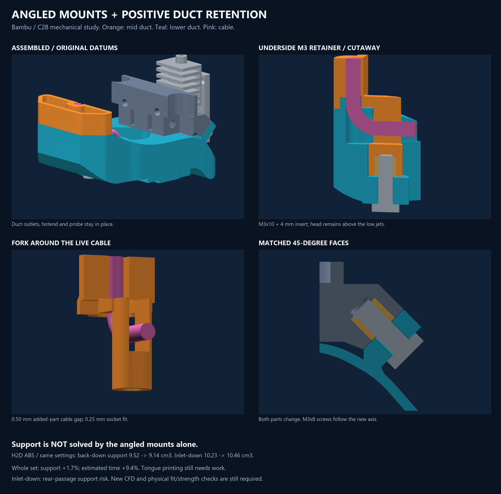

[Share JPEG](images/r43_c28_mechanical_review_share.jpg) |
[Full-size PNG](images/r43_c28_mechanical_review.png) |
[Bambu mechanical assembly STEP](step/53_C28_Bambu_Angled_Mounts_And_Retainer_REVIEW.step).

| Interface | New review geometry | Reason |
| :--- | :--- | :--- |
| P01 to P22 | Matched 45-degree faces; X +/-18 mm spacing; new face centres Y17, Z-55.5 mm; two M3x8 button-head screws and M3x4 inserts | Both printed parts and fastener axes change together. Nozzle, probe and tool positions do not move. |
| P21 to P22 | Integral forked tongue, 7 mm lower barrel, M3x4 insert; one M3x10 button-head screw driven upward from P22 | Positively retains the mid/lower joint instead of relying on the sleeve fit and the separate carriage mounts. |
| Cable bend | Open 4 mm fork around the 3 mm cable reference | The S-shaped feature is the live cable, not disposable material. New tongue material clears it by 0.50 mm. The tighter inherited cable-groove fit is unchanged. |
| Retainer location | Screw axis X0, Y-28.2 mm, underside seat Z-70.8 mm | Slightly forward of the narrow solid core, still below the cable bend. This leaves 1.23 mm around the insert rather than forcing an insert, tongue, fit gap and two walls into the narrowest core. |
| Receiver | 0.25 mm radial and end clearance; approximately 1.19 mm minimum separation from the channel | The existing sleeve remains the main registration feature. Small rounded/chamfered floor reinforcements prevent thin root-pocket walls. |

Nominal thread engagement is 4 mm for all three new screws. Each tongue root is
2 mm wide and 2.2 mm deep before its blend; the combined nominal section is
8.8 mm2. These are geometric dimensions, **not an allowable tightening torque or
strength rating**. Inserts must be installed before assembling the joint.

**Movement and service:** the added material and new hardware clear the actual
Monolith geometry over the checked X travel, rear limits, ten rack approaches,
both adjacent Bambu bays and 60 mm tool withdrawal. Closest sampled new-material
X-gantry clearance is **0.721 mm**, at the tongue-root blend. The exact-distance
translation checks include conservative between-sample clearance bounds; they
do not include printed distortion, cable dynamics or thermal growth. The new
underside screw remains **6.63 mm above the bed** with the nozzle at 0.2 mm;
the complete P22's original 1.23 mm minimum bed gap is unchanged. No new metal
occupies either probe's modelled sensing keepouts.

For service, park/remove the Bambu tool and raise Z for underside access. Free or
disconnect the probe lead, remove the two angled screws and the underside screw,
then lower P22 **18 mm** to release the tongue and sleeve. P21 and the EBB42 stay
on the carriage. The downward path clears P01, P21 and the rigid cable reference;
real connector access and cable slack still need a bench check.

### Printing result: retention improved, support reduction not solved

Matched H2D, ABS/Support for ABS, 0.20 mm, five-wall runs use identical machine,
process and all filament settings. Values below are deposited support, excluding
prime-tower/waste, not physical measurements.

| Part / pose | Original support, cm3 | Mechanical review, cm3 | Change |
| :--- | ---: | ---: | ---: |
| P01, back down | 4.808 | 4.775 | -0.7% |
| P21, top down | 0.643 | 1.318 | +105.0% |
| P22, back down | 9.524 | 9.136 | -4.1% |
| P22, inlet mating face down | 10.230 | 10.463 | +2.3% |
| Three-part set, using back-down P22 | 14.974 | 15.229 | **+1.7%** |

The tongue shifts support into P21. Total predicted time across the three
separate jobs rises **9.4%**. The angled tabs alone therefore do **not** make this
a whole-assembly printing improvement.

**Do not use the inlet-face-down P22 pose with this support setup.** The deposition
screen finds about **328 mm3 of support inside the narrow rear passage** in that
pose, with exact-CAD witness points. Back-down gives zero sampled deposition in
that passage. This is a trapped-support risk screen, not proof of physical
removability. The supplied P22 review STLs use **back down**; P21 uses its flat top
and P01 its back. No generated machine G-code is approved for printing.

### Remaining improvements and why

| Area | Next improvement | Why it remains necessary |
| :--- | :--- | :--- |
| Tongue printing | Rework the initial cantilever into a self-supporting ramp below the gantry, without weakening its roots or the receiver walls | The current tongue adds more support than the inclined mounts save. A preliminary alternative did not produce valid CAD and is not included in the review. |
| Inlet-down printing / curved fins | Redesign internal bridge support only after inspecting the actual deposition paths | The earlier two inlet fins did not reduce support, and this pose puts support in the rear branch. Neither two- nor three-fin trials are adopted here. |
| Cooling | Run fresh CFD with **all three revised P01/P21/P22 bodies** represented | The root-floor reinforcements add 5.01 mm3 inside the original main-channel air region, and external boundaries change. The swept feeds, 0.9 mm outlet, aim and probe seat remain unchanged, but old C28 CFD cannot be relabelled. |
| Fit and durability | Print a first article; check cable movement, insert pullout, seating/sealing and hot operation | The 0.50 mm added-part cable gap and 0.721 mm sampled gantry gap are small nominal clearances. Strength, tightening and thermal behaviour are unqualified. |

Review parts:
[P01](step/P01_C28_Bambu_45deg_Mounts_REVIEW.step) |
[P21](step/P21_C28_Bambu_Forked_Retainer_REVIEW.step) |
[P22 Beacon](step/P22_C28_Bambu_45deg_Mounts_Retainer_Beacon_REVIEW.step) |
[P22 Cartographer](step/P22_C28_Bambu_45deg_Mounts_Retainer_Cartographer_REVIEW.step).

Evidence:
[geometry, hardware and service](verification_c28_mechanical_geometry_r43.json) |
[real-scene movement](verification_c28_mechanical_motion_r43.json) |
[matched slicing](verification_c28_mechanical_slicing_r43.json) |
[support access](verification_c28_mechanical_support_access_r43.json) |
[delivery and preserved-edit provenance](verification_c28_mechanical_delivery_r43.json).
P01's frozen source also fails an exact OCC self-difference; the export audit
explicitly uses matching CAD properties, complete mesh vertices and sampled
retriangulation-patch agreement for that part, rather than trusting invalid
Boolean volumes.

## Finding and completed cleanup

**The circled feature really was unnecessary material in the airflow path.** The
previous identification from the selected Fusion face was incorrect: that face
defined the section plane, not the feature circled in the screenshot.

The new swept feed was clipped against `r43_rear_jet.duct_air()`, a helper intended
for the lower heel region and bounded above at Z -60 mm. Raising the feed roof put
part of its outer wall above that limit. This left a small roof-like obstruction
inside each existing side channel, with about 0.1 mm nominal clearance to the
original duct ceiling at its highest point.

The cleanup clips **only the added feed envelope** against the full-height original
channel. It does not indiscriminately hollow out P22. In particular, the original
cable-support rib, which has a printing purpose, stays in place.

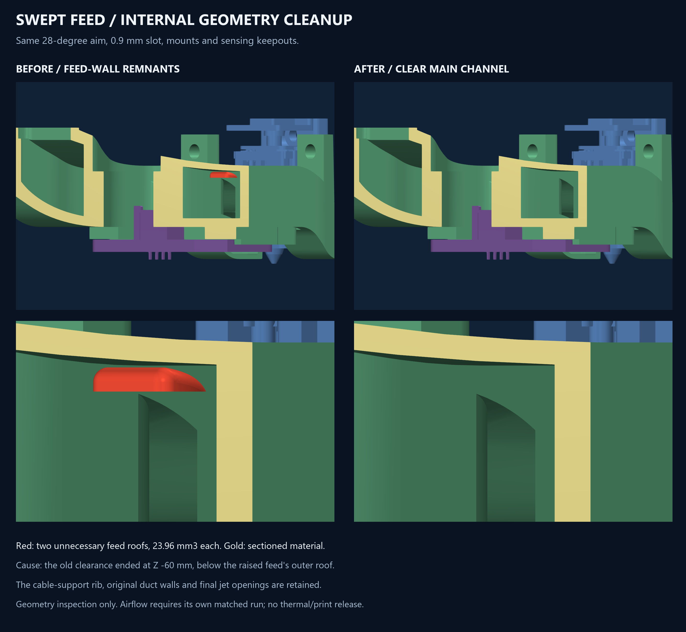

| Completed change | Evidence | Why it is appropriate |
| :--- | :--- | :--- |
| Remove both feed-roof remnants | Approximately 23.96 mm3 each; only within X +/-12.85-18.9, Y -10.8 to -4.41, Z -60 to -58.7 mm | They occupy an intended main-channel air volume and have no mounting or required wall function there. |
| Restore the obstructed feed-entry section | At Y -10 mm: 78.84 to 85.07 mm2 open area per main side channel, a 7.9% local increase | Restores the original channel instead of enlarging the entire duct or redirecting the final jets. This is area recovery, not a 7.9% flow/cooling prediction. |
| Reduce unnecessary surface complexity | Both probe variants: 383 to 351 faces | Removes the actual redundant feature rather than deleting small faces solely because they look suspicious. |
| Preserve critical geometry | No added material; no released-duct or cable-rib material removed; changes confined to the two entry regions | Mounts, screw seats, cable route, side jets, rear slot, probe datums and the exterior envelope are outside the changed regions. |
| Improve the geometric support screen | Down-facing area requiring support: 519.3 to 510.2 mm2 in the established back-face-down orientation | Removes some internal overhang, but this modest 1.8% reduction is not slicer or print qualification. |

The nominal swept-air cutter itself is unchanged. **The connected fluid domain is
not unchanged:** removing the obstructions exposes additional main-channel air.
Accordingly, old CFD is not relabelled as a result for this cleanup.

## Follow-on trial: a larger slot without lowering its floor

**D11 was tested and not adopted; retain C28's 0.9 mm slot for Bambu.** The rear opening grows from nominal
0.9 to 1.1 mm by raising the upper lip only. The 28-degree aim, 3 mm raised feed,
cleaned entries, side jets and mounting datums remain fixed. The complete lower
air-wall surfaces coincide with the C28 baseline, not just their endpoints.

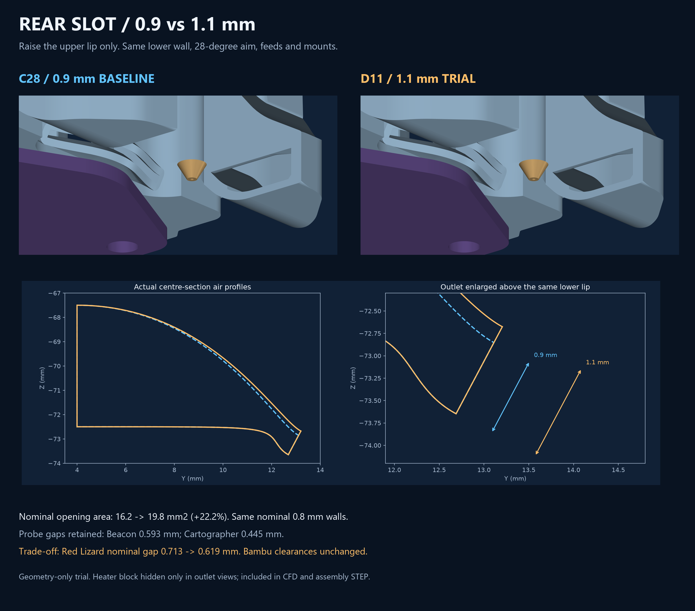

| Geometry | Cleaned C28 baseline | D11 trial |
| :--- | ---: | ---: |
| Rear slot height | 0.9 mm | 1.1 mm |
| Nominal projected mouth area | 16.2 mm2 | 19.8 mm2 |
| Beacon / Cartographer outlet gaps | 0.593 / 0.445 mm | unchanged |
| Bambu hotend / sock gaps | 1.918 / 3.2 mm | unchanged |
| Red Lizard nominal hotend gap | 0.713 mm | 0.619 mm |
| Geometric support-screen area | 510.2 mm2 | 510.2 mm2 |

Both probe variants pass the geometric checks, four wall-normal sampling offsets
and STEP round trips. The larger nominal opening is not evidence of easier printing:
the support screen is unchanged and no slice or coupon has been printed.
The reduced Red Lizard gap is an explicit disadvantage, not a released thermal allowance.

The matched Bambu CFD case `r43directD11_bambu_bed` completed against
`r43directC28clean_bambu_bed`, at 180 L/min and 1,200 iterations. Seventeen solver,
boundary, material and mesh dictionaries are identical; only a human-readable
refinement description differs in the stage metadata.

| Bambu airflow diagnostic | C28 / 0.9 mm | D11 / 1.1 mm |
| :--- | ---: | ---: |
| Pressure at 180 L/min | 1,408.2 Pa | 1,315.9 Pa |
| Estimated total flow, 1 m hose | 231.1 L/min | 234.4 L/min |
| Rear branch at 180 L/min | 39.95 L/min | 45.54 L/min (+14.0%) |
| Mean speed, radius 1-5 mm | 26.31 m/s | 22.67 m/s (-13.8%) |
| Mean speed, radius 1-10 mm | 30.95 m/s | 28.97 m/s (-6.4%) |
| Mean speed, radius 1-14 mm | 29.34 m/s | 27.28 m/s (-7.0%) |
| Weakest/strongest sector mean-speed ratio | 0.839 | 0.902 |
| Net radial flow, radius 8 mm | 45.45 L/min | 43.10 L/min |

Speed/coverage/radial values scale to estimated blower operation. D11 is more even
but weaker across these near-print speed measures; the lowest sector mean also falls
12.8%. Its lower restriction and extra rear flow are not enough to justify replacing
the C28 baseline for today's Bambu objective. This choice is based on Bambu airflow,
**not** the reduced Red Lizard clearance. Neither trial proves thermal superiority.
Last-500 pressure peak-to-peak is 2.02% / 3.19%; mesh/time sensitivity remains.

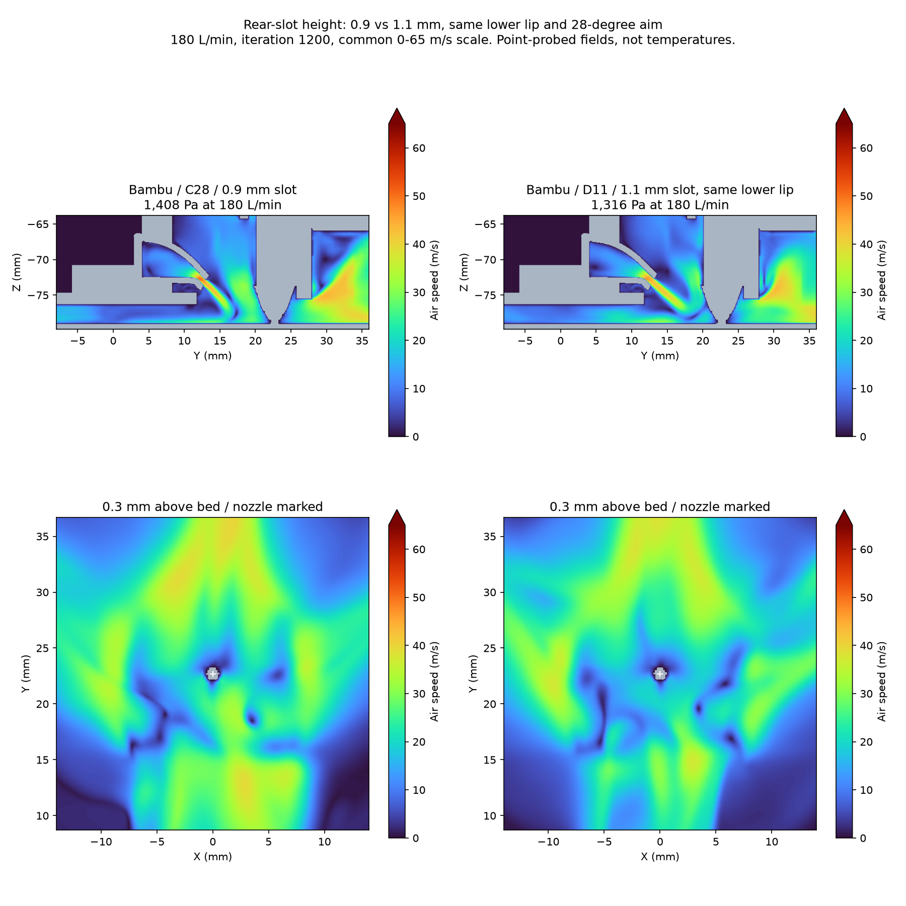

[Full slot-height CFD evidence](verification_slot_height_cfd_r43.json).

[Trial Beacon STEP](step/P22_Swept_D11_Fixed_Floor_Beacon_REVIEW.step) |
[Trial Cartographer STEP](step/P22_Swept_D11_Fixed_Floor_Cartographer_REVIEW.step) |
[C28/D11 comparison assembly](step/P22_C28_D11_Slot_Height_Comparison_REVIEW.step) |
[Geometry and invariant-floor audit](verification_slot_height_geometry_r43.json) |
[Matched numerical controls](verification_slot_height_controls_r43.json).
Fusion document **52 Slot-height study - 0.9 vs 1.1 mm** shows both variants.

## Bambu one-piece printability pass

A separate C28 candidate adds 45-degree ramps behind the direct-mount legs,
chamfers the relief steps, and replaces the seat's flat rear window edge with a
protected truncated-V notch. The original upper fillet remains: a smaller-fillet
trial produced a non-watertight tessellation and was rejected, not repaired by
filling arbitrary mesh holes.

Both probe variants preserve the 0.9 mm airway, original main-channel material,
live mount/inlet regions, outer bounds and previous Bambu/probe clearances.
They pass watertight STEP/STL round trips and the four-offset wall screen.

**Actual slicing gives a smaller improvement than the overhang map.** Assessment
uses the saved H2D 0.4 mm ABS / Support for ABS profiles, 0.2 mm layers, five walls,
automatic trees, support allowed on the part and small-overhang removal disabled.
These measurements are for the Beacon-seat model.

| Candidate / print pose | Deposited support | Estimated total time | Narrow rear-passage support |
| :--- | ---: | ---: | :--- |
| Original C28, back face down | 9.524 cm3 | 3.11 h | None in sampled toolpaths |
| Printability C28, back face down | 9.208 cm3 (-3.3%) | 2.90 h (-6.8%) | None in sampled toolpaths |
| Printability C28, rear-corner face down | 5.570 cm3 (-41.5%) | 3.69 h | Approximately 30 mm3 detected; reject for the current ABS support-body setup |

Geometric overhang area falls from 510.2 to 369.7 mm2 (-27.5%), but that is not
the same as support material saved. The remaining support trees are dominated by
other cantilevers, particularly the mounting faces. Disabling support for recognized
bridges made no meaningful change in either geometry. The angled pose is not an
acceptable shortcut if it leaves support inside the narrow passage.

The exterior-flow recheck also shows a trade-off: pressure changes +0.46%, rear
branch flow is essentially unchanged, and within-5-mm mean speed changes +2.35%.
However, the weakest/strongest sector ratio falls from 0.839 to 0.642, the weakest
sector mean falls 15.4%, and radius-8-mm net radial flow falls from 45.45 to
41.82 L/min. These are single oscillating steady snapshots, not thermal results.
The low-support candidate is therefore a manufacturing study, not a proven overall
upgrade over the airflow baseline.

[Beacon review STEP](step/P22_C28_Bambu_Low_Support_Beacon_REVIEW.step) |
[Beacon back-face-down STL](stl/P22_C28_Bambu_Low_Support_Beacon_REVIEW_PRINT_ORIENTED.stl) |
[Cartographer review STEP](step/P22_C28_Bambu_Low_Support_Cartographer_REVIEW.step) |
[Cartographer back-face-down STL](stl/P22_C28_Bambu_Low_Support_Cartographer_REVIEW_PRINT_ORIENTED.stl).

[Geometry audit](verification_swept_printable_geometry_r43.json) |
[Slicer comparison](verification_swept_printable_slicing_r43.json) |
[Sampled support-access check](verification_swept_support_access_r43.json) |
[Airflow recheck](verification_printability_cfd_r43.json) |
[Matched CFD fields](images/r43_printability_cfd.png).

The slicer outputs are analysis artifacts, **not approved machine G-code**; generate
printing instructions with the user's validated printer startup/nozzle settings.
No physical print has been performed. A larger reduction without inaccessible
supports may require a split, sealed construction rather than further cosmetic
chamfers on the same one-piece topology.

## Areas still needing improvement

Priorities below are engineering recommendations. Except for the feed-roof removal
and the D11/one-piece printability trials above, they have **not** been implemented
or claimed as performance improvements.

| Priority / area | Current evidence or concern | How I would improve it | Why / acceptance evidence |
| :--- | :--- | :--- | :--- |
| High: printed rear slot and internal finish | Nominal 0.9 mm slot; 0.8 mm new passage walls; internal access is limited. Neither variant is sliced or printed. | Slice the cleaned part in the intended material/profile and inspect every slot/bridge layer. Print a representative outlet coupon before a complete part. Avoid inaccessible internal support; tune bridging/flow or reshape the local roof only if the coupon requires it. | A sagged or over-extruded slot can change the effective area more than a small CAD optimization. Require an open, continuous slot with measured dimensions and no trapped support. |
| High: clearance and thermal/tolerance allowance | Minimum new outlet-to-probe gaps: Beacon 0.593 mm, Cartographer 0.445 mm. Red Lizard gap: 0.713 mm. These are nominal CAD clearances. | Measure actual boards, installed fasteners and hotends; define a tolerance/thermal stack. If inadequate, reroute or locally relieve the duct away from the constraint while retaining the sensor datum and a justified wall thickness. | Collision-free CAD is not a safe operating allowance for print error, warpage and hot components. Do not solve a duct conflict by moving the probe without requalifying its sensing height. |
| High: reliable cooling comparison | Existing results are steady, oscillating airflow fields, not temperature or heat-transfer measurements. | First repeat the cleaned geometry at additional local resolutions and examine several late fields. For thermal ranking, use a controlled heated-bead/coupon test or a thermal model with realistic material, temperatures and boundary conditions. | More speed, a better sector ratio or lower inlet pressure alone does not establish better part cooling. Require repeatable temperature/print outcomes, not a single velocity snapshot. |
| Medium: branch take-off and merge | The caps are removed, but the main-channel-to-branch intersection still has a distinct lip and curved turn. | Inspect velocity and total-pressure changes across that junction; test a smooth entry blend or a gentler take-off in one controlled variant. Keep the final slot and aim fixed. | Reduce separation/turning loss without simply drawing more air away from the side jets. Retain only a change that improves delivery/coverage at comparable blower conditions and passes walls/keepouts. |
| Medium: rear/side flow balance and aim | The previous 28-degree case improved sector evenness relative to 32 degrees but reduced radius-8-mm signed net outflow. | Use the cleaned geometry as the new baseline. If its branch balance still warrants it, compare 0.9 mm against one modest 1.1 mm slot variant at the same aim; change only one variable. | A larger rear outlet lowers that branch's resistance and changes the entire flow split. It is not automatically better cooling. Compare total pressure, rear/side flow, weak sectors and near-print transport together. |
| Medium: entry-region CFD resolution | The old cap-to-ceiling clearance was about 0.1 mm; matching mesh settings does not prove this small gap was resolved. | Add the same focused entry refinement to both geometries for a follow-up sensitivity study. Keep quality limits unchanged and monitor section closure as well as near-print results. | The cleanup's geometric benefit is clear, but a CFD percentage can contain both physical and under-resolution effects. A passing `checkMesh` is necessary, not a mesh-independence certificate. |
| Medium: tool/probe coverage | Current-angle airflow evidence is for Bambu with the Beacon scene. Red Lizard and Cartographer have geometry checks, not all corresponding CFD combinations. | Cross-check the leading cleaned geometry with the other hotend and the actual alternative probe envelope before making a shared performance claim. | The hotend and probe influence impingement, recirculation and blocked paths. A common mounting interface does not guarantee common cooling behavior. |
| Low: tiny residual CAD faces | Eighteen faces below 0.01 mm2 remain in each variant; the count is unchanged by the cleanup. The bodies are valid and watertight. | Investigate only those that produce thin material, bad export, poor meshing or slicer defects. Merge equivalent faces only with shape-equivalence checks. | Small trimmed faces are not the same as detached debris. Blanket healing or deletion risks moving the narrow slot or changing walls. |
| Medium (noted 2026-10-31, not changed): top-surface wedge under the P01 mount | On each side (\|X\| 14.5-21.5) P22's top falls away from the P01 45-degree mount into a wedge-shaped valley, 0.6 mm deep at Y 10 and 1.4 mm at Y 14.3, where it ends at P22's riser. Printed back-down, the riser's underside is a flat 1.1-1.4 mm overhang over that valley. | Fill the valley so P22's top runs straight into the riser, keeping a small even gap to P01. | The user flagged it as a large printability gain. It is outside the airway, so airflow is unaffected; recheck the P01 gap and the slicer's support afterwards. |

**Opening-size recommendation:** retain the 0.9 mm final slot as the Bambu baseline.
The controlled 1.1 mm trial increased rear flow but reduced the near-print speed and
radius-8-mm transport diagnostics. The printability pass will preserve the selected
0.9 mm airway instead of enlarging the outlet as a shortcut.

## Geometry and export evidence

Both probe variants are one valid solid with one shell. Their tessellations are
watertight with consistent winding. Wall-normal material checks at 0.1, 0.35, 0.6
and 0.75 mm pass; suspect tessellation classifications are resolved against exact
CAD, excluding deliberate main-channel connections and the open outlet.

The sampled 60 mm -Y withdrawal retains the previous minimum clearances: Bambu
1.918 mm, Red Lizard 0.713 mm; the Bambu silicone-sock gap remains 3.2 mm. The
sampling step is 0.5 mm, not a continuous-motion guarantee. Probe sensing keepouts
and modeled mounting hardware remain clear. Removal inside the channel cannot
enlarge the gantry envelope; this does not replace an actual machine fit test.

The standalone STEP round trips have no detected geometric difference under the
audit's comparison tolerance. Fusion document **51 Cleaned C28 feed - both probes -
REVIEW** contains the new assembly; the previous documents were preserved.

[Beacon STEP](step/P22_Swept_C28_Clean_Feed_Beacon_REVIEW.step) |
[Cartographer STEP](step/P22_Swept_C28_Clean_Feed_Cartographer_REVIEW.step) |
[Assembly and air-route cutaway STEP](step/P22_Swept_C28_Clean_Feed_Assembly_REVIEW.step).

## Matched CFD pass

The new case is `r43directC28clean_bambu_bed`, compared against the frozen
`r43directC28q_bambu_bed`. It retains 180 L/min, the 1,200-iteration schedule,
46-way decomposition, original obstacle exclusions and local refinement. Seventeen
meshing, solver, transport and initial-boundary dictionaries were compared byte for
byte; the stage metadata and ambient-domain controls also match.

**Completed:** the cleaned mesh passes with 2,479,266 cells and maximum skewness
3.32; the solver reached iteration 1,200 normally.

| Same 28-degree aim | Before inlet cleanup | After inlet cleanup |
| :--- | ---: | ---: |
| Pressure at 180 L/min | 1,461.4 Pa | 1,408.2 Pa (-3.64%) |
| Estimated blower flow, 1 m hose | 229.4 L/min | 231.1 L/min |
| Rear branch at 180 L/min | 39.45 L/min | 39.95 L/min |
| Mean speed, radius 1-5 mm | 24.20 m/s | 26.31 m/s (+8.70%) |
| Mean speed, radius 1-10 mm | 28.50 m/s | 30.95 m/s (+8.63%) |
| Weakest/strongest sector mean-speed ratio | 0.883 | 0.839 |
| Net radial flow, radius 8 mm | 33.14 L/min | 45.45 L/min |

Speed, sector and radial-flow values scale to estimated blower operation, not measured
blower performance. The cleanup reduces modeled restriction and improves these speed/
transport diagnostics; its sector ratio is slightly less even than the prior C28
snapshot. Pressure peak-to-peak over the last 500 iterations is 2.02%; approximate
side-plus-rear section closure is +0.24%. The entry's former sub-cell ceiling gap,
oscillating steady fields and resolution limits still prevent a thermal conclusion.

Against accepted released R43, cleaned C28 has 35.8% lower pressure at 180 L/min,
11.4% more estimated blower flow, 21.1% lower within-5-mm mean speed, 10.7% higher
within-14-mm mean speed and 4.5% lower radius-8-mm net radial flow. The sector ratio
is 0.839 versus 0.672. This is a trade-off, not an overall cooling winner. The direct
R43 comparison has different local mesh refinement/decomposition (1.64M vs 2.48M
cells), unlike the matched C28 before/after cleanup pair.

[Cleaned-feed CFD report](verification_feed_cleanup_cfd_r43.json) |
[Matched entry/nozzle/near-bed fields](images/r43_feed_cleanup_cfd.png).

## Reproducibility and records

Generate the cleaned geometry with
`r43_swept_feed.p22(base, probe, roof_raise=3, mouth_height=0.9, angle_deg=28,
remove_rear_mounts=True, conformal_outlet=True, clear_feed_intrusions=True)`.
The new flag defaults to false, preserving historical variant geometry.
For the D11 trial, use `mouth_height=1.1, floor_reference_height=0.9` with the same
other arguments. Omitting `floor_reference_height` preserves the old centered-slot
behavior; its default regression against frozen C28 is recorded in the trial audit.

- [Confined-removal, wall and STEP audit](verification_swept_feed_cleanup_r43.json)
- [Assembly, probe and withdrawal qualification](verification_swept_feed_optC28_clean_r43.json)
- [Matched CFD controls](verification_feed_cleanup_controls_r43.json)
- [New Fusion review record](verification_clean_feed_fusion_r43.json)
- `python audit_swept_feed_cleanup_r43.py` and
  `python render_swept_feed_cleanup_r43.py` reproduce the audit/visuals when the
  frozen session inputs are available.
- After the accepted result is retrieved and analyzed:
  `python cfd_direct_mount_r43.py --feed-cleanup`.
- **On another machine:** builders read frozen working inputs from `acc.WORK` and
  vendor probe models from `acc.SENSOR_DIR`. Set `SPARKSHIFT_WORK` and
  `SPARKSHIFT_SENSOR_DIR` to copies of those folders; the defaults are this
  workstation's session paths. A copy of the working inputs is in the data-only
  branch `nisparks-beacon-cpap-ebb42-workdata`; its README lists the setup and the
  vendor probe models to add.
