# SparkShift v26 Accessory & 3010 Toolhead Suite — Beacon RevH / Cartographer V3, Pure-Primitive CPAP Ducting, BTT EBB42 CAN Mount & 3010/2510 High-Flow Toolhead Carriers

**Current status: CAD review through revision 42. The first carriage has been printed and assembled,
and revision 41 fixes what it showed; nothing is machine-qualified.**
The [latest reviews](#33-one-piece-bambu-toolhead-with-side-2510) keep the dock rack
rigidly bolted across the front of the gantry, with the stock bed moved back 31 mm (option
B, revision 34). The full ten-tool rack requalifies with the current parts (revisions 36, 37,
39, 40, 41 and 42), and the print area is about 350 × 311 mm (revision 39). Revision 40 moves the
P20-to-P21 screws clear of the EBB42 and records two notes on the CPAP/EBB42 stack. Revision 41
replaces P24 with a plain frame, thickens the CPAP joints, widens the outlet's horizontal jets and
gives them bell-mouth entries, bolts P22's cheeks flat to P01's bosses, gives P21 one flat print
face, tightens the servo recess, opens a groove for the hall sensor's leads through P02 and P24, cuts
the tab off P01, and makes P03 in one version per magnet. A [CFD study](#cpap-airflow-cfd-revision-41) of the CPAP duct
replaces the old open-area comparison. Revision 42 adds a
[P23 for the Cartographer](#a-p23-for-the-cartographer-and-the-cartographers-own-keepout-revision-42), its coil at
2.81 mm, and checks the Cartographer's own keepout model. Print from the
[current print set](../../PRINT_PARTS.md#current-print-set-for-the-toolchanger-build-revision-42),
starting with a first-article set; it suggests a [colour for each part](../../PRINT_PARTS.md#colour-scheme). Nothing is build-approved or machine-qualified.
Earlier front-fan, vented-dock and firmware descriptions below are historical;
their qualification claims do not apply to the current CAD-review-only design.

This directory contains the parametric OpenCASCADE (`OCP`) CAD generator (`build_and_verify_accessories_v26.py`), 3D finite-volume CFD solver (`simulate_cpap_cfd_v26.py`), VTK multi-angle renderer (`render_accessories_v26.py`), animated GIF generator (`animate_accessories_v26.py`), and manufacturing-ready **STEP (`.step`)** and **binary STL (`.stl`)** files for the **SparkShift v26** accessory and toolhead cooling suite on a **Voron 2.4R2 350 with a Monolith 2WD 9mm gantry**.

All **14 pure-primitive accessory/dock/rack/jig parts** (`P20`–`P29_L/R`, `P17_HF_tool_carrier_3010`, `P17_HF_tool_carrier_2510`, and `P18_Tool_docking_backplate_3010`) plus **5 COTS-qualified core drop-in parts** (`P01_Back_case_COTS_MR74`, `P02_Motor_servo_plate_12p5mm`, `P03_Front_case_COTS`, `P04F_Swing_arm_front_half_COTS`, and `P05_Servo_cam_COTS`) are constructed from **analytical CAD primitives** (`GeomAbs_Plane`, `GeomAbs_Cylinder`, `GeomAbs_Cone` — **`0` BSpline/mesh/sphere faces** and **`0` sliver faces `< 0.15 mm²`** on all 16 pure-primitive parts) and mount to the existing **SparkShift AHG v26** carriage and Voron 2.4R2 frame with **zero unintended modifications (`0.000 mm³` cut/clash)** to any of the 135 existing v26 bodies.

---

## Animated Overview & Live Fusion 360 Inspection

| 360° Full Assembly Turntable | Exploded Assembly Sequence |
| :---: | :---: |
|  |  |
| **3010 Toolhead Docking & 21.8 mm NEMA14 Clearance** | **All 8 Pure-Primitive Printable Parts (360° Showcase)** |
|  |  |


---

## 1. Pure-Primitive Geometric & Topological Audit (All 17 Printable Parts)

Every printable part was audited at the OpenCASCADE B-Rep face/edge level and at the triangulated binary STL level (`verification_accessories_v26.json`) to guarantee **zero mesh facets, zero BSpline surfaces, zero non-manifold edges, and zero microscopic sliver faces (`< 0.15 mm²`)**:

| Part | STEP / STL Files | Solids / Shells | Volume (`mm³`) | Analytical Face Breakdown (`0` BSpline) | Min Face Area (`mm²`) | Bounding Box (`[Xmin, Ymin, Zmin] .. [Xmax, Ymax, Zmax]`) | Watertight Manifold / Clash |
| :--- | :--- | :---: | :---: | :--- | :---: | :--- | :---: |
| **`P20`** | [`P20_CPAP_Hose_Inlet`](./step/P20_CPAP_Hose_Inlet.step) ([STL](./stl/P20_CPAP_Hose_Inlet.stl)) | `1 / 1` | `7,900.87` | `172` (`86` Plane, `75` Cyl, `11` Cone) | `0.4721` | `[-20.60, -59.35, -21.58] .. [20.60, -27.60, 30.00]` | `True` / `0.000 mm³` |
| **`P21`** | [`P21_CPAP_Gantry_Bridge`](./step/P21_CPAP_Gantry_Bridge.step) ([STL](./stl/P21_CPAP_Gantry_Bridge.stl)) | `1 / 1` | `10,184.03` | `135` (`75` Plane, `60` Cyl) | `0.5508` | `[-21.00, -45.40, -51.40] .. [21.00, 0.30, -17.78]` | `True` / `0.000 mm³` |
| **`P22`** | [`P22_CPAP_Lower_Plenum`](./step/P22_CPAP_Lower_Plenum.step) ([STL](./stl/P22_CPAP_Lower_Plenum.stl)) | `1 / 1` | `17,672.75` | `222` (`122` Plane, `100` Cyl) | `0.4738` | `[-22.42, -45.40, -77.85] .. [22.42, 29.43, -49.00]` | `True` / `0.000 mm³` |
| **`P23`** | [`P23_Beacon_Cartographer_Mount`](./step/P23_Beacon_Cartographer_Mount.step) ([STL](./stl/P23_Beacon_Cartographer_Mount.stl)) | `1 / 1` | `2,397.87` | `56` (`34` Plane, `22` Cyl) | `3.2287` | `[-19.20, -14.20, -75.00] .. [19.20, 11.55, -70.80]` | `True` / `0.000 mm³` |
| **`P24`** | [`P24_EBB42_Controller_Mount`](./step/P24_EBB42_Controller_Mount.step) ([STL](./stl/P24_EBB42_Controller_Mount.stl)) | `1 / 1` | `9,724.16` | `214` (`Plane` + `Cyl` + `3-Slot Hall Comb` + `Solid 360° Bosses`) | `0.2434` | `[-21.80, -25.40, -18.40] .. [22.10, -2.50, 51.20]` | `True` / `0.000 mm³` |
| **`P17 (3010)`** | [`P17_HF_tool_carrier_3010`](./step/P17_HF_tool_carrier_3010.step) ([STL](./stl/P17_HF_tool_carrier_3010.stl)) | `1 / 1` | `11,390.43` | `347` (`Plane` + `Cyl` + `Cone` + `3-in-1 T-Slot Magnet` + `Cam Hook`) | `0.2752` | `[-15.00, 11.50, -52.50] .. [15.00, 35.93, 48.74]` | `True` / `0.000 mm³` |
| **`P17 (2510)`** | [`P17_HF_tool_carrier_2510`](./step/P17_HF_tool_carrier_2510.step) ([STL](./stl/P17_HF_tool_carrier_2510.stl)) | `1 / 1` | `10,832.43` | `322` (`Plane` + `Cyl` + `Cone` + `3-in-1 T-Slot Magnet` + `Cam Hook`) | `0.4088` | `[-12.40, 11.50, -51.80] .. [12.40, 35.93, 48.74]` | `True` / `0.000 mm³` |
| **`P17 (Bambu 3010)`** | [`P17_Bambu_P2S_tool_carrier_3010`](./step/P17_Bambu_P2S_tool_carrier_3010.step) ([STL](./stl/P17_Bambu_P2S_tool_carrier_3010.stl)) | `1 / 1` | `14,258.45` | `353` (`Plane` + `Cyl` + `Cone` + `3×M3 Rear Heating Assembly Wall` + `Ø5.10` Top Stub Boss) | `0.2752` | `[-15.00, 11.50, -65.93] .. [15.00, 35.93, 48.74]` | `True` / `0.000 mm³` |
| **`P17 (Bambu 2510)`** | [`P17_Bambu_P2S_tool_carrier_2510`](./step/P17_Bambu_P2S_tool_carrier_2510.step) ([STL](./stl/P17_Bambu_P2S_tool_carrier_2510.stl)) | `1 / 1` | `13,863.53` | `328` (`Plane` + `Cyl` + `Cone` + `3×M3 Rear Heating Assembly Wall` + `Ø5.10` Top Stub Boss) | `0.3150` | `[-12.40, 11.50, -65.93] .. [12.40, 35.93, 48.74]` | `True` / `0.000 mm³` |
| **`P18 (3010)`** | [`P18_Tool_docking_backplate_3010`](./step/P18_Tool_docking_backplate_3010.step) ([STL](./stl/P18_Tool_docking_backplate_3010.stl)) | `1 / 1` | `4,184.90` | `123` (`Plane` + `Cyl`, `15×5×3` / `12×6×3` / `Ø6×4` T-slot dock pocket) | `0.1920` | `[-10.01, 35.93, -22.45] .. [10.03, 45.75, 48.75]` | `True` / `0.000 mm³` |
| **`P25 (Dock)`** | [`P25_SparkShift_3010_Dock`](./step/P25_SparkShift_3010_Dock.step) ([STL](./stl/P25_SparkShift_3010_Dock.stl)) | `1 / 1` | `74,815.21` | `276` (`Plane` + `Cyl` + `Cone`, `37.30 mm` touching 2020 collar + `T-slot` pocket) | `0.1920` | `[-18.65, 20.91, -86.08] .. [18.65, 74.91, 37.22]` | `True` / `0.000 mm³` |
| **`P26 (Wiper)`** | [`P26_Dock_Nozzle_Wiper_and_Purge_Chute`](./step/P26_Dock_Nozzle_Wiper_and_Purge_Chute.step) ([STL](./stl/P26_Dock_Nozzle_Wiper_and_Purge_Chute.stl)) | `1 / 1` | `3,265.23` | `69` (`41` Plane, `28` Cyl) | `0.5975` | `[-15.00, 8.00, -92.08] .. [15.00, 45.91, -78.80]` | `True` / `0.000 mm³` |
| **`P27 (Blower)`** | [`P27_CPAP_7040_Blower_Frame_Mount`](./step/P27_CPAP_7040_Blower_Frame_Mount.step) ([STL](./stl/P27_CPAP_7040_Blower_Frame_Mount.stl)) | `1 / 1` | `39,597.38` | `118` (`Plane` + `Cyl` + `Cone`) | `0.8862` | `[-37.49, -40.00, 0.00] .. [41.50, 37.49, 34.00]` | `True` / `0.000 mm³` |
| **`P28 (Jig)`** | [`P28_Dock_and_Probe_Calibration_Jig`](./step/P28_Dock_and_Probe_Calibration_Jig.step) ([STL](./stl/P28_Dock_and_Probe_Calibration_Jig.stl)) | `1 / 1` | `9,384.04` | `41` (`31` Plane, `8` Cyl, `2` Cone) | `0.9425` | `[-25.00, -12.00, 0.00] .. [25.00, 12.00, 14.50]` | `True` / `0.000 mm³` |
| **`P29L (Rack L)`** | [`P29_Dock_Rack_Gantry_Mount_L`](./step/P29_Dock_Rack_Gantry_Mount_L.step) ([STL](./stl/P29_Dock_Rack_Gantry_Mount_L.stl)) | `1 / 1` | `63,879.03` | `66` (`35` Plane, `31` Cyl) | `3.5343` | `[-79.50, -29.00, 162.00] .. [-35.00, 74.00, 208.50]` | `True` / `0.000 mm³` |
| **`P29R (Rack R)`** | [`P29_Dock_Rack_Gantry_Mount_R`](./step/P29_Dock_Rack_Gantry_Mount_R.step) ([STL](./stl/P29_Dock_Rack_Gantry_Mount_R.stl)) | `1 / 1` | `63,879.03` | `66` (`35` Plane, `31` Cyl) | `3.5343` | `[385.00, -29.00, 162.00] .. [429.50, 74.00, 208.50]` | `True` / `0.000 mm³` |
| **`P30L (Spacer L)`** | [`P30_Dock_Side_Spacer_L`](./step/P30_Dock_Side_Spacer_L.step) ([STL](./stl/P30_Dock_Side_Spacer_L.stl)) | `1 / 1` | `10,989.85` | `30` (`24` Plane, `6` Cyl — `23.35 mm` `T0` side datum, `1` notch) | `3.5343` | `[-35.00, -38.00, 183.28] .. [-11.65, -9.00, 213.28]` | `True` / `0.000 mm³` |
| **`P30R (Spacer R)`** | [`P30_Dock_Side_Spacer_R`](./step/P30_Dock_Side_Spacer_R.step) ([STL](./stl/P30_Dock_Side_Spacer_R.stl)) | `1 / 1` | `11,126.37` | `32` (`25` Plane, `7` Cyl — `23.65 mm` `T9` side datum, `2` notches) | `3.5343` | `[361.35, -38.00, 183.28] .. [385.00, -9.00, 213.28]` | `True` / `0.000 mm³` |
| **`P01 (COTS)`** | [`P01_Back_case_COTS_MR74`](./step/P01_Back_case_COTS_MR74.step) ([STL](./stl/P01_Back_case_COTS_MR74.stl)) | `1 / 1` | `33,425.13` | `247` (`2.5 mm` COTS `MR74ZZ` + `4×25` shaft seats) | `0.1510` | `[-22.50, 0.30, -57.28] .. [22.50, 29.00, 62.22]` | `True` / `0.000 mm³` |
| **`P02 (COTS)`** | [`P02_Motor_servo_plate_12p5mm`](./step/P02_Motor_servo_plate_12p5mm.step) ([STL](./stl/P02_Motor_servo_plate_12p5mm.stl)) | `1 / 1` | `14,689.07` | `110` (`12.30 mm` `MG90S/D` window, `0.0 mm³` clash) | `0.1235` | `[-22.50, -11.20, -17.78] .. [22.50, 0.30, 62.22]` | `True` / `0.000 mm³` |
| **`P03 (COTS)`** | [`P03_Front_case_COTS`](./step/P03_Front_case_COTS.step) ([STL](./stl/P03_Front_case_COTS.stl)) | `1 / 1` | `30,477.45` | `345` (`3-in-1 T-Slot: 15×5×3 / 12×6×3 / Ø6×4 / Ø6×3mm N52 pockets`) | `0.1510` | `[-22.50, 9.35, -20.40] .. [22.50, 33.15, 57.02]` | `True` / `0.000 mm³` |
| **`P04F (COTS)`** | [`P04F_Swing_arm_front_half_COTS`](./step/P04F_Swing_arm_front_half_COTS.step) ([STL](./stl/P04F_Swing_arm_front_half_COTS.stl)) | `1 / 1` | `3,919.98` | `91` (`63` Plane, `28` Cyl — `0` BSpline, Cam Hook) | `0.2140` | `[3.18, 13.25, -17.06] .. [20.38, 26.85, 39.16]` | `True` / `0.000 mm³` |
| **`P05 (COTS)`** | [`P05_Servo_cam_COTS`](./step/P05_Servo_cam_COTS.step) ([STL](./stl/P05_Servo_cam_COTS.stl)) | `1 / 1` | `858.47` | `49` (`24` Plane, `23` Cyl, `2` Cone — `0` BSpline) | `0.1972` | `[2.68, -2.00, 43.52] .. [15.87, 13.70, 55.44]` | `True` / `0.000 mm³` |


---

## 2. Hardware Supported & Clearance Audits

### 2.1 Eddy-Current Probes & Input Shaping Accelerometers (`P23_Beacon_Cartographer_Mount`)
1. **Beacon H — Variation: Normal (`6ft` Right-Angle USB Cable)**
   - Mounted **forward-facing** (`+Y` coil toward the nozzle, `-Y` USB dome at the rear) on `P23` (`(±15.80, -0.30, -75.00) mm`; revision-37 review: seat `Z = -74.67 mm`, screws through `P23` into `P22` inserts).
   - Coil sensing bottom sits at **`(0.00, +3.20, -76.61) mm`** (**`2.269 mm`** above the `Z = -78.879 mm` nozzle tip, reducing nozzle-to-coil Y offset to **`19.50 mm`**). Revision-37 review: `Z = -76.28 mm`, **`2.60 mm`** above the tip.
   - Built-in **16 kHz 3-axis accelerometer** aligned with toolhead `X/Y/Z` axes.
2. **Cartographer Probe v3 with ADXL345 — Flat Pack (CAN & USB)**
   - Mounted **forward-facing** (`+Y` coil toward the nozzle, `-Y` MCU/JST at the rear) on the exact same shared `P23` mount holes (`(±15.80, -0.30, -75.00) mm`).
   - Coil sensing bottom sits at **`(0.00, +2.88, -76.60) mm`** (**`2.279 mm`** above the nozzle tip, `19.82 mm` Y offset). Revision-37 review: **`2.61 mm`** above the tip. Revision-42 review: its own `P23`, 0.2 mm thinner, puts it at **`2.81 mm`** (Cartographer asks for 2.6–3.0 mm), with `M3×5` probe screws.
   - Revision 42 checks the Cartographer's own keepout model (the last two solids of its STEP): none of our metal is in it; the Monolith core's two lower M3 nuts reach the top 1.8 mm of its 20 mm column.
   - Built-in **ADXL345 accelerometer** for Klipper input shaping (`axes_map: x, y, z`).
   - Rear cable exits `-Y` (`(0, -12.9, -66.5)`) and rises behind the MGN12H carriage (`Y = -20.5`), under the X-beam (`Z = -55.2`), and up `P21`'s center-front raceway (`X = 0, Y = -34.5`) directly to `EBB42`.

### 2.2 BTT EBB42 CAN V1.2 Controller & Connector / RGB LED Pin Accessibility (`P24_EBB42_Controller_Mount`)
- Mounted vertically behind `P02_Upper_Body` on `P24_EBB42_Controller_Mount`, **rotated (`R_X(+90°)` × `R_Y(180°)`)** so the 4-pin MicroFit 3.0 CAN+Power header and USB-C port face **UP (`+Z`)** and **flipped** so all JST connectors face **FORWARD (`+Y`)** into the protected wiring bay (`Y = -31.63 to -20.00 mm`), keeping all wiring narrower than the `45 mm` toolhead envelope (`31.0 × 31.0 mm` M3 standoff grid at `X ∈ {-16.748, +14.252}, Z ∈ {-9.00, +22.00}`).
- **Co-Bolted Upper Structural Tie (`Y = -32.26 mm`):** The upper two EBB42 mounting screws (`M3×18 SHCS` at `X = -16.748` and `+14.252 mm, Z = +22.00 mm`) pass from the rear through `P20`'s upper mounting wings, through the EBB42 PCB mounting holes, and thread directly into `4.6 mm` M3 heat-set inserts inside `P24`'s upper standoffs — structurally locking the upper CPAP inlet and EBB42 mount together.
- **Full Connector & LED Header Accessibility Audit:**
  - **Top Edge (`Z = +26.5 mm`, facing `+Z`):** 4-pin Molex MicroFit 3.0 (24V + CAN H/L), USB-C port, and green screw terminal (`Heater HE0`) are 100% open from above (`+Z`).
  - **Left Edge (`X = +14.25..+18.75 mm`, facing `+Y/+X`):** **3-pin RGB / Neopixel LED header (`PD3` / `5V` / `GND`)**, `I2C` header, and `Probe` header are 100% unobstructed (`P24` frame stays at `X <= +11.00 mm` along the mid-span).
  - **Right Edge (`X = -21.25..-16.75 mm`, facing `+Y/-X`):** Dual 2-pin fan headers (`FAN0`, `FAN1` for the 3010 heatsink fan) and `TH0` thermistor header are 100% open (`P24` frame stays at `X >= -13.80 mm` along the mid-span).
  - **Bottom Edge (`Z = -13.5 mm`, facing `-Z/+Y`):** Endstop headers and 5V selection jumpers sit inside an open window (`X = -13.80..+11.00 mm, Z = -5.80..+19.60 mm`).
- **Integrated `A1104` Hall-Sensor 3-Lead Insulator & Strain-Relief Saddle (`Y = -6.75..-2.50 mm, Z = -18.40..-14.30 mm`):**
  - Extends forward from `P24`'s lower bridge directly behind `P02`'s bare TO-92 `A1104` Hall-sensor lead exit (`X ∈ [-2.50, +1.50] mm, Z = -17.50..-11.50 mm`), separating `VCC`, `GND`, and `OUT` into three isolated `1.20 mm` wide × `2.50 mm` deep channels with `1.00 mm` insulating walls (`0.000 mm³` clash with all 135 core bodies) and routing them cleanly into EBB42's lower `ENDSTOP` header.

### 2.5 COTS-Qualified Core Drop-In Trio (`P01_COTS`, `P02_COTS`, `P05_COTS`) & `P28` 4-in-1 Calibration Jig
To eliminate custom shaft cutting, custom bearing grinding, servo body filing, and B-Spline cam mesh non-manifold edges when building from off-the-shelf components:
1. **`P01_Back_case_COTS_MR74` (`33,388.81 mm³`, `100%` watertight):**
   - Deepens the two rear `Ø7.04 mm` `MR74` pockets at `(±9.50, +13.10) mm` by `0.50 mm` rearward (`Y = 2.80..5.30 mm`, preserving a `2.50 mm` solid rear backing wall `Y = 0.30..2.80 mm`).
   - Allows standard off-the-shelf **`MR74ZZ (4×7×2.5 mm)`** shielded bearings (`2×`) and standard **`4 × 25.0 mm`** hardened dowel pins (`2×`, seated across `Y = 2.80..27.80 mm`) to drop directly into both compound axles with zero Dremel cutting.
2. **`P02_Motor_servo_plate_12p5mm` (`9,340.76 mm³`, `100%` watertight):**
   - Widens the servo pocket to `X ∈ [4.35, 16.65] mm` (`12.30 mm` width × `23.16 mm` height), reducing interference with `HOBBY_SERVO_ENVELOPE` (`12.20 mm` MG90S/MG90D body) from `114.71 mm³` to **`0.000 mm³`** while preserving `≥ 1.65 mm` wall thickness to the `X = 2.70 mm` heat-set insert boss.
3. **`P05_Servo_cam_COTS` (`434.23 mm³`, `49` pure analytical faces, `0` BSplines, `100%` watertight):**
   - Replaces the B-Spline `PRINT_DIRECT_CAM` (`1,080` non-manifold STL edges) with a 100% pure-primitive eccentric cam and a **4-keyed COTS servo-horn spline socket (`R = 2.48 mm` + `0.75 mm` cross-key slots, `Y = -2.00..+1.16 mm`)** inside the `MR128ZZ` (`8×12×3.5 mm`) journal.
4. **COTS Closing-Spring & Servo Torque Specification:**
   - **Spring SKU:** **`0.90 mm` wire × `7.50 mm` OD × `30.0 mm` free length** stainless compression spring (`k = 3.25 N/mm`).
   - **Installed Preload (`L = 21.38 mm` at `r_spring = 19.07 mm`):** **`28.0 N`**, producing **`40.7 N` (`4.15 kgf`)** HGX hob bite force at `r_hob = 13.12 mm`.
   - **Full Cam Open (`2.80 mm` lift at `175°`, `L = 18.58 mm`):** **`37.1 N`** spring force = **`24.4 N`** on the `623ZZ` cam follower (`r_cam = 28.95 mm`), requiring **`0.72 kg·cm`** peak servo torque (**`3.05×` safety margin** on a `2.2 kg·cm` MG90D metal-gear servo).
5. **`P28_Dock_and_Probe_Calibration_Jig` (`3,795.46 mm³`, `41` pure analytical faces, `0` BSplines, `100%` watertight):**
   - **Feature 1:** `37.30 mm` (9-tool) & `35.00 mm` (10-tool compact) `Ø5.0 mm` M5 dock pitch alignment pins.
   - **Feature 2:** `2.270 mm` stepped feeler ledge (`Z = 0..2.270 mm`) verifying the exact Beacon RevH (`2.269 mm`) / Cartographer V3 (`2.279 mm`) coil-to-nozzle Z offset. Revision-37 review: a `2.60 mm` ledge for the raised probes ([`P28_Dock_and_Probe_Calibration_Jig_R37_REVIEW`](./step/P28_Dock_and_Probe_Calibration_Jig_R37_REVIEW.step)).
   - **Feature 3:** `25.00 mm × Ø4.20 mm` COTS compound-shaft inspection trough.
   - **Feature 4:** `21.40 mm × Ø8.00 mm` closing-spring installed-length check pocket.

### 2.3 NEMA14 Extruder Motor Thickness Clearance (`17.4 mm` – `21.8 mm` Range)
In the SparkShift v26 carriage, the NEMA14 round pancake stepper (`LDO-36STH20-1004AHG(XH)`, `Ø36.4 mm`, centered at `X = 0.00, Z = +17.65 mm`) mounts flush against the rear face of `P02_Upper_Body` (`PRINT_REAR_MOTOR_SERVO_SPACER`) at **`Y = -6.50 mm`** and extends rearward (`-Y`):

| NEMA14 Motor Thickness | Rear Face Coordinate (`Y_rear`) | Nearest Rear Structure (`P24` PCB Standoffs at `Y = -30.50 mm`, `P20` Body at `Y = -32.26 mm`) | Axial Clearance Margin | Clash Volume |
| :---: | :---: | :--- | :---: | :---: |
| **`17.4 mm` (Min)** | `Y = -23.90 mm` | `Y = -30.50 mm` (`P24` standoffs) / `-31.63 mm` (`EBB42` PCB) | **`+6.60 mm`** (`+7.73 mm` to PCB) | `0.000 mm³` |
| **`20.0 mm` (Nominal LDO-36STH20)** | `Y = -26.50 mm` | `Y = -30.50 mm` (`P24` standoffs) / `-31.63 mm` (`EBB42` PCB) | **`+4.00 mm`** (`+5.13 mm` to PCB) | `0.000 mm³` |
| **`21.8 mm` (Max)** | `Y = -28.30 mm` | `Y = -30.50 mm` (`P24` standoffs) / `-31.63 mm` (`EBB42` PCB) | **`+2.20 mm`** (`+3.33 mm` to PCB) | `0.000 mm³` |

### 2.4 Trianglelab Supercharged 7040 Blower Hose Spigot (`P20_CPAP_Hose_Inlet`)
Designed specifically for the **Trianglelab Supercharged 7040 Centrifugal Blower (`24V DC, 67W, 46,000 RPM, 6.5 kPa`)** flexible hose (measured `21.5 mm` snug inner cuff ID):
- **Dual Asymmetric Retention Barbs (`Z = +14.50 to +30.00 mm`, centered at `(0.0, -45.70) mm`):**
  - **Lead-in Chamfer (`Z = +30.00 -> +28.00 mm`):** `Ø19.30 mm` tip tapering out to `Ø21.60 mm` for effortless initial hose insertion.
  - **Upper Barb #1 (`Z = +26.30..+28.00 mm`):** **`Ø21.60 mm`** (`+0.10 mm` interference grip).
  - **Inter-Barb Relief Groove (`Z = +22.60..+25.50 mm`):** **`Ø20.20 mm`** (`0.70 mm` radial engagement trough).
  - **Lower High-Grip Barb #2 (`Z = +19.50..+21.80 mm`):** **`Ø21.80 mm`** (`+0.30 mm` squeeze lock against `6.5 kPa` blow-off pressure).
  - **Base Retention Trough & Stop Collar (`Z = +14.50..+19.50 mm`):** `Ø20.20 mm` trough seated against a `Ø22.60 mm` base flange (`17.60 mm` smooth internal bore = `243.3 mm²`, `2.0–2.5 mm` heavy-duty structural wall).

---

## 3. High-Flow `3010` & `2510` Toolhead Carriers (`P17` / `P18`) & Voron 350 10-Toolhead Study

| 3010 Toolhead Assembly vs. Internal Shroud & Bellmouth | Rear V-Splitter, Lateral Exhaust Windows & Wire Channels |
| :---: | :---: |
| 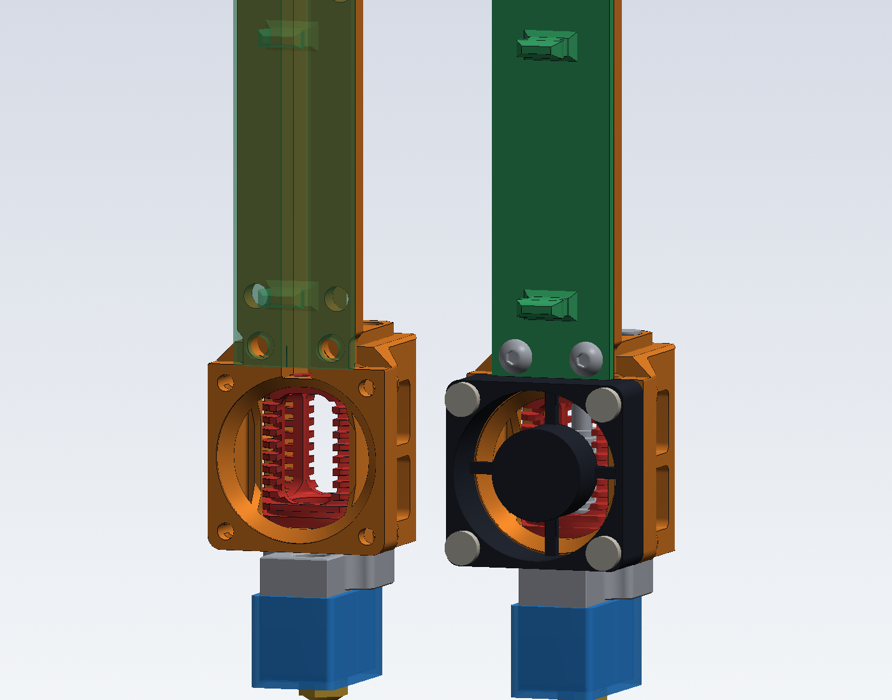 | 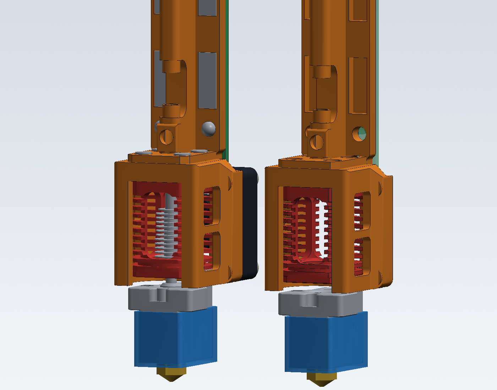 |
| **3010 Lateral Exhaust Windows on Docked Carriage** | **Voron 350 10-Toolhead Array (`37.30 mm` Pitch, `T0`–`T9`)** |
|  | 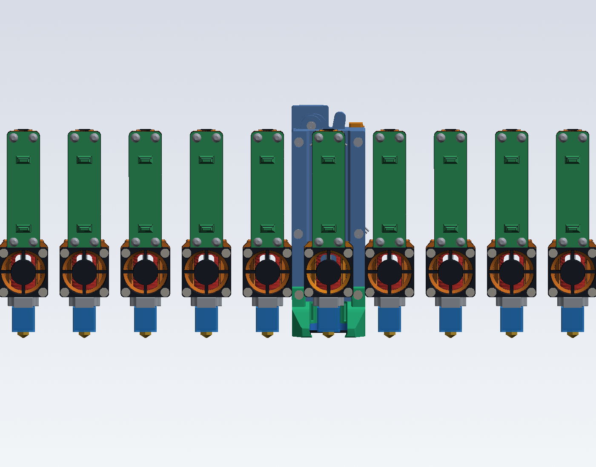 |

### 3.1 Aerodynamic Heatsink Exhaust & Wire Routing (`P17_HF_tool_carrier_3010`)
1. **Converging Bellmouth Intake (`Y = 11.50 -> 15.00 mm`, `Z = -52.50..-22.50 mm`):** Funnels the full **`Ø28.0 mm`** active blade sweep of the `30 × 30 × 10 mm` axial fan smoothly into the **`20.0 × 23.0 mm`** Creality K1 / RedLizard HF heatsink fin stack with zero step loss.
2. **Quad Lateral Exhaust Windows (`265.7 mm²` Total Exit Area) & Rear V-Splitter Wedge:**
   - Because the docked toolhead sits in front of `P01_Drive_Frame` (`Y = 35.93 mm`), air cannot exit straight through the backplate.
   - An aerodynamic **rear center V-splitter wedge (`X = 0, Y = 29.8..35.93 mm`)** bifurcates the post-heatsink airflow left and right out through **four large `8.1 × 8.2 mm` (`66.4 mm²` each) lateral exhaust windows** on the `±X` side walls (`Y = 25.00..33.10 mm, Z = -48.20..-39.80` and `-37.20..-28.80 mm`), plus an auxiliary `10.0 × 2.8 mm` bottom-rear relief slot.
3. **Partitioned Left/Right Vertical Wire Chimneys (`18.5 mm²` per side):**
   - Thick fiberglass-sleeved heater cartridge leads and thermistor wires enter via **`4.4 mm` bottom-side intake notches (`Z = -52.50..-45.00 mm`)** directly above the Volcano heatblock and travel straight up dedicated **enclosed `4.2 × 4.6 mm` vertical tunnels (`|X| = 8.00..12.20 mm, Y = 30.20..34.80 mm`)** isolated behind the lateral exhaust windows — keeping wires **100% out of the heatsink cooling airstream** and exiting cleanly out the top (`Z = -22.50 mm`).
4. **Support-Free Printability (Flat `Z = -52.50 mm` Build Plate Base):**
   - The bottom face of `P17_HF_tool_carrier_3010` (`Z = -52.50 mm`) is a single flat plane with a solid `1.70 mm` floor under the heatsink (`R = 4.60 mm` central heatbreak bore) and `45°` self-supporting upper chamfers on all lateral exhaust windows and wire inlets.
5. **StealthChanger-Compatible Docking Backplate (`P18_Tool_docking_backplate_3010`) & Dual-Compatible Magnet Pockets (`P17_3010` / `2510` & `P03_COTS`):**
   - **Dual-Compatible Receiver & Toolhead Magnet Pockets (`P03_Front_case_COTS` & `P17_3010` / `2510`):** Adds `8× Ø6.12 mm` circular magnet lobes at `(X = ±6.50 mm, Z = [30.50, 23.00, 5.50, -2.00] mm)` (`4.03 mm` deep in `P03_Front_case_COTS`, `3.10 mm` deep in `P17`) while preserving the `3.00 mm` deep rectangular corner shelves — allowing builders to press in **either `8× Ø6×4 mm / Ø6×3 mm` N52 cylindrical magnets** (`8× Ø6×4 mm` or `Ø6×3 mm` in `P03_COTS` + `8× Ø6×3 mm` in `P17`) **or `4× 15×5×3 mm` rectangular bar magnets** in the exact same print.
   - **StealthChanger `Ø5×12 mm` Rounded Dowel Pins + `Ø5 mm` Bushings + `Ø6×4 mm` Dock Magnets (`P18_3010` ↔ `P25`):** `P18_Tool_docking_backplate_3010` integrates two rear bosses at `(X = ±6.00, Z = +22.00 mm)` with `Ø4.98 × 6.50 mm` press-fit bores for **`2× Ø5×12 mm` rounded steel dowel pins** (`5.50 mm` projecting nose `Y = 45.00..50.50 mm`) and two rear bosses at `(X = ±6.00, Z = -2.00 mm)` with `Ø6.12 × 4.08 mm` pockets for **`2× Ø6×4 mm` (or `Ø6×3 mm`) N52 dock magnets**, mating into matching **`2× Ø5 mm` (`5×7×5.5 mm`) bushing counterbores** and **`2× Ø6×4 mm` magnet pockets** in `P25_SparkShift_3010_Dock` while keeping the `5.0 × 0.85 mm` central wire relief channel and upper/lower T-lugs intact. Revision-39 review: the pins move into `P25` and the bushings into `P18` (axes `X = ±4.80, Z = 21.00 mm`), so nothing sticks out of the tool; see [revision 39](#dowel-pins-moved-into-the-docks-revision-39).

### 3.2 Voron 350 (`350 mm` X-Travel) Multi-Toolhead Capacity (`2510` vs. `3010`)
With the `45.0 mm` wide carriage (`X ∈ [-22.42, +22.42] mm`), the usable dockable X-stroke across a `350 mm` Voron 2.4R2 / Monolith gantry is **`305.0 mm`**:

| Fan Variant | Toolhead Width (`X`) | Minimum Safe Dock Pitch | Max Toolheads on Voron 350 (`305 mm` C-to-C Span) | Pitch at 9 Toolheads (`8` Spaces) | Neighbor Clash at `35.0 mm` & `37.3 mm` Pitch (`dy = 0..35 mm`) |
| :--- | :---: | :---: | :---: | :---: | :---: |
| **`2510` Axial (`25×25×10 mm`)** | `24.80 mm` (`±12.40 mm`) | **`35.00 mm`** | **9 Toolheads** (`280.0 mm` span at `35.0 mm` pitch) — *10 toolheads if usable X-stroke `≥ 315.0 mm`* | `37.30 mm` (`12.50 mm` gap) | **`0.000 mm³`** |
| **`3010` Axial (`30×30×10 mm`)** | `30.00 mm` (`±15.00 mm`) | **`35.00 mm`** | **9 Toolheads** (`280.0 mm` span at `35.0 mm` pitch) — *10 toolheads if usable X-stroke `≥ 315.0 mm`* | `37.30 mm` (`7.30 mm` gap) | **`0.000 mm³`** |

> **Key Takeaway:** Upgrading from a `2510` to a **`3010` axial fan** increases fan swept area by **`+44%`** while having **zero penalty on maximum toolhead count** — because the minimum dock pitch (`35.0 mm`) is governed by the `44.84 mm` carriage/plenum width sweeping past the adjacent parked toolhead during docking (`22.42 + 12.40 = 34.82 mm`), not by the parked fan's own width!

### 3.2 Two-Part Bolt-On Bambu Hotend Heating Assembly + Snap-In 7-Fin Nozzle Variant (`P17_Bambu_P2S_tool_carrier_3010` & `2510`)


For the two-part **"Hotend Heating Assembly For Bambu Lab H2C / H2D / X2D / P2S / A1 (with Zirconia Ceramic Heat Insulation Block)"** paired with the **1-piece snap-in 7-fin Bambu hotend nozzle** (reference assembly [`A1_Hotend.step`](./A1_Hotend.step) / [`Hotend_Voron_Bambu_P2S.step`](./step/Hotend_Voron_Bambu_P2S.step)):
1. **Bolt-On Rear Vertical Mounting Wall (`Y = 14.30 mm, Z = -65.93..-19.28 mm`) with Triangular `3 × M3` Pattern:**
   - The `18.00 mm` wide **White Zirconia Ceramic Heat Insulation Block** (`X = -9.00..+9.00 mm, Z = -65.93..-37.13 mm`) mounts upright inside `P22_CPAP_Lower_Plenum`'s `20.26 mm` wide central channel (`X = ±10.13 mm`), bolting flat against `P17_Bambu_P2S`'s integral rear vertical apron (`Y = 11.50..14.30 mm`) using **`3 × M3×10` SHCS screws** in the exact Bambu triangular pattern (`2 ×` upper holes at `(X = ±6.00, Z = -40.13 mm)` and `1 ×` lower-center hole at `(X = 0.00, Z = -50.63 mm)`).
   - The **Silver Die-Cast Aluminum Heater Cradle** (`Z = -75.48..-53.18 mm`) and **Hinged Stainless Wire Bail + Stamped Buckle Latch** (`Z = -64.41..-53.34 mm`) face directly forward (`+Y`) below the `3010` / `2510` heatsink fan shroud (`Z = -52.50 mm`), giving unobstructed front finger access to unclip and swap nozzles in seconds while routing the heater and thermistor cables straight up the side wire chimneys.
2. **Integral Upper Filament Guide Boss (`Z = -32.38..-19.28 mm`) & Snap-In 7-Fin Bambu Nozzle (`Z_tip = -78.88 mm`):**
   - An integral upper filament boss extends down to `Z = -32.38 mm` with a concentric bottom **`Ø5.10 × 3.20 mm` counterbore socket** (`X = 0.00, Y = 22.70 mm`) that receives the `Ø4.75 mm` top filament entry stub (`Z = -32.38..-29.48 mm`) of the snap-in Bambu nozzle directly—eliminating any separate loose spacer.
   - The **7-fin rectangular heatsink (`16.60 × 12.00 × 17.30 mm`, `Z = -49.68..-32.38 mm`)** sits directly in the `3010` / `2510` axial fan jet with upper and lower lateral exhaust windows (`side_vent_upper`, `side_vent_lower`), and the nozzle tip lands at the exact **`(0.00, +22.70, -78.88) mm` SparkShift master nozzle datum** so Volcano (`P17_HF`) and Bambu Quick-Swap (`P17_Bambu_P2S`) toolheads can be mixed freely on the same 10-tool rack.
3. **Upper Stem Side ID Notches (`Z = 33.00..37.00 mm`):**
   - Dual side V-notches on the upper stem ribs distinguish `P17_Bambu_P2S` from Volcano `P17_HF` carriers at a glance.

### 3.3 One-Piece Bambu Toolhead with Side 2510

#### Current Bambu body: compact fan side, closed P18 bores (revision 30)

Revision 30 is rebuilt from revision 22 in one sequence, like revision 29, and keeps all
of its fixes: enclosed inlet, restored front neck, filled corridors and round fan bosses.
It changes three things, driven by dock spacing and review of revision 29.

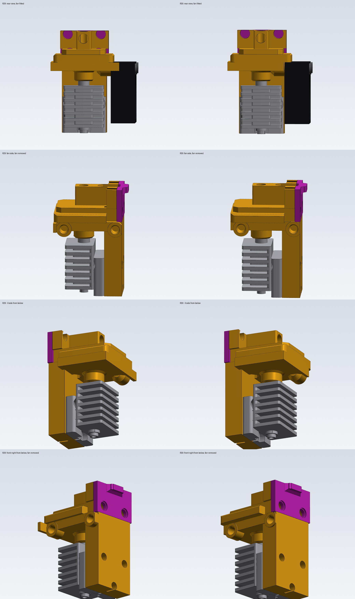

1. **Tighter fan side.** The fan moves 1.65 mm toward the hotend: seat face X9.80,
   centre X14.80, Y25.50, Z-35.30 mm. That leaves a **1.5 mm air gap** to the heatsink
   fins, 0.8 mm to the heating-assembly plate and 0.55 mm to the printed apron. The fan
   top stays 0.35 mm under P18's lower edge. Fan screw heads now end at **X20.60**
   instead of X22.25.
2. **Carriage clearance at the dock.** The shelf's fan-side face is now one flat face at
   X9.55 under the upper shelf layer. This removes a 1.25 mm strip behind the fan that
   ran out to X15. With a tool parked on the -X side of the active bay, that strip sat
   inside the active carriage's footprint, **0.10 mm** in front of the carriage frame.
3. **Closed P18 bores.** The two lower P18 insert bores broke through the shelf top
   behind the flange, leaving the small half-moon slots. Behind the flange the shelf top
   is only 1.98 mm above the bore axis, while the bore radius is 2.28 mm. The pockets now
   end inside the flange: 4.56 mm diameter, 3.38 mm deep, with a 0.5 mm rear wall. The
   old slots are filled flush with the shelf top. **These two positions take M3 x 3 mm
   heat-set inserts**; a 4 mm insert would reach behind the flange and break through
   again. The upper P18 pair is unchanged.

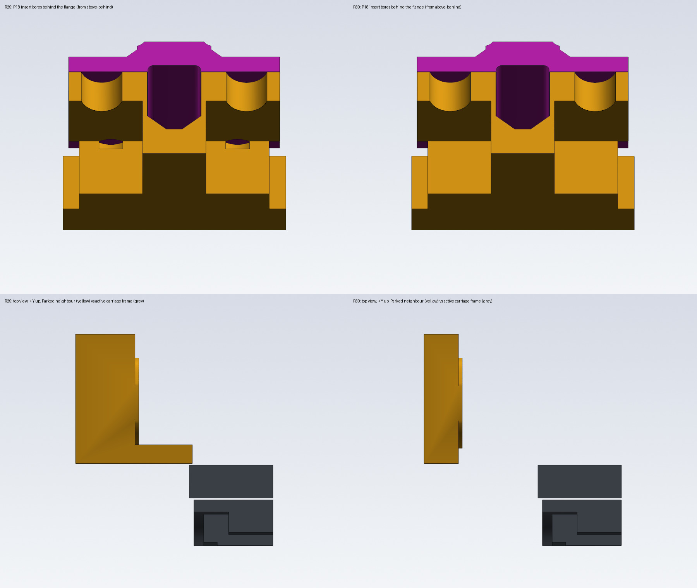

Dock and neighbour clearances, minimum distances with the tool fully assembled:

| Case | Revision 29 | Revision 30 |
| --- | --- | --- |
| Active carriage to a parked Bambu neighbour | 0.10 mm | 0.98 mm |
| Parked Bambu next to parked Bambu (fan side) | 1.55 mm | 3.20 mm |
| Parked Bambu fan side next to a Red Lizard | 1.05 mm | 2.70 mm |
| Parked Red Lizard fan side next to a Bambu | 1.84 mm | 1.84 mm |

The 0.98 mm case is now vertical: the carriage frame passes under a parked neighbour's
fan. Docks and carriage both ride on the gantry, so this gap does not change with Z
moves, but it does depend on printed-part and dock-mounting tolerances. The Red Lizard
rows use the revision-21 parked Red Lizard snapshot. The revision-31 carriage review
below lowers those mounts and opens this gap to 2.48 mm.

The Red Lizard body had the same strip.
[Revision 30 Red Lizard](./step/RedLizard_Side2510_Strip_Trim_R30_REVIEW.step)
([STL](./stl/RedLizard_Side2510_Strip_Trim_R30_REVIEW.stl)) removes only that strip
(6.30 mm³), raising its carriage clearance from 0.10 mm to 1.30 mm
([report](./verification_redlizard_strip_trim_r30.json), `python build_redlizard_strip_trim_r30.py`).

Verification (`python build_bambu_clean_r30.py`,
[report](./verification_bambu_compact_r30.json)):

- One valid solid with one closed shell, exported as one watertight STL shell. Every
  change against revision 22 lies inside the declared edit zones.
- Zero-volume witnesses: front neck filled; wire trough open; corridors closed; boss
  walls complete and pilots clear; P18 pockets clear, walled and closed at the rear,
  with the old slots filled and nothing above the shelf top; inlet socket and filament
  path; no fan-recess membrane or rear strip left.
- No intersection with the core, P18, P20-P24, hotend, hotend hardware, fan envelope or
  fan screws.
- Sampled motion: dock approach and withdrawal and carriage retreat over 60 mm (121
  samples each) with the changed parts, removed-hotend service path (57 samples), and the
  full tool past Bambu and Red Lizard neighbours at +/-37.3 mm (4 x 61 samples) found no
  intersections.
- The 139 unchanged solids in the complete carriage/dock assembly show no new
  intersection.

Files: [print STEP](./step/Bambu_Compact_Fan_Closed_Bores_R30_REVIEW.step),
[STL](./stl/Bambu_Compact_Fan_Closed_Bores_R30_REVIEW.stl),
[20-solid toolhead](./step/30_Bambu_Compact_Toolhead_REVIEW.step),
[145-solid complete assembly](./step/30_Bambu_Compact_Complete_REVIEW.step),
[fan and screws](./step/Bambu_Fan_2510_And_Screws_R30_REVIEW.step) and
[L4 fan inserts](./step/Bambu_Fan_Side_M2p5_L4_Inserts_R30_REVIEW.step).
Render the comparison with `python render_bambu_clean_r30.py`.

Limitations: the front fan insert keeps a 0.65 mm wall to the apron front face. Fan
cooling at the 1.5 mm gap, insert pullout, printed strength and socket temperature are
unqualified. The ten-tool rack and low-Z bed audits were not rerun. The fixed-rack low-Z
bed collision and the probe-cable entry issue were open at this revision; revisions 34 and
35 resolve them.

**Split toolhead considered, not adopted.** A common upper part, with the Red Lizard
bolted on through its four M2.5 heatsink screws and a Bambu lower module on the same
pattern, would not change the tool's width at the dock. It would add a four-bolt plastic
joint at the root of the 45 mm hotend overhang, where wiping and docking loads are
highest. The spacing problems were the shelf strip and the fan gap, both fixed above in
one piece.

#### Carriage: lowered P22-to-P01 front mounts (revision 31 review)

Each tool's side 2510 fan ends at Z-47.8. The closest carriage parts below it were the
two lower front accessory bosses on P01 (X±18, R4) and the P22 cheeks bolted to them:
**0.98 mm** to the boss tops and 1.20 mm to the cheek tops. The own fan passes over them
whenever a tool is picked up or parked. A tool parked one bay to the -X side passes its
fan over them whenever the active carriage enters or leaves a bay.

Revision 31 moves both mounts **1.5 mm lower**, from screw axis Z-52.78 to Z-54.28. This
covers the P01 bosses and their M3×4×4.6 heat-set pockets, the M3 screws, the P22 boss
clearances, screw holes and counterbores, and the P22 cheek tops (Z-49.0 to Z-50.5).
Nothing else changes, and the hardware list stays the same.

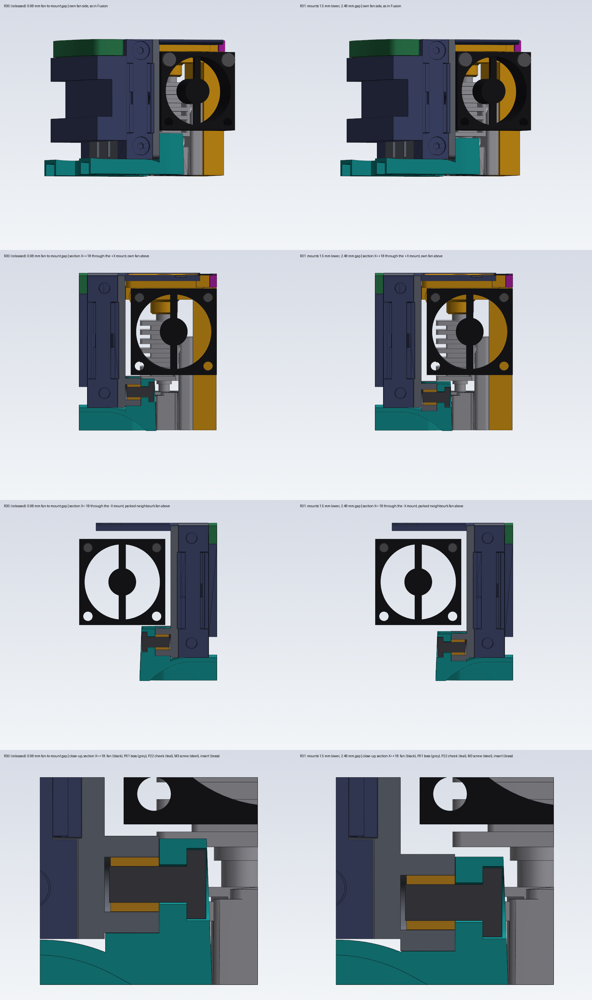

| Minimum distance | Released | Revision 31 |
| --- | --- | --- |
| Fan bottom to the mounts below it (vertical) | 0.98 mm | 2.48 mm |
| Own fan to the carriage (Bambu or Red Lizard) | 0.98 mm | 1.60 mm |
| Active carriage to a parked Bambu at -37.3 mm | 0.98 mm | 1.60 mm |
| Active carriage to a parked Red Lizard at -37.3 mm | 0.98 mm | 1.35 mm |
| Active carriage to a parked tool at +37.3 mm | 1.30 mm | 1.30 mm |

The vertical gap is no longer the limit. The 1.60 mm is the fixed gap between the fan's
rear face and the P01 front wall in the docked position; it opens as the carriage
retreats. The 1.35 mm and 1.30 mm rows are side clearances between P01 and the
neighbour's printed body, which this change does not touch; revision 32 below removes
both.

1.5 mm is the practical limit. The P22 boss clearance sits above the CPAP duct roof, and
the wall between them drops from 2.70 mm to 1.29 mm, against the duct's existing 1.24 mm
roof wall. The air path is unchanged. Each boss keeps its R4 shape and 1.73 mm wall around
the insert, so it now hangs **1.0 mm below the P01 bottom face** (Z-57.28) in front of the
wall. In the rear-face-down print orientation, each boss starts with a 1.0 mm
unsupported crescent.

The Z-53.079 cross-bore and nut slots on the P01 rear face, below the rail block, were
considered as a mount and not reused. They already clamp the belt side plates, a
screwdriver cannot reach them behind the rail block, and a mount there would leave the
probe end of P22 cantilevered.

**Core change note.** P01 is frozen v26j geometry, so this is a review proposal, not an
edit of the native model. To adopt it, move the two lower front accessory bosses in the
native P01 from Z-52.780 to Z-54.280, keeping the R4 × 4.5 mm boss and the 4.54 mm ×
4.5 mm insert pocket, and print the revision-31 P22 with it. Do not mix the released and
revision-31 P01/P22.

Verification (`python build_carriage_lowered_mounts_r31.py`,
[report](./verification_carriage_lowered_mounts_r31.json)):

- P01: the boss move is volume-neutral. Outside the two boss zones, its volume, surface
  area and centroid match the released part. P22 is likewise unchanged outside the cheek
  zones, and its CPAP air domain is identical. The parameterised P22 generator reproduces
  the released P22 at `mount_dz=0`.
- No new intersection with the core, P20-P24 or the mount hardware. Inserts and screws
  clear P01 and P22, and the 0.02 mm boss clearance is kept.
- Carriage retreat from its own Bambu and Red Lizard tool (121 samples each), and past
  both tool types parked at ±37.3 mm (61 samples each), found no intersections.
- The 143 unchanged solids in the complete assembly show no new intersection.

Files: [P01 STEP](./step/P01_Back_case_COTS_MR74_Lowered_Bosses_R31_REVIEW.step)
([STL](./stl/P01_Back_case_COTS_MR74_Lowered_Bosses_R31_REVIEW.stl)),
[P22 STEP](./step/P22_CPAP_Lower_Plenum_Lowered_Mounts_R31_REVIEW.step)
([STL](./stl/P22_CPAP_Lower_Plenum_Lowered_Mounts_R31_REVIEW.stl)),
[mount hardware](./step/P22_P01_Mount_Hardware_R31_REVIEW.step),
[101-solid core reference](./step/Core_With_Lowered_P01_Bosses_R31_REVIEW.step) and
[149-solid complete assembly](./step/31_Carriage_Lowered_Mounts_Complete_REVIEW.step).
Render with `python render_carriage_lowered_mounts_r31.py`. Insert pull-out, printed
strength and probe stiffness through the lowered mounts are unqualified.

#### Side clearances: flush non-fan side, Red Lizard fan skin (revision 32)

With the revision-31 carriage, two leftovers on the printed bodies set the closest
approach to the tools parked beside the active carriage. Revision 32 removes both, from
both bodies where they exist. Nothing else changes.

1. **Non-fan (-X) shelf lip.** On both bodies, the lower shelf layer (Z-26..-22.5) still
   reached X-13.5, 1.1 mm beyond everything else on that side. Revision 22 had already
   trimmed this edge from X-14 as unused stock. Its rear corner sat **1.30 mm** from the
   P01 front corner whenever the tool was parked on the +X side of the active bay. Both
   bodies are now X±12.40 below the flange, the original P17 carrier width. On the Red
   Lizard, this also removes a 0.1–0.2 mm sliver beside the old Y-axis bore groove under
   the shelf.
2. **Red Lizard fan-recess skin.** A 0.05 mm skin under the Red Lizard upper shelf
   (Z-22.55..-22.5), 0.25 mm above its fan, reached X15.0 and Y12.75. It sat **1.35 mm**
   in front of the P01 front face when a Red Lizard was parked on the -X side. Revision 29
   removed the same skin from the Bambu body.

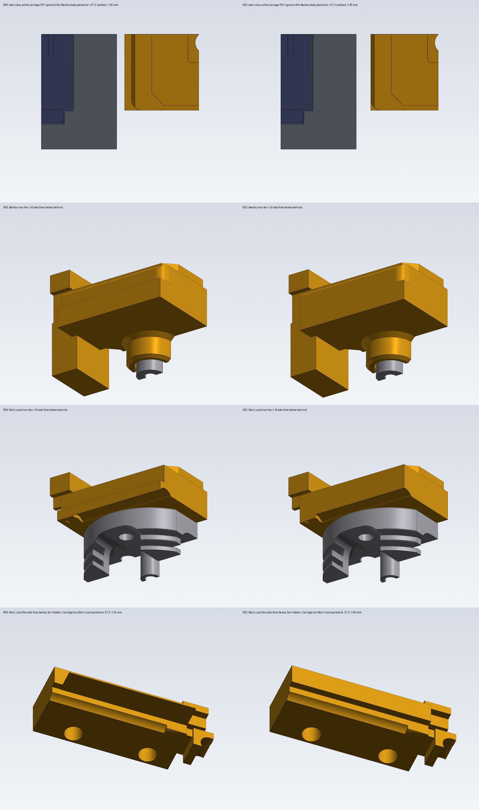

Minimum distances, all with the revision-31 carriage:

| Case | Revision 30 bodies | Revision 32 bodies |
| --- | --- | --- |
| Active carriage to a tool parked at +37.3 mm | 1.30 mm | 1.73 mm |
| Active carriage to a Red Lizard parked at -37.3 mm | 1.35 mm | 1.60 mm |
| Active carriage to a Bambu parked at -37.3 mm, or to its own fan | 1.60 mm | 1.60 mm |
| Parked Red Lizard fan side next to a Bambu | 1.84 mm | 2.77 mm |
| Parked Red Lizard fan side next to a Red Lizard | 1.94 mm | 2.84 mm |
| Parked Bambu fan side next to either tool | 3.20 mm | 4.30 mm |

On the +X side, P01 to the neighbour's body is now 2.40 mm. The 1.73 mm limit there is
a pair the lip used to hide, the same with the released and revision-31 P22: P22's
rounded lower outer edge passes 1.73 mm from the top edge of the neighbouring dock's P26
nozzle chute (X±15.0 in its own frame). The same pair sets 1.73 mm on the -X side.
Narrowing that chute to X±14.0 raises this pair to 2.50 mm, leaving P01 to the
neighbour's body (2.40 mm) as the +X limit; that is a dock change and is not made here.
Revision 36 chamfers the arm edge instead, because narrowing would open the M3 head channel.

**What still sets 1.60 mm.** The fan's back face (Y13.0) sits 1.6 mm in front of the P01
front face (Y11.4), for the tool's own fan and for the fan of a tool parked on the -X
side. It is a Y gap at full insertion: X error does not reduce it, and the tool body
seats 0.1 mm from P01, so the active carriage can only reach a neighbour's fan if that
neighbour sits more than 1.6 mm out of its dock. Raising it means moving the fan
forward. The dock leaves about 28 mm free directly in front of the fan, but each 0.5 mm
costs 0.5 mm of the 0.65 mm wall around the front fan insert, so the apron would need a
local boss. It also moves the airflow further off the heatsink: on the Bambu the hotend
body (Y15.7..26.9) is already centred 4.2 mm behind the fan centre. Not adopted.

Verification (`python build_side_clearance_r32.py`,
[report](./verification_side_clearance_r32.json)):

- Removal only: each body loses exactly the material inside its cut zones (Bambu
  79.12 mm³; Red Lizard 30.54 mm³ lip and 3.43 mm³ skin), nothing is left inside them,
  and each stays one valid solid with one shell. The Red Lizard keeps 4.26 mm of material
  at the new face above the old groove (Z-23.54..-19.28).
- Each revision-32 body is a subset of its revision-30 body, so the earlier dock,
  carriage-retreat, service and neighbour sweeps and the revision-31 carriage sweeps
  still hold. The 148 unchanged solids in the complete assembly show no new intersection.

Files: [Bambu STEP](./step/Bambu_Compact_Flush_Side_R32_REVIEW.step)
([STL](./stl/Bambu_Compact_Flush_Side_R32_REVIEW.stl)),
[Red Lizard STEP](./step/RedLizard_Side2510_Flush_Side_R32_REVIEW.step)
([STL](./stl/RedLizard_Side2510_Flush_Side_R32_REVIEW.stl)),
[20-solid Bambu toolhead](./step/32_Bambu_Flush_Side_Toolhead_REVIEW.step) and
[149-solid complete assembly](./step/32_Bambu_Flush_Side_Complete_REVIEW.step) with the
revision-31 carriage. Render with `python render_side_clearance_r32.py`.

#### Fan mounts: third Bambu screw, solid Red Lizard fan wall (revision 33)

Revision 33 strengthens how both bodies hold the 2510 fan. Nothing changes outside the
fan mounts and the Red Lizard front, and every clearance in the revision-32 table is
unchanged.

**Bambu: third fan screw.** The fan hung from its two upper holes and its lower edge was
free. A third R3 boss on the apron's side face at the fan's lower-front hole (Y35.5,
Z-45.3) takes a third fan-side M2.5 L4 heat-set insert and M2.5×14 low-head screw, so the
fan is held at three corners. The apron is solid there. The new insert sits 1.67 mm from
the apron's own hotend insert at (X6, Z-40.13) and keeps the same 0.65 mm front wall as
the upper front insert. The lower-rear hole stays empty because the heatsink fills the
space behind it.

**Red Lizard: fan wall and neck.** The fan hung from a 4 × 5 mm column (X7.45..11.45,
Y33..38). Its only joint to the shelf was a 1.48 mm tab that overlapped the shelf by
0.55 mm. The neck under P18 was also missing, so both lower P18 bores were half open at
the bottom. Revision 33:

1. Restores the front neck under P18 as on the Bambu (revision 29), with the wire trough
   left open from below.
2. Replaces the column with a fan wall 8.6 mm wide and 5.45 mm deep (X3.0..11.6,
   Y32.45..37.9, from Z-48.3 up into the neck). It seats the fan over its full height.
3. Moves both fan inserts from inner-entry M2.5 L3 to fan-side M2.5 L4 pilots, like the
   Bambu. The two M2.5×14 screws are unchanged.
4. Recuts the lower P18 bores as closed M3 × 3 pockets with a 0.5 mm rear wall, as on the
   Bambu (revision 30).

The Red Lizard fan's rear holes still cannot take screws. An insert behind them would
overlap the heatsink top by about 2.8 mm, and the fan sits 0.6 mm from the fins. The wall
stops 0.5 mm in front of the heatsink, so the hotend still drops straight out once its
four heatsink screws are removed.

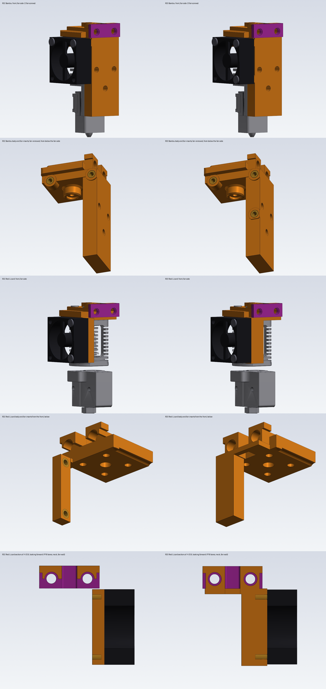

| Hardware | Revision 32 | Revision 33 |
| --- | --- | --- |
| Bambu fan inserts | 2 × M2.5 L4, fan side | 3 × M2.5 L4, fan side |
| Bambu fan screws | 2 × M2.5×14 low head | 3 × M2.5×14 low head |
| Red Lizard fan inserts | 2 × M2.5 L3, inner entry | 2 × M2.5 L4, fan side |
| Red Lizard lower P18 inserts | half-open bores | 2 × M3 × 3 in closed pockets |

Verification (`python build_fan_mounts_r33.py`,
[report](./verification_fan_mounts_r33.json)):

- Both bodies are one valid solid with one shell. Outside the declared edit zones their
  volume, surface area and centroid match revision 32. There is no new contact with the
  hotend and its hardware, the fan, the fan screws, P18, the revision-31 carriage or
  P20–P24.
- Zero-volume gauges: every fan insert is walled and every pilot clear. The Red Lizard
  wall and neck are fully filled, its wire trough is open, and both P18 pockets are
  clear, walled and closed at the rear. Nothing sits inside the fan envelope.
- Sampled motion for both tools found no intersections:
  - dock approach, withdrawal and carriage retreat over 60 mm (121 samples)
  - the hotend service path (Bambu as revision 30; the Red Lizard straight down 45 mm)
  - both tools past Bambu and Red Lizard neighbours at ±37.3 mm (61 samples each)
- The 144 unchanged solids in the complete Bambu assembly show no new intersection.

Files: [Bambu STEP](./step/Bambu_Three_Screw_Fan_R33_REVIEW.step)
([STL](./stl/Bambu_Three_Screw_Fan_R33_REVIEW.stl)),
[Red Lizard STEP](./step/RedLizard_Fan_Wall_R33_REVIEW.step)
([STL](./stl/RedLizard_Fan_Wall_R33_REVIEW.stl)),
[Bambu inserts](./step/Bambu_Fan_Side_M2p5_L4_Inserts_R33_REVIEW.step),
[Red Lizard inserts](./step/RedLizard_Fan_Side_M2p5_L4_Inserts_R33_REVIEW.step),
[Bambu fan and three screws](./step/Bambu_Fan_2510_And_Three_Screws_R33_REVIEW.step),
[22-solid Bambu toolhead](./step/33_Bambu_Three_Screw_Toolhead_REVIEW.step),
[24-solid Red Lizard toolhead](./step/33_RedLizard_Fan_Wall_Toolhead_REVIEW.step) and
[151-solid complete Bambu assembly](./step/33_Bambu_Three_Screw_Complete_REVIEW.step).
Render with `python render_fan_mounts_r33.py`. Insert pull-out, printed strength and fan
vibration remain unqualified.

#### Low-Z fix: rigid rack, bed front edge behind the docks (revision 34)

The flying gantry is a U: the two Y arms are joined at the rear and the X beam travels
along them. The 2020 dock crossbar closes the open front of the U, so the docks and
parked tools move with the gantry and tools can change at any height. That stays as
designed; the independent lift studied in revision 23 is not pursued.

Because the rack is rigid, the parked tools ride at the active tool's height. Their
chutes, silicone pads and wipers hang about 14 mm below the nozzle over the bed's front
strip, which is why revision 22 found them inside the bed at first-layer height in every
case. Mounting the crossbar higher would not help: the carriage, not the crossbar, sets
the parked tools' height.

The active nozzle cannot print over that strip anyway, because the parked tools occupy it
(front print limit Y63.21 mm in the [ten-tool report](./verification_ten_tool_closed_panel_dock.json),
Y52.22 mm from exact contact since revision 38, Y48.25 mm since revision 39).
The bed in front of the parked envelope only causes the collision. **Required printer
change: the bed's front edge at Y40 mm or further back.** The parked envelope ends at
Y35.41 mm, so the absolute minimum for a 1 mm gap is Y36.41 mm. Either:

- **Option B, chosen: move the stock 350 × 350 bed and its mounts back 31 mm**
  (Y40..390). The bed, heater and sheet stay standard. The nozzle still stops at the stock
  rear limit (Y359, where the original bed ended), so the last 31 mm of the moved bed is
  never printed on. It lets the probe, which trails the nozzle by 19.5 mm, mesh the bed
  right to the rear print limit.
- **Option A, not used: a 350 × 319 mm bed, heater and sheet** spanning Y40..359. The
  nozzle stops at the bed edge, and the last 10 mm at the rear cannot be meshed because the
  coil needs bed around it, as with the original bed.

Both options give the same print area; moving the bed only clears the docks at the front.

**On the moved bed (option B)**, measured from its front edge, the print area runs from
8.25 mm to 319 mm (CAD Y48.25..359) across the full 350 mm width. The rear 31 mm is for
probe meshing only. Set the slicer's bed to the full plate with that printable strip.

The build sheet needs no tab or overhang at the front edge. Nothing in the rack, docks,
toolheads, carriage or gantry changes.

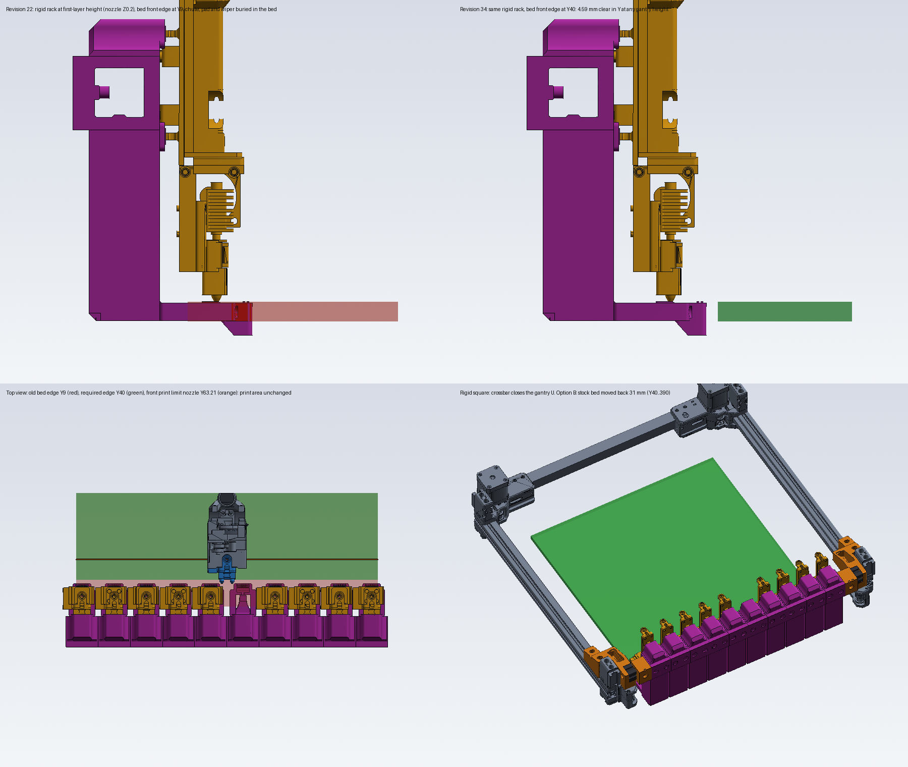

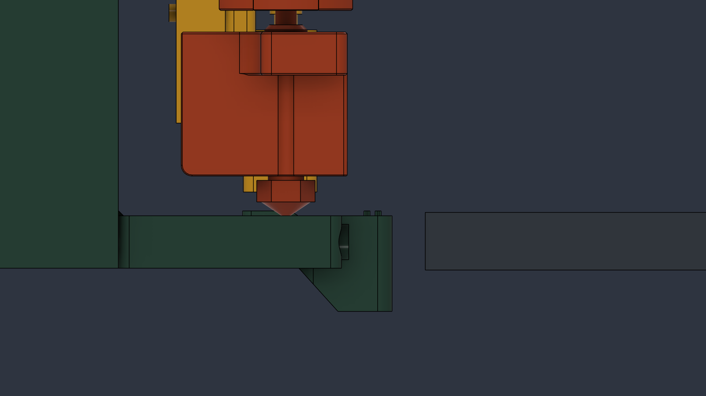

The [reproducible audit](./verification_bed_front_edge_r34.json)
(`python audit_bed_front_edge_r34.py`, about 1.5 minutes) checks both active hotends,
both parked hotends and all ten bays at nozzle Z0.2 (first layer) and Z0 (contact touch):

| Bed | Cases | Collisions | Minimum clearance |
|---|---|---|---|
| Original, front edge Y9 (control) | 80 | 80 | — |
| Front edge at Y40 (option A) | 80 | 0 | 4.59 mm |
| Stock bed moved back 31 mm (option B) | 80 | 0 | 4.59 mm |

- With the gantry 2 mm below nozzle touch, the parked hardware drops to Z-15.95 mm in
  front of the bed edge and reaches no frame, panel or door body. The nearest is the
  existing 2.0 mm gap between the bay-0 dock and the door-buffer plane at Y-40, which is
  the same at every height.
- Over option B's new rear strip (Y359..390), with the nozzle at Y359 and Z0.2, the X beam
  clears the bed by 30.9 mm and the flying gantry (at nozzle Z-2) by 47.7 mm. The lowest
  carriage part is P22 at 0.48 mm, the same as anywhere on the bed (see below).
- The front print limit leaves 23.2 mm of bed in front of it (12.2 mm with revision 38's
  limit, 8.25 mm with revision 39's), so the print area is unchanged, and the probe coil is
  over the bed there (Y82.71; Y71.7 with revision 38, Y67.75 with revision 39).
- The [native Fusion review](./34_Rigid_Rack_Bed_Front_Edge_Y40_REVIEW.f3d) is the
  revision-22 diagnostic with only the bed moved back 31 mm. Fusion measures the same
  4.59 mm from all ten docks to the bed.

**Travel limits and print area** ([report](./verification_travel_limits_r34.json),
`python audit_travel_limits_r34.py`, about 20 minutes). Contact is tested exactly every
0.5 mm along each path and bisected to 0.01 mm, at nozzle X0, 25, 175, 325 and 350 with
both tools:

| Limit | Nozzle Y |
|---|---|
| Dock seat (every bay) | 20.71 |
| Front print limit, whole-envelope rule (superseded by revision 38) | 63.21 |
| Front print limit, exact 3D contact + 1 mm, dowel pins on P18 ([revision 38](#front-print-limit-from-exact-contact-revision-38), superseded) | 52.22 |
| **Front print limit, dowel pins moved into the docks ([revision 39](#dowel-pins-moved-into-the-docks-revision-39))** | **48.25** |
| X-traverse corridor used by the toolchange | 80.71 |
| Rear rail end: the X beam's 40 mm Y blocks reach the end of the 400 mm rails | 365.15 |
| X beam reaches the Monolith rear motor mount | 365.26 |
| Carriage reaches the rear motor mounts (P22) or the rear extrusion (P21, X175 only, at 385.9) | 367.40 |
| Rear soft limit the rails would allow (1 mm inside the rail end) | 364.15 |
| **Rear limit on this machine: the stock rear limit, where the original bed ends** | **359** |

At the front, the rails would allow Y5.05 (the beam meets the front idler mount at
Y2.94), well forward of the dock seat. This matches Monolith's published overtravel
(+13 mm in Full Travel mode against a stock Voron's +10 mm). It does not recover the strip
the docks take. At the rear, the rails would reach Y365.15, but the nozzle on this machine
does not travel past the stock rear limit, so the print area ends at Y359 with either bed.

| Bed | Printable (X × Y) | Nozzle Y | Probe can mesh bed Y | Not meshed |
|---|---|---|---|---|
| Option A, Y40..359 | 350 × 310.8 mm (revision 34: 295.8, revision 38: 306.8) | 48.25..359 | 68.07..349 | front 19.8 mm, rear 10 mm |
| Option B, Y40..390 | 350 × 310.8 mm (revision 34: 295.8, revision 38: 306.8) | 48.25..359 | 68.07..378.5 | front 19.8 mm |

The front 19.8 mm of the print area cannot be meshed with either bed: the probe trails
the nozzle and the parked tools stop the nozzle at Y48.25 (Y63.21 before revision 38,
Y52.22 before revision 39). Klipper uses the nearest mesh row there. A stock Voron 2.4 350
prints 350 × 350 mm; the ten front docks cost about 39 mm of depth (54 mm before revision
38). The table uses revision 39's front limit
([report](./verification_front_print_limit_r39.json)) and the stock rear limit. The
revision-34, 38 and 39 reports also list option B to the rails' Y364.15, 5.1 mm deeper,
which this machine does not reach.

Found during and after this audit:

- **P22 over the Bambu nozzle: a reference-model artifact, not a P22 problem.** P22's
  lowest points are its two outlet lobes either side of the nozzle (X±8.5..20.3, flat
  bottoms at local Z-77.85, over a 1.2 mm floor). They sit 1.03 mm above the Red Lizard
  and v26 Volcano tips (Z-78.879), and the audit first reported only 0.28 mm above the
  Bambu tip. That tip (Z-78.131) comes from the synthetic Bambu reference: its 2 mm
  filament bore runs straight out of the nozzle, so the 31° outer cone (apex Z-79.795)
  ends in a knife edge where the cone reaches the bore radius. The Red Lizard model has a
  realistic 1.0 mm tip face around a 0.4 mm orifice. The same face on the Bambu cone puts
  its tip at about Z-78.96, within 0.1 mm of the Z-78.88 datum the toolhead was designed
  to, giving P22 about 1.1 mm and the probe coil about 2.35 mm above it. P22 is not
  changed. Audits that placed the Bambu tool by the modeled tip ran the gantry 0.75 mm
  lower than it really is, so their bed and frame clearances err on the safe side.
  **To confirm on the hotend:** the nozzle tip should be about 38.75 mm below the centres
  of the two upper mounting holes (Z-40.13). If it is, use the Red Lizard silicone pad and
  wiper heights (top Z-78.88) on the Bambu docks too; the revision-21 Bambu pad and wiper
  (top Z-78.13) follow the artifact and a real nozzle would press about 0.8 mm into them.
  Revision 37 repairs the reference tip and puts the datum pad and wiper in every dock.
- **Probe height versus the makers' nominal.** The coil bottom sits 2.27 mm (Beacon) or
  2.28 mm (Cartographer) above the Z-78.88 tip. Beacon's quick start gives a nominal
  2.6 mm and Cartographer's documentation 2.6–3 mm, so both are about 0.3 mm low.
  Revision 37 raises both probes 0.33 mm, to 2.60 / 2.61 mm.
- **Probe y_offset sign (fixed after revision 34).** The coil sits 19.5 mm (Beacon) or
  19.82 mm (Cartographer) behind the nozzle in printer Y, which grows toward the rear:
  the Beacon coil centre is at world Y40.21 with the nozzle at Y20.71. Klipper places
  the probe at nozzle + offset, so the probe snippets further down and
  `klipper/sparkshift_toolchanger.cfg` now use `y_offset: 19.50` / `19.82` instead of
  the earlier negative values. Confirm with `PROBE_CALIBRATE` before meshing.

Limitations: rigid CAD with the revision-21 parked tools and docks. Revision 36 below reruns
the full ten-tool rack audit, including this bed gate, with the revision-33 toolheads.
The model has no Z drives, bed supports, bed wiring or nozzle brush. On the printer, check:

- the space in front of the new bed edge, from Y-38 to the edge and down to 16 mm below the
  bed top;
- with option B, that the bed's supports, wiring and any rear-mounted brush or purge bucket
  still clear the rear Z drives and frame 31 mm further back.

Bed thermal growth at the front edge (about 0.4 mm at
100 °C) is well inside the 4.59 mm gap. Klipper limits and probe offsets are not
commissioned.

#### Probe-cable entry through P24 (revision 35)

The Beacon or Cartographer cable (3.0 mm) runs from the probe's rear dome under the X beam,
up P21's raceway at Y-34.9 and forward under P20's cable-channel roof at Z-15.8. It passes
under the EBB42 into the wiring bay between the board and the extruder motor. Since
revision 21, its last 2.4 mm ran through P24's bottom crossbar and P21 bridge plate
(15.5 mm3). Raising the forward run clears P24 only by hitting P20's roof (revision 22),
so there is no vertical room for it.

Revision 35 cuts one straight slot through P24's bottom at X0. It is 3.8 mm wide (0.4 mm
each side of the cable) and runs from P24's rear face to Y-19.48, through the full
bottom and open to the bay above. The modeled cable continues through it, turns up with an
R5 bend and rises at Y-21.0, 2.9 mm from the board's standoff plane and 2.8 mm from the
motor. Nothing else in P24 changes, and P20, P21 and the core are untouched.

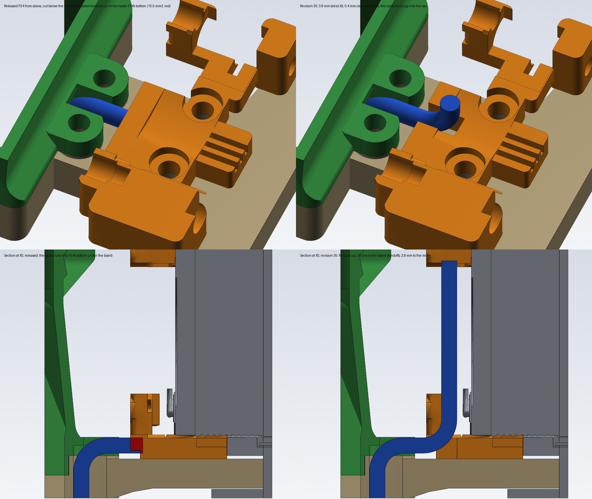

Verification (`python build_p24_cable_entry_r35.py`,
[report](./verification_p24_cable_entry_r35.json)):

- P24 stays one valid solid with 87.9 mm3 removed. Outside the slot, its volume, surface
  area and centroid match the released part.
- The slot leaves 2.51 mm to the counterbores of the two P24-to-P21 bolts, and P24's seat
  on P21 goes from 624 to 594 mm2. The bottom crossbar is now split at X0; both halves
  stay bolted to P21 and joined by the bridge plate in front of the slot.
- The cable clears P24 by 0.40 mm (the slot walls), the motor by 2.80 mm, P23 by
  7.06 mm and P20 by 0.29 mm. The unchanged under-beam part of the route keeps its
  inherited 0.05 mm to P21 and P22. The revision-21 cable no longer touches P24
  (15.5 mm3 before, 0 after).

Files: [P24 STEP](./step/P24_EBB42_Controller_Mount_Cable_Entry_R35_REVIEW.step)
([STL](./stl/P24_EBB42_Controller_Mount_Cable_Entry_R35_REVIEW.stl)),
[cable route](./step/Probe_Cable_Route_R35_REVIEW.step) and
[111-solid carriage assembly](./step/35_Carriage_Probe_Cable_Entry_REVIEW.step).
Render with `python render_p24_cable_entry_r35.py`. The EBB42 board and its connectors are
not modeled (the board position comes from P24's standoffs). The cable is a rigid 3.0 mm
tube; its connectors, strain relief and the exit above Z20 are not modeled, and the split
crossbar's printed strength is not qualified.

#### Chute arm chamfer and full-rack requalification (revision 36)

With the revision-31 carriage, the closest approach to a tool parked on the +X side was
1.73 mm: P22's rounded lower outer edge passes the sharp top outer edge of the neighbouring
chute's side arm (X±15.0, Z-78.80). Revision 32 suggested narrowing the arms to X±14.0, but
each arm is a tube around an M3 screw-head channel (Ø5.5 at X±11.75) with a 0.5 mm outer
wall, so narrowing would open the channel.

Revision 36 chamfers that edge instead: 1.5 mm × 45° along each arm (Y15..45.91). This removes
67.3 mm3 from P26 and leaves 1.06 mm between the chamfer and each screw-head channel. Nothing
else in the dock changes, and both hotends use the same chute.

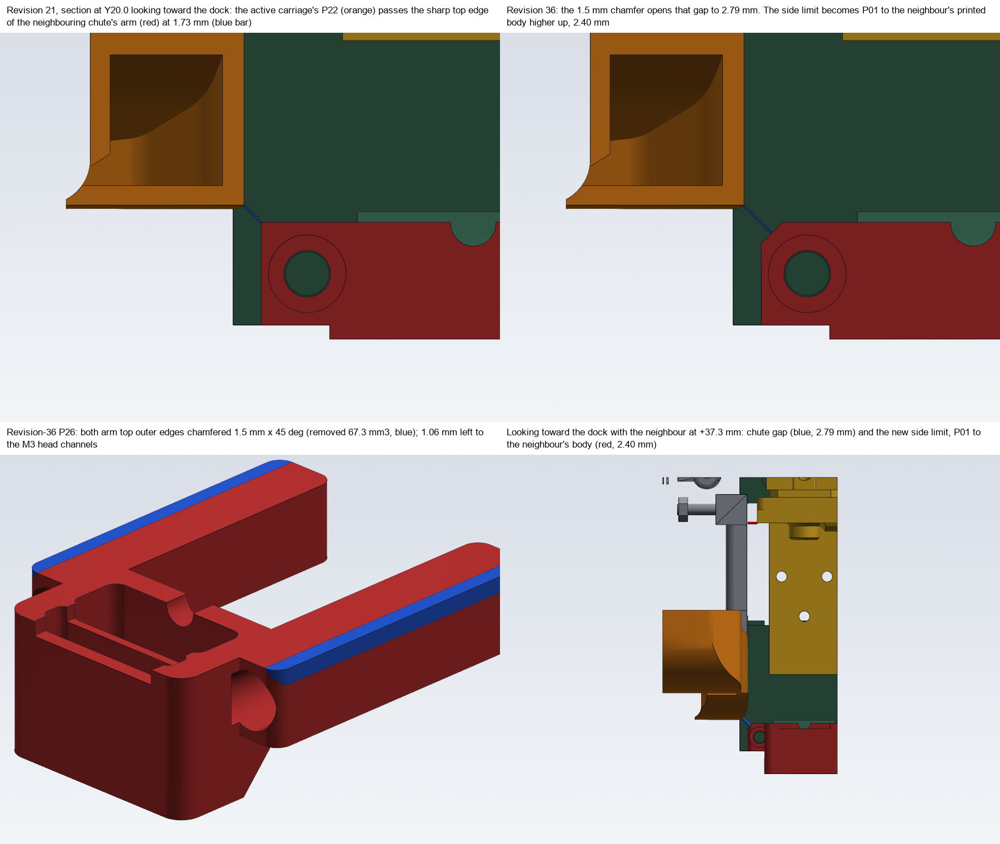

| Case (revision-31 carriage, revision-33 tools) | Revision 21 docks | Revision 36 docks |
| --- | --- | --- |
| Active carriage to a tool parked at +37.3 mm | 1.73 mm (P22 to the chute arm) | 2.40 mm (P01 to the neighbour's body) |
| P22 to the neighbouring chute arm | 1.73 mm | 2.79 mm |
| Active carriage to a tool parked at -37.3 mm, or to its own fan | 1.60 mm | 1.60 mm |

The 1.60 mm on the -X side is the fan's Y gap at full insertion (see revision 32).

**Full ten-tool rack, requalified.** Revisions 30-35 each checked only their own change.
Revision 36 reruns the revision-21 rack qualification with all of the current parts together:

- the revision-33 toolheads (both hotends, with fan screws, inserts, P18 and coupling);
- the revision-31 carriage with the revision-35 P24 and probe cable;
- the Beacon, the EBB42 and every accessory fastener;
- the revision-36 docks.

They are checked against the actual crossbar, P29/P30 hardware, flying gantry and Monolith
X gantry, with the revision-34 bed added as a gate. Everything passes:

- **Docking.** Each tool goes into and out of its own dock, and the carriage backs away from
  it: 121 samples each, in 0.5 mm steps over 60 mm. The same holds with the Cartographer in
  place of the Beacon.
- **Mixed neighbours.** All eight cases at ±37.3 mm, over the 60 mm withdrawal (488 samples).
- **Bays.** All 20 bay/hotend cases, against the crossbar, P29/P30 hardware and flying
  gantry, static and over the withdrawal (2,420 samples).
- **Gantry and traverse.** The X gantry backs out over the full parked rack (121 samples), and
  both tools traverse X0..350 at 60 mm withdrawal (702 samples).
- **Bed.** With the front edge at Y40, and with the shifted stock bed, 0 of 80 cases collide
  and the minimum clearance is 4.59 mm. The original bed still collides in 80 of 80 (control).
  The frame below the bed plane clears by 2.0 mm.
- **Rack layout.** Parked tools are 2.50 mm apart and the end bays sit 9.3 / 9.6 mm inside
  the X-rail stroke. The front print limit (Y63.21) and the X corridor (Y80.71) are unchanged.
- **Sideways moves.** These still collide inside the rack at 0 and 12.7 mm withdrawal and are
  clear at 60 mm, so the straight-Y docking rule stands.

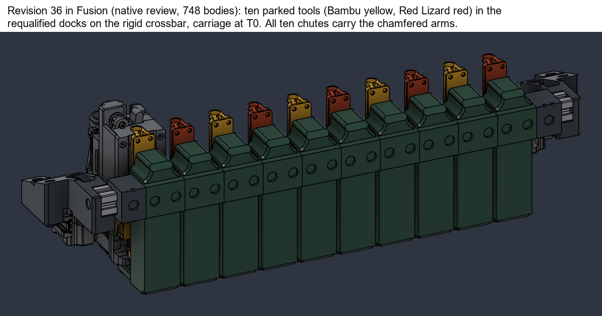

**Verification.** Run `python build_chute_chamfer_rack_r36.py` ([report](./verification_rack_requalification_r36.json)).
The 32 independent cases run in six worker processes on a cached scene and take 8.8 minutes.
The Fusion native review "36 Ten-tool rack - requalified (native review)" is archived as
[`36_Ten_Tool_Rack_Requalified_REVIEW.f3d`](./36_Ten_Tool_Rack_Requalified_REVIEW.f3d). It
reopens with 748 bodies, and all ten docks carry the chamfered chute.

**Files.** [P26 STEP](./step/P26_Chute_Arm_Chamfer_R36_REVIEW.step)
([STL](./stl/P26_Chute_Arm_Chamfer_R36_REVIEW.stl)), and the complete docks
[Bambu](./step/36_Bambu_Dock_Complete_REVIEW.step) /
[Red Lizard](./step/36_RedLizard_Dock_Complete_REVIEW.step). The 748-solid rack STEP (203 MB)
is too large for the repository; the script regenerates it. Render with
`python render_chute_chamfer_r36.py`.

**Limits.** This is rigid CAD with sampled straight paths (0.5 mm in Y, 1 mm in X). Jaw
flexure, thermal growth and machine tolerances are not modelled. The Bambu hotend is still the
synthetic reference, so its pad and wiper follow the modeled tip (see revision 34; revision 37
repairs the tip). The
inherited dock snap detents and the MGN9H-to-rail overlaps in the source gantry model are
reported separately, as in revision 21. Parked fan power, the cam/servo sequence and Klipper
are outside this audit.

#### Probe height, P23 screws off the Beacon, Bambu tip at the datum (revision 37)

**Probe height.** The Beacon's coil sat 2.27 mm above the nozzle tip (Cartographer 2.28 mm).
Beacon gives 2.6 mm as nominal and Cartographer 2.6–3 mm. P23 is now 0.33 mm thinner, so both
probes sit 0.33 mm higher: 2.60 mm (Beacon) and 2.61 mm (Cartographer) above the tip. The
lowest carriage parts near the nozzle move up with them:

- the Beacon connector pins: 0.91 mm above the tip (was 0.58);
- P22's outlet lobes: 1.03 mm (unchanged);
- the probe screw heads: 1.10 mm (was 0.78).

**A fault in the released P23.** Revision 37 checks every fastener against both probes, which no
earlier audit did. The two rear P23-to-P22 screw heads at (±15.8, -11.5) sit inside the Beacon's
top-side component block, 25.5 mm3 each. That block is the 1.1 mm volume the Beacon model reserves
on top of the rear 7.8 mm of the board. The screw heads were recessed into P23's underside directly
above it. Thinning P23 would also have left only 0.65 mm of web above the two front screw heads.

Revision 37 removes every fastener from between P23 and the probe board:

- **Probe screws.** The probe's own two M3 screws now go through the board and P23 into heat-set
  inserts in P22, clamping all three together. They replace the captive nuts in P23. Use M3x6
  low-profile screws; they engage the insert by 2.7 mm.
- **Rear ears.** P23 gains two ears behind the board. Two M3x4 button-head screws hold P23 to P22
  when the probe is off (2.3 mm engagement). Their heads sit 0.85 mm behind the board's rear edge
  and are reached from below.
- **Removed.** The four screws that sat under the board, and their inserts.

P22's four spigot bosses move to the new screw positions. They are 0.4 mm longer to take standard
3 mm inserts, and keep 1.1 mm of floor between each insert and the air duct. Behind Y4.6, P23 is
1.2 mm wider on each side, so every spigot socket keeps a 1.45 mm outer wall. P23's front edge does
not change.

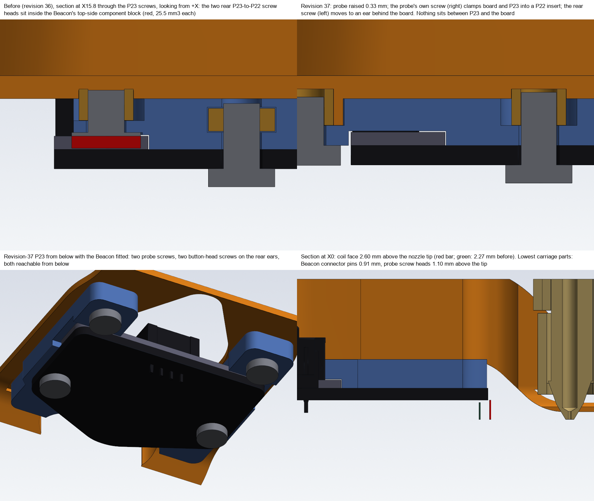

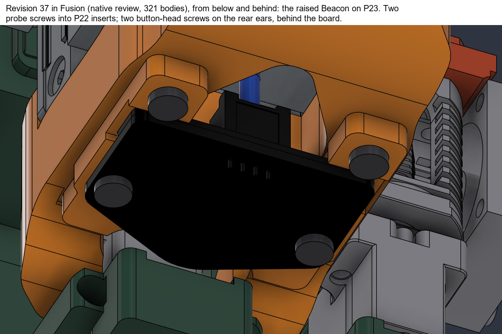

**Bambu tip at the datum.** The synthetic Bambu nozzle's cone was drawn with a 1.1 mm tip face at
the datum (Z-78.88). Its 2 mm filament bore was then cut straight through the tip, leaving a knife
edge 0.75 mm higher (see revision 34). Revision 37 restores the tip: the bore now ends at Z-77.3,
with a 118° taper to a 0.4 mm orifice 1.1 mm long. Nothing above Z-77.3 changes.

**One dock for all ten bays.** Both hotends now end at the same height, so the Bambu docks use the
Red Lizard's pad and wiper (top Z-78.88). All ten docks are identical:
[dock](./step/37_Dock_Complete_REVIEW.step),
[pad](./step/Dock_Ooze_Pad_Datum_SILICONE_R37_REVIEW.step)
([STL](./stl/Dock_Ooze_Pad_Datum_SILICONE_R37_REVIEW.stl)) and
[wiper](./step/Dock_Wiper_Datum_SILICONE_R37_REVIEW.step)
([STL](./stl/Dock_Wiper_Datum_SILICONE_R37_REVIEW.stl)). The raised Bambu pad and wiper (top
Z-78.13) are retired. Before making the pad, check the real nozzle: its tip should be 38.75 mm
below the centres of the two upper hotend mounting holes.

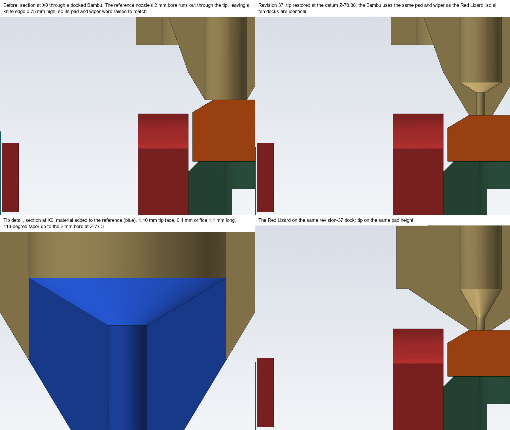

**P28.** The calibration jig's probe feeler goes from 2.27 to 2.60 mm
([STEP](./step/P28_Dock_and_Probe_Calibration_Jig_R37_REVIEW.step),
[STL](./stl/P28_Dock_and_Probe_Calibration_Jig_R37_REVIEW.stl)).

**Verification.** Run `python build_probe_height_datum_dock_r37.py`
([report](./verification_probe_height_datum_dock_r37.json)). It passes, in 9.4 minutes:

- **P22.** The parameterised builder still reproduces revision 31 with its default spigots.
  Outside the eight spigot zones, revision 37 matches revision 31, and its air duct is identical.
- **Carriage.** Every changed part, the raised Beacon and the new fasteners are checked against
  each other and the whole carriage: core, P20–P24, cable, EBB42 and all accessory fasteners.
  Nothing intersects. The only overlaps are inside the Beacon's own model (its connector passes
  through its board and component block). The raised Cartographer, checked in the Beacon's
  place, is also clear.
- **Keepouts.** No metal is in either Beacon keepout. P01's printed motor mount reaches into the
  top zone, as it already did at the old height; only metal is excluded there.
- **Tools.** Both mounted tools clear the changed carriage. Both tips rest exactly on the shared
  pad (29.6 mm2 of pad support), and the repaired Bambu core still lifts out along its service
  path (57 samples).
- **Rack.** The full revision-36 requalification, rerun with every revision-37 part, is clean:
  - own-dock docking and withdrawal, with the Beacon and with the Cartographer;
  - the eight mixed-neighbour cases (488 samples);
  - the 20 bay/hotend cases (2,420 samples);
  - the X gantry backing out (121 samples);
  - both X0..350 traverses at 60 mm withdrawal (702 samples).

  With the Y40 or shifted bed, none of the 80 bed cases collide and the minimum clearance is
  4.59 mm. Side clearances stay at 2.40 / 1.60 mm.

**Files.** [P22](./step/P22_CPAP_Lower_Plenum_Probe_Mounts_R37_REVIEW.step)
([STL](./stl/P22_CPAP_Lower_Plenum_Probe_Mounts_R37_REVIEW.stl)),
[P23](./step/P23_Probe_Mount_Raised_Rear_Ears_R37_REVIEW.step)
([STL](./stl/P23_Probe_Mount_Raised_Rear_Ears_R37_REVIEW.stl)),
[probe hardware](./step/P23_P22_Probe_Hardware_R37_REVIEW.step),
[cable](./step/Probe_Cable_Route_R37_REVIEW.step) and the
[repaired Bambu reference](./step/Tool2510_Reversed_Bambu_Reference_Datum_Tip_R37_REVIEW.step).
The Fusion native review "37 Probe height and datum dock (native review)" is archived as
[`37_Probe_Height_And_Datum_Dock_REVIEW.f3d`](./37_Probe_Height_And_Datum_Dock_REVIEW.f3d). It
reopens with 321 bodies, and its P22 and P23 volumes match the report. The 108 MB review STEP is
too large for the repository; the script regenerates it. Render with
`python render_probe_height_datum_dock_r37.py`.

**Limits.** Insert pull-out, P23 creep under the probe clamp and the probes' electrical behaviour
are not qualified. The Beacon's component block is treated as occupied, as its model reserves it.
The Cartographer's own cable route is not modelled. Use the revision-37 P22 and P23 together, and
do not mix them with the released or revision-31 parts.

#### Front print limit from exact contact (revision 38)

Revision 34 took the front print limit from whole-envelope separation. It added the rearmost
point of any parked tool or dock (Y35.41, the P26 chute lip) to the active toolhead's deepest
point ahead of its nozzle (27.8 mm), giving nozzle Y63.21 across the full width. Because the rack
rides at the active tool's height, only solids that actually meet should set the limit. The
active tool's leading features are narrow, and the parked tools are open between bays. Revision
38 measures that contact. No part changes.

[`audit_front_print_limit_r38.py`](./audit_front_print_limit_r38.py) moves the active tool
(Bambu or Red Lizard, on the revision-37 carriage with both probes) toward the rack at every
nozzle X from 0 to 350 mm, in 1 mm steps. Each path starts at the X corridor (Y80.71), steps
forward 2 mm at a time, and bisects the first exact contact to 0.01 mm. The fixed side is:

- all ten bays holding both parked tool variants at once, so any mix of tools is covered and
  the active tool's own bay counts as occupied;
- the ten docks, the crossbar and the P29/P30 mounts;
- the whole flying gantry, including its Y rails.

| First contact | Where along X | Nozzle Y |
|---|---|---|
| The active tool's front coupling pins/magnets reach into the upper recess of a parked Bambu body, 2.7 mm behind the parked nozzle | 4–7 mm either side of every bay centre, end bays included | **51.22** |
| The active P18 dock plate meets a parked body's rear face | everywhere else | 47.25 |
| Crossbar, P29/P30 mounts, gantry | never first | — |

- **New front print limit: nozzle Y52.22.** That is 1 mm behind the worst first contact, the
  same margin as the rear soft limit. It is rechecked every 0.1 mm of X with both active tools
  (7,002 positions) with no contact. The closest gap there is 1.01 mm, pin to body.
- **Print area, with no part changes:**

  | Bed | Revision 34 | Revision 38 |
  |---|---|---|
  | Option A, Y40..359 | 350 × 295.8 mm | **350 × 306.8 mm** (+11.0) |
  | Option B, stock bed moved back 31 mm (Y40..390) | 350 × 295.8 mm | **350 × 306.8 mm** (+11.0) |

  Both beds end at the stock rear limit, Y359 (see revision 34). This report also lists
  option B to the rails' Y364.15 (300.9 / 311.9 mm), which the machine does not reach.
  The probe meshes from bed Y72.04 (was 83.03); the unmeshed front strip stays 19.8 mm.
- **Using it.** Start the slicer's printable area 12.2 mm behind the bed's front edge (Y52.22)
  instead of 23.2 mm. A Klipper Y soft limit cannot enforce it, because tool changes run forward
  of it to the dock seat (Y20.71).

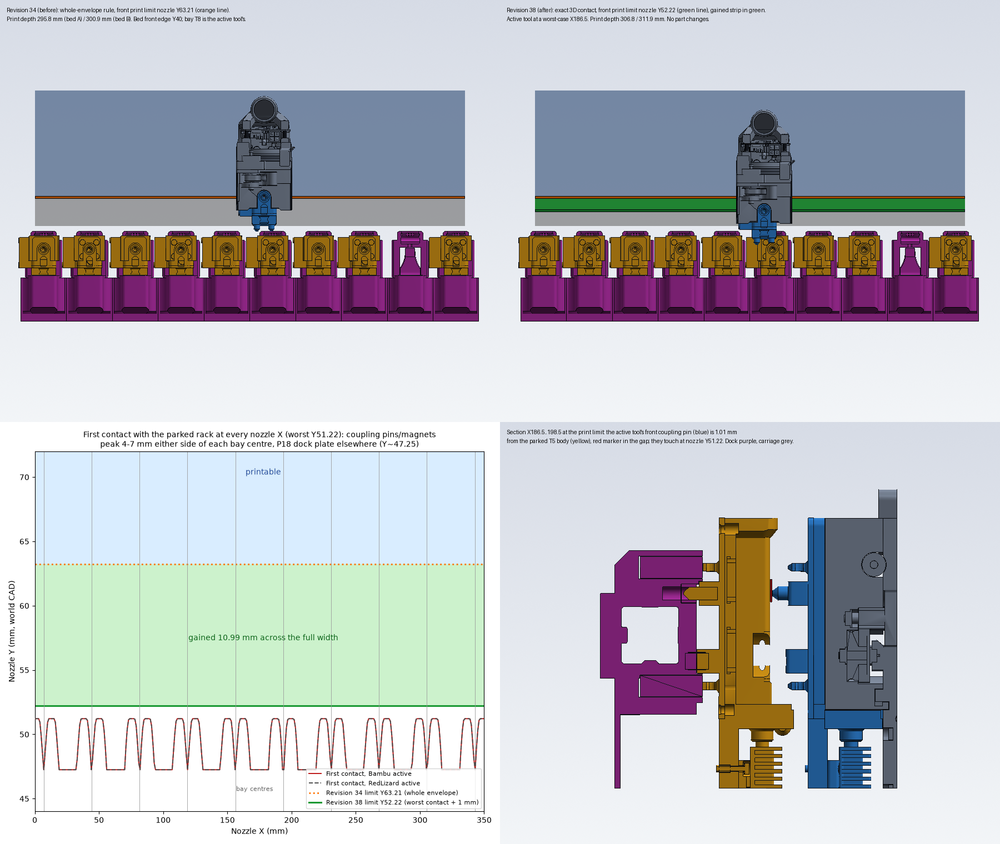

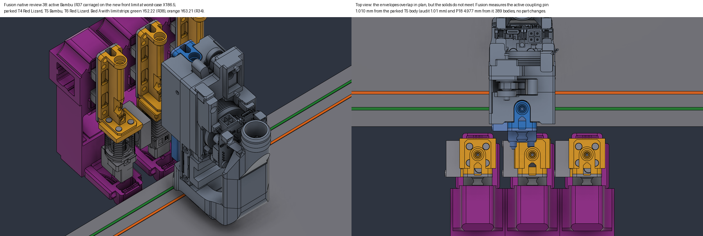

**Other ways to get area back, checked and not pursued** (each needs part changes):

- **Move the rack forward.** The P29/P30 mounts already sit 2.0 mm behind the frame's front
  posts, and the bay-0 dock 2.0 mm behind the door-buffer plane (Y-40). More travel needs new
  mounts that step around the posts and a door spacer. Even then the Y rails stop the nozzle at
  Y5.05, so the gain would be at most about 14 mm.
- **Trim the binding features.** The coupling pins/magnets and the parked body's recess are
  working features. Clearing the pin contact gains only 4 mm, down to P18's 47.25.
  [Revision 39](#dowel-pins-moved-into-the-docks-revision-39) gets those 4 mm by moving the
  pins into the docks.
- **Bed option B** (revision 34) would add 5.1 mm at the rear over option A, using the
  Monolith's rear overtravel. This machine's nozzle does not travel past the stock rear
  limit, so it adds nothing.

**Verification.** Run `python audit_front_print_limit_r38.py --workers 10`
([report](./verification_front_print_limit_r38.json)); it takes 12 minutes. It reads the
revision-37 scene that `build_probe_height_datum_dock_r37.py` writes. `python
render_front_print_limit_r38.py` renders image 71 and the world-frame review STEP. The STEP is
121.7 MB, too large for the repository. The Fusion native review "38 Front print limit (native
review)" is archived as [`38_Front_Print_Limit_REVIEW.f3d`](./38_Front_Print_Limit_REVIEW.f3d).
It reopens with 389 bodies, and Fusion measures the pin-to-body gap at 1.010 mm and P18 at
4.977 mm.

**Limits.** Parked tools are taken at the modeled dock seat; the 1 mm margin covers only small
seating and frame errors. Hoses, cable chains, umbilicals and toolhead wiring are not modeled.
The limit is in world CAD coordinates; commission it on the machine.

#### Dowel pins moved into the docks (revision 39)

Revision 38 found that the front print limit came from the two Ø5×12 mm dowel pins sticking
5.5 mm out of every tool's P18. They locate a parked tool in its dock, but on the active tool they
reach into the open rear of a parked tool, around its filament stem. Revision 39 swaps the two
halves of the coupling. The pins are pressed into the dock and point at the tool, and the bushings
are pressed into P18, flush with its face. Nothing on a tool now sticks out past its magnet bar.

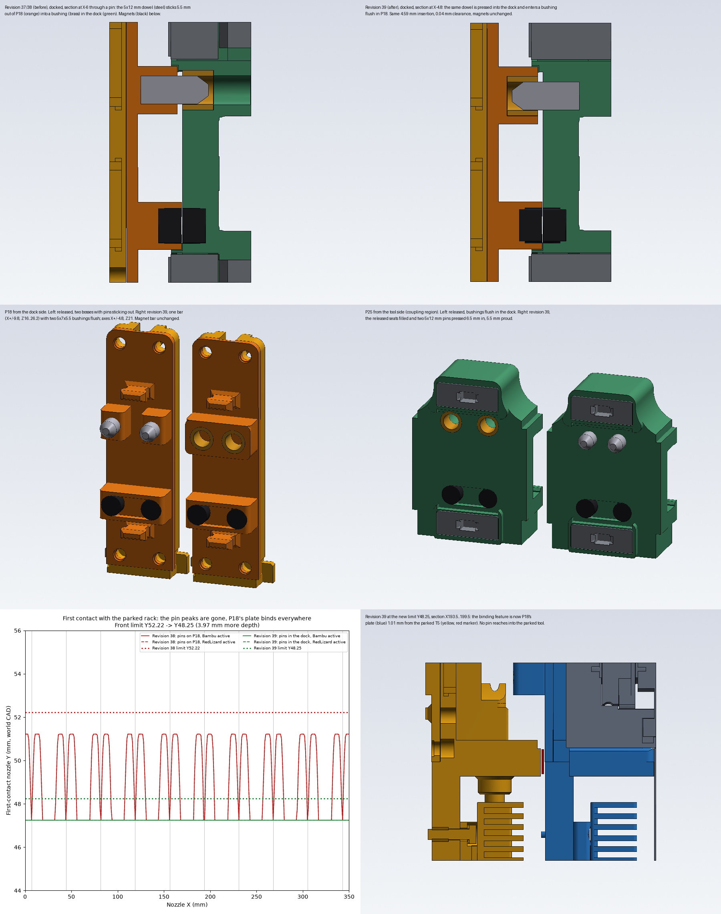

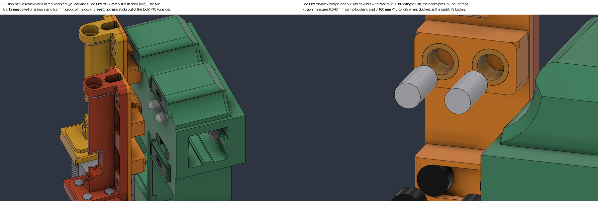

**What changes**

- **P18** ([STEP](./step/P18_Docking_Backplate_Bushing_Seats_R39_REVIEW.step),
  [STL](./stl/P18_Docking_Backplate_Bushing_Seats_R39_REVIEW.stl)).
  - The two pin bosses become one bar across P18's existing width (X±9.8, Z16..26.2), with its
    face at Y45 as before.
  - Two 5×7×5.5 mm bushings press flush into Ø7.04 × 5.5 mm seats, the dock's released seat.
  - A bushing is wider than the pin, so the axes move from X±6, Z22 to X±4.8, Z21. That leaves
    at least 1.48 mm of wall and 2.5 mm of floor.
  - The bar's top stays at Z26.2, so it keeps the released bosses' 0.20 mm to the dock's entry
    lip and 1.27 mm to the upper snap jaw.
  - The magnet bar, T-lugs and mounting holes are untouched. Both hotends use this P18.
- **P25** ([STEP](./step/P25_Dock_Pin_Seats_R39_REVIEW.step),
  [STL](./stl/P25_Dock_Pin_Seats_R39_REVIEW.stl)). The released bushing seats and pin-clearance
  bores are filled. Two Ø4.98 × 6.5 mm press-fit bores (P18's released pin bore) hold the pins
  5.5 mm proud, with at least 1.8 mm of wall around them and 3 mm behind. Nothing else changes.
- **Hardware** ([dock](./step/39_Dock_Complete_REVIEW.step),
  [tool hardware](./step/P18_Bushings_And_Magnets_R39_REVIEW.step)). Each tool now carries two
  bushings instead of two pins, and each dock two pins instead of two bushings. Ten tools and
  docks still need 20 pins, 20 bushings and 40 magnets.

**Docking is unchanged.** The tool still docks with the same straight-Y move:

- Each pin enters its bushing 4.59 mm (2.59 mm at full diameter) with 0.04 mm radial clearance.
- The magnet gap is still 0.26 mm.
- Every P18-to-dock clearance is the same, including 0.16 mm to P25 at the magnet bar and
  0.025 mm at the snap-jaw T-lugs.

**Print area.** P18's flat plate is now the first contact everywhere: the active tool first touches
a parked tool at nozzle Y47.25, at every X, for both hotends.

| | Revision 38 | Revision 39 |
|---|---|---|
| Front print limit (nozzle Y) | 52.22 | **48.25** |
| Either bed option (nozzle Y to the stock rear limit, Y359) | 350 × 306.8 mm | **350 × 310.8 mm** |

The probe meshes from bed Y68.07 (was 72.04); on the chosen option-B bed it reaches Y378.5, past
the rear print limit. Start the slicer's printable area 8.25 mm behind the bed's front edge (Y48.25). The front-limit report also lists option B to the rails' Y364.15
(315.9 mm), which this machine does not reach.

**Verification.** Run `python build_dock_pins_r39.py` ([report](./verification_dock_pins_r39.json)).
It passes, in 23 minutes:

- **Parts.** Outside their edit zones, P18 and P25 match their released versions, and their
  bounds are unchanged. The old bores and seats are solid. The wall and floor gauges are
  checked on the solids.
- **Fits and docking.** No hardware intersects its seat. Both tools, docked in the revision-39
  dock, touch nothing. The new P18 and its hardware clear the rest of both tools and the
  mounted carriage.
- **Rack.** The full revision-36 requalification, rerun with the revision-39 tools and docks, is
  clean:
  - own-dock docking and withdrawal;
  - the eight mixed-neighbour cases (488 samples);
  - the 20 bay/hotend cases (2,420 samples);
  - the X gantry backing out (121 samples);
  - both X0..350 traverses (702 samples).

  None of the 80 bed cases collide, with 4.59 mm minimum clearance. Side clearances stay at
  2.40 / 1.60 mm.
- **Front limit.** The revision-38 audit, run on the revision-39 scene
  ([report](./verification_front_print_limit_r39.json)), finds the first contact at Y47.25
  everywhere. Y48.25 is rechecked every 0.1 mm of X with no contact; the closest gap is 1.01 mm.

The Fusion native review "39 Dock pins and P18 bushings (native review)" is archived as
[`39_Dock_Pins_And_P18_Bushings_REVIEW.f3d`](./39_Dock_Pins_And_P18_Bushings_REVIEW.f3d)
([STEP](./step/39_Dock_Pins_And_P18_Bushings_REVIEW.step)). It reopens with 79 bodies, and its
P18 and P25 volumes match the report. Fusion measures the same 0.040 mm pin-to-bushing and
0.160 mm P18-to-P25 gaps. Render with `python render_dock_pins_r39.py`.

**What is left.** `python audit_whats_left_r39.py` ([report](./verification_whats_left_r39.json), 8 minutes)
measures it with no part changes:

- **The toolheads are now the front limit.** Cut P18 1 mm above the parked tools' lower block, or remove it
  and its hardware. Either way the active tool's side fan meets a parked tool at Y47.22, only 0.03 mm better
  than P18's plate. Each toolhead is about 26.5 mm deep front to back where they meet. More depth means
  parking the tools further forward.
- **Thinner dock standoff.** P25 holds its coupling face 6.5 mm off the crossbar. The dock magnets sit in that
  wall, 2.45 mm from the crossbar; the pins and jaws pass above or below it. Keeping 1.2 mm of backing allows
  about 1 mm less with Ø6×4 magnets, or about 2 mm with Ø6×3. P25 would have to be rebuilt.
- **Rack forward.** The Y rails would let the dock seat move up to about 14 mm forward. But the dock clamps are
  already 2.0 mm from the door plane, so this needs a door spacer and new rack mounts.
- **Rear.** None: the nozzle stops at the stock rear limit (Y359). The rails would reach Y365.15,
  but this machine does not travel there, so moving the bed back only clears the docks at the front.
- **Z height is not reduced.** The dock clamps reach the top front extrusion at nozzle Z335.9; the bare gantry
  would reach the frame at Z343.9. Voron's stock 2.4 350 configuration stops at Z310.

None of these is pursued: the standoff gains 1–2 mm for weaker magnet backing, and the rack move adds an
enclosure change.

**Limits.**

- Press fits, bushing retention, magnet pull and pin wear are not qualified; the seats copy the
  released ones.
- An empty dock's pins stand 5.5 mm proud. Nothing in the audited paths reaches them, but keep
  fingers and wiring clear when servicing the rack.
- Use the revision-39 P18 and P25 together.

#### P20-to-P21 screws and two design notes (revision 40)

A readiness check of the carriage, this time checking every pair of carriage parts and fasteners
against each other, found that the two P20-to-P21 screws can't be fitted as drawn:

- Their M3×8 heads sit on P20's lug tops, 0.7 mm below the EBB42's bottom edge, so they reach
  0.9 mm into the board and its bottom headers (26.6 mm³ in all).
- P21's insert pockets for them are 0.28 mm from the probe-cable raceway and 0.57 mm from the
  socket that P20's sleeve slides into. Installing the inserts would push through both walls.

Revision 40 changes only those two lugs, in P20 and P21:

- The screws move from X±4.5 to X±5.5, and 1 mm forward to Y-30.2.
- ISO 7380 button heads (Ø5.7 × 1.65 mm) sit in Ø6.1 mm counterbores 1.6 mm deep in P20's lugs,
  with 1.98 mm of lug under them. They are 0.59 mm under the board and 1.15 mm from the probe
  cable.
- P21's pockets take the same M3 × 3 mm inserts with 3.0 mm of thread. They are now 1.28 mm from
  the raceway and 1.57 mm from the socket, with at least 1 mm of material all round.

Fit the two screws before the EBB42, because they sit under its board. Nothing else changes:
P20's wings, spigot and air path, P21's conduit and saddle, and P22 and P24 are as released.

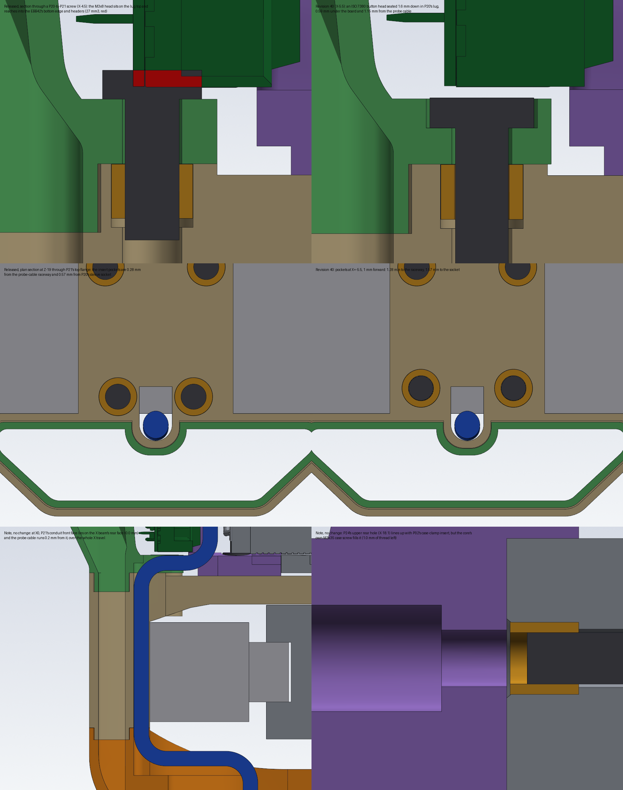

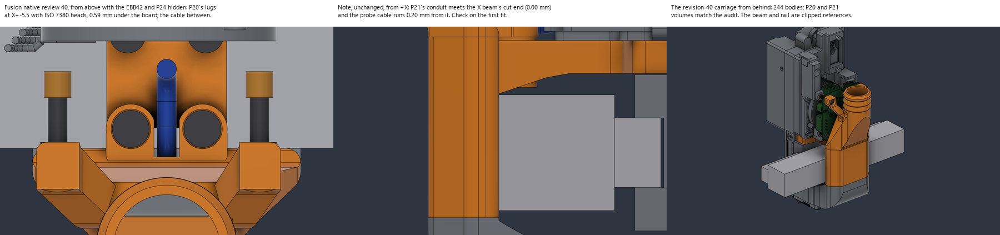

**Two notes, recorded without changing parts.**

- **P21's conduit against the X beam.** In the Monolith gantry model, the conduit's front face
  lies on the X beam's rear face (0.0 mm) over the whole X travel. It also meets the XY joints'
  rear faces at both X limits, and the probe cable runs 0.2 mm from the beam. The original
  accessory audit used an older gantry model with the beam's rear face 0.5 mm further forward.
  Check the first fitted carriage for rubbing.
  - If it rubs, the column behind the beam can move 1.5 mm rearward: P20, P21's conduit, P22's
    collar, riser and elbow, and the cable riser.
  - That gives 1.09 mm to the beam and leaves 6.76 mm to the rear motor mounts at the stock rear
    limit (7.82 mm now).
  - P22's air path would gain 1.5 mm of straight plenum and is otherwise unchanged.
- **No screws hold the CPAP/EBB42 stack to the carriage.** P24's two rear holes line up with the
  core's right case-clamp inserts in P02, but the core's own M3×35 case screws, fitted from the
  front, already fill them. Only 1.0 mm (upper) and 0.2 mm (lower) of thread is left, and no screw
  for P24 was ever specified.
  - The stack (P20, P21, P24 and the EBB42) rests on P22's collar, against P02's rear face and
    under P02. P24's pockets over three core screw heads locate it.
  - Options, not adopted: separate anchor inserts in P02 (a core change), or two M2.5 screws from
    below in the column's chamfered rear corners, inside its outline.
  - A rear foot on P21, screwed down to a ledge on P22, was tried and rejected. At the stock rear
    limit it hits the rear motor mounts near X0 and X350.

**Verification.** Run `python build_inlet_screws_r40.py`
([report](./verification_inlet_screws_r40.json)). It passes, in 18 minutes:

- **Parts.** Parameterised P20, P21 and P22 builders and the cable route reproduce the released
  parts. The revision-40 P20 and P21 match the released ones outside their lugs, and both air
  paths are unchanged.
- **Carriage.** Every pair of carriage parts and fasteners is checked against each other for the
  first time. There are no interferences; the only contacts are the two lower EBB42 screw heads
  bearing on the board. The released carriage adds the two P20 screw heads inside the EBB42.
- **Gantry.** P20 and P21 come no closer to the X beam, the rail or the XY joints than before.
- **Rack.** The full revision-36 requalification, rerun with the revision-40 carriage, is clean:
  - own-dock docking and withdrawal, with the Beacon and with the Cartographer;
  - the eight mixed-neighbour cases (488 samples);
  - the 20 bay/hotend cases (2,420 samples);
  - the X gantry backing out (121 samples);
  - both X0..350 traverses (702 samples).

  None of the 80 bed cases collide, with 4.59 mm minimum clearance. Side clearances stay at
  2.40 / 1.60 mm.
- **Rear travel (new check).** The carriage clears the flying gantry at the stock rear limit
  (nozzle Y359) and at the rails' end (Y365.15), swept over X0..350 in 2 mm steps. The closest part at Y359 is P20, 6.70 mm from the flying gantry; at Y365.15 it is P21, 2.25 mm.

The Fusion native review "40 P20-to-P21 screws (native review)" is archived as
[`40_P20_P21_Screws_REVIEW.f3d`](./40_P20_P21_Screws_REVIEW.f3d); `python build_inlet_screws_r40.py`
regenerates its STEP (83 MB, not committed). It reopens with 244 bodies, and its P20 and P21 volumes match the report. Fusion measures 0.59 mm
from the button heads to the board, and the note-1 gaps of 0.0 mm (P21 to the beam) and 0.2 mm (cable). Render with
`python render_inlet_screws_r40.py`.

**Limits.** Insert pull-out and printed-part creep are not qualified. Whether the conduit actually
rubs depends on the real extrusion, rail and printed parts.

#### First-build fixes: P24, CPAP joints and outlet, P22 mounts, P21 print face, servo recess, P03 per magnet (revision 41)

The first carriage was printed and put together, and it showed these problems:

- P24, the EBB42 mount, was complicated and had thin areas.
- The CPAP outlet was too small and restricted the blower.
- The CPAP joints went together well, but some of their walls were thin.
- P03 had one universal pocket for every magnet choice instead of one version per magnet.
- The MG90D servo had a little slack in P02's recess.
- P22's two cheeks wrapped P01's front bosses with very thin walls.
- P21's top, the face it prints on, was on two levels: the saddle under P24 sat 0.62 mm below the
  trunk rim and the bosses for P20's lugs.
- The hall sensor's leads had no clear way to the EBB42: P02 blocked them, and P24's groove for
  them stopped 8.2 mm short of the board.
- P01 had a tab under its +X front frame screw.

Revision 41 fixes them without moving any interface except P24's underside, which follows P21's
raised saddle: the fastener positions, the EBB42 and probe positions and the outside of the CPAP parts
stay where they were. A first draft also added slots
through P22's floor and cheeks along the servo; both were dropped at review (the slots blew down
at the bed, and the servo only needed a tighter recess).

- **P24 is a plain frame.** A foot on P21's saddle (raised 0.62 mm, below), a deck under the motor, a
  solid wall at +X, a column at -X, a block over each top corner and a tower under each bottom
  corner, all reaching P02's rear face, which is also the print face. The wire comb, the two dead
  rear holes and the hook over P02's top edge are gone; P21's two screws hold the frame.
  - Its walls are 0.84 mm and up, with 10 mm² under 1.0 mm (released: 0.03 mm and 381 mm²). The
    thinnest is where the top-left insert channel passes the servo header's plug.
  - The four M3 × 4 heat-sets move 2.8 mm forward, behind a Ø3.4 step, so each screw pulls its
    insert against the step. They are pressed in from the side that faces P02; the upper two go in
    through Ø4.4 channels in the corner blocks.
  - The EBB42's parts stay 0.25 mm clear and every connector keeps room for its plug and wires. The
    frame bears on P02 over 409 mm² and on P21 over 379 mm².
  - The two core screw heads on P02's rear face sit in U-slots that open straight through the
    nearest face of their blocks.
  - Below its deck the frame keeps to P21's saddle outline: at the X limits the 9 mm 2WD XY joints
    reach in to |X| 10.7. It stays 0.68 mm from them (released 0.63 mm).
- **CPAP joints, three perimeters.** The sockets and sleeves thicken inward from 0.84 and 0.82 mm to
  1.25 mm and keep the 0.18 mm slip. The thinnest joint walls go from 0.78 mm (P20), 0.79 mm (P21)
  and 0.03 mm (P22) to 1.21-1.22 mm.
  - The probe-cable bosses at the joints grow to match, with the same 0.06 mm slip.
  - The bore through each sleeve narrows to 213 mm² (released 287 mm²), about the hose's own
    211 mm². A 45° taper leads into it; in P20 the taper runs out to the funnel's back wall, which
    leans back toward the hose cuff.
  - P22's socket floor met the roof of its forward sweep in a feather edge along the front. It is
    cut back to the socket wall; P21 seats on P22's top rim, not on that edge.
- **P21 prints flat.** Its saddle, where P24 stands, rises 0.62 mm to the trunk rim and the bosses
  for P20's lugs (Z-17.78), so P21's whole top, the face it prints on, is one plane of 923 mm²
  (released: 170 mm² there and 753 mm² 0.62 mm lower).
  - P24's underside rises with it; its deck and everything above stay put. P20's and P02's undersides
    now rest on the saddle too, face to face. The probe cable stays 0.48 mm clear.
  - The two P24-to-P21 heat-set inserts stay where they were, so each pocket now opens through a
    0.62 mm counterbore: press each insert to the bottom of it. The same M3×8 screws reach them.
- **Outlet: wider horizontal jets.** The two jets still blow straight across the nozzle at the
  plastic it has just laid, not down at the bed. Each left through a 1.8 mm throat under a vane
  that ended in a knife edge (0.04 mm), over a floor lip that ended in a feather edge.
  - The vane is cut off flat at Z-73.6, leaving the wall between the duct and the hotend slot a
    1.4 mm flat bottom, and the floor lip is trimmed back to that wall. Each jet now leaves through
    a 3.05 mm opening between the floor and the wall; the floor under the jets stays solid.
  - The jets' open area is 59 mm², 1.7 times the released 34 mm² (measured inside P22's outer
    profile), against 154-175 mm² in the side channels and 211 mm² in the hose.
  - Each jet's entry is a bell-mouth. The air comes down the duct side of that wall and turns under
    it into the jet. Off a square corner it sprang clear and used about 56 % of the opening (the
    [CFD](#cpap-airflow-cfd-revision-41) found this). The corner is now rounded to the wall's own
    1.4 mm thickness, from the jet's heel (Y16.7) to Y26.2, and the air follows it round: at 180 L/min the duct
    needs 45 % less pressure. The slot side keeps its square edge at Z-73.6, so the jets' top
    doesn't move. P22 prints on its back face, so the round lies flat in every layer.
  - The jets can only grow upward: P22's underside is 1 mm above the nozzle tip, under a 1.2 mm
    floor. Their top stays 0.32 mm under the Red Lizard's heater block. On the Bambu, the upper
    1.9 mm of each jet meets the side of the silicone sock (the released jets' top 0.6 mm did).
  - The outlet's walls are 1.2 mm and up (released 0.045 mm), except where the bell-mouth rounds
    them into a square edge. P22's gap to both hotends is unchanged.
- **P22 face-mounts on P01.** Each upper cheek wrapped round P01's front boss with walls of 0.05 mm
  on the inner side and 0.42 mm on the outer, open on top; the screw head's counterbore came within
  0.05 mm of the outer face.
  - Each cheek now stops at the boss's front face and bears on it, face to face (34 mm²), and its
    screw locates it. Nothing of P22 surrounds the boss.
  - The counterbore is filled: the cheek is solid round a plain Ø3.3 hole, with walls of 1.38 mm
    and up. An M3×8 ISO 7380 button head sits on the cheek's front face, 3.6 mm clear of the
    mounted tool, with 3.7 mm of thread in P01's insert.
  - Just behind each boss, the released pocket round it dipped up to 0.1 mm below P22's outer
    skin. Cutting the cheek back to the skin left that as a small crescent pit in the roof
    (0.01 mm³); both are filled flush.
- **Clean surfaces for printing.** A face-by-face audit of P20, P21 and P22 found slivers where
  revision 41's cuts met the released shapes: too small to see, but enough to leave specks or gaps
  in a slice. Each cut now follows the duct's own outline, and P22 goes from 249 faces to 232
  (0.54 mm³ less):
  - P22's socket: the cut that squares off its front edge follows the duct's plan outline, so it
    leaves no 0.014 mm sliver along the cable boss and no 0.4 mm notch at the corner.
  - P22's jets: the vane's flat bottom and the bell-mouth rounds follow the duct's own profile. No
    0.03 mm strip of the vane's old underside is left at either jet's heel (Y16.7, where the floor
    rises to the wall's flat bottom), and each round now starts right there. The end of the
    released 0.5 mm fillet at the front corner of each jet's floor is trimmed off.
  - P20: behind the sleeve, the released cable boss's top stood 0.32 mm proud of the new boss in two
    thin strips. The new boss's back is raised 0.07 mm over it (2.75 mm³ more).
  - What's left is by design (each round's 0.25 mm ledge at Z-72.2 and its square end at Y26.2) or
    older than revision 41 (a 0.05 mm strip in P22's cable channel, and the taper where its nose
    fillet runs out at Y29). P21 had nothing to fix.
- **P02: a snug servo recess.** The MG90D's top 4.5 mm sits in the same recess in P02's rear face,
  now 12.20 × 22.90 mm (released 12.30 × 23.05). That is line to line across TowerPro's
  12.2 × 22.8 mm body and 0.05 mm at each end (released 0.05 and 0.125 mm). Apart from the hall
  leads' groove (below), nothing else on P02 changes; the two ear screws stay. If your servo
  measures differently, change `SERVO_POCKET` in `r41_parts.py`.
- **Hall sensor leads: one groove through to the EBB42.** The A1104's leads end 0.4 mm in front of
  P02, against the solid strip under the motor bore, and P24's groove for them under the motor
  stopped at the motor's end cap, 8.2 mm short of the board. One groove, 4.0 mm wide and 2.1 mm deep
  with the motor as its roof, now runs from the leads' end through P02 and P24 to the EBB42's side
  of the frame. P02 and P24 keep 1.68 mm under it. Behind the motor the probe cable turns up into
  the bay through the same opening.
- **P01: the tab is gone.** Since the v26 original, P01 (the back case) has had a 5.3 × 2.9 × 1.9 mm
  tab under the boss of its +X front frame screw, modelled line to line in a matching slot in P03,
  with nothing like it on the -X side. It is cut off at the boss's own bottom (Z-17.40); P03's slot
  stays as it is, an empty pocket inside the case. Nothing else on P01 changes. On a P01 you have
  already printed, the tab can be trimmed flush with the boss.
- **P03 comes in four versions**, one per magnet: 4× 15×5×3 or 12×6×3 mm bars, or 8× Ø6×4 or Ø6×3 mm
  discs, all where the tools' receiver magnets expect them.
  - Each pocket is 0.10 mm over the magnet's width or diameter and 0.15 mm over its length. Each
    magnet stands 0.2 mm proud, 0.36 mm from a mounted tool.
  - A 6 mm magnet's inner edge is only 0.3 mm from P03's centre slot, too thin to print (the
    released pocket left 0.2 mm). Those pockets open into the slot wherever the wall would be under
    0.6 mm. The 15×5×3 bars keep a 0.75 mm wall.
  - Ø6×4 discs need pockets 3.8 mm deep. At the three +X discs (Z 30.5, 5.5 and -2.0) P03's wall is
    only 4.3 mm thick, with carriage parts right behind it, so their floor is 0.5 mm (released
    0.27 mm). Glue them in; Ø6×3 discs or bars avoid it.
  - There is no lead-in chamfer: it would cut into the centre slot and into the notch above the upper
    pockets.

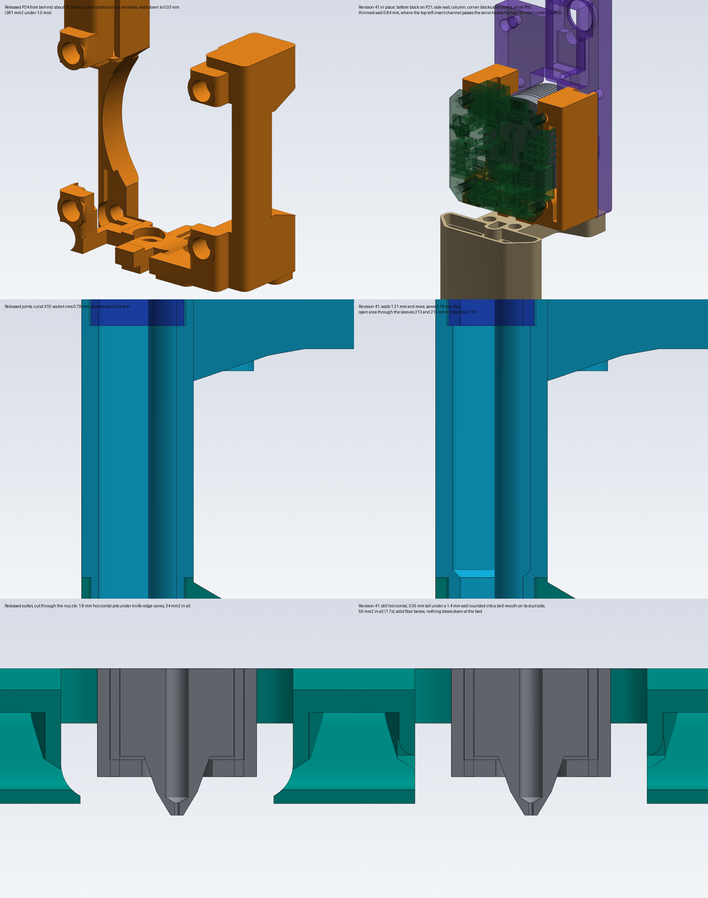

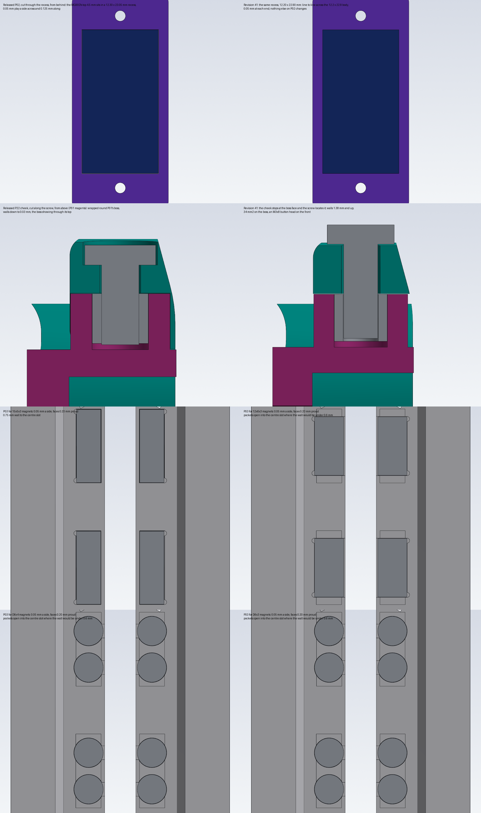

**Hardware.**

- P24: 4× M3 × 4 mm heat-set inserts (OD 4.2) in Ø4.0 holes, pressed in from the side that faces
  P02.
- EBB42 to P24: 2× M3×18 socket heads through P20's wings and the board (upper), and 2× M3×14 from
  behind the board (lower, were M3×12). Shorter screws don't reach the moved inserts.
- P22 to P01: 2× M3×8 ISO 7380 button heads on the cheeks' front faces (were M3×10 socket heads in
  counterbores), into the same inserts in P01's bosses.
- P24 to P21: the same 2× M3×8 socket heads and M3 inserts; press each insert to the bottom of the
  0.62 mm counterbore over its pocket in P21's raised saddle.
- Fit the motor before P24: its upper ear screw's head sits in one of P24's U-slots, and the
  P02-to-P01 button head in the other.
- P03: the magnets for your version, glued in.

**Verification.** Run `python build_carriage_fixes_r41.py --workers 10`
([report](./verification_carriage_fixes_r41.json)). It passes, in 27 minutes:

- **Parts.** Every revision-41 part is a single valid solid. P01, P20, P21, P22, P02 and the four P03s
  change only inside their edit zones, and the CPAP parts don't grow: P22's nose is 0.16 mm
  shorter where the floor lip is trimmed.
- **Joints.** The sleeves keep 0.18 mm radial slip and the cable bosses 0.06 mm. The thinnest joint
  walls are 1.21-1.22 mm (released 0.78, 0.79 and 0.03 mm); the bore through each sleeve is
  213 mm².
- **Outlet.** The jets' narrowest section is 59.1 mm² (released 33.9 mm²) and the floor under them
  is solid. The outlet's thinnest wall is 1.2 mm (released 0.045 mm), leaving out the bell-mouth
  rounds: a ray cast reads any rounded corner as thin, so their profile is measured instead and
  matches the 1.4 mm radius to within 0.001 mm. The jets' top is 0.32 mm
  under the Red Lizard's heater block, and P22 keeps its 1.92 mm (Bambu) and 1.72 mm (Red Lizard)
  gaps to the hotends.
- **P22 on P01.** No P22 is left round either boss (released 57 mm³ each). Each cheek is 0.05 mm
  from its boss's face, with 34 mm² of bearing. Each screw has 3.74 mm of thread in its insert and
  touches neither part; the nearer head is 3.63 mm from a mounted tool. The cheek walls are 1.38 mm
  and up (released 0.03 mm). No pit is left in P22's skin round either cheek: inside its outer
  profile there, nothing of P22 is missing but the duct's bore and the air beyond its side walls.
- **P24.** The EBB42's parts stay 0.25 mm clear and every plug zone is empty. It bears on P02 over
  409 mm² and on P21 over 379 mm², with walls of 0.84 mm and up.
- **P02.** The recess doesn't touch TowerPro's 12.2 × 22.8 mm body. The v26 servo model is 22.96 mm
  long and overlaps each end of the recess by 0.03 mm (3.25 mm³ in all). The recess lies inside the
  released one, so its walls are at least as thick as before (1.16 mm); P02 keeps 1.68 mm under the
  hall leads' groove.
- **Hall sensor leads.** From the leads' end to the EBB42's side of P24, nothing enters the groove
  but the probe cable, which shares the opening behind the motor. Released, P02 filled 5.8 mm of
  the route and P24 12.7 mm.
- **P01.** It changes only where the tab was (26.1 mm³ less).
- **P03.** In every version the magnets fit with 0.05 mm a side, stand 0.20 mm proud and clear both
  mounted tools by 0.36 mm.
- **Carriage.** Every pair of carriage parts and fasteners, with the 15×5×3 P03, shows no new
  interference or contact. The 27 overlaps inside the revision-31 core (screws in inserts and
  self-tapping holes) match the released core's, and the four EBB42 screws pass only through the
  board's standoffs. Nothing that changed touches the Cartographer or the mounted tools, and no
  metal enters the Beacon's keepouts.
- **Gantry.** No changed part comes closer to the X beam, the rail or the XY joints than before; P24
  is 0.68 mm from the joints (released 0.63 mm).
- **Rack.** The full revision-36 requalification, rerun with the revision-41 carriage, is clean:
  - own-dock docking and withdrawal for both tools, with the Beacon and with the Cartographer
    (242 samples);
  - the eight mixed-neighbour cases (488 samples);
  - the 20 bay/hotend cases (2,420 samples);
  - the X gantry backing out (121 samples);
  - both X0..350 traverses (702 samples).

  None of the 80 bed cases collide, with 4.59 mm minimum clearance. Side clearances stay at
  2.40 / 1.60 mm.
- **Rear travel.** The carriage clears the flying gantry at the stock rear limit (nozzle Y359) and
  at the rails' end (Y365.15), as in revision 40: P20 is 6.70 mm from it at Y359, P21 and P22
  2.25 mm at Y365.15.

The Fusion native review "41 Carriage build fixes (native review)" is archived as
[`41_Carriage_Build_Fixes_REVIEW.f3d`](./41_Carriage_Build_Fixes_REVIEW.f3d);
`python build_carriage_fixes_r41.py` regenerates its STEP (86 MB, not committed). It reopens with
243 bodies, and its P01, P20, P21, P22, P24, P02 and P03 volumes match the report. Fusion measures
0.25 mm from P24 to the EBB42 and 0.05 mm from P22 to P01. Render with
`python render_carriage_fixes_r41.py`.

**Limits.** Airflow is simulated (below), not measured. The recess fits TowerPro's datasheet
body: measure your servo, and change `SERVO_POCKET` if it differs. Insert pull-out, printed-part
creep and magnet glue joints are not qualified.

#### CPAP airflow CFD (revision 41)

The CPAP duct's airflow is simulated with OpenFOAM v2512: steady flow (`simpleFoam`) with k-ω SST
turbulence, the air arriving from the hose already turbulent (5 % intensity). The model is the air
inside P20, P21 and P22 from the hose spigot to the jets, four bore lengths of straight hose above
the spigot, and the open air round the nozzle (X ±30, Y -20..50, Z -95..-45 mm) with the mounted
tool, P01, P23, the Beacon and their screws in it; that air's outer faces are open to the room.
`snappyHexMesh` meshes it in 1.7 million cells: 1 mm in the open, 0.5 mm at the walls (0.25 mm where
they curve) and 0.25 mm round the jets and the nozzle. Each run steps the flow through 180, 120 and
240 L/min. The pressure
the duct needs at the spigot is set against the WS7040-24 blower's published curve at full speed,
less an allowance for 1 m of Ø19 mm CPAP hose, to find the flow the blower delivers.

| Bambu tool | Pressure at 180 L/min | Blower flow, 1 m hose | Jets at 180 L/min |
| :--- | ---: | ---: | :--- |
| Released duct (revision 40) | 8.30 kPa | 131 L/min | 2 × 17 mm², 87 m/s mean, 104 m/s peak |
| Revision 41, square-edged jets | 5.15 kPa | 158 L/min | 2 × 30 mm², 51 m/s mean, 87 m/s peak |
| Revision 41, bell-mouth jets | 2.83 kPa | 192 L/min | 2 × 30 mm², 51 m/s mean, 63 m/s peak |

- **Where the pressure goes.** With the bell-mouth jets at 180 L/min, the hose section to P21
  costs 63 Pa, the elbow into P22 78 Pa, the side channels 56 Pa and the turn into the jets
  224 Pa. The other 2.39 kPa leaves as the jets' own speed: the jets set the restriction, as the
  first build showed.
- **Bell-mouth jets.** The CFD showed the air springing clear of the square bottom corner of the
  wall between each side channel and the hotend slot, so it used about 56 % of the opening. With the
  corner rounded (r 1.4 mm) the air follows it round and uses about 77 % of it. At 180 L/min the
  duct needs 45 % less pressure, so the blower moves 21 % more air: 192 L/min instead of 158.
  These runs predate the final surface clean-up, which starts each round 0.31 mm earlier, at the
  jet's heel; the jets' narrowest section grows 0.2 % (59.0 to 59.1 mm²), too little to move them.
- **The elbow.** Where the air turns from P21 into P22 it leaves P22's roof: just past the turn
  17 % of the section flows backwards (about 10 L/min going round), and by Y-20 it has reattached.
  The air there moves at only about 15 m/s, so this costs 78 Pa at 180 L/min, about 2.8 % of the
  total; even an elbow with no loss at all would raise the blower's flow by 0.9 %. The sharp inner
  corner sits at P21's sleeve tip, in the joint, and a rounded corner inside P22 would overhang in
  its print orientation, so the elbow stays as it is.
- **At the nozzle.** The jets leave about 13° below horizontal and meet at the nozzle tip. In open
  air, of the air leaving the space round the nozzle 44 % passes down by the tip, 31 % goes forward,
  23 % up and 2 % back. Over a print surface 0.2 mm under the tip, as when printing, only 10 % gets
  under the nozzle; the rest spreads forward (54 %), back (22 %) and up (14 %). The bell-mouth makes
  each jet fuller and more even: its fastest air drops from 87 to 63 m/s at 180 L/min. At each
  design's blower flow (158 and 192 L/min), the air 0.1 mm over the print is within about 10 % of
  the square-edged jets' from 0.8 to 5 mm from the nozzle axis: 7 m/s at 1.2 mm, 14 m/s at 3 mm and
  17 m/s at 5 mm. In open air under the nozzle, as under a bridge, it is 11-19 % slower within
  1.2 mm of the axis and 10-45 % faster from 2 to 5 mm out. So the bell-mouth takes the restriction
  away without losing cooling at the fresh plastic, and spreads the extra air further out.
- **Red Lizard.** The duct and jets behave the same: 2.83 kPa at 180 L/min, and 192 L/min from the
  blower. Its heater block, wider than the Bambu's sock and 0.32 mm above the jets' top, stops the
  air rising past the nozzle: 46 % passes down by the tip, 42 % goes forward and 12 % back.
- **Layer lines.** P22 prints on its back face, so in the jets, where the air is fastest, the layer
  lines run along the flow; upstream they cross it, but there the air is slow. With every wall made
  rough, an FDM-like 0.1 mm roughness raises the pressure at 180 L/min by 0.2 %, and a pessimistic
  0.3 mm by 2.6 %, which would cost the blower about 0.8 % of its flow.
- **Mesh.** A finer mesh at the walls (2.6 million cells) moves the pressure by 0.5 % and the jets'
  flow and speeds by less than 0.5 %.

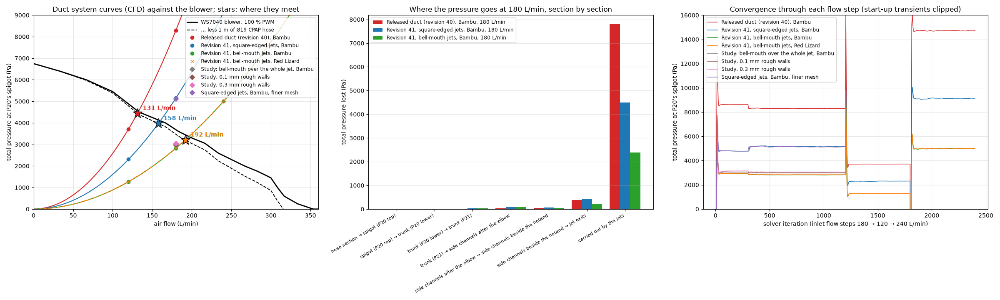

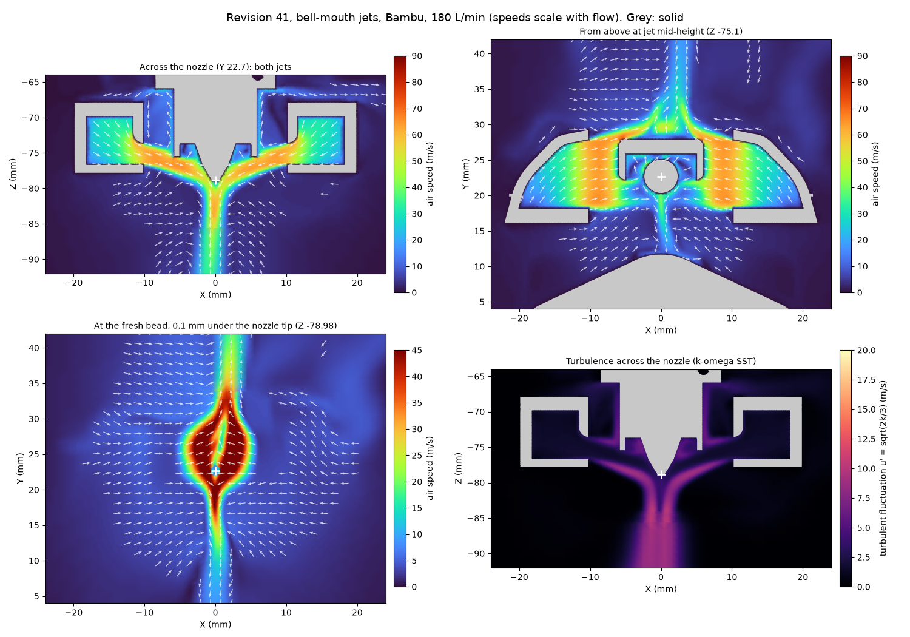

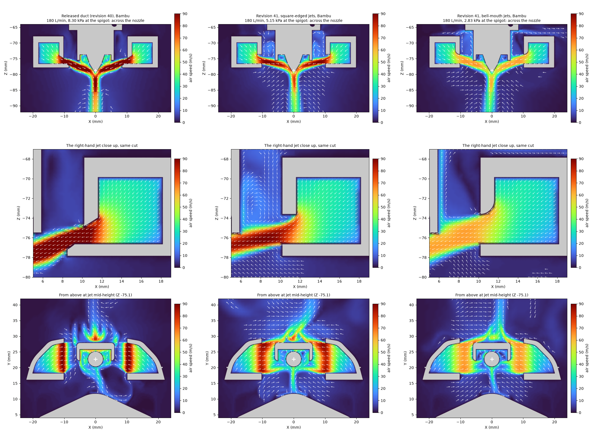

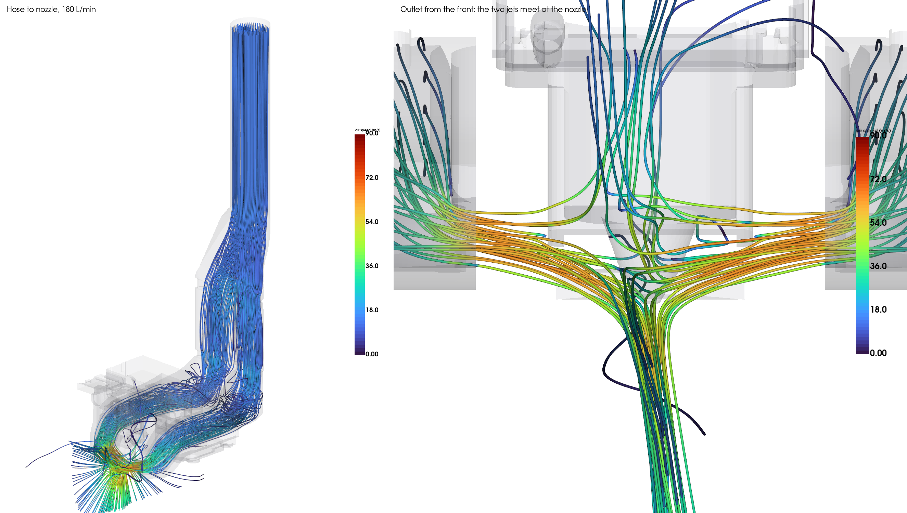

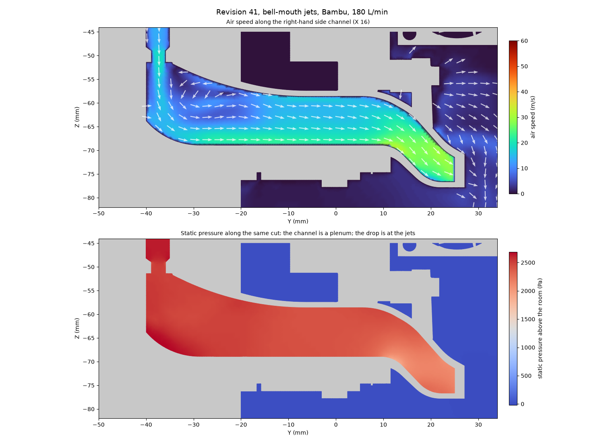

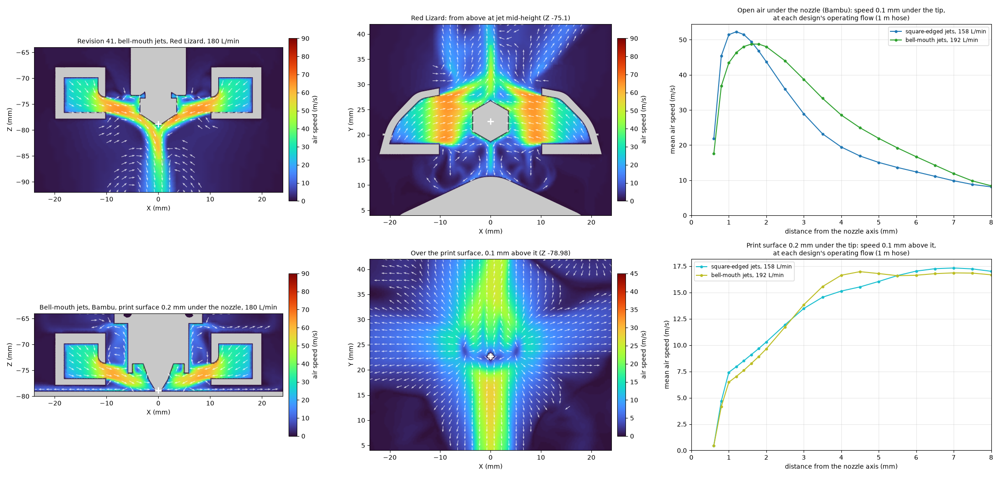

**Run.** Each step works in the session folder's `cfd/` (`acc.WORK`):

```
python cfd_cpap_r41.py domain r41bm_bambu                 # the air, from the revision-41 scene
python cfd_cpap_r41.py domain r41_bambu --p22 square      # revision 41's first, square-edged jets
python cfd_cpap_r41.py domain released_bambu --duct released
python cfd_cpap_r41.py domain r41bm_bambu_bed --bed       # also --tool RedLizard
python cfd_cpap_r41.py case r41bm_bambu --np 24           # [--flows 180] [--roughness-mm 0.1]
bash cfd/run_case.sh <case dir>                           # OpenFOAM v2512, or cfd/launch_docker.sh
python cfd_cpap_r41.py analyse r41bm_bambu                # after copying the results back
python cfd_cpap_r41.py report <names>                     # verification_cfd_cpap_r41.json
python render_cfd_cpap_r41.py                             # images 81-86
```

The [report](./verification_cfd_cpap_r41.json) has every case's flows, pressures, jets, losses and
mesh. The runs here used `opencfd/openfoam-default:2512` in Docker on a 96-thread host, 20 to 90
minutes a case depending on how many shared it.

**Limits.** Steady, time-averaged flow: the two jets meeting at the nozzle are unsteady in fact. No
heat transfer is modelled, only air speed. The blower curve is the maker's at full speed, and the
hose is an allowance (1 m of Ø19 mm, friction factor 0.06): a longer or narrower hose lowers the
flow. Wall roughness uses a wall function on 0.25 mm wall cells, which suits 0.1 mm but stretches it
at 0.3 mm. Nothing here is measured on the printer.

#### A P23 for the Cartographer, and the Cartographer's own keepout (revision 42)

**Why.** Revision 37's P23 puts the Beacon RevH's coil 2.60 mm above the nozzle tip, Beacon's nominal
2.6 mm. The Cartographer V3 fits the same P23 (the same two M3 holes, 31.6 mm apart) but sits at
2.61 mm, on the bottom edge of the 2.6–3.0 mm Cartographer asks for. A P23 that prints a little thin,
or a slightly thicker board, would take it out of range.

**A P23 for the Cartographer.** The same P23, 0.2 mm thinner (3.67 mm), so the Cartographer's coil sits
2.81 mm above the tip, mid-way in its range. P22, its inserts and the rear-ear screws don't change, so
either P23 fits the P22 you have. Keep revision 37's P23 for the Beacon.

- **Probe screws:** M3×5 low-profile socket heads through the board and P23 into P22's inserts. They
  engage 1.93 mm (about four threads), a little under the 2.0 mm used elsewhere, because an M3×6
  would end only 0.07 mm short of the end of the insert hole.
- **Rear ears:** the same M3×4 button heads, now engaging 2.53 mm and ending 0.47 mm short.
- **Webs:** 1.45 mm under each spigot socket (was 1.65 mm).
- **P28:** a jig with a 2.81 mm probe feeler to match.

**Merging P23 into P22 was considered and rejected.** It would save one part, two screws and two inserts.
But the probe's own screws already clamp board, P23 and P22 together, so the probe and its
accelerometer would gain nothing. It would also fix the probe height in P22, the largest print
(75 mm tall, with supports), instead of a 4 mm plate, and the Beacon and Cartographer would each need
their own P22.

**The Cartographer's own keepout.** The Cartographer's STEP model carries its keepout zones as its last
two solids. Revision 37 loaded only the first 100, the probe itself, so they were never checked:

- a column 22.5 × 22.5 mm and 20 mm tall standing on the board over the coil, where Cartographer
  allows no metal (the Beacon's is 18.6 × 18.6 × 18.4 mm);
- a 15 × 15 × 3 mm zone under the coil.

None of our metal is in either zone. The nearest is the probe screws' inserts in P22, 3.46 mm from
the column. Some existing metal does reach into the column, with the probe on either P23:

| Metal in the Cartographer's column | Revision 37 P23 (2.61 mm) | Revision 42 P23 (2.81 mm) | Where |
|---|---|---|---|
| The Monolith core's two lower M3 nuts | 10.4 mm³ each | 12.9 mm³ each | The top 1.6 or 1.8 mm of the column, 4.2–6.6 mm either side of the coil's axis |
| Their M3×16 draw screws | None | 0.6 mm³ each | The top 0.11 mm |
| The Red Lizard's heater block | 0.53 mm³ | 0.45 mm³ | 0.15 mm into the column's front face, 14.7–18 mm above the board |

These belong to the frozen Monolith core and the Red Lizard hotend, so they are recorded, not changed.
All of it sits at the far edges of the zone, 15–20 mm above the coil, and moves with the probe. The
nuts and screws should show up as a fixed offset that calibration takes out. The heater block changes
temperature with the hotend, so calibrate with the hotend at printing temperature. Neither effect is
qualified. If the Cartographer's readings drift, these are the first suspects; changing them would be a
change to the core or the tool. The Beacon's zones, now also checked against the core's metal, are
clear.

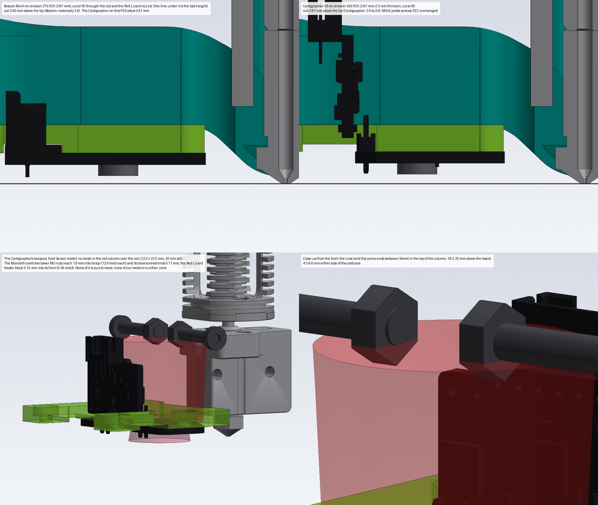

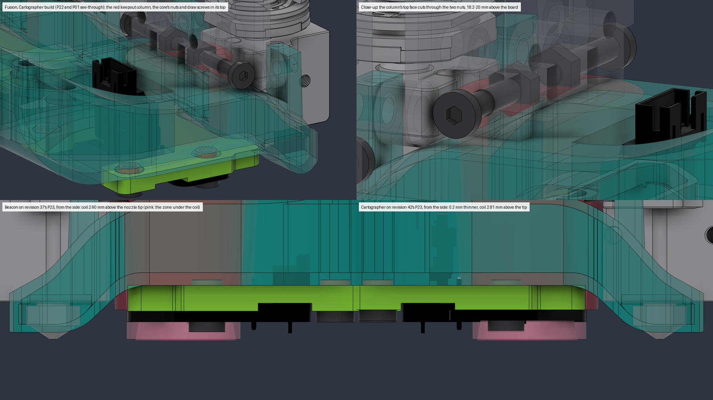

**Verification.** Run `python build_cartographer_mount_r42.py --workers 10`
([report](./verification_cartographer_mount_r42.json)). It passes, in 12 minutes:

- **P23.** A single valid solid: revision 37's P23 less exactly its bottom 0.2 mm (155.4 mm³), with
  nothing added. The walls round the spigot sockets are whole.
- **Heights.** The Cartographer's coil is 2.81 mm above the tip on this P23 (2.61 mm on revision
  37's). The Beacon's is 2.60 mm on revision 37's.
- **Fit.** The Cartographer, this P23 and its screws touch nothing in the revision-41 carriage or
  either mounted tool, and the probe is 0.41 mm from P22. The lowest carriage parts above the tip are
  P22's outlet lobes (1.03 mm), the probe screw heads (1.31 mm) and the Cartographer's header pins
  (1.41 mm).
- **Keepouts.** As above, for the probe on either P23.
- **P28.** The builder at 2.60 mm reproduces revision 37's jig; the new one changes only its feeler.
- **Rack.** The revision-36 requalification, on a scene of the carriage as built for the
  Cartographer, is clean:
  - own-dock docking and withdrawal, the Cartographer included;
  - the eight mixed-neighbour cases (488 samples);
  - the 20 bay/hotend cases (2,420 samples);
  - the X gantry backing out (121 samples);
  - both X0..350 traverses at 60 mm withdrawal (702 samples).

  With the Y40 or shifted bed, none of the 80 bed cases collide and the minimum clearance is
  4.59 mm. Side clearances stay at 2.40 / 1.60 mm.

**Files.** [P23](./step/P23_Probe_Mount_Cartographer_R42_REVIEW.step)
([STL](./stl/P23_Probe_Mount_Cartographer_R42_REVIEW.stl)),
[P28](./step/P28_Dock_and_Probe_Calibration_Jig_Cartographer_R42_REVIEW.step)
([STL](./stl/P28_Dock_and_Probe_Calibration_Jig_Cartographer_R42_REVIEW.stl)),
[screws and inserts](./step/P23_P22_Cartographer_Hardware_R42_REVIEW.step) and the
[keepout zones](./step/Cartographer_V3_Keepouts_R42_REVIEW.step). The Fusion native review
"42 Cartographer mount (native review)", both builds side by side, is archived as
[`42_Cartographer_Mount_REVIEW.f3d`](./42_Cartographer_Mount_REVIEW.f3d). The 87 MB review STEP it
comes from is left out of the repository; the script regenerates it. Render with
`python render_cartographer_mount_r42.py`.

**Limits.** Rigid CAD. The keepouts are the Cartographer model's own zones, and the effect of the core's
and the hotend's metal in them on the readings isn't qualified. The Cartographer's own cable route
isn't modelled: the Beacon's route stands in for it in the rack check and is left out of the fit and
keepout checks.

#### P22: lower jet floor, larger bell-mouth, and less support (revision 43)

**Why.** With revision 41's CPAP set printed, P20 and P21 fit well, but P22 still felt restrictive,
and its output at the nozzle could be better. Revision 41's CFD says why: the jets carry 85 % of the
duct's pressure, because at 180 L/min the air leaves through about 60 mm² at 51 m/s. P22 also needed
support whichever way it was printed.

**What changes.** Only P22, in five places (the last, and parts of the second and third, from a review in
Fusion of the first version):

- **The jets' floor drops 0.4 mm.** Under each jet the floor follows revision 41's, 0.4 mm lower:
  flat at Z-77.05 from Y22.4 to the front wall, and down the heel's curve back to Y19. It keeps
  0.8 mm (two perimeters with P22 on its back face) over P22's underside, which doesn't move, and
  each jet is 13 % taller where it faces the nozzle.
- **The bell-mouth grows from r 1.4 to r 2.4, over the jet's whole length.** The duct-side bottom
  edge of the wall over each jet is rounded r 2.4 from the jet's heel (Y16.7), on a foot 1 mm proud of
  the wall's duct face with a 45° chamfer back up to it. Over the jet's last 3 mm (Y24.6 to 27.3) the
  round and its foot ease out together, along a cosine, into the wall's corner, as the duct's front
  roof comes down to meet them. At the heel the round runs back into the heel's ramp, and the
  rounded foot runs on, in the duct's air only, until the ramp and the wall (which thickens there)
  take it in. Nothing ends square and nothing faces down in print. The first version stopped the
  round square at Y26.2, 1.7 mm short of the front wall, and narrowed its foot at 45° in plan behind
  Y17.6, which left a V-shaped notch against the thickening wall. The review's first pass ran the
  round at full size right to the front wall; the CFD below says why it eases out instead.
- **The window gets a 45° notch, right through.** The window between the side channels, where the
  probe's connector and cable come up, ended in front at a flat face: on P22's back face, a 22.9 mm
  ceiling. A 45° notch now runs through the solid block in front of it, from the underside up, to
  2.25 mm behind the hotend slot, with its three vertical edges rounded r 5. The first version kept
  the block's bottom 1.8 mm for P23 to bear on; Bambu Studio sliced that 22.9 mm strip as wall loops
  and a gap-fill line across thin air. P23 now bears on 692 mm² of P22 (revision 41: 817 mm², 85 %);
  its four screws clamp it at the bosses, at least 9 mm from the notch.
- **The bottom-back edge is chamfered.** The first half of its r16 round, which faced the plate, is a
  45° chamfer tangent to the rest of the round, and the back face's two corners in plan are sharp
  (were r3.5). The flat back face, on the plate, grows from 5.8 to 12.4 mm tall.
- **A rib behind the cable boss.** In the plenum under the socket, a 1.3 mm rib in the plane of
  symmetry runs from the back wall to the cable boss's nose (the nose's flat tip is as wide), up to
  the socket's floor. Each side flares into the nose along the 45° tangent to its r 3 round, blended
  r 1.5, so the nose, which printed as a 7 mm arch, stands on it, and no edge faces the air head on.
  The nose's rounds also run on to the centre island's sides: the island's square back corners
  stood 0.32 mm proud of them.

The jets' top (Z-73.6, 0.32 mm under the Red Lizard's heater block), the hotend slot (|X| 10.2), the
rest of the duct, the cheeks and every fastener stay as they were.

**Airflow.** The CFD (`cfd_cpap_r43.py`) uses revision 41's model, mesh and solver; only P22 changes.

| | Pressure at 180 L/min | Blower flow, 1 m hose | Jets at 180 L/min |
| :--- | ---: | ---: | :--- |
| Revision 41, Bambu | 2.83 kPa | 192 L/min | 2 × 30 mm², 51 m/s mean, 63 m/s peak |
| **Revision 43, Bambu** | **2.26 kPa** | **206 L/min** | 2 × 33 mm², 45 m/s mean, 57 m/s peak |
| Revision 41, Red Lizard | 2.83 kPa | 192 L/min | |
| **Revision 43, Red Lizard** | **2.26 kPa** | **206 L/min** | |

With a print 0.2 mm under the nozzle (Bambu), the blower gives 208 L/min instead of 195. At that
flow revision 43 puts as much air over the print within 5 mm of the nozzle as revision 41 (+1 %,
area mean, 0.3 mm over it), a little more within 3 mm, and 5 % and 6 % less within 10 and 14 mm:
32, 28 and 17 m/s at 7, 10 and 14 mm from the nozzle, against revision 41's 35, 29 and 19. Revision
43's first version put 9 % more air within 5 mm of the nozzle; the review's notch-free round costs
that back (below).

The design search, each design with a print 0.2 mm under the tip at its own blower flow, against
revision 41 (2.66 kPa at 180 L/min, 195 L/min from the blower, 10 % of the jets' air leaving
upward past the hotend):

| Design | Pressure at 180 L/min | Blower flow | Air over the print within 5 mm | Within 14 mm | Air leaving upward |
| :--- | ---: | ---: | ---: | ---: | ---: |
| Jets run back to Y13 (heel dropped in front of P23) | −30 % | +12 % | −22 % | −17 % | 35 % |
| ... with their front 4 mm closed | +8 % | −2 % | −6 % | −14 % | 37 % |
| Bell-mouth r 2.4 alone | −2 % | +1 % | 0 % | −4 % | 9 % |
| Lower floor alone | −16 % | +6 % | −2 % | −4 % | 18 % |
| Floor lower only where flat (Y22.4 on) | −9 % | +3 % | +3 % | −1 % | 11 % |
| ... with the bell-mouth | −9 % | +3 % | +9 % | −5 % | 11 % |
| A flat pocket under the jets (not printable) | −14 % | +5 % | +6 % | +2 % | 15 % |
| ... with the bell-mouth (not printable) | −12 % | +4 % | +14 % | −6 % | 11 % |
| Revision 43's first version: lower floor and bell-mouth | −13 % | +5 % | +9 % | −7.5 % | 14 % |

- **Longer jets**, run back past the hotend to Y13, cut the pressure most, but the extra air blows
  into the gap behind the hotend and up, not over the print.
- **The lower floor alone** lets the blower move 6 % more air, but the jets leave steeper (15°
  below horizontal, against 13°) and more of the air splashes up behind the hotend.
- **The larger bell-mouth** turns the air into the jets more gently. On its own it changes little,
  but with the lower floor the jets leave a little flatter than revision 41's (12° below horizontal,
  against 13°), the blower keeps most of the floor's extra air, and in the first version the air
  within 5 mm of the nozzle rose by 9 %.
- **The flat pocket** was the first try at the lower floor. Behind Y22.4 it ran under the heel's
  curve, over a slot with 0.18 mm of floor under it, so it can't be printed; revision 43's floor
  follows the curve instead.
- **The first printable version** ended the bell-mouth's foot at the heel with a 45° taper, where
  the study's stopped square at Y17.6. That cost 3 % of pressure (about 2 L/min of blower flow).
- These studies ran 600 iterations, within 1 % of 1200 on revision 41.

**The review in Fusion**, each step from the first version, the same way:

| Design | Iterations | Pressure at 180 L/min | Blower flow | Within 5 mm | Within 10 mm | Within 14 mm | Air leaving upward |
| :--- | ---: | ---: | ---: | ---: | ---: | ---: | ---: |
| First version: round square at Y26.2, foot tapered at the heel, strip under the notch | 1200 | −13 % | +4.5 % | +9 % | −5 % | −7.5 % | 14 % |
| ... the rib, the notch right through and the island's corners | 600 | −14 % | +5 % | +7 % | −7 % | −9 % | 16 % |
| ... and the round and its foot run back to the heel | 600 | −14.5 % | +5 % | +5 % | −6 % | −7 % | 16 % |
| ... and the round at full size to the front wall | 1200 | −19 % | +7 % | +1 % | −7 % | −8 % | 17 % |
| ... or with its foot faded out at both ends | 1200 | −15 % | +5 % | 0 % | −12 % | −13 % | 22 % |
| ... and the round eased out over the jet's last 3 mm, its cut started at the heel | 1200 | −15 % | +5 % | +4 % | −6 % | −7 % | 16 % |
| **Revision 43: the same, its cut run back into the heel's ramp** | 1200 | **−18 %** | **+6 %** | **+1 %** | **−5 %** | **−6 %** | **16 %** |
| ... or the round only where the jets face the nozzle: a sharp edge from the heel to Y18.2, full from Y20.9 | 1200 | +10 % | −3 % | +2 % | −14.5 % | −15.5 % | 28 % |

- **The rib** adds no turbulence: behind the cable boss's nose the air's mean fluctuation is
  1.44 m/s with it and without, and the plenum's loss rises by 0-5 Pa.
- **The first version's extra air at the nozzle went with its notches.** Its foot tapered off at
  the heel, and the jets passed 3.5 % of their air through their back 2 mm, behind the nozzle
  (revision 43: 5.6 %; revision 41: 5.8 %); its round stopped square 1.7 mm short of the front
  wall. Running the round and its foot out to both ends, so nothing ends in a notch, lets the
  blower move 1-2 % more air, but within 5 mm of the nozzle it brings the air back to revision 41's.
- **Of the notch-free ends**, the round at full size right to the front wall (the review's first
  pass) passes the most air, 20 % of the jets' through their front 1.8 mm (revision 43: 17 %),
  where revision 41's sloping front roof leads the air in, and sends more of it past the print:
  17 % of the jets' air leaves upward. Eased out over the last 3 mm, as the roof comes down, the
  round puts about 2 % more air over the print within 10 and 14 mm, as much within 5 mm (within
  2 %), for under 1 % less blower flow. Fading the foot out instead did worse everywhere.
- **The heel.** The eased-out round as first simulated started the round's cut at the heel, which
  left a 0.5 mm² step at the jet's closed back end. Revision 43 runs the cut back into the heel's
  ramp, so the step goes, but that opens the jets' back corner by 0.17 mm³: 5.7 % of their air then
  leaves through their back 2 mm instead of 4.5 %, the duct is 2 % less restrictive, and the air
  within 5 mm of the nozzle falls by 4 %, to revision 41's. The less of the jets' air leaves behind
  the nozzle, the more reaches the print near it (the first version, its foot tapered off at the
  heel: 3.5 %), but only up to a point. A study left the jets' back end with a plain sharp edge,
  from the heel to Y18.2, where the island's duct face turns straight, and grew the round and its
  foot from there to full by Y20.9, along the front's cosine, so the round sat centred on the
  nozzle. That cut the back end's share to 1.7 %, but the duct became 34 % more restrictive (10 %
  more than revision 41's), and the faster jets splashed up past the hotend (28 % of their air):
  2 % more air within 5 mm of the nozzle, 15 % less within 10 and 14 mm. Easing the round in from
  the heel itself leaves a V-shaped valley against the island's slanting face, so it wasn't
  simulated.
- **The model's scatter.** The same P22 meshed and run on 30 and on 46 cores agrees within 1 % of
  the pressure and of the air over the print (the full-size round and revision 43 both); the
  differences above are larger.
- The review's studies ran 600 or 1200 iterations (as listed); revision 43's own cases ran to 1200
  (Bambu at 180, 120 and 240 L/min).

**A rear jet (variant, not adopted).** Could a third jet, blowing at the nozzle from behind (270°),
help? Behind the nozzle the probe (Beacon or Cartographer, Z-76.3 to -74.7) reaches forward to
Y11.7, the Bambu's sock starts at Y18.4 (bottom Z-75.5) and the Red Lizard's block at Y14.2 (from
Z-73.3 up). The variant ([`r43_rear_jet.py`](./r43_rear_jet.py)) runs a manifold across that
gap, 0.6 mm in front of the probe and 0.5 mm under the Red Lizard's block, and out under the heel's
ramp on both sides, where openings draw air from the bottom of each side channel. Its rear jet
leaves the manifold's front face under the Bambu's sock, 12 mm wide. Against revision 41, with a
print under the nozzle and both cases on 46 cores:

| | Pressure at 180 L/min | Blower flow | Within 5 mm | Within 10 mm | Within 14 mm | Air leaving upward | Rear jet's share |
| :--- | ---: | ---: | ---: | ---: | ---: | ---: | ---: |
| Revision 43 | −18 % | +6 % | 0 % | −5 % | −6 % | 16 % | |
| Rear jet, openings \|X\| 12.9-14.7 | −28 % | +11 % | −12 % | −8 % | −7 % | 32 % | 7 % |
| Rear jet, openings \|X\| 12.9-18.2 | −25 % | +9 % | −9 % | −10 % | −11 % | 33 % | 6 % |

The side jets' air leaves the nozzle along the print, most of it backward. The manifold and its
jet stand in that path and push against it, so twice as much air turns up the hotend slot, and
the blower's extra flow goes with it.

**Folding P23 into P22 to feed a rear jet down the centre (variant, not adopted).** The manifold
above is fed through 2.6 x 2.5 mm inside, so its jet draws only 7 % of the air. The second variant
([`r43_centre_feed.py`](./r43_centre_feed.py)) takes P23's place instead:
- **Mount.** P23's outline becomes part of P22, and the probe screws straight into P22's inserts.
- **Feed.** An opening in each side channel's floor (|X| 13.4-18.4, in front of the probe screws'
  bosses) drops air into P23's old layer (Z-73.87 to -70.8, on a 0.8 mm floor). That layer runs
  inward to a plenum on the probe, where the board itself is the floor over the coil (|X| up to 9.4;
  plastic only in the probe's keepout).
- **Outlet.** The air drops past the probe's nose. On the centre line the drop is 1.2 mm deep, 4.7 mm
  at |X| 9.4 as the nose's edges run back, and beside the Red Lizard's neck it runs on forward. It
  reaches a manifold under the neck (0.5 mm under the block) and the same rear jet under the sock. A
  0.8 mm wall in front of the board's edge closes the drop below the board, so the probe still goes
  in from below.
- **Probes.** The seat is the Beacon's. The Cartographer's board top is 0.2 mm higher, so it would
  need its own P22, or a full-outline 0.2 mm shim.

The CFD runs with P23 and its rear screws left out (`cfd_cpap_r41.py domain ... --leave-out
P23_Probe_Mount,R37_REAR_`), and a check case closes the rear jet to separate the duct's body from
its jet. Against revision 41 as above:

| | Pressure at 180 L/min | Blower flow | Within 5 mm | Within 10 mm | Within 14 mm | Air leaving upward | Rear jet's share |
| :--- | ---: | ---: | ---: | ---: | ---: | ---: | ---: |
| Revision 43 | −18 % | +6 % | 0 % | −5 % | −6 % | 16 % | |
| Centre feed | −32 % | +12 % | −11 % | −11 % | −9 % | 29 % | 10 % |
| Centre feed, rear jet closed | −16 % | +6 % | +3 % | −8 % | −10 % | 28 % | |

- **The jet's share.** The rear jet draws 17.7 L/min at 180 (the first variant 12.8). It blows into
  the space where the side jets meet, which is already at high pressure.
- **The body.** The duct's body alone doubles the air leaving upward. It fills the space where the
  side jets' air ran back along the print under the probe, and the stream turns up the slot at the
  manifold's front wall.
- **The jet's cost.** The jet then takes another 14 points off the air within 5 mm: the backward
  stream breaks up and swings to one side.
- **Steadiness.** This solution isn't quite steady: its duct pressure wanders about 1 % over the
  last 500 iterations, against 0.1 % for revision 43. The gaps at 5 and 10 mm are well outside that.

Anything in the space behind the nozzle at the print's level costs more than a rear jet returns.

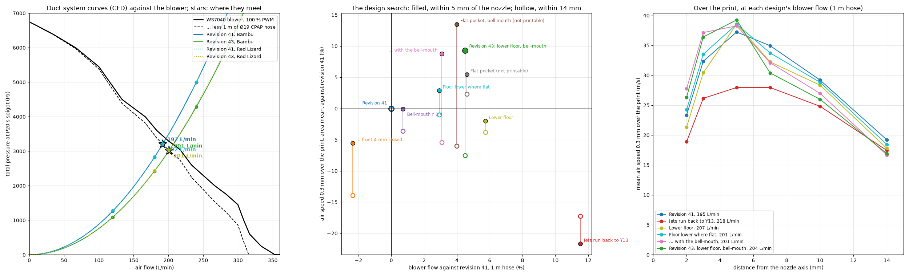

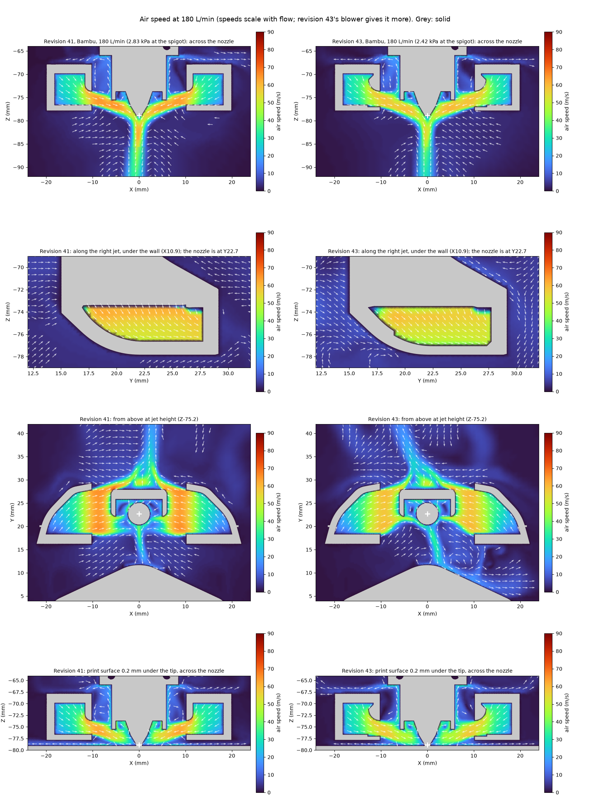

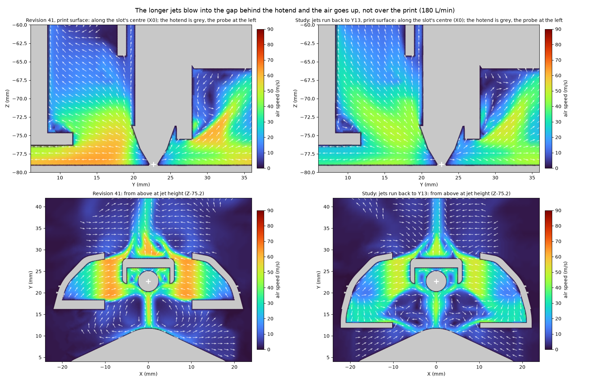

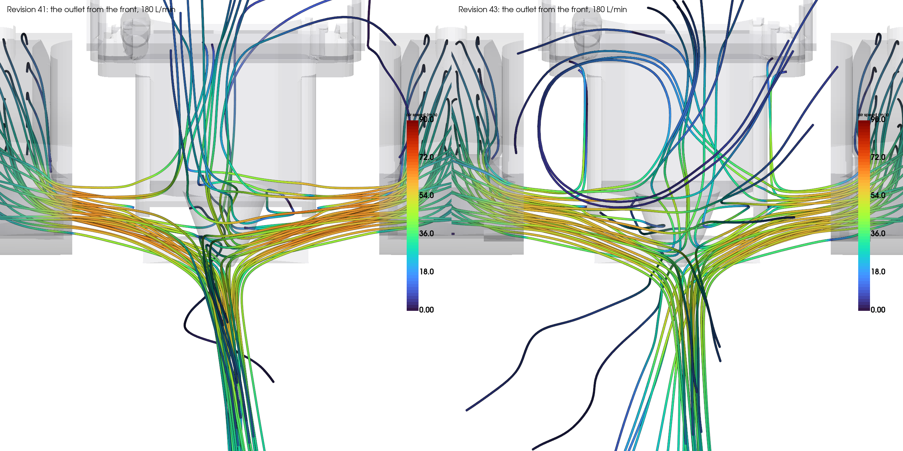

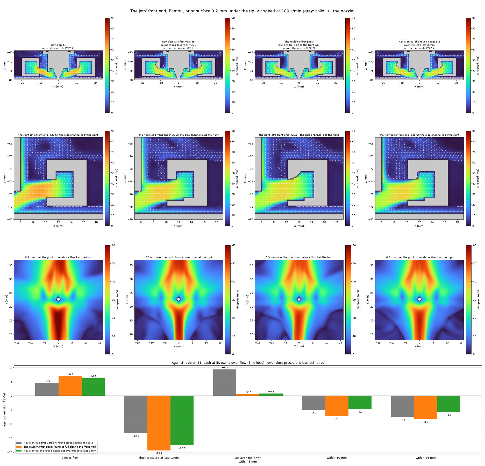

**The Bambu hotend and its silicone sock.** Every change is on the duct side of the hotend slot's
walls, below the jets' top or away from the hotend, so nothing comes nearer either hotend. Exact
distances, with the tool mounted and along the carriage's 60 mm withdrawal (each smallest gap is at
the mounted position):

| Hotend part | Nearest P22, revision 41 | Revision 43 |
| :--- | ---: | ---: |
| Bambu aluminium heater cradle | 1.918 mm | 1.918 mm |
| Bambu wire bail and latch | 2.10 mm | 2.10 mm |
| Bambu silicone sock | 3.20 mm | 3.20 mm |
| Bambu ceramic (zirconia) block | 4.592 mm | 4.592 mm |
| Bambu nozzle, melt block and heatsink | 5.20 mm | 5.20 mm |
| Red Lizard heater block | 1.722 mm | 1.722 mm |

The sock is this project's model of the P2S's; measure yours if it differs. The jets blow at the
sock's sides for their top 1.9 mm, as revision 41's did.

**Printing.** P22 still prints on its back face: of the ten flat faces it can stand on, that one
needs the least support (386 mm², against 660 mm² for the next) and keeps the jets' layer lines
along the flow. Every orientation that needs no support at all stands P22 on an edge.

| P22 on its back face | Revision 41 | Revision 43 |
| :--- | ---: | ---: |
| On the plate | 156 mm² | 323 mm² |
| Facing down more steeply than 30° | 936 mm² | 386 mm² |
| … that a support from the plate could reach | 255 mm² | 14 mm² |

Two places still need support:

- **The cheeks' bearing faces.** They sit flat on P01's bosses, and with P22 on its back face they
  are ceilings 8.5 mm wide, cantilevered 10 mm from the duct, over P22 itself, so the support has to
  stand on P22's top.
- **The undersides of P23's two rear-ear bosses.** These Ø6.1 tubes stand 2.2 mm proud of P22's
  underside and lie on their side in print. They would print without support, but P23's sockets
  leave them only 0.10 mm of radial clearance, so even a slight droop makes the ears tight. A small
  tree from the plate reaches them. Bambu Studio's automatic supports skip them as small overhangs.

In Bambu Studio set the support type to tree (manual), paint those faces as support enforcers (the
lower third of each boss), turn off "on build plate only", and use Bambu Support for ABS or HIPS as
the support interface, so the faces come off flat. Tree (auto) does worse, sliced with the same
preset: it puts tree tips inside the inlet socket where P21 plugs in, and with "on build plate only"
on it reaches less than half of the cheeks. Turning off "Remove small overhangs" to catch the bosses
also puts tips inside their bores. Everything else bridges or prints at 45° or steeper:

- the socket's front lip (15.4 mm);
- the jets' front lips (3.7 mm);
- the window notch's r 5 apex, a 7.1 mm arch like the top of a 10 mm hole (with automatic supports
  Bambu Studio puts a small tree up through the window under it; the painted setup leaves it).

The window's lower, sloping sides face up in print, and the cable boss's nose stands on the rib, so
they need nothing.

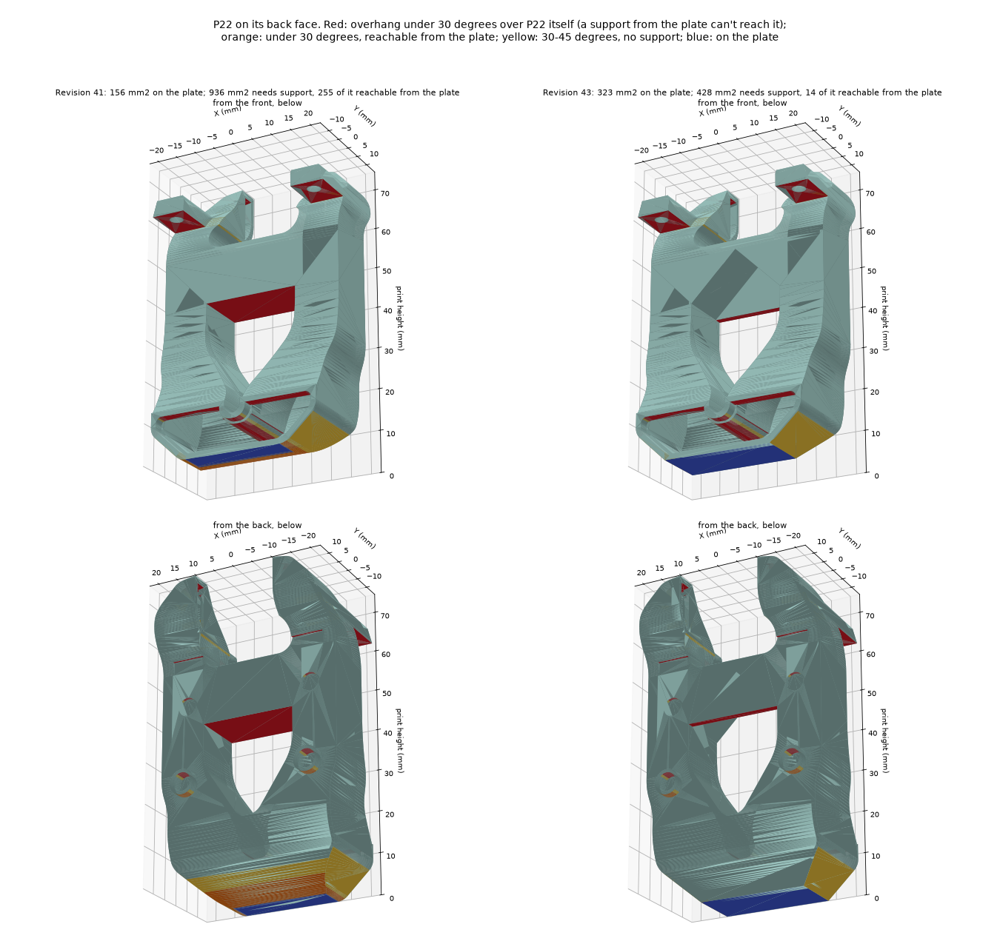

**Verification.** Run `python build_cpap_outlet_r43.py --workers 10`
([report](./verification_cpap_outlet_r43.json)). It passes, in 22 minutes:

- **P22.** One valid solid, 15,982 mm³ (revision 41: 17,381), inside revision 41's bounds and
  changed only at the jets, the window, the back and the rib.
- **Jets.**
  - The narrowest section across both jets is 66.2 mm², 1.12 times revision 41's.
  - The floor under them is solid and at least 0.80 mm thick (1,376 vertical rays).
  - The bell-mouth is within 0.001 mm of its design from just in front of the heel (Y16.9) to
    Y24.4, and its run-out within 0.001 mm of the run-out's design at three of its sections
    (Y25.18, 25.95 and 26.72).
  - The rest of the outlet's walls are no thinner than revision 41's (1.2 mm).
- **Hotends.** As above, for both tools.
- **Fit.** Against both builds (Beacon and Cartographer) and both mounted tools: no new
  interference or contact. P22 bears on 692 mm² of P23's top (revision 41: 817 mm²); the 125 mm²
  less is exactly the window notch's footprint.
- **Print.** As above. The walls at the printing changes are 1.4 mm and up, and the rib 1.3 mm.
- **Rack.** The revision-36 requalification, on a revision-43 scene, is clean:
  - own-dock docking and withdrawal;
  - the eight mixed-neighbour cases (488 samples);
  - the 20 bay/hotend cases (2,420 samples);
  - the X gantry backing out (121 samples);
  - both X0..350 traverses at 60 mm withdrawal (702 samples).

  With the Y40 or shifted bed, none of the 80 bed cases collide and the minimum clearance is
  4.59 mm. Side clearances stay at 2.40 / 1.60 mm.

The CFD report is [here](./verification_cfd_cpap_r43.json), with every case's flows, pressures,
jets and losses, and the design search against revision 41.

**Files.** [P22](./step/P22_CPAP_Lower_Plenum_Low_Jets_R43_REVIEW.step)
([STL](./stl/P22_CPAP_Lower_Plenum_Low_Jets_R43_REVIEW.stl),
[print-oriented STL](./stl/P22_CPAP_Lower_Plenum_Low_Jets_R43_REVIEW_PRINT_ORIENTED.stl)). The
Fusion native review "43b CPAP outlet", revision 41's and revision 43's P22 side by side with both
hotends, cut-aways, and the left jet from its side channel before and after the review (and with the
round at full size to the front wall, as the review first tried), is archived
as [`43_CPAP_Outlet_REVIEW.f3d`](./43_CPAP_Outlet_REVIEW.f3d); the STEPs it comes from are left out
of the repository, and the script regenerates them.

**Run.**

```
python cfd_cpap_r43.py brep                      # revision 43's P22 for the CFD domains
python cfd_cpap_r41.py domain r43_bambu --p22 <WORK>/cfd/p22_r43.brep   # also --tool RedLizard, --bed
python cfd_cpap_r41.py case r43_bambu --np 32    # then run as revision 41's (cfd/run_case.sh)
python cfd_cpap_r43.py analyse r43_bambu         # each case, after copying the results back
python cfd_cpap_r43.py report                    # verification_cfd_cpap_r43.json
python render_cfd_cpap_r43.py                    # images 89-92 and 94
python render_p22_r43_print.py                   # image 93
```

The studies' P22s are in [`r43_parts.py`](./r43_parts.py) (`pocket_study`, `front_study`,
`bell_study`, `low_study`, `low_bell_study`, `long_jets_study`, and from the review `review_rib_study`,
`review_back_study`, `review_full_study`, `review_fade_study`, `review_runout_study`,
`review_focus_study`), each identical
to the one simulated; the rear-jet variants are [`r43_rear_jet.py`](./r43_rear_jet.py)
(`p22(wide=False|True)`, cases `r43rearjet_bambu_bed` and `r43rearjetb_bambu_bed`) and
[`r43_centre_feed.py`](./r43_centre_feed.py) (`p22(jet=True|False)`, cases `r43centre_bambu_bed` and
`r43centrebody_bambu_bed`, domains built with `--leave-out P23_Probe_Mount,R37_REAR_`).

**Limits.** The CFD's limits are revision 41's: steady, time-averaged flow, no heat transfer, the
blower's published curve and a hose allowance, nothing measured on the printer. "Air over the
print" is the model's air speed near a flat print surface, not measured cooling. The floor under
the jets is 0.8 mm, under the 1.0 mm used elsewhere on the CPAP parts; it carries no load and the
jets keep it cool. Printability is judged on meshes (overhang angles and rays to the plate), not on
a print.

#### Faster verification (`fast_geometry.py`)

The review scripts now share [`fast_geometry.py`](./fast_geometry.py), and the full
revision-33 pass took 2.9 minutes. Revisions 31 and 32 each took about 45 minutes. The
results are the same, only computed with less work:

- **Exact distances by face, not by solid.** OCC's solid-to-solid distance compared every
  face pair of complex parts. For example, the 904-face P03 against the 354-face dock took
  16 s to find a 26 mm gap. Each face now has a tight bounding box, and the exact distance
  runs only on face pairs whose boxes can still beat the best answer so far. One clearance
  sample went from about 100 s to 0.04 s.
- **Boolean screen.** Overlap checks skip the Boolean for solid pairs whose surfaces do not
  meet and where neither solid lies inside the other, since that Boolean can only return
  zero.
- **BREP cache.** STEP files are cached as OCC's native BREP under `.cache/` (git-ignored),
  so the 30 MB core loads in 0.35 s instead of 7.4 s.

Re-running the revision-30, 31 and 32 checks with these helpers reproduced every stored
value and label exactly, including nested and touching test cases.

#### Superseded: revisions 25-29

These are kept for history. Revisions 25-28 patched on top of each other: revision 25
added the inlet sleeve but kept the corridor scallops and only partly filled the front
slot; revision 26 closed the corridors with full-width blocks and added stock behind the
core; revision 27 tapered those blocks into wedges; revision 28 cut them back to
half-cylinders. Revision 29 rebuilt cleanly from revision 22 and restored the front neck,
but kept the fan 1.65 mm further out, the shelf strip near the carriage and the open P18
bore slots. Reports:
[R25](./verification_bambu_continuous_guide_r25.json),
[R26](./verification_bambu_closed_mounts_r26.json),
[R27](./verification_bambu_blended_mounts_r27.json),
[R28](./verification_bambu_flat_shelf_r28.json),
[R29](./verification_bambu_clean_r29.json).

#### Low-Z blocker and shelf refinement (revision 22)

**Resolved in revision 34** by moving the bed's front edge behind the parked tools; the
rack itself is unchanged. The original finding follows.

**Do not build or commission the current rack position with the original bed.** The previous
revision-21 checks established lateral packing and the sampled toolchange
paths, but did not lower the gantry to printing height over the actual bed.
The new [bed-clearance audit](./verification_low_z_bed_clearance.json)
finds rigid intersections in **all 40 cases**: two active-hotend heights,
both parked hotends, and all ten bays, with the active nozzle at world
Z0.2 mm and the bed top at Z0.

The fixed bed occupies world X0..350, Y9..359, Z-8..0 mm.
The parked purge chutes extend below the active nozzle and over its footprint.
They first touch the bed top when the active nozzle is still approximately
**13.95 mm above it for Bambu, or 13.20 mm for Red Lizard**.
The dock body, silicone pad and wiper also intersect at first-layer height.
Reserving a front print-area strip does **not** prevent this physical collision.

Moving the current rack forward by **27.41 mm** would put its complete
parked envelope 1 mm outside the bed's front edge, but the necessary
X-gantry docking position collides with the existing Monolith front
motorless mounts and their fasteners. It is not a usable translation-only
fix; the named bearing references also extend beyond the front rail ends.

A straight rear relocation **with the existing orientation** requires
**391.50 mm** of Y translation to keep the low hardware 1 mm beyond the
rear bed edge. That position intersects 91 fixed gantry bodies and puts
the named bearing references at Y422.16..462.06 mm, outside the existing
Y15..415 mm rails. Neither simple translation is a usable fix. These are
necessary reach screens, not redesigned supports, docking paths or an
assessment of every possible rear-facing arrangement.
A different rack location or docking geometry needs a design decision;
the original gantry and bed have not been modified.

The [native diagnostic assembly](./22_Low_Z_Bed_Interference_DIAGNOSTIC.f3d)
shows the revision-21 geometry lowered to first-layer height with the actual
fixed bed included. The moving beam/carriage are hidden only for clarity.

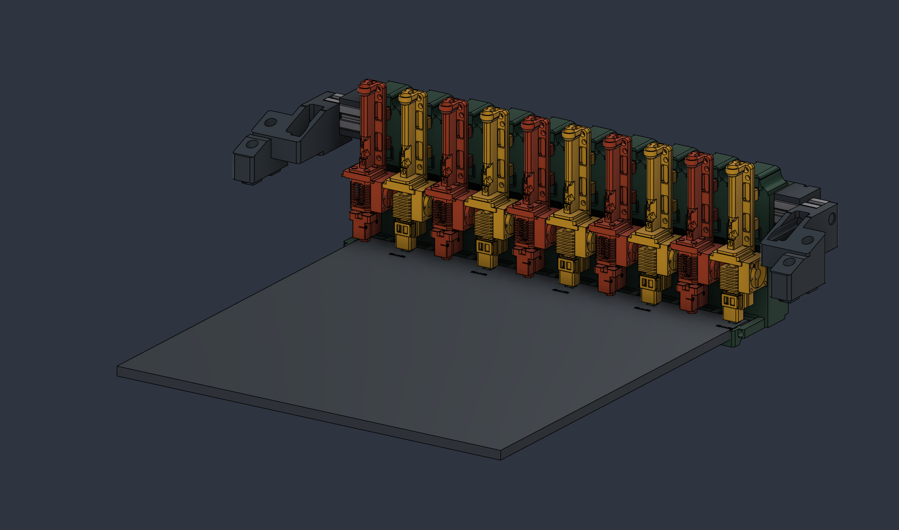

The revision-22 shelf candidate removes only another **0.5 mm** from the
unused left shelf edge, from X-14 to X-13.5 mm, leaving the fans, hotend
mounts, coupling and rack pitch unchanged. The resulting one-solid bodies
are exported as
[Bambu](./step/Bambu_One_Piece_Shelf_Clearance_R22_REVIEW.step) /
[Red Lizard](./step/RedLizard_Side2510_Shelf_Clearance_R22_REVIEW.step).
Their nominal parked X gap improves to approximately **1.40 mm**.
This local refinement does not fix the low-Z blocker; revision 22 has
**not** completed full rack qualification, and its partial assembly
exports are not approved successors to revision 21.

The cable-route screen also confirms that simply raising the upper cable
bend is not a fix: at Z-12 mm it clears P24 by 0.2 mm but intersects P20
by approximately 6.10 mm3. The P24 entry interference was left unchanged
here; revision 35 resolves it with a cable slot in P24.

`build_refined_docking_review.py` now targets revision 22 and includes a
mandatory low-Z bed gate before the full-rack qualification. Use
`python audit_low_z_bed_clearance.py` for the focused reproducible audit;
its nonzero exit is the expected failure while this blocker remains.
Each run also repeats four dock-only controls at nozzle Z15 mm and verifies
the saved diagnostic archive/image hashes before retaining their evidence.
A changed geometry source or diagnostic file raises an explicit error
rather than silently reusing stale native evidence.

#### Independent lifting-rack feasibility study (revision 23 concept only)

**Not pursued.** The rack stays rigidly bolted across the open front of the gantry U, and
revision 34 fixes the bed collision with a bed change instead. This study is kept for
reference.

The separate [native motion study](./23_Independent_Rack_Lift_Kinematic_CONCEPT.f3d)
shows **nine raised parked tools plus one active Bambu tool**, all ten docks
and the crossbar raised 15 mm, and the X beam/carriage withdrawn 60 mm.
The actual bed remains fixed. Original rigid rack mounts are hidden,
incompatible reference geometry, not working supports for the raised rack.
**No guides, lift actuator or replacement supports have been designed.**
This is a possible direction for a later mechanism change, not an approved
revision of the printer or a resolution of the current fixed-rack blocker.

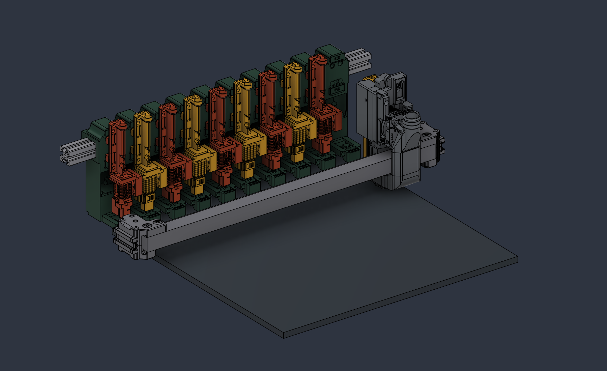

The [reproducible lift screen](./verification_independent_rack_lift.json)
checks both parked variants in every bay. At an active nozzle height of
0.2 mm, all 40 bed cases are clear, with the lowest parked hardware at
**Z1.2512 mm**. Conservative per-solid boxes enclosing the entire 0..15 mm
lift clear the modeled flying gantry and withdrawn X beam by at least
**10.00 mm**. After 60 mm withdrawal, the complete modeled active
tool/carriage envelope has **17.50 mm** of Y separation from the raised
rack, independent of X position. This does not include flexible cable
motion or any future lift mechanism.

The [native readback record](./verification_lifting_rack_native.json)
confirms 739 bodies, unchanged occurrence transforms on archive reopening,
the active Bambu tip at Z0.2 and the lowest dock at Z1.2512 mm.
The archive includes the 26 hidden original rigid-mount reference bodies;
those bodies are not part of the collision-screened moving assembly.
The study uses revision-21 tool geometry, not an unqualified full-rack
revision-22 assembly.

Necessary changes are recorded rather than applied to the inherited design:

| Required change | Constraint for a future implementation |
|---|---|
| Independent guided rack motion | Replace rigid support attachment, partition spacers/fasteners correctly, preserve the lowered dock coupling datums and ten-bay pitch. |
| Actuation and retention | Synchronize both ends under load, prove repeatability, and prevent a power-loss drop toward the bed or print. |
| Motion interlocks | Confirm active-tool retention and carriage withdrawal before lifting. A nominal 15 mm Z hop above the current print plane is needed before lowering the existing dock geometry; check top travel before allowing it. These are requirements, not commissioned macros. |
| Wiring and travel | Accommodate parked-fan wiring, full enclosure/top-Z clearance and the added moving load. |

The raised rack reaches approximately Z142.08 mm with the active Bambu
nozzle at Z0.2 mm, about 1.51 mm above the current carriage reference.
This is a height requirement for a later enclosure/travel audit, not a
verified maximum printer Z. Loads, deflection, guides, fail-safe retention,
actuation and firmware remain unqualified. Run
`python audit_independent_rack_lift.py` to reproduce the limited geometry
screen; its clear status must not be interpreted as machine approval.

#### Bambu side-fan placement review (alignment study 24)

**Retain the current fan position within the unchanged design.**
The [Bambu-specific alignment study](./verification_bambu_fan_alignment.json)
identifies seven fins spanning local Y15.70..26.02 and Z-49.68..-32.38 mm.
Their projected center is Y20.86, Z-41.03 mm, compared with the current
fan center Y25.50, Z-35.30 mm. However, moving the fan to that center
intersects both P22 and the existing core. Geometric centering is not a
drop-in improvement.

| Candidate relative to current fan | Projected annular coverage | Constraint |
|---|---:|---|
| Current | 56.1% | No screened envelope intersections; 1.20 mm P22 clearance. |
| 0.5 mm lower | 58.2% | No screened envelope intersections, but P22 clearance falls to 0.70 mm. |
| 1 mm lower | 60.5% | Core interference; P22 clearance only 0.20 mm. |
| Centered: Y-4.64, Z-5.73 mm | 71.8% | P22 interference about 103.78 mm3 and core interference about 808.31 mm3. |
| 1 mm inward only | 56.1% | Existing printed-mount interference about 62.72 mm3; hotend clearance falls from 2.45 to 1.45 mm. |

Coverage measures the overlap of the fin-stack side-projected rectangle
with a generic radius-11 mm fan opening excluding a radius-4 mm hub.
It is **not fin cooling efficiency, airflow coverage or thermal proof**.
Forward-only offsets also hit the existing print and do not improve this
annular metric. A 0.5 mm lowering is too small a demonstrated geometric
benefit to justify sacrificing the approved clearance cushion without
thermal evidence. The proposed lower/forward position is therefore not
adopted; printed parts, fan hardware and approved fan coordinates are unchanged.

The [comparison STEP](./step/24_Bambu_Fan_Alignment_Comparison_UNMOUNTED.step)
overlays current and centered **unmounted** fan envelopes for inspection;
the centered envelope intentionally intersects unchanged parts. It is not
a toolhead assembly to manufacture. Run `python audit_bambu_fan_alignment.py`
to reproduce the twelve-position screen. Actual fan CAD, parked intake
behavior and a hot-soak test are needed before claiming an optimal placement.

#### Historical marked-region investigation (superseded by revisions 29-30)

The [focused region audit](./verification_bambu_marked_regions.json) examines
the earlier revision-21 body, before the user's clarification and the
revision-29/30 rebuilds above. Its unresolved status describes that historical
investigation, not the current body. No gray
core/accessory solid intersects the modeled fan's straight-through annular
projection, but that does **not** positively identify the gray patch in the
image: perspective sight lines and airflow projections are different.
Yellow printed material does occupy part of that projected corridor.

The revision-21 Bambu body examined here was one valid, watertight, connected solid.
A small continuous material witness through the central spine crosses
Z-23..-15 mm at X0, Y20 mm. This rules out a wholly detached upper body,
not a locally weak outer junction. The circled outer step still needs
positive face identification and its intended correction before cutting
or bridging it. No wall-strength, assembly-access or thermal approval is
implied, and no geometry was changed in response to these ambiguous marks.
Run `python audit_bambu_marked_regions.py` to reproduce this limited audit.

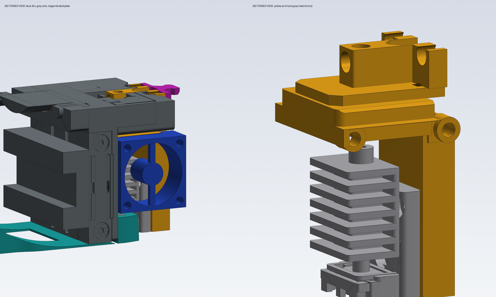

The comparison above sections away material outside local Z-58..-10 mm
for visibility only; it does not modify the design. Blue identifies the
fan, gray the core/hotend, magenta P18 and cyan P22. The right panel hides
the fan, core and backplate to expose the yellow upper transition and
fan-mount ears. Reproduce it with `python render_bambu_marked_regions.py`.
It is an identification aid, not evidence that either user-marked feature
has been repaired.

The follow-up audit records twelve horizontal section profiles through the
upper transition. Individual loop areas include holes and must not be
summed as net structural area. Both upper fan screw heads have a clear
radius-2.25 mm, 4 mm-long outward entry gauge against the listed print,
core and accessories. This does not certify a full driver, docked neighbors
or the circled outer upright's fastening access. These checks do not
establish a defect that can safely be repaired without identifying the
intended change.

#### Historical ten-tool / closed-panel dock review (revision 21)

The current rack review is the native Fusion archive
[`21_Ten_Tool_Side2510_Rack_REVIEW.f3d`](./21_Ten_Tool_Side2510_Rack_REVIEW.f3d)
([STEP exchange file](./step/21_Ten_Tool_Side2510_Rack_REVIEW.step)).
It shows ten complete parked side-fan tools (five Bambu and five Red Lizard),
their matching docks, the existing crossbar and P29/P30 hardware, the
Monolith X gantry at the dock, and the carriage at T0. It is not ten copies
of the carriage: the carriage, CPAP and controller travel with the active
tool only.
The native archive contains 738 solid bodies and was reopened to verify
all ten tools and the restrained motor leads. `Monolith_X_Gantry_At_Dock`
and `Carriage_At_T0` are hidden only for an unobstructed parked-tool view;
turn their visibility on to inspect the complete in-situ assembly.

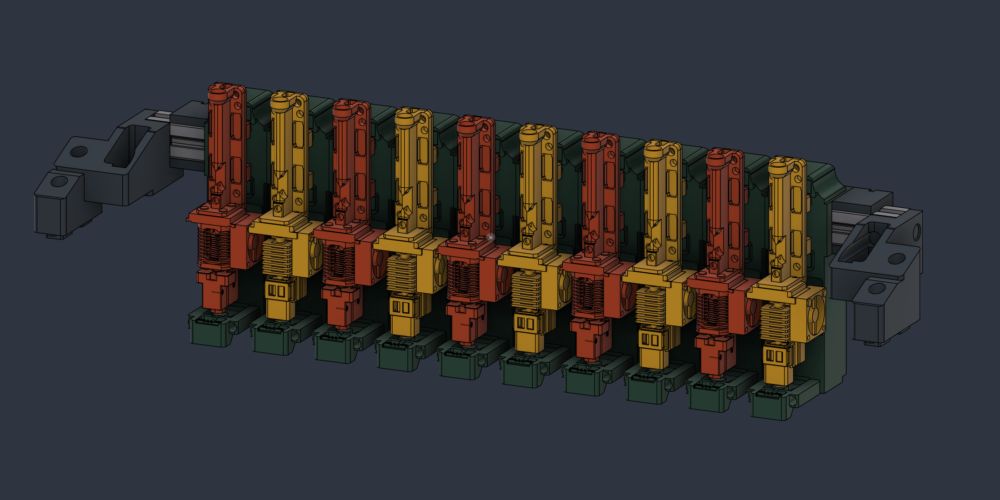
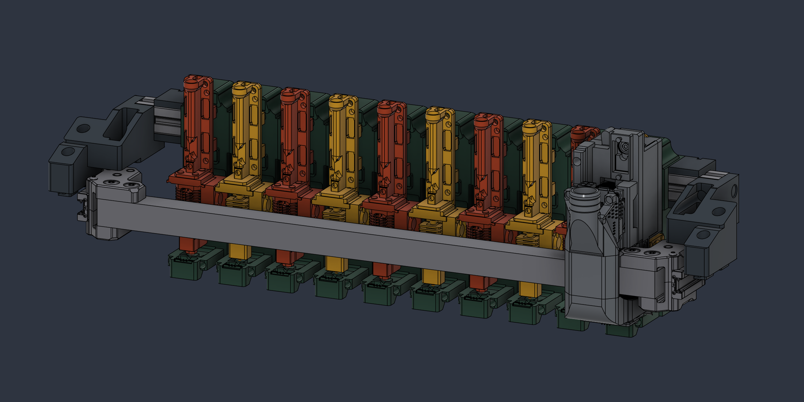

The collar pitch remains **37.30 mm**, with centers
**7.0, 44.3, 81.6, 118.9, 156.2, 193.5, 230.8, 268.1, 305.4, 342.7 mm**.
Ten collars occupy 373 mm, inside the 420 mm mount-to-mount span with the
existing 23.35 / 23.65 mm side spacers. No rack length or machine travel
increase is assumed. The existing crossbar reference is **450 mm long**
(X-50..400); 420 mm is the support-datum span, not its stock length. These
dimensions must match the physical rack. The modeled 400 mm rail spans
X-25..375; the unchanged
45.4 mm carriage block gives a center stroke of X-2.3..352.3. T0/T9 have
9.3 / 9.6 mm physical rail-end margins and 7.0 / 7.3 mm margins to the
assumed X0..350 software limits.
The ten collars touch nominally; this is not an assembly or thermal-expansion
allowance. Check the printed collar/spacer stack at operating temperature
before fixing the end stops. Do not force an oversized stack into the supports.

The least nominal parked-tool X separation is **0.899 mm**, including
mixed hotends and their fan screws. This is not a large tolerance allowance:
measure printed pitch, selected fan frames and hardware before commissioning.

**Obsolete cooling cleanup:** P25's old front-fan exhaust grille is closed
with a continuous **2 mm wall**, and its four unused blind fan-mounting
bores are filled. The hollow recess remains as weight relief, not a cooling
passage. The clamp collar, jaw/coupling geometry, lower pad flexure,
purge window and silicone-wiper seats are retained. Nothing is added
around the side-fan opening. Use
`step/P25_Closed_Panel_Side2510_Dock_REVIEW.step` and its matching STL,
not the older vented P25.

**Crossbar fit correction:** the previous dock references put each rear
magnet 73.546 mm3 into the actual extrusion and let the M5x12 screw tips
enter the rear slot floor. The revised collar incorporates a **6.5 mm
standoff**: the tool, coupling face, jaws and lower dock sit 6.5 mm farther
forward (+world Y), while the crossbar, P29/P30 parts and every X center
stay put. No metal is removed from the rail. The collar is relieved to
the actual extrusion profile with 0.15 mm assembly allowance. Use
**two M5x10 screws**, not the old M5x12 references, with appropriate 2020
M5 T-nuts. Actual nut geometry/thread engagement and torque need confirmation.
The lower jaw has 0.2 mm relief in the new web while its original seat
and both snap detents are preserved. Update docking Y coordinates by
**+6.5 mm in the displayed world frame**; nozzle Z and X offsets are unchanged.
The extra section audit found only 0.770 mm of magnet-pocket backing with
the initial 5 mm standoff. Increasing it to 6.5 mm provides a sampled minimum of
about 2.27 mm at the ten sampled backing gauges, while retaining the M5 head
bearing seats. These are local stock measurements, not a global
wall-thickness, printability or retention-strength qualification.

The separate assembled reviews are
[Bambu](./step/21_Bambu_Toolhead_And_Closed_Panel_Dock_REVIEW.step) /
[Red Lizard](./step/21_RedLizard_Toolhead_And_Closed_Panel_Dock_REVIEW.step);
their native Fusion archives are
[Bambu](./21_Bambu_Toolhead_And_Closed_Panel_Dock_REVIEW.f3d) /
[Red Lizard](./21_RedLizard_Toolhead_And_Closed_Panel_Dock_REVIEW.f3d),
reopened with 145 / 144 solid bodies respectively.
Standalone 14-solid docks are
[Bambu](./step/21_Bambu_Closed_Panel_Dock_Complete_REVIEW.step) /
[Red Lizard](./step/21_RedLizard_Closed_Panel_Dock_Complete_REVIEW.step).
The one-piece bodies, fan positions and hotend-specific silicone pieces
remain those of revision 20 below.

The revision-21 report is
[`verification_ten_tool_closed_panel_dock.json`](./verification_ten_tool_closed_panel_dock.json).
Its recorded pass covers the following checks, not the later low-Z bed
test; see the blocking revision-22 finding above before interpreting it.
In addition to the tool/dock checks below, this pass uses world-frame
geometry snapshots from the open Fusion Monolith/rack documents, records
their fingerprints and transforms, and checks **both hotends in all ten
bays** against the actual crossbar, P29/P30 hardware and flying gantry.
It includes the physical Beacon, EBB42, probe cable and accessory fasteners
in the moving carriage. The X-gantry sweep is checked against every possible
parked tool variant. Immediate-neighbor pairs cover all mixed combinations;
nonadjacent tools are separated by their complete X envelopes. Thus the
alternating display is not a restriction to that particular tool ordering.
The final recorded CAD pass has no failures across the 20 bay/hotend
cases, eight mixed-neighbor cases, the sampled X-gantry withdrawal and
both X0..350 traverses at 60 mm withdrawal. The inherited reference
intersections described below are reported separately, not concealed.

**Do not inherit the old lateral docking moves.** The +/-1.5 mm peel and
+/-6.5 mm X scrub screens collide with neighboring side-fan tools inside
the rack, including at the wiper station. Use fixed-X, straight-Y insertion
and withdrawal with the Y wiper; the audited clearance route withdraws
**60 mm before X travel**. Cam/servo release must be established independently
before attempting this route. No Klipper macros or interlocks are installed
by this CAD generator.
The repository's `klipper/sparkshift_toolchanger.cfg` is still a **legacy
nine-bay T0..T8 template**, with different X positions, the old docking Y
and unsafe lateral scrubs for these side-fan tools. Its header now warns
against using it with revision 21. Ten-bay firmware configuration and
commissioning are not delivered by this mechanical audit.

The probe cable's rear leg moves from local Y-34.5 to **Y-34.9**, keeping
its endpoints and 5 mm bend radii unchanged. This removes its 0.2 mm
intrusion into the actual X extrusion and leaves 0.2 mm nominal clearance
without changing CPAP printed parts. Two inherited reference issues are
reported separately, not silently declared clear: four MGN9H reference
bodies overlap their own Y rails by 11.126 mm3 total, and the unchanged
upper cable entry overlaps P24 by 15.493 mm3. The latter needs a future
cable/entry clearance refinement; P24 and the rigid core parts are not modified here.
All other X-gantry/rail pairs remain in the rigid-collision checks.

The right-end audit also found the **loose yellow/blue AHG motor-lead
references** clipping the right XY joint at T9 and beyond. The current
review bends all four flexible lead envelopes upward in separated Y lanes,
retaining their motor-connector endpoints and staying inside the previous
X envelope. Only these flexible reference bodies change; no rigid core
part or original core document is edited. Restrain the real leads to this
space before using the end bay. These are clearance envelopes with a
nominal 4 mm bend, not validated wire lengths or strain-relief hardware.

**Reserve the front rack/service strip.** Ten parked tools do not establish
a usable 350 x 350 mm print area. Their nozzles and chutes descend with the
flying gantry; printed objects and arbitrary X moves must stay clear.
The audit reports the parked envelope and a conservative whole-envelope
Y-separation boundary. The 6.5 mm standoff moves this occupied strip 6.5 mm
farther forward into the modeled bed frame. The 60 mm withdrawal corridor
is an access path, not an approved printable-volume configuration.
The source bed spans world Y9..359 mm. The parked tool/dock envelope
reaches Y35.41 mm; conservative whole-envelope separation places the active
nozzle at Y63.21 mm, **54.21 mm from the modeled bed's front edge**.
The audited X-traverse corridor is at nozzle Y80.71 mm. These are world-frame
CAD datums and conservative clearance bounds, not commissioned Klipper
coordinates or a certified printable-area limit.

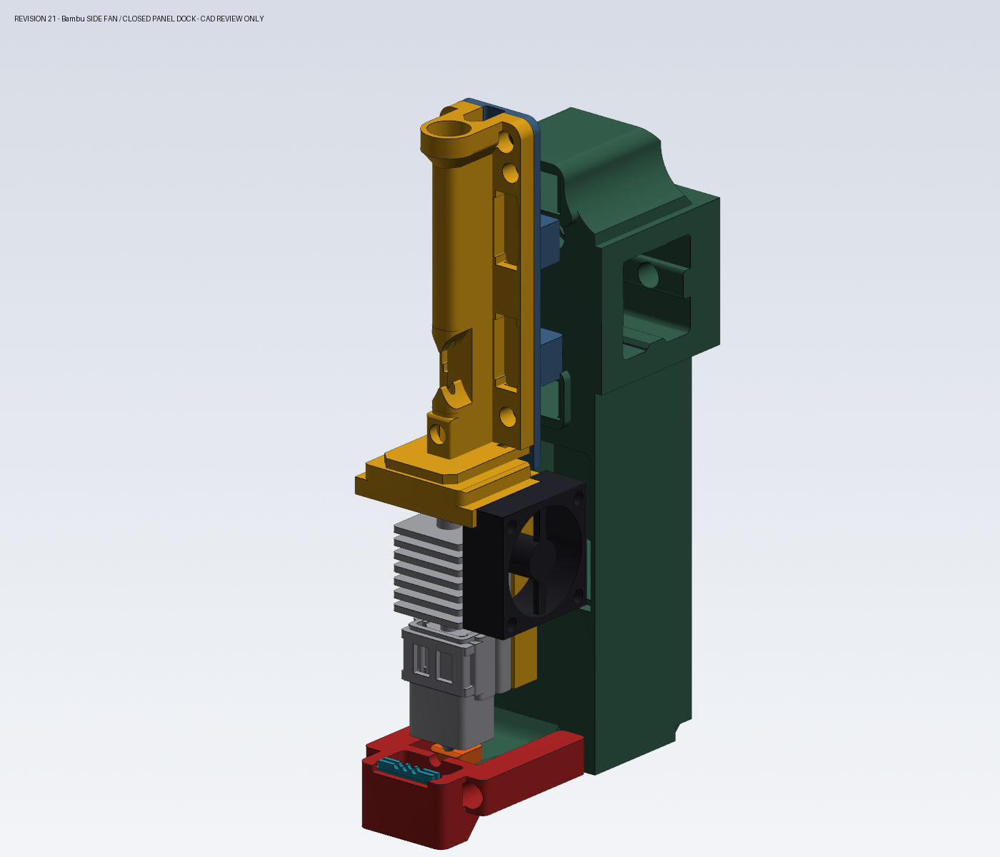
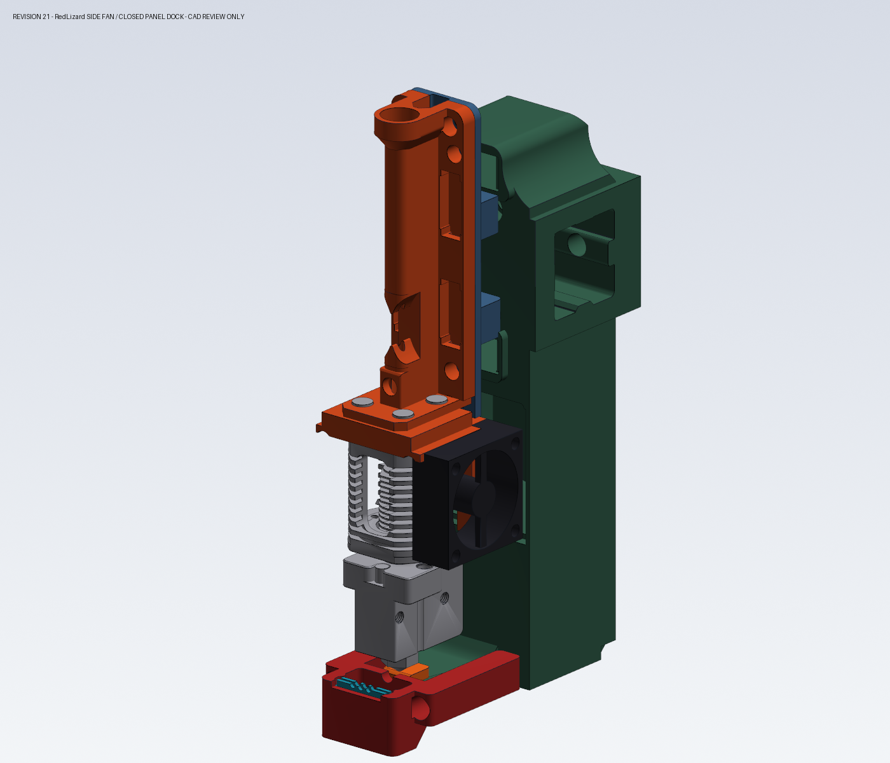

**Qualification limits remain:** these are rigid CAD models and sampled
paths, not continuous machine-motion, jaw-flexure or thermal certification.
Actual fan frames, wire exits, hose/umbilical motion, side-to-side hot-air
recirculation, retention forces and print tolerances need physical checks.
The parked fan power/control system is still not implemented.
The additional intake-space review also finds nearby tool material in front
of the nominal fan annulus: the closest features are 1.70..4.85 mm away,
depending on the neighboring hotend. At the 2 mm section, a Bambu neighbor
occupies about 4.1% of the nominal annular port projection. This is a
geometric obstruction measurement, **not** an airflow-loss or cooling
prediction. Keep the approved fan positions; verify all-ten-parked hot-soak
temperatures and the actual fan/wire envelopes before approving operation.

#### Historical toolhead/dock refinement (revision 20)

This review consists of **one whole printed toolhead per hotend**,
one tool-owned side 2510 fan, and the refined shared dock/chute. Complete
assemblies, including the unchanged core and CPAP/probe/controller mounts:

- [Bambu toolhead and dock](./step/20_Bambu_Toolhead_And_Refined_Dock_REVIEW.step).
- [Red Lizard toolhead and dock](./step/20_RedLizard_Toolhead_And_Refined_Dock_REVIEW.step).
- Standalone docks:
  [Bambu](./step/20_Bambu_Refined_Dock_Complete_REVIEW.step) /
  [Red Lizard](./step/20_RedLizard_Refined_Dock_Complete_REVIEW.step).

Native archives are saved alongside this README as
`20_Bambu_Toolhead_And_Refined_Dock_REVIEW.f3d` and
`20_RedLizard_Toolhead_And_Refined_Dock_REVIEW.f3d`. Both were reopened in
Fusion: 145 and 144 assembly bodies respectively. Each standalone dock
reimports as 14 solids; each new rigid printed part is one valid solid
with a connected, watertight, consistently wound STL.

Use `Bambu_One_Piece_Docking_Audited_REVIEW` or
`RedLizard_Side2510_Clearance_Refined_REVIEW` for the respective body,
`P25_Side_Fan_Refined_Dock_REVIEW` for the rigid dock, and
`P26_Nozzle_Entry_Clearance_Chute_REVIEW` for the chute. Each has STEP/STL
geometry under `step` / `stl`. They supersede the corresponding older
review parts below, not the unchanged printer/core/rack components.

The approved **Bambu fan center stays (16.45, 25.5, -35.3) mm**. Red Lizard
retains its narrow two-hole edge rail, shifted outward just 0.15 mm with
the fan/hardware: center (16.60, 25.5, -35.3) mm, nominal fan-to-hotend gap
**0.60 mm**, outer screw face X22.40 mm. Both keep the same ultra-low-head
M2.5x14 screws and L3 x OD3.5 inserts. There is no added shroud.
An unused left shelf strip is trimmed from X-15 to X-14 below Z-22.5 on
both bodies to clear adjacent tools at 37.3 mm pitch; the upper stems,
hotend mounting seats and coupling interfaces are retained.

Two targeted P25 entry-lip cuts remove 91.665 mm3, resolving the inherited
55.057 mm3 P18 interference without modifying P18, the pin/bushing seats
or snap detents. P26 has a radius1.6 longitudinal nozzle-entry relief at
its rear purge-window lip, removing the Red Lizard tip's grazing contact.
The ooze pads now sit on the existing Z-81.0794 rigid floor instead of
penetrating it. **Use hotend-specific silicone pads/wipers:** Bambu contact
top Z-78.1312; Red Lizard Z-78.8794, following the supplied reference tips.
(Superseded by revision 37, which repairs the Bambu reference tip at Z-78.88 and uses the
Red Lizard pad and wiper in every dock.)
Do not print these contact pieces in ordinary rigid filament, and do not
move the hotend merely to force the synthetic reference onto a nominal datum.

The reproducible modeled audit is
[`verification_refined_toolhead_dock.json`](./verification_refined_toolhead_dock.json),
from the revision-20 generator run. The current generator produces
revision 21 above. This earlier audit checks rigid
interferences, screw/heatset access and material support, nozzle-pad
height/support, probe keepouts for new cooling/coupling hardware, printed
solid/mesh integrity, and exported STEP reimport. Straight tool approach
and carriage retreat are sampled from Y0 to Y-60 at 0.5 mm increments.
All Bambu/Red Lizard immediate-neighbor combinations on both sides are
sampled at 1 mm increments at **37.3 mm pitch**, retaining the ten center
positions X7..342.7 mm and unchanged rack mounts/spacers.
The final report passes with no unexpected intersections above the
0.001 mm3 static / 0.01 mm3 motion reporting thresholds. These thresholds
are Boolean-volume tolerances, not guaranteed physical clearance margins.

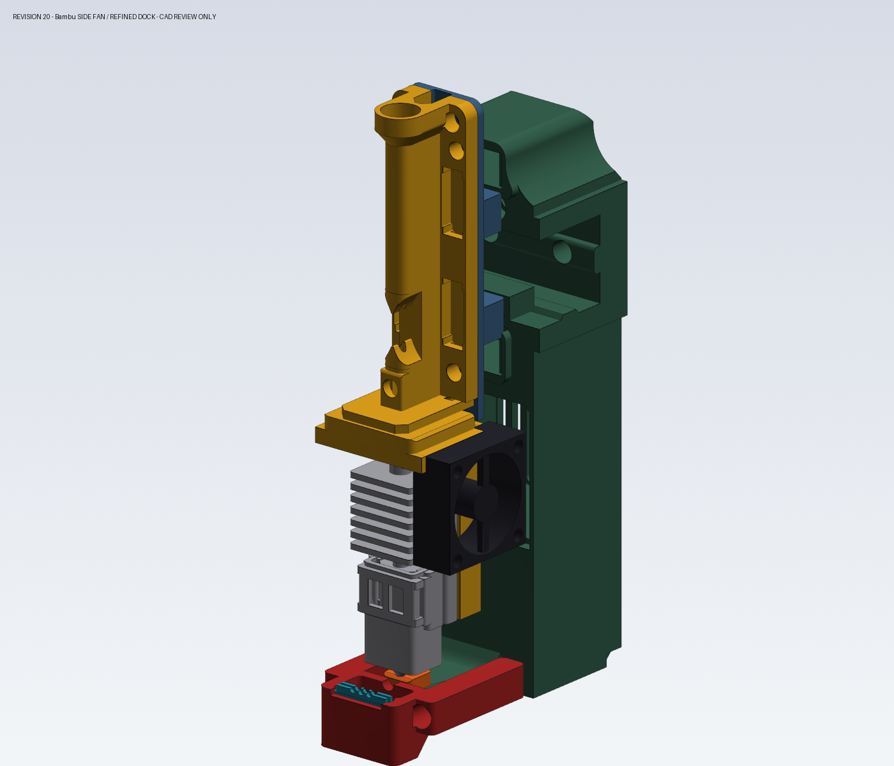
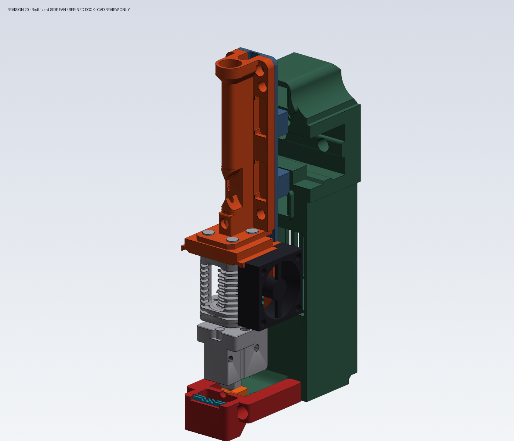

**CAD review, not print-ready machine qualification.** The two inherited
flexible jaw detents retain 14.679 mm3 nominal overlap each; this is
intentional snap geometry, not rigid clearance or validated flexure.
Pin/bushing diametral clearance remains 0.08 mm and magnet face gap
0.260 mm. Jaw strain, magnet retention, tolerances, thermal performance,
rail strength and insert fit require physical qualification. The Red
Lizard's 0.60 mm nominal fan gap remains tolerance-sensitive. The fan is
a generic envelope, not selected manufacturer CAD. Sampled translations
do not prove continuous clearance or simulate the cam/servo/peel sequence.
Printer X-end hardware limits are not re-certified. Existing CPAP,
Beacon/Cartographer and EBB42 geometry is retained; this does not certify
probe electromagnetic behavior, firmware or resonance measurements.
Parked fan power contacts/control/interlocks are **not implemented**;
each fan must remain powered through cooldown.

#### Historical Bambu one-piece baseline (revision 18)

**Revision 18: one complete hotend-specific printed body, not a modular
carrier/adapter pair.** Open
[`step/18_One_Piece_Bambu_Toolhead_2510_REVIEW.step`](./step/18_One_Piece_Bambu_Toolhead_2510_REVIEW.step)
for the complete assembly. The individual printable-body geometry is
`step/Tool2510_One_Piece_Bambu_Toolhead_REVIEW.step` /
`stl/Tool2510_One_Piece_Bambu_Toolhead_REVIEW.stl`.
The native archive `18_One_Piece_Bambu_Toolhead_2510_REVIEW.f3d` is also
saved locally and was reopened in Fusion with 128 assembly bodies and
exactly one printed-toolhead body.
The STL is in assembly coordinates, not a qualified slicer orientation.
Each hotend variant is to have its own whole toolhead print. This revision
implements the Bambu variant; the older Red Lizard studies below are not
updated one-piece cooling variants. See the separate Red Lizard side-fan
feasibility revision below.

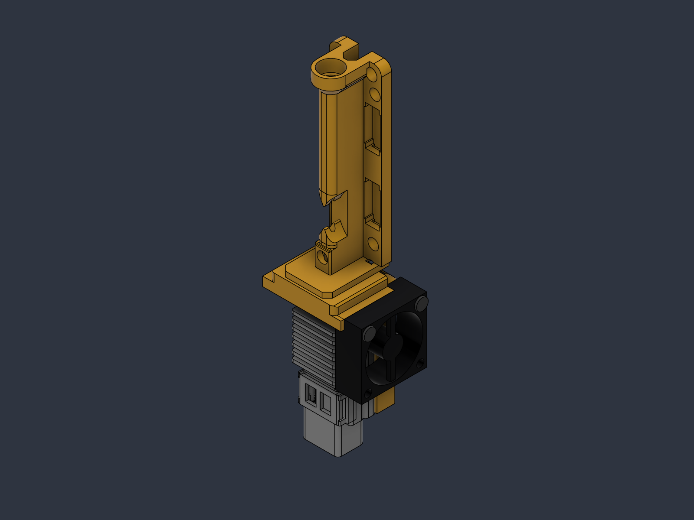

[Full assembly view in Fusion](./images/38_one_piece_bambu_full_assembly_fusion.png)

The fan placement approved in revision 16 is unchanged: center
**(16.45, 25.5, -35.3) mm**, one tool-owned 25 x 25 x 10 mm fan on +X,
no shroud, duct, baffle, lower frame or outboard support. The two upper
mounting ears are integral to the toolhead. The former shelf joint,
two M2.5x20 screws, two shelf heatsets and unnecessary clamp ears are gone.
Obsolete 3010 bores and old clamp reliefs are filled within the shelf/apron
outline. The original lower P18 attachment passages are restored, and the
fan heatset installation corridors clear the entire fused body.
The inherited tiny carrier/P18 overlap is trimmed from the toolhead only.
The supplied core, physical hotend, CPAP, probe/controller mounts and dock
geometry are not modified. Older STEP/Fusion documents remain historical
snapshots, not the current printable-body definition.

The fan inner face is X11.45 mm, 3.15 mm from the modeled fin edge.
Its body ends at X21.45 mm; two **M2.5x14 ultra-low-head screws, maximum
OD4.5 x H0.8 mm**, end at X22.25 mm. Actual screws must match this envelope;
ordinary 1.5 mm heads exceed the width limit. Fan inserts are the user's
M2.5 x L3 x OD3.5, entering from -X through diameter4.4 corridors, with
1 mm outer retaining shoulders opposing the screw heads.
The heating assembly retains three M2.5x10 screws, two upper 0.5 mm washers,
and front-entry M2.5 x L4 x OD3.5 inserts with 2.8 mm retaining shoulders.
Install all heatsets before the hotend/fan. Fit the three heating-assembly
screws **with the snap-in nozzle removed**; the fins otherwise block the
straight driver approach. Then fit the snap-in nozzle. Routine nozzle
service remains intended with the complete tool removed from the carriage.

**Second-pass CAD audit:** one valid connected, watertight printed body;
128 solids in the reimported full STEP; no unexpected modeled tool
intersections with the core, P18/P20-P25, supplied gantry, accessory
fasteners, Beacon/Cartographer bodies, EBB42 or probe cable. Diameter3
straight screwdriver approaches and diameter4.4 heatset approaches are
clear in the documented assembly sequence. The filament passage, heatset
shoulders/surrounds, lower backplate passages and sampled upper
guide/coupling boundary preservation are checked. The 35 mm forward
withdrawal screen is clear at 1 mm increments; the exploratory detached-tool
nozzle path also remains clear. These are sampled translations, not a
continuous cam/latch/docking simulation.

The tool/accessories span **44.84 mm**, excluding the previously reported
inherited core overhangs. The fan retains **1.2 mm to P22, 0.98 mm to the core,
and 1.50 mm to P18**. New cooling clears neighboring supplied tool/dock
copies at +/-45 mm pitch; this does not establish ten-tool rack capacity.
The supplied Beacon top metal and bottom keepouts are checked. An inherited
printed motor-mount portion occupies the top region, classified as polymer
from the original source metadata, not metal. Cartographer physical fit is
checked, not a separate manufacturer-specific electromagnetic certification.
Existing probe/EBB42 accelerometer references are retained; no firmware,
wiring or resonance measurements are implemented.

**Still unqualified:** actual 2510 frame/hole pitch/connector and wire bends,
ultra-low-head hardware availability, thermal movement, airflow/heat creep,
printed-part strength/creep and physical insert fit. The supplied P18/dock
references have an inherited **55.057 mm3 overlap**; neither is altered,
and that docking interface still needs resolution/qualification. The
synthetic nozzle tip also differs from the intended master Z datum.
Full-machine travel, ten-tool layout, exact H2D latch/finger access and
parked fan power/control remain outside this geometric pass. Keep each
parked fan powered through cooldown.

Reports: [`verification_tool_owned_2510.json`](./verification_tool_owned_2510.json)
and [`verification_toolhead_second_pass.json`](./verification_toolhead_second_pass.json).
Regenerate with
`python build_tool_owned_2510_review.py --core-reference <identity-transformed-core.step>`,
then run
`python audit_tool_owned_2510.py --core-reference <identity-transformed-core.step>`.

#### Historical Red Lizard side-fan feasibility (revision 19)

`step/19_One_Piece_Red_Lizard_Side2510_REVIEW.step` is the complete review
assembly. `step/RedLizard_One_Piece_Side2510_REVIEW.step` and the matching
STL contain the single printed Red Lizard body. The Bambu revision is not
changed. The fan uses the same center (16.45, 25.5, -35.3) mm and the same
44.84 mm assembly envelope, excluding inherited core overhangs.

The existing top-pair fan heatsets cannot be reused: the rear boss enters
the Red Lizard fins. This variant instead uses the **two +Y-edge fan holes,
one upper and one lower**, on a 5 mm wide integral edge rail. It is not a
shroud and does not bridge across the fan opening. The same two M2.5x14
ultra-low-head screws and inner-entry L3 inserts are used, with 1 mm retaining
shoulders. Install inserts before the hotend. The original four vertical
M2.5x8 heatsink screws are retained; the old front fan frame/shared shelf
joint is not.

The generic fan envelope clears the metal heatsink by only **0.45 mm**.
This is geometric feasibility, not physical or cooling approval. Actual
frame tolerances, screw heads, wire exit, thermal motion, cantilevered rail
strength and heat-creep performance require confirmation before printing.
The Bambu top-only mounting preference cannot be preserved at this exact
fan position on the Red Lizard.

The CAD audit checks static fit, fan screw/insert access, full insert
surrounds/shoulders, Beacon metal keepout, sampled 35 mm forward withdrawal,
45 mm adjacent cooling clearance, one-piece watertight STL and STEP
reimport. See
[`verification_red_lizard_side2510.json`](./verification_red_lizard_side2510.json);
regenerate with `python build_red_lizard_side2510.py`.
The dock is unchanged: the inherited P18/dock overlap and full docking
motion still require a separate dock revision. A side fan is geometrically
possible on both hotends, but this does not establish cooling performance
or approve the existing ten-tool rack.

**Historical modular mounting study: reversed assembly with 4 mm M2.5 inserts.**
`step/Bambu_Reversed_M2_5_Adapter_REVIEW.step` rotates the reconstructed
heating/nozzle assembly 180 degrees about the existing vertical filament
axis, without translating the nozzle. Its yellow front wall is 6.8 mm
thick and contains three front-entry **M2.5 x L4 x OD3.5 mm** inserts.
The 2.8 mm retaining shoulders oppose the rear screw heads, so tightening
pulls the inserts into the shoulders, away from their installation mouths.
The provisional installation pilot is diameter3.1 mm; calibrate it with
the actual inserts and polymer.

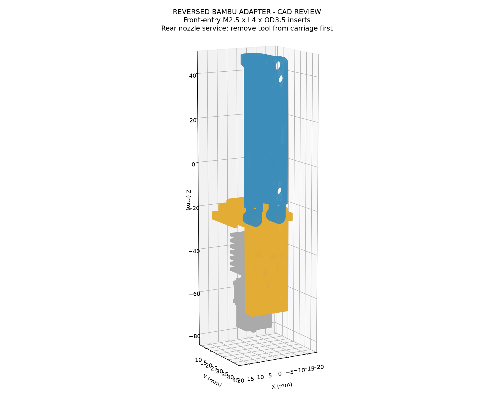

Three M2.5x10 low-head screws provide 4 mm engagement and protrude 1 mm
beyond the insert mouths. Maximum head envelope is OD4.5 x H1.7 mm.
The upper pair uses 0.5 mm washers, OD4.5/ID2.7 mm, to accommodate the
different counterbore depths. Two separate M2.5x20 shelf-clamp screws use
3 mm inserts; the fan does not clamp the tool together. The four original
vertical Red Lizard mounting holes are filled; the filament passage remains.
The user's 5 mm inserts are available but not needed for this layout.

**Service limitation:** rearward nozzle removal clears the new printed
mount in the exploratory sampled path, but collides with the core during
part of that path. Remove the tool from the carriage before a nozzle
change. Exact H2D latch motion, finger access and wiring are not certified
by this reconstructed reference. The reversed carrier is a separate
revision, not an overwrite of the saved Fusion V2 design.

Both printed parts are single connected, watertight meshes; the persisted
20-solid assembly reimports as valid. Static checks cover core, P18 and
P20-P24, including fastener-to-hotend clearance and complete hotend insert
shoulders/surrounds. No physical print, torque, thermal-creep, repeatability
or cooling qualification is implied.
All five screw paths clear the printed parts. The shelf-clamp heads have
front driver-access bores, and both shelf insert seats have complete
retaining shoulders. `_REVIEW_PRINT.stl` files are oriented with their
chosen planar faces toward the bed and minimum Z at zero; this is not
slicer/support qualification. The native Fusion V2 remains unchanged;
the reversed assembly is delivered as a separate STEP review.
See [`verification_bambu_reversed.json`](./verification_bambu_reversed.json).
Regenerate with
`python build_reversed_bambu_adapter.py --core-reference <identity-transformed-core.step>`.

**Rejected historical study: outboard carriage/dock cooling.**
`step/Carriage_And_Dock_Cooling_CONCEPT.step` and
`step/13_Reversed_Bambu_Full_Cooling_Review.step` exceed the required
45 mm lateral envelope and are not candidates for the ten-tool layout.
Do not use their side brackets or separate dock fans. The single,
tool-owned shroudless 2510 review above supersedes this direction.

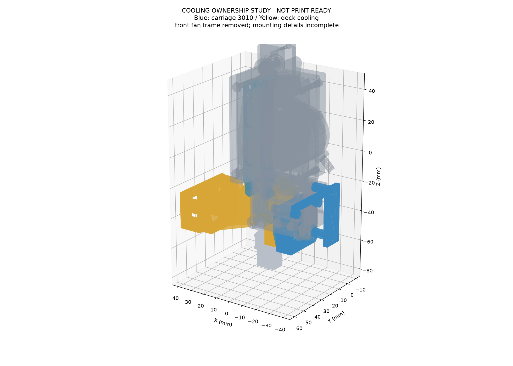

The rejected single 3010 had its center at `(-30, 36, -36) mm`, feeding
the left heatsink face through a short offset duct and leaves the front
open. The mirrored dock outlet feeds the right side. Both cooling units
clear the supplied core, P18, P20-P24 and reconstructed Bambu reference;
the dock cooling clears P25. A sampled 60 mm negative-Y carriage retreat
shows no cooling-to-cooling collision. A sampled 4 mm downward disengagement
followed by 40 mm forward nozzle withdrawal clears the new cooling parts.
These are exploratory paths, **not verified real latch/docking kinematics**.
The outboard support now clears the fan housing, with integral tubular
stand-offs toward the existing left carriage fastener axes. Two upper
M2.5x18 fan screws and the user's OD3.5 x L3 mm heatset envelopes are
included; there are no lower fan mounting fasteners. All cooling-part
pairs clear each other, and the sampled retreat also clears the parked
hotend reference and P25. The model deliberately retains mounting and
thermal qualification warnings rather than implying physical approval.

Substituting a 2510 at that same outboard center does not fix the envelope.
The briefly considered dual-2510 push-pull direction was also superseded
by the user's single tool-owned fan decision.

**Not installation-ready:** carriage stand-off contact/fastener engagement,
the dock bracket, yellow heating-assembly retention, rack pitch, complete
motion paths, cooling controls and thermal qualification remain unfinished.
Parked hot tools need dock cooling through standby and cooldown, plus a
heater interlock for cooling loss. No firmware control is implemented here.
Do not print the failed intermediate V4 adapters or treat the incomplete
side-2510 experiment as an accepted design.

Regenerate the study with
`python build_carriage_cooling_review.py --core-reference <identity-transformed-core.step>`.
See [`verification_carriage_cooling_review.json`](./verification_carriage_cooling_review.json)
for measured intersections, exploratory paths and explicit limitations.

**Current two-adapter revision: V2.** Open the saved Fusion design
`12_Two_Hotend_Adapters_V2_Review` for the Red Lizard assembly on the left
and Bambu assembly on the right. Both use the unchanged blue carrier from
the user-defined version 4 split and the restored YUDX guide. Fans are hidden
in the overview to expose the yellow adapters; they remain available in the
component tree. The assemblies are spaced 90 mm apart for comparison only.


| Interface | V2 implementation |
|---|---|
| Common blue/yellow joint | Four rear-entry M2 heatsets, OD3.2 x L2 mm, at the existing fan axes |
| Heatset pockets | Diameter2.8 mm provisional pilots, Y29..31; inserts pull into a 1.05 mm front retaining shoulder |
| Insert surround | At least 0.75 mm verified around the full installed OD envelope |
| Fan/joint screws | Four M2x18 with 0.5 mm thick, OD4.5 mm washers; 2 mm insert engagement |
| Red Lizard hotend | Original four M2.5x8 screws into the metal K1 heatsink; cylindrical clearance and original top pattern |
| Bambu hotend | Three M2.5x5 low-head screws, maximum head OD4.5 x H1.7 mm; rear-captured AF5 x 1.6 mm thin steel nuts |
| Bambu upper screw seating | Two OD4.5 x ID2.7 x 0.5 mm washers bridge the different ceramic counterbore depths; lower screw seats directly |
| Bambu nut shoulders | Complete 1.1 mm thick retaining wall; nuts draw forward into it rather than toward their rear openings |

The Bambu hotend-specific joint intentionally uses **captured nuts, not
heatsets**: normal inserts plus retaining shoulders do not fit its existing
2.8 mm wall. Both yellow adapters still contain the four shared heatsets.
No ceramic, heatsink, core, nozzle position, docking or CPAP geometry was
changed to force a fit. The forward compact inserts replace the earlier
long M2.5 scheme, which must not be used with these V2 adapters.

Install inserts and Bambu nuts from the rear with the adapter removed.
Mount the hotend before assembling the yellow adapter to the blue carrier,
so the Red Lizard top screws remain accessible. Finally install the fan and
four common screws. Do not overtighten the printed shoulders or ceramic;
torque limits require material/hardware testing.

**Current exports:** `step/P17M_RedLizard_Adapter_V2_REVIEW.step` and
`step/P17M_Bambu_Adapter_V2_REVIEW.step`, matching STL and `_PRINT.stl`
files, and separate `P17M_*_Hardware_V2_REVIEW.step` envelopes.
Regenerate with
`python build_two_hotend_adapters.py --core-reference <identity-transformed-core.step>`.
This reads the earlier common-carrier/Bambu review files as baselines and
does not overwrite them. The
[`V2 verification report`](./verification_two_hotend_adapters.json) records
zero new adapter/hardware interference with the supplied core, hotends,
fan, P18 and P20-P24; full insert/nut shoulders; screw-head seating; and
connected watertight meshes. Finite-shift mating contact is approximately
215 mm2 for Red Lizard and 206 mm2 for Bambu.

The inserts use a [commercially listed short M2 envelope](https://www.amazon.com/kvohlum-Threaded-Inserts-Nut/dp/B0D3B4VDH4).
[Low-head M2.5 dimensions](https://monsterbolts.com/pages/m2-5-bolt-size)
fit the modeled head envelope; verify the selected supplier's drawing.
Pilots still require print coupons. These remain **CAD review parts**:
no physical strength, thermal-creep, slicer/support or repeatability
qualification is implied. The narrow Bambu rear/core clearance and its
existing synthetic nozzle-tip discrepancy still require physical checks.

**Historical prototype notes below refer to the earlier M2.5 revision,
not the V2 hardware or adapters above.**


**Review prototype, not a print-qualified release.** This additive variant follows
the user's revised two-body construction in `09_Modular_Toolhead_3010_Review`
version 4, preserved in
[`P17_Modular_User_Revision_v4_Reference.step`](./step/P17_Modular_User_Revision_v4_Reference.step).
It does not overwrite the monolithic carriers or modify the printer master.
The refined Fusion document is **`11_User_Layout_Refined_3010`**, in
`SparkShift_Voron350_Master / 03_SparkShift_System`. The user's saved version 4
is untouched. `10_Modular_Toolhead_Cutout_Audit` is an earlier architecture,
not the current design reference.


- **Blue reusable carrier:** retains the upper coupling, filament feed and 3010
  fan frame. The lower frame retains its original outside envelope but replaces
  the overlapping K1 heatsink pocket and breached wire tunnels with one lofted
  airflow passage. The front frame remains only `3.88 mm` deep at the fan.
  The original blind fan holes become through clearance holes.
- **Yellow hotend-specific adapter:** retains the Bambu filament socket, heating
  assembly mounting wall, upper seating shelf and full-depth upper corner rails.
  Local lower rear recesses clear P22 and expose the lower insert seats. Two
  3 mm high side bridges support those lower seats; their effect on exhaust area
  still needs a cooling review.
- **Common interface:** shelf at `Z = -17.2794 mm`, front/rear seam at
  `Y = 32.05 mm`, four Y-axis screws at `X = +/-12 mm`,
  `Z = -49.50 / -25.50 mm`. Width remains `30 mm`. Future adapters must locate
  their nozzle at the intended `(0, 22.70, -78.88) mm` datum and independently
  satisfy cooling, wiring, thermal and collision constraints. Other hotends are
  not yet modeled or qualified.

The provisional joint uses **two upper M2.5 x 35 screws with 1 mm washers**
and **two lower M2.5 x 25 screws without washers**, through a 10 mm fan and the
carrier's `2.8 mm` holes, into short inserts installed **from the opposite, rear
side**, not the seam. Upper seats start at the rear rail face, `Y = 11.50 mm`;
lower recessed seats start at `Y = 20.30 mm` to avoid the CPAP plenum.
Adapter pilots are `3.2 mm` diameter and `4.0 mm` deep; the insert
envelope is **maximum 4.0 mm OD x 4.0 mm length**, leaving at least `0.75 mm`
nominal wall on the inboard side and `1.0 mm` outboard/vertically.
The narrow inboard wall needs an insert coupon and load test. These are **fit-study
dimensions, not a selected manufacturer's insert specification**. Select the
hardware and test an insert coupon before printing the adapter. The printed
shoulders have only a `2.8 mm` shank hole, with material extending from the
insert ends at `Y = 15.50 mm` (upper) / `24.30 mm` (lower) to the seam at
`Y = 32.05 mm`.
Tightening pulls the insert toward this shoulder and clamps the adapter and
carrier, rather than pulling it toward its installation opening. Nominal screw
engagement is `3.57 mm` upper and `3.37 mm` lower. This does not eliminate shoulder fracture, thread
stripping, installation damage or temperature-dependent creep. Extra washers,
gaskets or a different fan thickness require revisiting screw length. Fastener
envelopes are reference geometry, not thread-accurate hardware. The four screws
also retain the fan, so removing the adapter releases that fan; the upper carrier
does not need reprinting.

Print `P17M_Reusable_Carrier_3010_REVIEW_PRINT.stl` front-face down and
`P17M_Bambu_Adapter_3010_REVIEW_PRINT.stl` rear-face down. These exports are
already rotated onto the bed. Nominal bed contact is approximately `1,238 mm2`
and `953 mm2`, respectively. Recessed ledges and horizontal bores still require
a slicer/support review. Keep the mating faces free of support damage and
elephant-foot interference. The stepped shoulder seats the adapter, but clearance
screws do not provide precision X registration: do not assume repeatable nozzle
offsets after adapter changes. Layer adhesion, insert pullout, fan-frame
compression, chamber-temperature creep and the existing three Bambu mounting
holes' retention remain unqualified.

#### Circled-cutout audit

| Concern | Disposition |
| :--- | :--- |
| Large central opening and upper/lower filament guide lips | **Restored from YUDX.** The custom rectangular opening and extra `4.9 mm` bore reliefs had removed the close filament guides. The upstream curved hob opening and `2.3 mm` guide bore are restored locally, with `0.65 mm` tapers to the existing `3.6 mm` bore at the replacement boundaries. Upper geometry outside that region is unchanged. |
| Cam-hook pocket, magnet pockets and epoxy-lock undercuts | **Retained.** Functional locking and coupling geometry; not filled for appearance. |
| Small crescents below the two lower backplate attachment holes | Holes are retained at their original centers and diameter; the lower frame is rebuilt without intersecting legacy wire cavities. |
| Narrow openings next to the stem/fan transition | The functional central stem wire trough is retained; the fragmented lower tunnel geometry is removed. |
| Triangular bites around the fan aperture | **Removed.** A single round-to-rounded-rectangle loft replaces the overlapping K1 bore, bellmouth and tunnel cuts. |
| Tiny nick on the adapter side crossbar | Obsolete K1-pocket remnants are filled. The rear apron and sidebar now share the same `+/-9.25 mm` edge, eliminating the separate `0.05 mm` lower transition step. Existing mounting holes and screw-tip relief dimples are retained. |
| Side wiring | Fragmented tunnels are removed from the thin blue frame. The yellow cradle still carries legacy internal reliefs; a complete cable route, exit bends and strain relief need a separate fit check. |
| Four adapter insert seats | Rear-entry stepped seats with complete printed shoulders; no crescent-shaped access skins. |


Guide source: Dumpling Lab [YUDX `CAD/Tool.step`](https://github.com/dumplinglab/YUDX-tool-changer/blob/52e8ef6e04b93c1fa63bea4beb5c3a67a4b704aa/CAD/Tool.step),
commit `52e8ef6e04b93c1fa63bea4beb5c3a67a4b704aa`, under the existing
GPL-3.0 attribution. The cropped reference is
`step/P17_YUDX_Hob_Guide_Reference.step`. Alignment is a 180-degree Y rotation,
then translation `(0, 37.98, 31.24) mm`, matching the filament axis and paired
upper/lower coupling-hole Z datums. Only the local
`X = +/-3.1, Y = 19..26.1, Z = -8.3..8.5 mm` region is replaced.
This is a geometry restoration, not physical qualification of hob-to-filament
engagement or printed guide tolerances.

**Hotend mounting blocker found during this audit:** the existing three Bambu
`M3` holes pass through only `2.8 mm` of rear wall, with approximately `0.1 mm`
clearance to the live core carriage. A normal `4 mm` rear insert plus a retaining
shoulder cannot fit there. Rear boss extensions were checked and rejected because
they collide with the core; they are **not** included in the saved model.
Those three holes remain unchanged and are **not an approved fastener joint**.
The modular fan joint now follows the opposite-side insert requirement, but the
hotend mount needs a separate retention redesign before printing. The existing
lower Bambu screw-head reference also overlaps the synthetic sock by about
`0.224 mm3`; verify actual screw-head/sock clearance rather than cutting the
vendor part speculatively.

Regenerate with `python build_modular_toolhead.py` from this directory
(CadQuery 2.8 and trimesh required). STEP and assembled-coordinate STL outputs
are under `step/` and `stl/`; `_PRINT.stl` files are printing orientations.
[`verification_modular_toolhead.json`](./verification_modular_toolhead.json)
records solid/mesh connectivity, shared fastener paths, full insert shoulders,
upper-interface preservation and interference with P20-P24, P18, the fan and
the existing Bambu hotend reference. Pass
`--core-reference <identity-transformed-core.step>` to additionally compare
against the live core carriage (used for this audit). The new fastener envelopes stay
above the existing Beacon/Cartographer 20 mm top-metal keepout's Z range.
This does **not** requalify the complete printer's motion envelope, all sensor
variants or material performance.

**Existing nozzle-model discrepancy:** the intended nozzle datum remains
`Z = -78.88 mm`, but the current synthetic Bambu STEP ends near `-78.13 mm`.
Its through-bore removes the narrow end of the modeled tip. This review leaves
that reference and the CPAP geometry unchanged; physical nozzle alignment must
be confirmed before treating the earlier exact-tip claim as verified.
Revision 37 restores the reference tip at the datum.

**Two-adapter feasibility audit (not a completed adapter set):** the installed
Red Lizard assembly is preserved in
`step/P17M_RedLizard_Hotend_Reference.step`. Its heatsink conflicts with the
current long-through-fan M2.5 fasteners: each lower insert envelope overlaps
the reference by approximately `7.155 mm3`, and the upper bolt shanks also
clip the heatsink. Do not copy the Bambu rail seats onto a Red Lizard adapter
and assume compatibility. The original four top screws engage the metal
K1 heatsink; these metal threads do not require printed heatset seats.

A shorter M2 fastener/forward-seat alternative clears the hotend reference
in an envelope-only check, but its insert hardware, printed shoulders,
surrounding material and assembly access remain unqualified. It is not
implemented, and it does not solve the independent Bambu M3 retention
blocker above. The common carrier and saved Fusion refinement were left
unchanged rather than replacing them with an unverified two-adapter design.
See [`verification_two_adapter_feasibility.json`](./verification_two_adapter_feasibility.json).

---

## 4. X-Edge Gantry Keepouts, Thermal Clearance & 3D CFD (`P20`–`P22`)

| 3D CFD Internal Streamlines & Velocity (`Q = 18 CFM`) | Dual Crescent Nozzle Jets & Thermal Keepout (`≥ 4.65 mm`) |
| :---: | :---: |
|  |  |

### 4.1 Pure-Primitive Aerodynamic CPAP Path, Smooth `R = 61 mm` Elbow & Shingle Slip-Joints
- **Edge-Tapered Rear Gantry Corridor (`corridor_aero_vertices`):** Fits cleanly behind the Monolith 2WD 9mm carbon X-beam (`Y <= -33.20 mm`) and inside the 45° X-limit XY-joint chamfers (`GANTRY_Body4..9`, `0.000 mm³` clash across all 39 gantry bodies) with **`353.40 mm²`** internal flow area. Revision-40 note: in the user's Monolith gantry model the beam's rear face is at exactly `Y = -33.20`, so the conduit is nominally in contact with it (see [revision 40](#p20-to-p21-screws-and-two-design-notes-revision-40)).
- **Step-Free Directional Shingle Slip-Joints (`0.18 mm` radial slip clearance, `0.00 mm` internal bore step):**
  - **`P20 -> P21` (`Z = -17.78..-21.58 mm`):** `P20`'s `3.80 mm` continuous 360° inner male sleeve telescopes flush inside `P21`'s top female socket (`corridor_aero_vertices(1.84)`).
  - **`P21 -> P22` (`Z = -49.00..-51.40 mm`):** Raised right below the 2020 X-axis extrusion (`Z = -47.78 mm`) so `P21`'s `2.40 mm` lower inner male sleeve telescopes flush inside `P22`'s top female collar (`Z = -51.40 mm`), initiating a long **`R = 61.0 mm` inner / `R = 50.0 mm` outer circular elbow sweep** (`R = 14.8 / 16.0 mm` rear heel) and a **100% flat, obstacle-free `Z = -68.90 mm` plenum floor** (`1.20 mm` solid continuous wall above the `Z = -73.00..-70.10 mm` heat-set insert pockets, with zero protruding floor pucks or ledges).
- **Exact 3D Constant-Distance Thermal Keepout (`P22` & `P23`):**
  - Analytically cut with cylindrical offsets providing **`≥ 4.65 mm` 3D Euclidean clearance** around the entire **Volcano silicone sock** (`X ∈ [-7.00, +7.00], Y ∈ [12.95, 38.45], Z ∈ [-74.35, -59.50] mm`) and **`≥ 5.90 mm` clearance** from the bare `350 °C` Volcano aluminum heatblock — preventing ABS/ASA radiant heat softening while directing 100% of the cooling jet (`25.9 m/s` mean velocity at `18 CFM`) below the sock onto the nozzle tip (`Z = -78.88 mm`).

### 4.2 3D CFD Summary (`cfd_simulation_v26.json`)

> **Superseded.** These figures came from the v26 analytic model, not a flow solver, and they
> understate the duct's losses many times over. Use the OpenFOAM results in
> [CPAP airflow CFD (revision 41)](#cpap-airflow-cfd-revision-41).
| Station / Metric | Flow Area (`mm²`) | Mean Velocity (`m/s`) | Peak Velocity (`m/s`) | Dynamic Pressure (`Pa`) |
| :--- | :---: | :---: | :---: | :---: |
| **1. `P20` Hose Spigot Inlet (`Z = +24 mm`)** | `380.13` | `22.36` | `29.80` | `296.0` |
| **2. `P20` S-Bend Transition (`Z = 0 mm`)** | `356.40` | `23.85` | `29.80` | `336.7` |
| **3. `P21` Rear Gantry Trunk (`Z = -38 mm`)** | `353.40` | `24.05` | `26.94` | `342.5` |
| **4. `P22` Sweeping Rear Elbow (`Z = -66 mm`)** | `358.50` | `23.71` | `26.56` | `332.8` |
| **5. `P22` Over-Sensor Runners (`Y = 0 mm`)** | `368.40` | `23.07` | `25.84` | `315.2` |
| **6. `P22` Dual Sub-Sock Nozzle Outlets** | `328.00` | `25.91` | `29.02` | `397.6` |
| **Total Static Backpressure (`@ 18 CFM`)** | — | — | — | **`542.5 Pa`** (`81.0%` margin on `2,850 Pa` blower) |

---

## 5. Multi-Angle VTK & Live Fusion 360 Inspection Gallery (`images/01`–`24`)

| `21` Complete Voron 2.4 350mm Master XRef (`00_Complete_Printer_Voron24_350_SparkShift`) | `22` Front 10-Dock Array (`T0`–`T9`) & Active SparkShift at Bay `T3` |
| :---: | :---: |
|  |  |
| **`23` Rear-Interior View (Monolith 2WD 9mm Gantry + 10-Bay Dock Bar)** | **`24` Modular Primary SparkShift XRef (`04_Assembled_SparkShift_Primary`)** |
|  |  |
| **`18` Full-System Exploded View with Gantry (Front-Right Iso)** | **`19` Full-System Exploded View with Gantry (Rear-Left Iso)** |
|  |  |
| **`20` Live Fusion 360 Section (`X = ±15.80 mm`) — Smooth `R = 61 mm` Sweep & Flat Floor** | **`17` Live Fusion 360 Shaded with Visible Edges** |
|  |  |
| **`01` Rear-Right Iso (Complete Assembly)** | **`02` Rear-Left Iso (Complete Assembly)** |
| :---: | :---: |
|  |  |
| **`03` Right Side Gantry & Beacon Keepout Cone** | **`04` Lower Beacon & Dual Nozzle Jets Close-up** |
|  |  |
| **`05` Ghost Shell Internal CPAP Air Domain** | **`06` Isolated Accessory Suite (`P20`–`P24` + EBB42 + Beacon)** |
|  |  |
| **`07` Front-3/4 CPAP Inlet vs. Nozzle Outlets** | **`10` Bottom-Up Thermal Keepout & Sealed Plenum Floor** |
|  |  |
| **`11` Top-Down `P20` Bore Fairing & Co-Bolted EBB42 Wings** | **`12` Trianglelab 7040 Multi-Barb Spigot Close-up** |
|  |  |

---

## 6. Bill of Materials, Print Settings & Assembly Sequence

### Recommended Print Settings
- **Material:** ABS or ASA (GF-ABS / CF-ABS recommended for `P22_CPAP_Lower_Plenum` and `P17_HF_tool_carrier_3010` for maximum thermal stability near the hotend).
- **Layer Height:** `0.20 mm` (`0.40 mm` nozzle).
- **Perimeters / Walls:** `4` walls (`1.60 mm`).
- **Infill:** `40–60%` Gyroid or Cubic.

### Fasteners & Heat-Set Inserts BOM
- **Voron-standard M3×4×4.6 Heat-Set Inserts (`12×`):**
  - `2×` in `P21_CPAP_Gantry_Bridge` top flange (`(±4.50, -31.20, -17.78)`; the model's inserts are M3 × 3 mm; revision 40: `(±5.50, -30.20)`)
  - `2×` in `P21_CPAP_Gantry_Bridge` upper bridge saddle (`(±6.00, -15.80, -18.40)`)
  - `2×` in `P01_Drive_Frame` front upper bosses (`(±18.00, +11.90..15.90, -52.78)`; revision-31 review: `Z = -54.28`)
  - `4×` in `P22_CPAP_Lower_Plenum` bottom registering spigots (`(±15.80, +8.50, -70.80)` & `(±15.80, -11.50, -70.80)`; revision-37 review: `4× M3 × 3 mm` inserts at `(±15.80, -0.30)` & `(±15.80, -19.50)`)
  - `2×` in `P24_EBB42_Controller_Mount` upper standoffs (`(-16.748, -21.40, +22.00)` & `(+14.252, -21.40, +22.00)`; revision 41: `4×` M3 × 4 mm, OD 4.2, at all four corners of `P24_EBB42_Frame_Mount`, `Y = -22.60..-18.60`, pressed in from the side that faces P02)
- **M3 Hex Nuts (`2×`):**
  - `2×` captive in `P23_Beacon_Cartographer_Mount` side slots (`(±15.80, -0.30, -72.55)`) for Beacon H or Cartographer V3 (none in the revision-37 review)
- **M3 Socket Head Cap Screws (`18×`):**
  - `2× M3×8 SHCS` — `P20` rear lugs down into `P21` (`(±4.50, -31.20)`; revision 40: ISO 7380 button heads at `(±5.50, -30.20)`, seated at `Z = -15.80` in the lugs, under the EBB42)
  - `2× M3×8 SHCS` — `P24` lower horizontal foot down into `P21` upper bridge (`(±6.00, -15.80)`)
  - `2× M3×10 SHCS` — `P22` front upper cheeks into `P01` (`(±18.00, -52.78)`; revision-31 review: `Z = -54.28`; revision 41: `M3×8` ISO 7380 button heads seated on the cheeks' front faces, no counterbore)
  - `4× M3×8 SHCS` — `P23` upward into `P22` (`(±15.80, +8.50)` & `(±15.80, -11.50)`; revision-37 review: `2× M3×4` ISO 7380 button heads on the rear ears at `(±15.80, -19.50)`)
  - `2× M3×8 Low-Profile SHCS` — Beacon H Normal or Cartographer V3 into `P23` (`(±15.80, -0.30)`; revision-37 review: `M3×6` low-profile through `P23` into `P22` inserts; revision 42: `M3×5` for the Cartographer on its own `P23`)
  - `2× M3×12 SHCS` — `P24` lower EBB42 standoffs (`Z = -9.00 mm`, from rear through `P24` into EBB42 pre-soldered standoffs; revision 41: `M3×14` from behind the board into P24's lower inserts)
  - `2× M3×18 SHCS` — `P20` upper wings through EBB42 upper mounting holes into `P24` upper inserts (`Z = +22.00 mm`; revision 41: the same length reaches through the moved inserts)
  - `2× M3×14 SHCS` — `3010` or `2510` axial fan to `P17` lower mounting holes (`Z = -50.00 mm`)

---

## 7. Klipper Configuration, Anti-Ooze Toolchange Macros, Pressure Advance & Input Shaping ([`klipper/sparkshift_toolchanger.cfg`](../../klipper/sparkshift_toolchanger.cfg))

The complete Klipper macro suite in [`klipper/sparkshift_toolchanger.cfg`](../../klipper/sparkshift_toolchanger.cfg) manages all physical and firmware steps required between toolchanges on SparkShift's **Single-HGX-Drive / Multi-Hotend** architecture:

1. **Stage 1 — Pre-Drop Melt-Zone Decompression (`_SPARKSHIFT_PRE_DROP`):**
   - Because SparkShift keeps one HGX drive on the carriage while leaving the filament strand in the parked toolhead, the macro retracts **`5.0 mm` at `45 mm/s`** *before* opening the `P05` servo cam (`175°`), relieving pressure in the `22 mm` Volcano melt zone and pulsing a `40%` CPAP burst to freeze the molten meniscus.
2. **Stage 2 — Spring-Leaf Silicone Ooze-Pad Sealing & Cam Release (`_SPARKSHIFT_DROP_TOOL`):**
   - Slides the toolhead into `P25_SparkShift_3010_Dock` (`Y = 36.91 mm`), where the brass Volcano nozzle tip (`Z = -78.88 mm`) glides up the `15°` ramp onto the **spring-compliant red Silicone Ooze Stopper Pad**, sealing the orifice while dropping the hotend to `standby_temp` (`150–175 °C`).
3. **Stage 3 — Tool Pickup & Hob-Seating Micro-Pulse (`_SPARKSHIFT_PICKUP_TOOL`):**
   - Enters `T_new`'s dock with `sparkshift_cam` at `175°` (`2.73 mm` release gap), closes the cam to `0°`, disables continuous servo PWM (`WIDTH=0`) so the mechanical closing spring holds the HGX hobs without servo heat drift, finishes heating while sealed on the silicone pad, and advances `+0.40 mm` to seat the hob teeth before unlatching.
4. **Stage 4 — Purge-Chute Prime & Dual-Blade Silicone Wiper Scrub (`SPARKSHIFT_CLEAN_NOZZLE`):**
   - Steps back `6.5 mm` to center the nozzle directly over **`P26_Dock_Nozzle_Wiper_and_Purge_Chute`'s Purge Drop Window (`Y_local = 16.20 mm`)**, primes `5.4 mm` of filament, micro-retracts `0.7 mm`, blasts `75%` CPAP to solidify the pellet, and runs `3` high-speed `±6.5 mm` X-scrub strokes across `P26`'s **dual V-notched silicone wiper blades** (`Y_local = 10.70 mm`, `>= 1.03 mm` below `P22` and `>= 2.27 mm` below Beacon RevH; `2.60 mm` with the revision-37 `P23`).
5. **Stage 5 — Dynamic Per-Tool Parameter Sync (`_SPARKSHIFT_APPLY_TOOL_PARAMS`):**
   - Automatically switches **`SET_PRESSURE_ADVANCE`** (`advance` + `smooth_time` per nozzle diameter/material), **`SET_RETRACTION`**, **`SET_INPUT_SHAPER`**, **`SET_GCODE_OFFSET`** (combining static XYZ tool offsets with dynamic Volcano thermal Z-expansion `0.00035 mm/°C`), and **`M106` CPAP blower scaling**.

### Option A — Beacon H (Normal) on Shared Forward Mount (`(±15.80, -0.30, -75.00)`)
```ini
[beacon]
serial: /dev/serial/by-id/usb-Beacon_Beacon_RevH_...
x_offset: 0.0
# Coil centre 19.50 mm behind the nozzle (+Y, toward the rear): probe = nozzle + offset
y_offset: 19.50
# Coil bottom is 2.269 mm above nozzle tip (Z = -76.610 vs -78.879 mm); 2.60 mm with the revision-37 P23
mesh_main_direction: x
mesh_runs: 2

[resonance_tester]
accel_chip: beacon
probe_points: 175, 175, 20
```

### Option B — Cartographer Probe v3 (Flat Pack, CAN/USB) on Shared Forward Mount (`(±15.80, -0.30, -75.00)`)
```ini
[cartographer]
canbus_uuid: <your_cartographer_uuid>
x_offset: 0.0
# Coil centre 19.82 mm behind the nozzle (+Y, toward the rear): probe = nozzle + offset
y_offset: 19.82
# Coil bottom is 2.279 mm above nozzle tip (Z = -76.600 vs -78.879 mm); 2.61 mm with the revision-37 P23,
# 2.81 mm with the revision-42 Cartographer P23

[adxl345 cartographer]
cs_pin: cartographer:PA3
spi_bus: spi1
axes_map: x, y, z

[resonance_tester]
accel_chip: adxl345 cartographer
probe_points: 175, 175, 20
```

### Upper-Frame Redundant Accelerometer & RGB LEDs — BTT EBB42 CAN V1.2
```ini
[adxl345 ebb42]
cs_pin: EBBCan:PB12
spi_software_sclk_pin: EBBCan:PB10
spi_software_mosi_pin: EBBCan:PB11
spi_software_miso_pin: EBBCan:PB2
axes_map: -z, -y, -x

[neopixel toolhead_leds]
pin: EBBCan:PD3
chain_count: 3
color_order: GRBW
initial_RED: 0.2
initial_GREEN: 0.2
initial_BLUE: 0.2
initial_WHITE: 0.5
```

---

## 8. Modular Nested-XRef Fusion 360 Cloud Project Architecture (`SparkShift_Voron350_Master`)

To assemble the complete **Voron 2.4R2 350mm** printer while keeping every subsystem independently editable and staying within Fusion 360's **10-editable-document Personal Use limit**, the project is organized as a 3-tier External Reference (**XRef**) hierarchy inside the **`SparkShift_Voron350_Master`** cloud project:


### 8.1 Cloud Folder & Document Table (`SparkShift_Voron350_Master`)

| Cloud Folder | Document Name | Default State | Linked Children / Sub-Components | Coordinate Frame & Placement |
| :--- | :--- | :---: | :--- | :--- |
| `(Project Root)` | **`00_Complete_Printer_Voron24_350_SparkShift`** | **Editable** | Links `01`, `02`, `03`, `04` (`1×`), and `07` (`9×`) | Voron 350 World Frame (`X ∈ [0, 350]`, `-Y` Front Door) |
| `01_Printer_and_Gantry` | **`01_Voron24_350_Frame_and_Enclosure`** | `Read-Only` | `Bed`, `Door_buffer`, `Enclosure_panels_and_door` (`12%` opacity), `Frame_extrusions` (`26` bodies) | Voron 350 World Origin `(0, 0, 0)` |
| `01_Printer_and_Gantry` | **`02_Monolith_2WD_9mm_Gantry_System`** | `Read-Only` | `Flying_Gantry` + `X_Gantry` (`347` bodies, 2020 X-beam at `Y = 208.23, Z = 153.50 mm`) | Voron 350 World Origin `(0, 0, 0)` |
| `02_Dock_System` | **`03_Front_Dock_Rack_and_Docks`** | `Read-Only` | `Front_Dock_2020_Crossbar_and_P29_Mounts` (`27` bodies: `P29_L`, `P29_R`, `420 mm` `2020` crossbar, `12× M5×10 BHCS`, `12× T-nuts`) + `10×` linked `08_SparkShift_Dock_Unit_3010` | `R_Z(180°)` at `X_i = 7.0 + 37.3·i mm` (`i = 0..9`), `Y = 36.91, Z = 191.28 mm` |
| `02_Dock_System` | **`08_SparkShift_Dock_Unit_3010`** ([`Dock_3010_Complete.step`](./step/Dock_3010_Complete.step)) | `Read-Only` | `P25_SparkShift_3010_Dock_Body` (stilt-free `Z = -86.08..+37.22 mm`), `P26_Dock_Nozzle_Wiper_Chute` (flush `Z = -92.08..-78.80 mm`), `Silicone_Ooze_Stopper_Pad`, `Silicone_Dual_Wiper_Blade`, `Latch_Roller_Switch_Upper/Lower`, `2× M5x12_Rack_Screw`, `2× M3x10_SHCS_Wiper` (`10` bodies, `34.0 mm` width, `0.000 mm³` clash with `3010` toolhead) | SparkShift Local Toolhead Frame |
| `03_SparkShift_System` | **`04_Assembled_SparkShift_Primary`** | `Read-Only` | Links `05_SparkShift_Core_Carriage_v26j` + `06_SparkShift_Accessories_v26` + `07_SparkShift_Toolhead_3010_Assembly` | SparkShift Local Frame (placed in `00` via `R_Z(180°)` at `X = 118.90, Y = 185.03, Z = 191.28 mm`) |
| `03_SparkShift_System` | **`05_SparkShift_Core_Carriage_v26j`** | `Read-Only` | `13` sub-components (`P01`–`P16` + carriage hardware, `101` bodies) | SparkShift Local Frame |
| `03_SparkShift_System` | **`06_SparkShift_Accessories_v26`** | `Read-Only` | `8` sub-components (`P20`–`P24`, `Beacon RevH`, `BTT EBB42`, `Sensor Cable`, `Fasteners`, `145` bodies) | SparkShift Local Frame |
| `03_SparkShift_System` | **`07_SparkShift_Toolhead_3010_Assembly`** | `Read-Only` | `5` sub-components (`P17_HF_tool_carrier_3010`, `P18_Tool_docking_backplate_3010`, `3010_Axial_Fan`, `Volcano_Hotend`, `Silicone_Sock`, `37` bodies) | SparkShift Local Frame (parked in `00` via `R_Z(180°)` at `X_i = 7.0 + 37.3·i mm, Y = 36.91, Z = 191.28 mm`) |

### 8.2 Individual Component Update Workflow (Managing the 10-Editable-Document Limit)
1. **Open the leaf module you want to edit** (for example, `07_SparkShift_Toolhead_3010_Assembly` or `06_SparkShift_Accessories_v26` inside `03_SparkShift_System`).
2. Toggle the document from **Read-Only** to **Editable** in the top bar (or via `ui.commandDefinitions.itemById("ActiveDocumentActivateCommand").execute()`).
3. Make your CAD/appearance changes and **Save** (`Ctrl+S`), creating a new cloud version (`vN+1`).
4. Toggle the leaf document back to **Read-Only** (`ui.commandDefinitions.itemById("ActiveDocumentDeactivateCommand").execute()`) to free its editable slot.
5. Open **`00_Complete_Printer_Voron24_350_SparkShift`** (or `04_Assembled_SparkShift_Primary` if updating an intermediate sub-assembly) and click the yellow **Get All Latest** link icon in the toolbar (`UpdateAllReferencesCmd`) to pull the updated geometry across all linked instances automatically.
