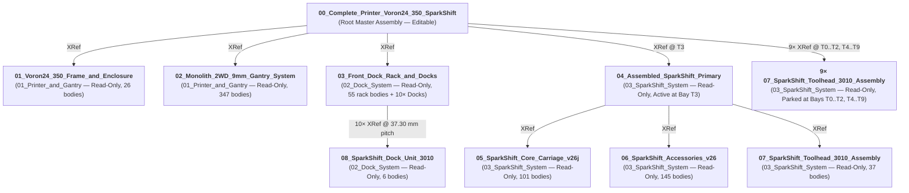

# SparkShift v26 Accessory & 3010 Toolhead Suite — Beacon RevH / Cartographer V3, Pure-Primitive CPAP Ducting, BTT EBB42 CAN Mount & 3010/2510 High-Flow Toolhead Carriers

This directory contains the parametric OpenCASCADE (`OCP`) CAD generator (`build_and_verify_accessories_v26.py`), 3D finite-volume CFD solver (`simulate_cpap_cfd_v26.py`), VTK multi-angle renderer (`render_accessories_v26.py`), animated GIF generator (`animate_accessories_v26.py`), and manufacturing-ready **STEP (`.step`)** and **binary STL (`.stl`)** files for the **SparkShift v26** accessory and toolhead cooling suite on a **Voron 2.4R2 350 with a Monolith 2WD 9mm gantry**.

All **8 printable parts** (`P20`–`P24`, `P17_HF_tool_carrier_3010`, `P17_HF_tool_carrier_2510`, and `P18_Tool_docking_backplate_3010`) are constructed **100% from pure analytical CAD primitives** (`GeomAbs_Plane`, `GeomAbs_Cylinder`, `GeomAbs_Cone` — **`0` BSpline/mesh/sphere faces** and **`0` sliver faces `< 0.15 mm²`**) and mount to the existing **SparkShift AHG v26** carriage with **zero modifications (`0.000 mm³` cut/clash)** to any of the 135 existing v26 bodies.

---

## Animated Overview & Live Fusion 360 Inspection

| 360° Full Assembly Turntable | Exploded Assembly Sequence |
| :---: | :---: |
|  |  |
| **3010 Toolhead Docking & 21.8 mm NEMA14 Clearance** | **All 8 Pure-Primitive Printable Parts (360° Showcase)** |
|  |  |


---

## 1. Pure-Primitive Geometric & Topological Audit (All 8 Printable Parts)

Every printable part was audited at the OpenCASCADE B-Rep face/edge level and at the triangulated binary STL level (`verification_accessories_v26.json`) to guarantee **zero mesh facets, zero BSpline surfaces, zero non-manifold edges, and zero microscopic sliver faces (`< 0.15 mm²`)**:

| Part | STEP / STL Files | Solids / Shells | Volume (`mm³`) | Analytical Face Breakdown (`0` BSpline) | Min Face Area (`mm²`) | Bounding Box (`[Xmin, Ymin, Zmin] .. [Xmax, Ymax, Zmax]`) | Watertight Manifold / Clash |
| :--- | :--- | :---: | :---: | :--- | :---: | :--- | :---: |
| **`P20`** | [`P20_CPAP_Hose_Inlet`](./step/P20_CPAP_Hose_Inlet.step) ([STL](./stl/P20_CPAP_Hose_Inlet.stl)) | `1 / 1` | `7,900.87` | `172` (`86` Plane, `75` Cyl, `11` Cone) | `0.4721` | `[-20.60, -59.35, -21.58] .. [20.60, -27.60, 30.00]` | `True` / `0.000 mm³` |
| **`P21`** | [`P21_CPAP_Gantry_Bridge`](./step/P21_CPAP_Gantry_Bridge.step) ([STL](./stl/P21_CPAP_Gantry_Bridge.stl)) | `1 / 1` | `10,184.03` | `135` (`75` Plane, `60` Cyl) | `0.5508` | `[-21.00, -45.40, -51.40] .. [21.00, 0.30, -17.78]` | `True` / `0.000 mm³` |
| **`P22`** | [`P22_CPAP_Lower_Plenum`](./step/P22_CPAP_Lower_Plenum.step) ([STL](./stl/P22_CPAP_Lower_Plenum.stl)) | `1 / 1` | `18,435.18` | `214` (`118` Plane, `96` Cyl) | `0.4738` | `[-22.42, -45.40, -77.85] .. [22.42, 35.20, -48.00]` | `True` / `0.000 mm³` |
| **`P23`** | [`P23_Beacon_Cartographer_Mount`](./step/P23_Beacon_Cartographer_Mount.step) ([STL](./stl/P23_Beacon_Cartographer_Mount.stl)) | `1 / 1` | `2,397.87` | `56` (`34` Plane, `22` Cyl) | `3.2287` | `[-19.20, -14.20, -75.00] .. [19.20, 11.55, -70.80]` | `True` / `0.000 mm³` |
| **`P24`** | [`P24_EBB42_Controller_Mount`](./step/P24_EBB42_Controller_Mount.step) ([STL](./stl/P24_EBB42_Controller_Mount.stl)) | `1 / 1` | `8,762.85` | `196` (`107` Plane, `89` Cyl) | `0.1702` | `[-21.80, -25.40, -18.40] .. [22.10, -2.50, 51.20]` | `True` / `0.000 mm³` |
| **`P17 (3010)`** | [`P17_HF_tool_carrier_3010`](./step/P17_HF_tool_carrier_3010.step) ([STL](./stl/P17_HF_tool_carrier_3010.stl)) | `1 / 1` | `11,656.13` | `270` (`164` Plane, `102` Cyl, `4` Cone) | `0.2752` | `[-15.00, 11.50, -52.50] .. [15.00, 35.93, 48.74]` | `True` / `0.000 mm³` |
| **`P17 (2510)`** | [`P17_HF_tool_carrier_2510`](./step/P17_HF_tool_carrier_2510.step) ([STL](./stl/P17_HF_tool_carrier_2510.stl)) | `1 / 1` | `11,098.13` | `245` (`142` Plane, `99` Cyl, `4` Cone) | `0.4088` | `[-12.40, 11.50, -51.80] .. [12.40, 35.93, 48.74]` | `True` / `0.000 mm³` |
| **`P18 (3010)`** | [`P18_Tool_docking_backplate_3010`](./step/P18_Tool_docking_backplate_3010.step) ([STL](./stl/P18_Tool_docking_backplate_3010.stl)) | `1 / 1` | `2,718.87` | `70` (`52` Plane, `18` Cyl) | `1.4000` | `[-10.01, 35.93, -22.45] .. [10.03, 45.02, 48.75]` | `True` / `0.000 mm³` |

---

## 2. Hardware Supported & Clearance Audits

### 2.1 Eddy-Current Probes & Input Shaping Accelerometers (`P23_Beacon_Cartographer_Mount`)
1. **Beacon H — Variation: Normal (`6ft` Right-Angle USB Cable)**
   - Mounted **forward-facing** (`+Y` coil toward the nozzle, `-Y` USB dome at the rear) on `P23` (`(±15.80, -0.30, -75.00) mm`).
   - Coil sensing bottom sits at **`(0.00, +3.20, -76.61) mm`** (**`2.269 mm`** above the `Z = -78.879 mm` nozzle tip, reducing nozzle-to-coil Y offset to **`19.50 mm`**).
   - Built-in **16 kHz 3-axis accelerometer** aligned with toolhead `X/Y/Z` axes.
2. **Cartographer Probe v3 with ADXL345 — Flat Pack (CAN & USB)**
   - Mounted **forward-facing** (`+Y` coil toward the nozzle, `-Y` MCU/JST at the rear) on the exact same shared `P23` mount holes (`(±15.80, -0.30, -75.00) mm`).
   - Coil sensing bottom sits at **`(0.00, +2.88, -76.60) mm`** (**`2.279 mm`** above the nozzle tip, `19.82 mm` Y offset).
   - Built-in **ADXL345 accelerometer** for Klipper input shaping (`axes_map: x, y, z`).
   - Rear cable exits `-Y` (`(0, -12.9, -66.5)`) and rises behind the MGN12H carriage (`Y = -20.5`), under the X-beam (`Z = -55.2`), and up `P21`'s center-front raceway (`X = 0, Y = -34.5`) directly to `EBB42`.

### 2.2 BTT EBB42 CAN V1.2 Controller & Connector / RGB LED Pin Accessibility (`P24_EBB42_Controller_Mount`)
- Mounted vertically behind `P02_Upper_Body` on `P24_EBB42_Controller_Mount`, **rotated (`R_X(+90°)` × `R_Y(180°)`)** so the 4-pin MicroFit 3.0 CAN+Power header and USB-C port face **UP (`+Z`)** and **flipped** so all JST connectors face **FORWARD (`+Y`)** into the protected wiring bay (`Y = -31.63 to -20.00 mm`), keeping all wiring narrower than the `45 mm` toolhead envelope (`31.0 × 31.0 mm` M3 standoff grid at `X ∈ {-16.748, +14.252}, Z ∈ {-9.00, +22.00}`).
- **Co-Bolted Upper Structural Tie (`Y = -32.26 mm`):** The upper two EBB42 mounting screws (`M3×18 SHCS` at `X = -16.748` and `+14.252 mm, Z = +22.00 mm`) pass from the rear through `P20`'s upper mounting wings, through the EBB42 PCB mounting holes, and thread directly into `4.6 mm` M3 heat-set inserts inside `P24`'s upper standoffs — structurally locking the upper CPAP inlet and EBB42 mount together.
- **Full Connector & LED Header Accessibility Audit:**
  - **Top Edge (`Z = +26.5 mm`, facing `+Z`):** 4-pin Molex MicroFit 3.0 (24V + CAN H/L), USB-C port, and green screw terminal (`Heater HE0`) are 100% open from above (`+Z`).
  - **Left Edge (`X = +14.25..+18.75 mm`, facing `+Y/+X`):** **3-pin RGB / Neopixel LED header (`PD3` / `5V` / `GND`)**, `I2C` header, and `Probe` header are 100% unobstructed (`P24` frame stays at `X <= +11.00 mm` along the mid-span).
  - **Right Edge (`X = -21.25..-16.75 mm`, facing `+Y/-X`):** Dual 2-pin fan headers (`FAN0`, `FAN1` for the 3010 heatsink fan) and `TH0` thermistor header are 100% open (`P24` frame stays at `X >= -13.80 mm` along the mid-span).
  - **Bottom Edge (`Z = -13.5 mm`, facing `-Z/+Y`):** Endstop headers and 5V selection jumpers sit inside an open window (`X = -13.80..+11.00 mm, Z = -5.80..+19.60 mm`).

### 2.3 NEMA14 Extruder Motor Thickness Clearance (`17.4 mm` – `21.8 mm` Range)
In the SparkShift v26 carriage, the NEMA14 round pancake stepper (`LDO-36STH20-1004AHG(XH)`, `Ø36.4 mm`, centered at `X = 0.00, Z = +17.65 mm`) mounts flush against the rear face of `P02_Upper_Body` (`PRINT_REAR_MOTOR_SERVO_SPACER`) at **`Y = -6.50 mm`** and extends rearward (`-Y`):

| NEMA14 Motor Thickness | Rear Face Coordinate (`Y_rear`) | Nearest Rear Structure (`P24` PCB Standoffs at `Y = -30.50 mm`, `P20` Body at `Y = -32.26 mm`) | Axial Clearance Margin | Clash Volume |
| :---: | :---: | :--- | :---: | :---: |
| **`17.4 mm` (Min)** | `Y = -23.90 mm` | `Y = -30.50 mm` (`P24` standoffs) / `-31.63 mm` (`EBB42` PCB) | **`+6.60 mm`** (`+7.73 mm` to PCB) | `0.000 mm³` |
| **`20.0 mm` (Nominal LDO-36STH20)** | `Y = -26.50 mm` | `Y = -30.50 mm` (`P24` standoffs) / `-31.63 mm` (`EBB42` PCB) | **`+4.00 mm`** (`+5.13 mm` to PCB) | `0.000 mm³` |
| **`21.8 mm` (Max)** | `Y = -28.30 mm` | `Y = -30.50 mm` (`P24` standoffs) / `-31.63 mm` (`EBB42` PCB) | **`+2.20 mm`** (`+3.33 mm` to PCB) | `0.000 mm³` |

### 2.4 Trianglelab Supercharged 7040 Blower Hose Spigot (`P20_CPAP_Hose_Inlet`)
Designed specifically for the **Trianglelab Supercharged 7040 Centrifugal Blower (`24V DC, 67W, 46,000 RPM, 6.5 kPa`)** flexible hose (measured `21.5 mm` snug inner cuff ID):
- **Dual Asymmetric Retention Barbs (`Z = +14.50 to +30.00 mm`, centered at `(0.0, -45.70) mm`):**
  - **Lead-in Chamfer (`Z = +30.00 -> +28.00 mm`):** `Ø19.30 mm` tip tapering out to `Ø21.60 mm` for effortless initial hose insertion.
  - **Upper Barb #1 (`Z = +26.30..+28.00 mm`):** **`Ø21.60 mm`** (`+0.10 mm` interference grip).
  - **Inter-Barb Relief Groove (`Z = +22.60..+25.50 mm`):** **`Ø20.20 mm`** (`0.70 mm` radial engagement trough).
  - **Lower High-Grip Barb #2 (`Z = +19.50..+21.80 mm`):** **`Ø21.80 mm`** (`+0.30 mm` squeeze lock against `6.5 kPa` blow-off pressure).
  - **Base Retention Trough & Stop Collar (`Z = +14.50..+19.50 mm`):** `Ø20.20 mm` trough seated against a `Ø22.60 mm` base flange (`17.60 mm` smooth internal bore = `243.3 mm²`, `2.0–2.5 mm` heavy-duty structural wall).

---

## 3. High-Flow `3010` & `2510` Toolhead Carriers (`P17` / `P18`) & Voron 350 10-Toolhead Study

| 3010 Toolhead Assembly vs. Internal Shroud & Bellmouth | Rear V-Splitter, Lateral Exhaust Windows & Wire Channels |
| :---: | :---: |
|  |  |
| **3010 Lateral Exhaust Windows on Docked Carriage** | **Voron 350 10-Toolhead Array (`37.30 mm` Pitch, `T0`–`T9`)** |
|  |  |

### 3.1 Aerodynamic Heatsink Exhaust & Wire Routing (`P17_HF_tool_carrier_3010`)
1. **Converging Bellmouth Intake (`Y = 11.50 -> 15.00 mm`, `Z = -52.50..-22.50 mm`):** Funnels the full **`Ø28.0 mm`** active blade sweep of the `30 × 30 × 10 mm` axial fan smoothly into the **`20.0 × 23.0 mm`** Creality K1 / RedLizard HF heatsink fin stack with zero step loss.
2. **Quad Lateral Exhaust Windows (`265.7 mm²` Total Exit Area) & Rear V-Splitter Wedge:**
   - Because the docked toolhead sits in front of `P01_Drive_Frame` (`Y = 35.93 mm`), air cannot exit straight through the backplate.
   - An aerodynamic **rear center V-splitter wedge (`X = 0, Y = 29.8..35.93 mm`)** bifurcates the post-heatsink airflow left and right out through **four large `8.1 × 8.2 mm` (`66.4 mm²` each) lateral exhaust windows** on the `±X` side walls (`Y = 25.00..33.10 mm, Z = -48.20..-39.80` and `-37.20..-28.80 mm`), plus an auxiliary `10.0 × 2.8 mm` bottom-rear relief slot.
3. **Partitioned Left/Right Vertical Wire Chimneys (`18.5 mm²` per side):**
   - Thick fiberglass-sleeved heater cartridge leads and thermistor wires enter via **`4.4 mm` bottom-side intake notches (`Z = -52.50..-45.00 mm`)** directly above the Volcano heatblock and travel straight up dedicated **enclosed `4.2 × 4.6 mm` vertical tunnels (`|X| = 8.00..12.20 mm, Y = 30.20..34.80 mm`)** isolated behind the lateral exhaust windows — keeping wires **100% out of the heatsink cooling airstream** and exiting cleanly out the top (`Z = -22.50 mm`).
4. **Support-Free Printability (Flat `Z = -52.50 mm` Build Plate Base):**
   - The bottom face of `P17_HF_tool_carrier_3010` (`Z = -52.50 mm`) is a single flat plane with a solid `1.70 mm` floor under the heatsink (`R = 4.60 mm` central heatbreak bore) and `45°` self-supporting upper chamfers on all lateral exhaust windows and wire inlets.
5. **Counterbored Docking Backplate (`P18_Tool_docking_backplate_3010`):**
   - Adds `Ø6.0 mm × 2.05 mm` deep front counterbores at `(±5.00, -18.50) mm` (`Y = 35.93..37.98 mm`) so the two lower M3 mounting screw heads sit recessed behind `Y = 35.93 mm`, giving the `3010` fan housing (`Z_top = -22.50 mm`) `0.000 mm³` interference with the upper M3 screws.

### 3.2 Voron 350 (`350 mm` X-Travel) Multi-Toolhead Capacity (`2510` vs. `3010`)
With the `45.0 mm` wide carriage (`X ∈ [-22.42, +22.42] mm`), the usable dockable X-stroke across a `350 mm` Voron 2.4R2 / Monolith gantry is **`305.0 mm`**:

| Fan Variant | Toolhead Width (`X`) | Minimum Safe Dock Pitch | Max Toolheads on Voron 350 (`305 mm` C-to-C Span) | Pitch at 9 Toolheads (`8` Spaces) | Neighbor Clash at `35.0 mm` & `37.3 mm` Pitch (`dy = 0..35 mm`) |
| :--- | :---: | :---: | :---: | :---: | :---: |
| **`2510` Axial (`25×25×10 mm`)** | `24.80 mm` (`±12.40 mm`) | **`35.00 mm`** | **9 Toolheads** (`280.0 mm` span at `35.0 mm` pitch) — *10 toolheads if usable X-stroke `≥ 315.0 mm`* | `37.30 mm` (`12.50 mm` gap) | **`0.000 mm³`** |
| **`3010` Axial (`30×30×10 mm`)** | `30.00 mm` (`±15.00 mm`) | **`35.00 mm`** | **9 Toolheads** (`280.0 mm` span at `35.0 mm` pitch) — *10 toolheads if usable X-stroke `≥ 315.0 mm`* | `37.30 mm` (`7.30 mm` gap) | **`0.000 mm³`** |

> **Key Takeaway:** Upgrading from a `2510` to a **`3010` axial fan** increases fan swept area by **`+44%`** while having **zero penalty on maximum toolhead count** — because the minimum dock pitch (`35.0 mm`) is governed by the `44.84 mm` carriage/plenum width sweeping past the adjacent parked toolhead during docking (`22.42 + 12.40 = 34.82 mm`), not by the parked fan's own width!

---

## 4. X-Edge Gantry Keepouts, Thermal Clearance & 3D CFD (`P20`–`P22`)

| 3D CFD Internal Streamlines & Velocity (`Q = 18 CFM`) | Dual Crescent Nozzle Jets & Thermal Keepout (`≥ 4.65 mm`) |
| :---: | :---: |
|  |  |

### 4.1 Pure-Primitive Aerodynamic CPAP Path, Smooth `R = 61 mm` Elbow & Shingle Slip-Joints
- **Edge-Tapered Rear Gantry Corridor (`corridor_aero_vertices`):** Fits cleanly behind the Monolith 2WD 9mm carbon X-beam (`Y <= -33.20 mm`) and inside the 45° X-limit XY-joint chamfers (`GANTRY_Body4..9`, `0.000 mm³` clash across all 39 gantry bodies) with **`353.40 mm²`** internal flow area.
- **Step-Free Directional Shingle Slip-Joints (`0.18 mm` radial slip clearance, `0.00 mm` internal bore step):**
  - **`P20 -> P21` (`Z = -17.78..-21.58 mm`):** `P20`'s `3.80 mm` continuous 360° inner male sleeve telescopes flush inside `P21`'s top female socket (`corridor_aero_vertices(1.84)`).
  - **`P21 -> P22` (`Z = -49.00..-51.40 mm`):** Raised right below the 2020 X-axis extrusion (`Z = -47.78 mm`) so `P21`'s `2.40 mm` lower inner male sleeve telescopes flush inside `P22`'s top female collar (`Z = -51.40 mm`), initiating a long **`R = 61.0 mm` inner / `R = 50.0 mm` outer circular elbow sweep** (`R = 14.8 / 16.0 mm` rear heel) and a **100% flat, obstacle-free `Z = -68.90 mm` plenum floor** (`1.20 mm` solid continuous wall above the `Z = -73.00..-70.10 mm` heat-set insert pockets, with zero protruding floor pucks or ledges).
- **Exact 3D Constant-Distance Thermal Keepout (`P22` & `P23`):**
  - Analytically cut with cylindrical offsets providing **`≥ 4.65 mm` 3D Euclidean clearance** around the entire **Volcano silicone sock** (`X ∈ [-7.00, +7.00], Y ∈ [12.95, 38.45], Z ∈ [-74.35, -59.50] mm`) and **`≥ 5.90 mm` clearance** from the bare `350 °C` Volcano aluminum heatblock — preventing ABS/ASA radiant heat softening while directing 100% of the cooling jet (`25.9 m/s` mean velocity at `18 CFM`) below the sock onto the nozzle tip (`Z = -78.88 mm`).

### 4.2 3D CFD Summary (`cfd_simulation_v26.json`)
| Station / Metric | Flow Area (`mm²`) | Mean Velocity (`m/s`) | Peak Velocity (`m/s`) | Dynamic Pressure (`Pa`) |
| :--- | :---: | :---: | :---: | :---: |
| **1. `P20` Hose Spigot Inlet (`Z = +24 mm`)** | `380.13` | `22.36` | `29.80` | `296.0` |
| **2. `P20` S-Bend Transition (`Z = 0 mm`)** | `356.40` | `23.85` | `29.80` | `336.7` |
| **3. `P21` Rear Gantry Trunk (`Z = -38 mm`)** | `353.40` | `24.05` | `26.94` | `342.5` |
| **4. `P22` Sweeping Rear Elbow (`Z = -66 mm`)** | `358.50` | `23.71` | `26.56` | `332.8` |
| **5. `P22` Over-Sensor Runners (`Y = 0 mm`)** | `368.40` | `23.07` | `25.84` | `315.2` |
| **6. `P22` Dual Sub-Sock Nozzle Outlets** | `328.00` | `25.91` | `29.02` | `397.6` |
| **Total Static Backpressure (`@ 18 CFM`)** | — | — | — | **`542.5 Pa`** (`81.0%` margin on `2,850 Pa` blower) |

---

## 5. Multi-Angle VTK & Live Fusion 360 Inspection Gallery (`images/01`–`24`)

| `21` Complete Voron 2.4 350mm Master XRef (`00_Complete_Printer_Voron24_350_SparkShift`) | `22` Front 10-Dock Array (`T0`–`T9`) & Active SparkShift at Bay `T3` |
| :---: | :---: |
|  |  |
| **`23` Rear-Interior View (Monolith 2WD 9mm Gantry + 10-Bay Dock Bar)** | **`24` Modular Primary SparkShift XRef (`04_Assembled_SparkShift_Primary`)** |
|  |  |
| **`18` Full-System Exploded View with Gantry (Front-Right Iso)** | **`19` Full-System Exploded View with Gantry (Rear-Left Iso)** |
|  |  |
| **`20` Live Fusion 360 Section (`X = ±15.80 mm`) — Smooth `R = 61 mm` Sweep & Flat Floor** | **`17` Live Fusion 360 Shaded with Visible Edges** |
|  |  |
| **`01` Rear-Right Iso (Complete Assembly)** | **`02` Rear-Left Iso (Complete Assembly)** |
| :---: | :---: |
|  |  |
| **`03` Right Side Gantry & Beacon Keepout Cone** | **`04` Lower Beacon & Dual Nozzle Jets Close-up** |
|  |  |
| **`05` Ghost Shell Internal CPAP Air Domain** | **`06` Isolated Accessory Suite (`P20`–`P24` + EBB42 + Beacon)** |
|  |  |
| **`07` Front-3/4 CPAP Inlet vs. Nozzle Outlets** | **`10` Bottom-Up Thermal Keepout & Sealed Plenum Floor** |
|  |  |
| **`11` Top-Down `P20` Bore Fairing & Co-Bolted EBB42 Wings** | **`12` Trianglelab 7040 Multi-Barb Spigot Close-up** |
|  |  |

---

## 6. Bill of Materials, Print Settings & Assembly Sequence

### Recommended Print Settings
- **Material:** ABS or ASA (GF-ABS / CF-ABS recommended for `P22_CPAP_Lower_Plenum` and `P17_HF_tool_carrier_3010` for maximum thermal stability near the hotend).
- **Layer Height:** `0.20 mm` (`0.40 mm` nozzle).
- **Perimeters / Walls:** `4` walls (`1.60 mm`).
- **Infill:** `40–60%` Gyroid or Cubic.

### Fasteners & Heat-Set Inserts BOM
- **Voron-standard M3×4×4.6 Heat-Set Inserts (`12×`):**
  - `2×` in `P21_CPAP_Gantry_Bridge` top flange (`(±4.50, -31.20, -17.78)`)
  - `2×` in `P21_CPAP_Gantry_Bridge` upper bridge saddle (`(±6.00, -15.80, -18.40)`)
  - `2×` in `P01_Drive_Frame` front upper bosses (`(±18.00, +11.90..15.90, -52.78)`)
  - `4×` in `P22_CPAP_Lower_Plenum` bottom registering spigots (`(±15.80, +8.50, -70.80)` & `(±15.80, -11.50, -70.80)`)
  - `2×` in `P24_EBB42_Controller_Mount` upper standoffs (`(-16.748, -21.40, +22.00)` & `(+14.252, -21.40, +22.00)`)
- **M3 Hex Nuts (`2×`):**
  - `2×` captive in `P23_Beacon_Cartographer_Mount` side slots (`(±15.80, -0.30, -72.55)`) for Beacon H or Cartographer V3
- **M3 Socket Head Cap Screws (`18×`):**
  - `2× M3×8 SHCS` — `P20` rear lugs down into `P21` (`(±4.50, -31.20)`)
  - `2× M3×8 SHCS` — `P24` lower horizontal foot down into `P21` upper bridge (`(±6.00, -15.80)`)
  - `2× M3×10 SHCS` — `P22` front upper cheeks into `P01` (`(±18.00, -52.78)`)
  - `4× M3×8 SHCS` — `P23` upward into `P22` (`(±15.80, +8.50)` & `(±15.80, -11.50)`)
  - `2× M3×8 Low-Profile SHCS` — Beacon H Normal or Cartographer V3 into `P23` (`(±15.80, -0.30)`)
  - `2× M3×12 SHCS` — `P24` lower EBB42 standoffs (`Z = -9.00 mm`, from rear through `P24` into EBB42 pre-soldered standoffs)
  - `2× M3×18 SHCS` — `P20` upper wings through EBB42 upper mounting holes into `P24` upper inserts (`Z = +22.00 mm`)
  - `2× M3×14 SHCS` — `3010` or `2510` axial fan to `P17` lower mounting holes (`Z = -50.00 mm`)

---

## 7. Klipper Configuration & Input Shaping Offsets

### Option A — Beacon H (Normal) on Shared Forward Mount (`(±15.80, -0.30, -75.00)`)
```ini
[beacon]
serial: /dev/serial/by-id/usb-Beacon_Beacon_RevH_...
x_offset: 0.0
y_offset: -19.50
# Coil bottom is 2.269 mm above nozzle tip (Z = -76.610 vs -78.879 mm)
mesh_main_direction: x
mesh_runs: 2

[resonance_tester]
accel_chip: beacon
probe_points: 175, 175, 20
```

### Option B — Cartographer Probe v3 (Flat Pack, CAN/USB) on Shared Forward Mount (`(±15.80, -0.30, -75.00)`)
```ini
[cartographer]
canbus_uuid: <your_cartographer_uuid>
x_offset: 0.0
y_offset: -19.82
# Coil bottom is 2.279 mm above nozzle tip (Z = -76.600 vs -78.879 mm)

[adxl345 cartographer]
cs_pin: cartographer:PA3
spi_bus: spi1
axes_map: x, y, z

[resonance_tester]
accel_chip: adxl345 cartographer
probe_points: 175, 175, 20
```

### Upper-Frame Redundant Accelerometer & RGB LEDs — BTT EBB42 CAN V1.2
```ini
[adxl345 ebb42]
cs_pin: EBBCan:PB12
spi_software_sclk_pin: EBBCan:PB10
spi_software_mosi_pin: EBBCan:PB11
spi_software_miso_pin: EBBCan:PB2
axes_map: -z, -y, -x

[neopixel toolhead_leds]
pin: EBBCan:PD3
chain_count: 3
color_order: GRBW
initial_RED: 0.2
initial_GREEN: 0.2
initial_BLUE: 0.2
initial_WHITE: 0.5
```

---

## 8. Modular Nested-XRef Fusion 360 Cloud Project Architecture (`SparkShift_Voron350_Master`)

To assemble the complete **Voron 2.4R2 350mm** printer while keeping every subsystem independently editable and staying within Fusion 360's **10-editable-document Personal Use limit**, the project is organized as a 3-tier External Reference (**XRef**) hierarchy inside the **`SparkShift_Voron350_Master`** cloud project:



### 8.1 Cloud Folder & Document Table (`SparkShift_Voron350_Master`)

| Cloud Folder | Document Name | Default State | Linked Children / Sub-Components | Coordinate Frame & Placement |
| :--- | :--- | :---: | :--- | :--- |
| `(Project Root)` | **`00_Complete_Printer_Voron24_350_SparkShift`** | **Editable** | Links `01`, `02`, `03`, `04` (`1×`), and `07` (`9×`) | Voron 350 World Frame (`X ∈ [0, 350]`, `-Y` Front Door) |
| `01_Printer_and_Gantry` | **`01_Voron24_350_Frame_and_Enclosure`** | `Read-Only` | `Bed`, `Door_buffer`, `Enclosure_panels_and_door` (`12%` opacity), `Frame_extrusions` (`26` bodies) | Voron 350 World Origin `(0, 0, 0)` |
| `01_Printer_and_Gantry` | **`02_Monolith_2WD_9mm_Gantry_System`** | `Read-Only` | `Flying_Gantry` + `X_Gantry` (`347` bodies, 2020 X-beam at `Y = 208.23, Z = 153.50 mm`) | Voron 350 World Origin `(0, 0, 0)` |
| `02_Dock_System` | **`03_Front_Dock_Rack_and_Docks`** | `Read-Only` | `Front_Dock_2020_Crossbar_and_Mounts` (`55` bodies) + `10×` linked `08_SparkShift_Dock_Unit_3010` | `R_Z(180°)` at `X_i = 7.0 + 37.3·i mm` (`i = 0..9`), `Y = 36.91, Z = 191.28 mm` |
| `02_Dock_System` | **`08_SparkShift_Dock_Unit_3010`** ([`Dock_3010_Complete.step`](./step/Dock_3010_Complete.step)) | `Read-Only` | `P25_SparkShift_3010_Dock_Body`, `Latch_Roller_Switch_Upper/Lower`, `Silicone_Nozzle_Wiper_Pad`, `2× M5x12_Rack_Screw` (`6` bodies, `34.0 mm` width, `0.000 mm³` clash with `3010` toolhead) | SparkShift Local Toolhead Frame |
| `03_SparkShift_System` | **`04_Assembled_SparkShift_Primary`** | `Read-Only` | Links `05_SparkShift_Core_Carriage_v26j` + `06_SparkShift_Accessories_v26` + `07_SparkShift_Toolhead_3010_Assembly` | SparkShift Local Frame (placed in `00` via `R_Z(180°)` at `X = 118.90, Y = 185.03, Z = 191.28 mm`) |
| `03_SparkShift_System` | **`05_SparkShift_Core_Carriage_v26j`** | `Read-Only` | `13` sub-components (`P01`–`P16` + carriage hardware, `101` bodies) | SparkShift Local Frame |
| `03_SparkShift_System` | **`06_SparkShift_Accessories_v26`** | `Read-Only` | `8` sub-components (`P20`–`P24`, `Beacon RevH`, `BTT EBB42`, `Sensor Cable`, `Fasteners`, `145` bodies) | SparkShift Local Frame |
| `03_SparkShift_System` | **`07_SparkShift_Toolhead_3010_Assembly`** | `Read-Only` | `5` sub-components (`P17_HF_tool_carrier_3010`, `P18_Tool_docking_backplate_3010`, `3010_Axial_Fan`, `Volcano_Hotend`, `Silicone_Sock`, `37` bodies) | SparkShift Local Frame (parked in `00` via `R_Z(180°)` at `X_i = 7.0 + 37.3·i mm, Y = 36.91, Z = 191.28 mm`) |

### 8.2 Individual Component Update Workflow (Managing the 10-Editable-Document Limit)
1. **Open the leaf module you want to edit** (for example, `07_SparkShift_Toolhead_3010_Assembly` or `06_SparkShift_Accessories_v26` inside `03_SparkShift_System`).
2. Toggle the document from **Read-Only** to **Editable** in the top bar (or via `ui.commandDefinitions.itemById("ActiveDocumentActivateCommand").execute()`).
3. Make your CAD/appearance changes and **Save** (`Ctrl+S`), creating a new cloud version (`vN+1`).
4. Toggle the leaf document back to **Read-Only** (`ui.commandDefinitions.itemById("ActiveDocumentDeactivateCommand").execute()`) to free its editable slot.
5. Open **`00_Complete_Printer_Voron24_350_SparkShift`** (or `04_Assembled_SparkShift_Primary` if updating an intermediate sub-assembly) and click the yellow **Get All Latest** link icon in the toolbar (`UpdateAllReferencesCmd`) to pull the updated geometry across all linked instances automatically.


